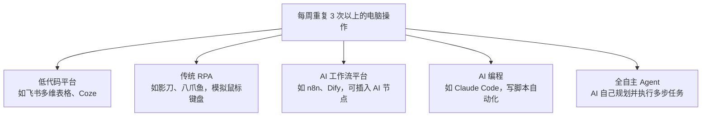
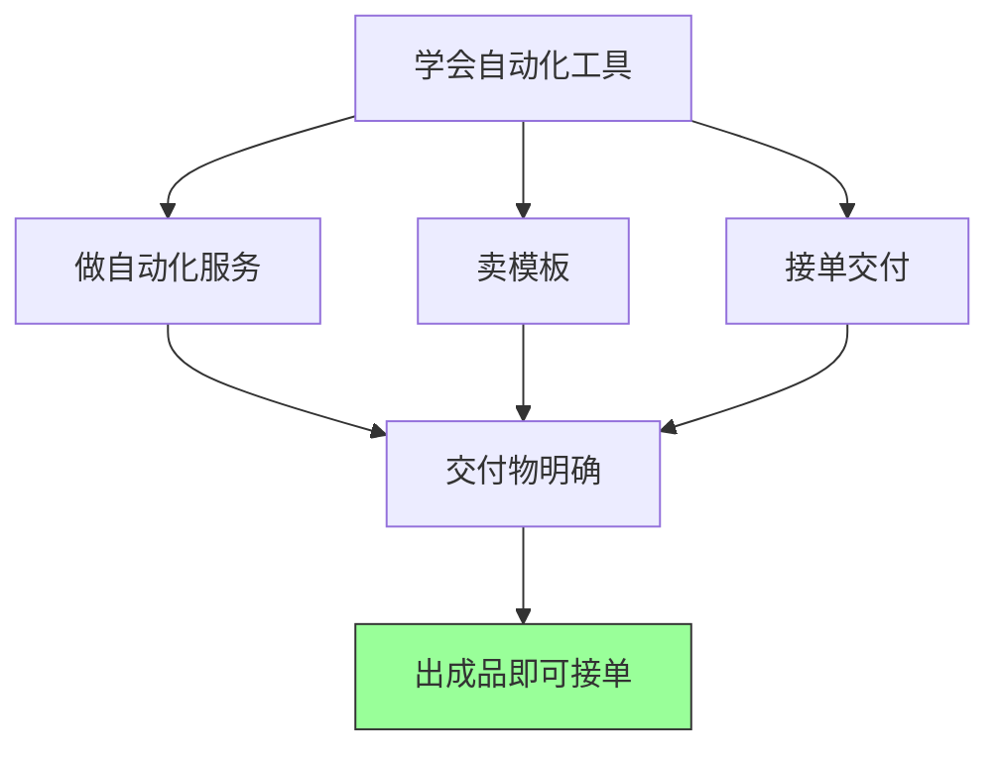

# 第21章 AI 零代码自动化五类工具盘点

> 本节系统介绍五类自动化工具及其适用场景，帮助读者判断"自己手头的重复工作该用哪一类工具"，并给出商业变现路径（做自动化服务、卖模板、接单交付）。

---

## 32.1 大白话：自动化工具就像"数字员工"

自动化工具就像"数字员工"，不同工具擅长不同的活。简单重复的用低代码平台，需要 AI 思考的用 AI 工作流平台，会写代码的用 AI 编程，最复杂的用全自主 Agent。先看你每周重复做几次什么工作，再对号入座。

> **大白话**：自动化就是用技术代替人手，把重复劳动交给机器，而我们只需要动脑子做更有价值的事。用好自动化+AI，就相当于给我们的团队招了个"数字员工"，它会变成一个超级杠杆，成倍放大业务的价值。

---

## 32.2 五类自动化工具选型 Mermaid 图

---

## 32.3 五类工具详细对比

| 工具类别 | 代表工具 | 适用场景 | 优势 | 劣势 | 典型费用 |
|---------|---------|---------|------|------|---------|
| 低代码平台 | 飞书多维表格、Coze | 批量表格处理、自动通知、简单审批 | 无需编程，上手快 | 复杂逻辑受限 | 免费层或月付 |
| 传统 RPA | 影刀、八爪鱼 | 模拟鼠标键盘，老旧软件操作 | 可操作任意软件 | 配置复杂，易破坏 | 付费 |
| AI 工作流平台 | n8n、Dify | 采集→AI 处理→分发，智能自动化 | 可插入 AI 节点，灵活 | 有一定学习成本 | 免费层或月付 |
| AI 编程 | Claude Code、Cursor | 写自动化脚本，灵活度最高 | 完全可定制 | 需要基础编程能力 | 订阅 |
| 全自主 Agent | WorkBuddy、Hermes | AI 自己规划并执行多步任务 | 最高级自动化 | 配置调试复杂 | 免费层或订阅 |

---

## 32.3.1 第一类：低代码平台（如 Zapier、n8n、Make）

首先是低代码的应用集成自动化平台，比如 Zapier、n8n、Make，它们通过触发器和动作，把不同应用串起来，比如，我在 Notion 写了一篇笔记，它自动帮我同步到 Twitter。

它的优点就是上手快，门槛低，几乎零代码，适合个人或小团队处理简单的跨平台联动任务，缺点是作为国外的平台，对国内工具的生态支持不完美，同时也很难通过预设模板的形式支持复杂的业务工作量，这个我们要根据实际的应用场景来决定。

### 32.3.2 第二类：传统 RPA

接下来就是传统的 RPA，比如八爪鱼 RPA、影刀 RPA，通过可视化的指令拖拽实现一个自动化流程。

它的优点是基于本地运行，会接管键盘鼠标来模拟人类进行操作完成整个的自动化流程。还有一点上手门槛低，半天就可上手入门。

缺点是一些情况下的运行可能存在不稳定，同时自定义的调度比较困难，不容易集成到现有的工作用，但总体上它是一种最均衡、最平衡的自动化方式。

### 32.3.3 第三类：AI 工作流平台

下一种在线的工作流平台，通过拖拽的形式把不同的模块链接。

比如在一个示例中，输入一个链接或一篇文章，自动生成不同风格调性的文案，去生成你所需要的内容等等，最后串联起来，这种自动化方式适合在一些内容创作上的自动化，但这类平台个性化需求的实现成本依然很高，而且对复杂逻辑的支持有限，多工作流协同能力较差，并发场景稳定性存在一定问题，可以说是一个入门级应用轻量使用。

### 32.3.4 第四类：AI 编程

AI 编程类的自动化工具，主要是利用 AI 编程，来实现脚本化或者产品化的自动化。

比如用 Cursor 这样的 AI IDE 自己编写自动化脚本。这种方式的灵活性极强，可以根据需求定制复杂自动化工作流，比如我用 AI 编程实现同时采集不同平台的数据，再用 AI 分析趋势、生成内容并分发。

它的优势是高度可定制化的，可以应对各种复杂业务场景，但需要一定的编程能力，对初学者不太友好。当然他最重要的特点，他可以稳定地支持大规模的并行处理，可以在短时间内高强度密集执行任务。

### 32.3.5 第五类：全自主 Agent

我认为未来自动化最终形态可能类似 manus 型的，全自主 Agent 的形式，我们只需要下达指令，它会自动地进行任务拆解，调用不同的工具去完成任务，最终交付结果。

比如我告诉它去找给我提供一个 RPA 相关调研的 PPT，他会很快的反馈给我们结果，不需要去提前去编排流程，非常简单，而且它会自动扩展不同的平台自动提供的信息。

缺点是可控性和成熟度上存在一些问题，但相信随着大模型能力上升和产品的不断迭代，这些问题最终都会被解决掉。

OK，上面我们聊了自动化的几种实现方式，从低代码平台到 RPA，再到 AI 编程和未来的全自主 Agent，每种方式都有它的适用场景和局限性，我们要根据自己的真实需求决定自动化的实现方式。

---

## 32.3.6 五类工具选型决策表

| 场景 | 推荐工具类别 | 具体工具示例 |
|------|---------|---------|
| 简单重复（复制粘贴、格式转换） | 低代码平台 | 飞书多维表格、Zapier、n8n |
| 需要模拟人工操作（无 API 的老旧软件） | 传统 RPA | 影刀、八爪鱼 |
| 需要 AI 思考（内容总结、情感分析） | AI 工作流平台 | Dify、Coze |
| 需要高度定制（复杂逻辑、特殊格式） | AI 编程 | Claude Code、Cursor |
| 需要自主决策（多步任务规划） | 全自主 Agent | WorkBuddy、Hermes |

---

## 32.3.7 商业变现路径

学会自动化工具后，可以走三条变现路径：

1. **做自动化服务**：帮其他人或公司搭建自动化流程，收取服务费
2. **卖模板**：将自己搭建好的工作流模板出售给需要的人
3. **接单交付**：在平台上接自动化相关的单子，交付明确的成品

交付物明确、决策门槛低，出成品即可接单。

---

## 32.4 商业变现路径 Mermaid 图

---

## 32.6 对应素材

- `202506-aizidonghua` > AI 零代码自动化（五类工具盘点，适用场景与商业变现路径）

---

## 小练习

列出你每周重复做 3 次以上的电脑操作（如整理表格、发周报、备份文件），为每个操作标注归属的五类工具中的一种。

> **参考模板**：
>
> | 重复操作 | 频率 | 复杂度 | 推荐工具类别 | 具体工具 |
> |---------|------|--------|-------------|---------|
> | 整理每周报表 | 每周 1 次 | 简单 | 低代码平台 | 飞书多维表格 |
> | 采集竞品价格 | 每周 3 次 | 中等 | AI 工作流平台 | n8n |
> | 备份重要文件 | 每周 1 次 | 简单 | AI 编程 | Claude Code 脚本 |
