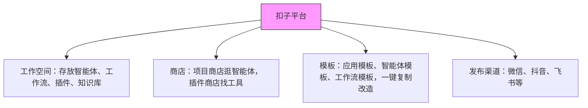
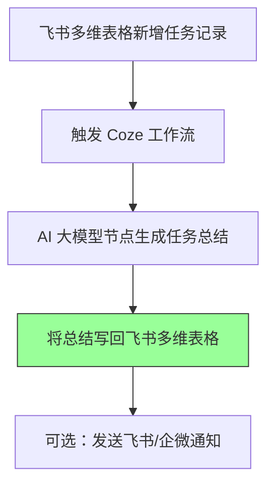
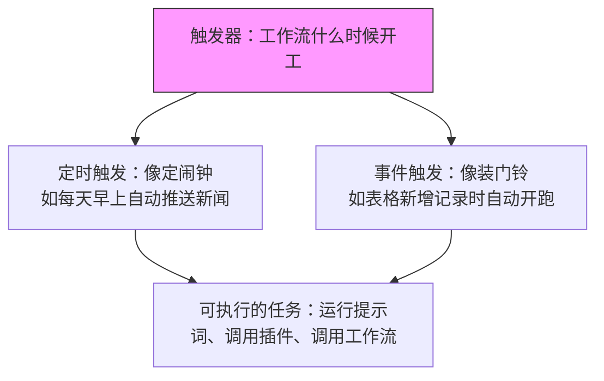

# 第22章 Coze 工作流与飞书多维表格实战

> 本节教用 Coze 工作流 + 飞书多维表格把重复性工作设计成自动运行的工作流，覆盖批量处理表格、监控竞品、生成周报、批量修图等案例。解决非程序员实现自动化的提效问题，每章配提示词手册与百问百答。

---

## 32.1 大白话：Coze 像搭积木一样拖拽模块

Coze 像搭积木一样拖拽模块，就能让 AI 自动帮你做重复工作。配合飞书多维表格，可以实现"新增任务时自动生成总结并填入表格"这种自动化，不用会编程。

![asset/img/ch22-coze-home.png]

> **图片说明**：扣子（Coze）平台首页截图——图源：《懒人“养虾”攻略：OpenClaw_豆包_扣子_飞书落地实战指南》。左侧导航栏包含主页、工作空间、商店、模板、扣子 API 等功能入口，右侧展示对应的功能页面，新手可以直接从“主页”开始创建智能体或工作流。

什么是“扣子”？扣子（Coze）是字节跳动公司推出的一站式智能体开发平台，可以帮助个人和企业用户轻松创建、调试和部署智能体。个人用户可以把扣子当作生活助手，用它做内容创作和学习辅导；企业用户则可以用扣子构建智能客服、管理数据和整合知识库。它有三个对我们新手特别友好的特点：

1. **零代码开发**：扣子支持拖拽操作和模板配置，无须编程即可构建智能体，并具备文本、图像处理和 API 调用能力，满足日常的多样化需求。
2. **跨平台发布与插件扩展**：做好的智能体可以一键发布到微信、抖音、飞书等平台，平台还内置 60 余款插件，支持接入自定义私有 API。
3. **全流程工具支持**：通过扣子罗盘可以对智能体进行测试、评估和优化，适用于生活助手、内容创作、智能客服和数据管理等多个场景。

什么是“飞书多维表格”？飞书是字节跳动于 2016 年自主研发的一站式企业协作平台，最初用于保障字节跳动全球数万员工的高效协作，后来在 2020 年向所有企业和组织免费开放。它整合了即时沟通、智能日历、音视频会议、云文档、云盘、工作台等核心功能。而多维表格是飞书里的一款在线数据库工具：不仅支持数据的存储、分析与可视化，还具备多人实时协作、历史记录溯源、批注讨论等功能；它有丰富的字段、视图、仪表盘和插件，可以灵活搭建定制化业务系统；它还内置自动化功能，无须代码就能实现数据同步、消息通知等操作；通过行、列级权限设置，还能确保数据安全。顺带一提，多维表格还有自己的插件市场：有编程能力的用户可以编写插件实现自定义功能，没有编程能力的用户直接用市场里的现成插件就行。比如装一个“查找替换”插件，就能在整张表里批量查找某段文字并一键替换，不用肉眼一行行扫。

把两者组合起来用大白话打个比方：飞书多维表格就像一个“智能仓库”，每一条记录就是一个货位；扣子工作流就像一条“自动传送带”，货位上一有新货（新增记录），传送带就自动开动；传送带上站着的 AI 大模型节点就像一个“打包工人”，看到新货就按你教它的方法处理一遍，再把处理结果放回货位。整个过程你只在旁边喝咖啡看着就行。

再把扣子平台的“家底”画成一张图。登录之后对着这张图在界面里找一遍，各个入口就都认识了：

> **大白话**：工作空间是你自己的“车间”，商店是别人作品的“橱窗”，模板是“半成品套装”，发布渠道是“对外营业的门店”。新手的最短路径是：先去逛模板，看中哪个就复制到自己的车间，拆开看看人家是怎么搭的，再照着改成自己的需求。

---

## 32.2 什么是 Coze 工作流+飞书多维表格

如果说 ChatGPT 的出现让 AI 能理解你的需求，那么 Coze 这样的工作流平台，则让 AI 真正能执行你的需求。你只需要在 Coze 上拖拽几个模块，连接几条线，就能让 AI 自动帮你完成原本需要花大量时间和精力才能搞定的重复性工作——批量处理飞书表格数据、监控竞品小红书动态、自动生成周报月报、批量修图去水印……

最关键的是：这些原本需要程序员才能实现的自动化，现在你通过简单的鼠标拖拽就能快速搭建。虽然不能完全替代复杂的开发工作，但对于大部分日常重复任务，已经足够应付。

本次航海会带你系统掌握 Coze 工作流+飞书多维表格的组合拳。不是教你用某个具体功能，而是教你一种思维方式：如何把任何重复性工作，设计成可以自动运行的工作流。

先给“工作流”一个正式的定义：扣子的工作流支持通过可视化的方式，对插件、大语言模型、代码块等功能进行组合，从而实现复杂、稳定的业务流程编排，例如旅行规划、报告分析等。当目标任务场景包含较多的步骤，且对输出结果的准确度、格式有严格要求时，就适合用工作流来实现。

上面提到的几类典型场景，我们可以逐个拆开看看它们各自的“流水线”长什么样：

| 典型场景 | 流水线大致步骤 | 涉及的模块 |
|---------|--------------|-----------|
| 批量处理表格数据 | 表格新增/更新记录 → AI 逐行处理 → 结果写回表格 | 触发节点、大模型节点、多维表格插件 |
| 监控竞品小红书动态 | 定时触发 → 抓取指定账号或关键词 → AI 筛选总结 → 通知到你 | 定时触发器、搜索插件、大模型节点 |
| 自动生成周报月报 | 收集本周素材 → AI 按模板整理成文 → 写入文档或表格 | 大模型节点、多维表格/文档插件 |
| 批量修图去水印 | 拿到图片列表 → 逐张调用图像处理能力 → 存回表格附件列 | 循环节点、图像插件、多维表格插件 |

你会发现它们的套路都一样：**有一个“起点”（触发）、有一条“处理线”（AI 节点和插件节点串起来）、有一个“终点”（结果写回或通知）**。学会搭一条，其余的就是换零件。

我们把这四个场景再各聊两句，帮你先建立画面感：

- **批量处理表格数据**：以前运营要给一批新用户逐个打标签，人工一条条看，又慢又容易走神；现在把工作流挂到表格的“新增记录”上，AI 收到一条就按你定好的规则处理一条，几分钟干完你一下午的活。
- **监控竞品小红书动态**：以前要每天手动点进对方主页翻动态、截图、复制；现在让定时触发器当你的闹钟，到点自动抓取、自动总结成一句话，你只需要看结论，甚至不看也行，有变动再通知你。
- **自动生成周报月报**：素材书里就有现成的例子——用扣子搭一个能快速生成工作总结、周报、月报的写作智能体，自动抓取你输入的关键词、事项与时间点，生成格式规范、重点突出的报告，特别适合周五这种高频报表节点。
- **批量修图去水印**：把图片链接或文件路径丢进表格，循环节点带着图像处理插件一张一张过，处理完写回表格的附件列，全程不用打开修图软件，也不用来回拖拽文件。

为什么非要“工作流 + 多维表格”这个组合，而不是单用其中一样？因为表格负责“存”，AI 负责“想”，工作流负责“把它们连起来并让它们自己跑”。少了表格，AI 生成的结果没地方放；少了工作流，表格和 AI 之间只能靠你手工搬运。而组合起来最大的价值是：**它把“每天都要做一遍的事”变成了“做一次，以后自动做”**。

当然，也要泼一盆小冷水：不是所有事都值得自动化。如果你一辈子只会做一次的事情，直接问 AI 就行了，搭工作流反而是浪费时间；只有那些“每周重复 3 次以上、步骤固定、结果格式统一”的事情，才最值得搬上流水线。这个判断标准，和上一章讲的“先看每周重复做几次什么工作，再对号入座”是一脉相承的。

![asset/img/ch22-feishu-bitable.png]

> **图片说明**：飞书多维表格新建页面截图——图源：《OpenClaw+DeepSeek+Coze+飞书：AI智能体高效工作指南》。进入飞书官网后点击“新建多维表格”即可创建空白表格，随后可以新建数据表、添加字段、录入数据，表格就变成了可协作的在线数据库。

---

## 32.3 项目完整操作思路

了解 AI 工作流原理 > 学习 Coze、多维表格的操作方法 > 提效案例实操演练（关键） > 搭建个性化工作流方案

### 32.3.1 操作重点

1. **了解 AI 工作流原理**：AI 工作流是利用人工智能技术，来优化和自动化工作流程的方法。它具有自动化任务执行、动态调整和优化、自主规划和执行、与外部工具集成等特点。用大白话说，就是把“这一步做完再做下一步”的重复工作，交给 AI 按照你设计的顺序自动跑通。这一步不用死记概念，只要能看懂“触发→处理→写回”这条主线就够了。

2. **学习 Coze、多维表格的操作方法**：Coze 和多维表格都提供可视化界面，即使没有编程经验也能上手。重点在于熟悉其操作界面和基本功能。Coze 侧重拖拽工作流模块，多维表格侧重建表、建字段、录入数据，两者结合才能完成端到端的自动化。建议新手先各花半小时把界面点一遍，混个脸熟。

3. **提效案例实操演练**：通过实际案例，如内容创作、微信机器人、图像处理、职场工作等场景，学习如何应用 AI 工作流提高效率。光看不练是学不会的，一定要亲手跑通至少一个案例，遇到报错再去一个一个修——这是掌握自动化的必经之路，也是本章 32.6 节要带你做的事。

4. **搭建个性化工作流方案**：学会将自己的思维融入工作流，并能够拆解自己的业务需求，搭建对应的工作流。先列出自己每天重复做的事，再看哪几步可以交给 AI，最后在 Coze 里把这些步骤拼成一条流水线。拆需求有个小窍门：把一件事写成“什么时候开始→中间经过哪几步→最后产出什么”的三段话，这段话基本就是工作流的骨架。

---

## 32.4 Coze 是什么及其核心价值

要构建复杂的自动化流程，得先了解平台的基础功能与核心概念。本章是 Coze 的入门介绍，也是后续项目的基础。我们会从零开始，带你掌握 Coze 的各项核心功能。

本章将向你展示如何通过可视化的界面，组合不同的功能模块，还会拆解工作流的创建过程，从而为你构建复杂的自动化应用打下坚实基础。

在本章中，你将系统地学会：

- **理解核心价值**：Coze 不只是问答工具。它是一个能执行业务流程的强大助手。
- **掌握创建流程**：学会从注册账号到发布上线，完整地创建、管理和调试一个工作流。
- **精通三大核心模块**：学习如何运用"大模型节点"、"插件工具"和"逻辑节点"等模块。

### 32.4.2 三大核心模块

| 模块 | 作用 | 示例 |
|------|------|------|
| 大模型节点 | AI 思考和生成内容 | 写文案、总结信息、翻译 |
| 插件工具 | 连接外部服务 | 搜索网络、读取文件、调用 API |
| 逻辑节点 | 控制流程分支 | 条件判断、循环、数据转换 |

学完本章，你就拥有了搭建任何自动化流程所必需的知识和技能。

把三大模块再往细里拆，工作流里常见的节点其实就这几种。先混个脸熟，后面实操时对着找：

| 节点 | 作用 | 大白话理解 |
|------|------|-----------|
| 开始节点 | 接收工作流的输入参数 | 流水线的“进料口”，调用时提示词里必须包含开始节点的必选参数，否则工作流不会按预期运行 |
| 大模型节点 | 调用大语言模型生成内容 | 让 AI 思考和写东西的工位 |
| 插件节点 | 调用某个插件的能力 | 给流水线接上外接工具，比如链接读取、必应搜索 |
| 代码节点 | 运行代码块做数据处理 | 让现成的小工具帮你整理、转换数据 |
| 条件分支节点 | 按条件走不同路线 | 路口的红绿灯，符合 A 条件走这条线，符合 B 条件走那条线 |
| 循环节点 | 对一组数据逐个执行同样的操作 | 传送带的循环段，一张图一张图、一行数据一行数据地过 |
| 结束节点 | 输出最终结果 | 流水线的“出货口”，把成品交出来 |

围绕这三大模块，再补充几个新手必须知道的平台常识：

**关于账号和空间。**进入扣子网站页面，单击页面右上方的“登录”按钮，使用手机号即可登录。登录后你会看到“工作空间”的概念：工作空间是组织和管理资源的基本单元，插件、工作流、知识库等资源都保存在你的个人工作空间中；同一个工作空间内的成员可以共享模型、智能体、插件、工作流和知识库等资源，还能对同一个智能体、工作流进行协同操作。个人使用时不用管这么多，默认的个人空间就够用；以后想和小伙伴一起搭工作流，再研究团队空间的邀请链接功能。

**关于模板。**对开发新手来说，快速上手的一个好方法就是使用别人发布好的模板：把模板复制到个人工作空间，分析里面的智能体、工作流是怎么搭的，再修改相关参数设置。模板类型包括应用模板、智能体模板和工作流模板，都支持在模板详情页一键复制，按需改造后直接使用。看别人的工作流是学搭工作流最快的路径，就像学做菜先照着菜谱做。

**关于智能体。**在扣子平台中，智能体是基于对话的 AI 项目：它通过自然语言交互接收用户输入，由大模型自动调用插件或工作流运行业务流程并生成回复。当某些功能超出大模型的能力范围时，可以在智能体的“编排”面板为它添加插件、工作流和触发器，以满足更多开发需求。触发器除了我们前面说的两种启动方式，还可以用一句自然语言就设好定时任务，比如“每天早上推送新闻”，也可以在数据更新时自动发送通知，不用写一行代码。

**关于发布与调试。**一个智能体搭好之后，典型流程是这么走的：在“编排”页面的“人设与回复逻辑”里写清它是谁、怎么回答；在“技能”区域挂上插件、工作流和触发器；在右侧的“预览与调试”窗口发消息试跑，看效果满不满意；最后再发布到微信、抖音、飞书等渠道。调试阶段千万别怕报错——报错信息会直接告诉你哪个节点出了问题，改完再跑一遍，反复几轮就顺了。另外可以放心的是，扣子平台为插件和工作流提供了版本控制功能，可以追踪变更、回滚更新，改坏了随时能退回上一版。等你熟练之后，还可以把搭好的工作流发布到项目商店，把别人的工作流复制到自己的空间慢慢研究，这就是最快学会搭工作流的办法。

**关于常用插件。**插件是扩展工作流功能的重要手段，先认识几个最常用的：

- **链接读取**：一个功能强大的网页内容抓取工具，不仅能返回网页的标题、内容、链接等原始内容，还可以对这些内容进行筛选和解析。
- **图片理解**：回答用户关于某张图片的问题，比如“这张图里有什么”“这张截图里的表格数据是什么”。
- **ByteArtist**：根据文本描述生成图像，可指定图像数量和大小。
- **必应搜索**：从 Bing 搜索任何信息或网页 URL，让工作流能拿到最新的网络信息。

值得一提的是，扣子是国内首个支持 DeepSeek-R1/V3 工具调用的平台，开发者可以在 DeepSeek 模型的基础上自由组合插件，实现联网搜索、代码生成、图片理解等能力——也就是说，本书前面章节讲的 DeepSeek，在扣子里可以直接当成工作流的“大脑”来用。

---

## 32.5 Coze + 飞书多维表格工作流示例 Mermaid 图

对照这张图把整条流水线再走一遍：最左边是“起点”——你在飞书多维表格里新增了一条任务记录，这个动作就是触发信号；接着工作流被唤醒，AI 大模型节点读到这条记录的任务描述，生成一段简要总结；然后写回节点把总结填回表格对应的字段；最后还可以加一步，通过飞书或者企业微信给你发条通知，告诉你“活干完了”。绿色高亮的“写回表格”是整个闭环的关键一步——有了它，处理结果才真正落回你的数据仓库，而不是飘在聊天窗口里。

---

## 32.6 实操案例：新增任务时自动生成总结并填入表格

### 32.6.1 场景描述

在飞书多维表格中建立一张简单的任务追踪表，用 Coze 工作流实现"新增任务时自动生成简要总结并填入表格"的自动化，运行一次并验证结果。

这个场景虽小，五脏俱全：它包含了触发、AI 处理、写回三个环节，是最典型的“表格自动化”骨架。以后你想做“新增客户线索自动打标签”“新增文章自动生成摘要”“新增bug自动分类”等等，都是把这条流水线的零件换一换而已。所以请务必亲手把它跑通一遍。

### 32.6.2 操作步骤

1. **在飞书多维表格中建立任务追踪表**：包含任务名称、任务描述、任务总结等字段。具体做法是：

   （1）进入飞书官网，选择“多维表格”选项，打开多维表格页面，在页面弹出的模板库窗口中，选择“新建多维表格”，即可创建一个空白多维表格。

   （2）在新建的空白多维表格页面中，在左下方单击“数据表”按钮，新建一个数据表，并把表重命名为“任务追踪表”。单击数据表名称右侧的按钮，还可以对数据表进行重命名、复制或删除操作。

   （3）多维表格的“列”提供了丰富的字段类型，满足录入多样数据的需求。单击右侧的“+”按钮新增字段：先建一个“任务名称”字段（文本类型），再建一个“任务描述”字段（文本或长文本类型），最后建一个“任务总结”字段（文本类型）。双击任意字段名称，可以在下拉菜单中更改字段类型、编辑字段名称、进行格式设置。

   如果你懒得从零建表，也可以直接用模板：飞书多维表格预置了不少结构化模板，它们结合了预设的字段、视图、数据关系及自动化规则，把项目管理、任务跟踪、客户管理这类场景做成了开箱即用的表格。模板下载到本地是 `.base` 文件——装了飞书客户端双击就能打开；没装客户端，就在飞书网页版里单击页面上方的“导入 Excel/ 在线表格”按钮，上传后打开即可。打开模板后界面默认显示“卡片视图”，那上面不能编辑，切换到“原始数据”界面就能正常填写了。本例场景很简单，建议直接新建空白表格练手，熟悉了再用模板提速。

2. **在 Coze 中创建工作流**：

   - 添加触发节点：监听飞书多维表格新增记录。触发器决定工作流什么时候启动，它主要有两种启动方式：定时触发和事件触发。定时触发就像定个闹钟，让智能体在设定的时间自动完成任务；事件触发则是当有外部事件发生时（比如表格新增了一条记录），智能体才被唤醒并运行任务。本例用的就是事件触发。需要提醒的是，每个智能体最多只能添加 10 个触发器，而且目前触发器功能只在飞书渠道有效，所以带触发器的智能体要发布到飞书才能用。
   - 添加大模型节点：根据任务描述生成简要总结。大模型节点就是让 AI 思考和生成内容的地方，你可以把它想象成在对话框里发消息给 AI，只不过这次 AI 收到的是表格里刚填进去的任务描述。在节点的提示词里写清楚要求，比如“请用不超过 50 字总结这条任务的核心目标和交付物”，输出就会又短又准。
   - 添加写回节点：将总结写回飞书多维表格。这一步把 AI 生成的总结填回到刚才那条记录的“任务总结”字段里，完成闭环。

   还有一个实用细节：扣子工作流默认是同步运行，也就是必须等工作流跑完才把结果交出去。如果以后你的工作流很复杂、包含运行耗时长的节点，可能导致整体超时，这时可以把工作流设置为异步运行，让对话不等它跑完、跑完再补发最终回复。本例流程很短，同步默认即可。另外，触发器关联的工作流或插件要在 1 分钟内完成运行，并且工作流需要关闭流式输出功能，否则可能导致触发器不推送消息，或者推送的消息不完整。

3. **测试运行**：在表格中新增一条任务，验证工作流是否自动执行。先在飞书表格里手动新建一行，填好任务名称和任务描述，然后等几秒钟，看“任务总结”列是否自动出现了一段总结。如果没生效，按下面的顺序排错：

   - 先确认智能体已经发布到飞书渠道（触发器只在飞书渠道有效）；
   - 再到 Coze 的“预览与调试”面板手动跑一次工作流，逐节点查看数据有没有正常传递；
   - 检查大模型节点的输入参数是否真的拿到了“任务描述”这一列的内容，别让节点收到的是空值；
   - 最后检查写回节点的目标字段名和表格里的字段名是否完全一致，差一个字都写不进去。

   把常见的毛病和对策整理成一张小表，贴在自己的工位上，新手排错时照着查就行：

| 症状 | 可能原因 | 怎么办 |
|------|---------|--------|
| 新增记录后毫无反应 | 智能体没有发布到飞书渠道 | 先发布到飞书，再触发一次 |
| 总结列始终是空的 | 大模型节点没取到“任务描述”的值 | 在调试面板逐节点看输入输出 |
| 写回失败或写到别的列 | 目标字段名与表格字段名不一致 | 核对字段名，一字不差 |
| 触发器不推送或消息不全 | 工作流开着流式输出，或耗时超过 1 分钟 | 关闭流式输出，精简流程步骤 |
| 流程跑到一半就停了 | 节点返回的数据结构和预期不一致 | 检查上一个节点的输出格式 |

最后，把触发器的两种启动方式画成一张图，加深一下印象：

![asset/img/ch22-coze-create-agent.png]

> **图片说明**：在扣子平台创建智能体的截图——图源：《OpenClaw+DeepSeek+Coze+飞书：AI智能体高效工作指南》。填写智能体名称和功能介绍，系统自动生成头像，然后进入智能体编排页面。

![asset/img/ch22-coze-workflow-panel.png]

> **图片说明**：扣子智能体编排页面截图——图源：《OpenClaw+DeepSeek+Coze+飞书：AI智能体高效工作指南》。左侧是“人设与回复逻辑”，中间是“编排/技能”区域（可拖拽大模型节点、插件工具、逻辑节点等），右侧是“预览与调试”窗口，可以实时测试工作流效果。

---

## 小练习

在飞书多维表格中建立一张简单的任务追踪表，用 Coze 工作流实现"新增任务时自动生成简要总结并填入表格"的自动化，运行一次并验证结果。

---

## 本章小结

通过本章，你应该已经了解：

1. **扣子是什么**：字节跳动推出的一站式智能体开发平台，零代码拖拽即可构建智能体，内置 60 余款插件，可一键发布到微信、抖音、飞书等平台。
2. **飞书多维表格是什么**：飞书里的在线数据库工具，支持多人协作、丰富字段类型、内置自动化和行列级权限，是自动化流程的“数据仓库”。
3. **工作流的骨架**：任何自动化都可以拆成“触发（什么时候开始）→ 处理（AI 节点和插件节点怎么串）→ 写回/通知（结果落到哪）”三段。
4. **三大核心模块**：大模型节点负责 AI 思考生成内容，插件工具负责连接外部服务，逻辑节点负责控制流程分支。
5. **触发器要点**：定时触发像闹钟、事件触发像门铃；每个智能体最多 10 个触发器，目前只在飞书渠道有效，工作流需在 1 分钟内完成并关闭流式输出。
6. **完整实操闭环**：建表（任务名称/任务描述/任务总结三个字段）→ 建工作流（触发→大模型→写回）→ 新增一条记录验证自动总结，排错时按“发布渠道→调试面板→输入参数→字段名”的顺序逐项检查。

下一章，我们将继续深入工作流的高级玩法，学习 n8n 这类开源工作流平台，看看当自动化需求超出托管平台的能力时，更专业的玩家是怎么搭流水线的。
