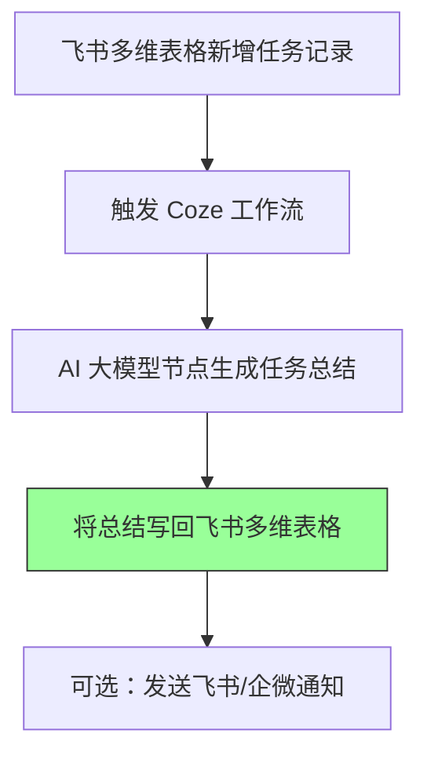

# 第22章 Coze 工作流与飞书多维表格实战

> 本节教用 Coze 工作流 + 飞书多维表格把重复性工作设计成自动运行的工作流，覆盖批量处理表格、监控竞品、生成周报、批量修图等案例。解决非程序员实现自动化的提效问题，每章配提示词手册与百问百答。

## 22.1 大白话：Coze 像搭积木一样拖拽模块

Coze 像搭积木一样拖拽模块，就能让 AI 自动帮你做重复工作。配合飞书多维表格，可以实现"新增任务时自动生成总结并填入表格"这种自动化，不用会编程。

## 22.2 什么是 Coze 工作流+飞书多维表格

如果说 ChatGPT 的出现让 AI 能理解你的需求，那么 Coze 这样的工作流平台，则让 AI 真正能执行你的需求。你只需要在 Coze 上拖拽几个模块，连接几条线，就能让 AI 自动帮你完成原本需要花大量时间和精力才能搞定的重复性工作——批量处理飞书表格数据、监控竞品小红书动态、自动生成周报月报、批量修图去水印……

最关键的是：这些原本需要程序员才能实现的自动化，现在你通过简单的鼠标拖拽就能快速搭建。虽然不能完全替代复杂的开发工作，但对于大部分日常重复任务，已经足够应付。

本次航海会带你系统掌握 Coze 工作流+飞书多维表格的组合拳。不是教你用某个具体功能，而是教你一种思维方式：如何把任何重复性工作，设计成可以自动运行的工作流。

## 22.3 项目完整操作思路

了解 AI 工作流原理 > 学习 Coze、多维表格的操作方法 > 提效案例实操演练（关键） > 搭建个性化工作流方案

### 22.3.1 操作重点

1. **了解 AI 工作流原理**：AI 工作流是利用人工智能技术，来优化和自动化工作流程的方法。它具有自动化任务执行、动态调整和优化、自主规划和执行、与外部工具集成等特点。
2. **学习 Coze、多维表格的操作方法**：Coze 和多维表格都提供可视化界面，即使没有编程经验也能上手。重点在于熟悉其操作界面和基本功能。
3. **提效案例实操演练**：通过实际案例，如内容创作、微信机器人、图像处理、职场工作等场景，学习如何应用 AI 工作流提高效率。
4. **搭建个性化工作流方案**：学会将自己的思维融入工作流，并能够拆解自己的业务需求，搭建对应的工作流。

## 22.4 Coze 是什么及其核心价值

### 22.4.1 核心组件

要构建复杂的自动化流程，得先了解平台的基础功能与核心概念。本章是 Coze 的入门介绍，也是后续项目的基础。我们会从零开始，带你掌握 Coze 的各项核心功能。

本章将向你展示如何通过可视化的界面，组合不同的功能模块，还会拆解工作流的创建过程，从而为你构建复杂的自动化应用打下坚实基础。

在本章中，你将系统地学会：

- **理解核心价值**：Coze 不只是问答工具。它是一个能执行业务流程的强大助手。
- **掌握创建流程**：学会从注册账号到发布上线，完整地创建、管理和调试一个工作流。
- **精通三大核心模块**：学习如何运用"大模型节点"、"插件工具"和"逻辑节点"等模块。

### 22.4.2 三大核心模块

| 模块 | 作用 | 示例 |
|------|------|------|
| 大模型节点 | AI 思考和生成内容 | 写文案、总结信息、翻译 |
| 插件工具 | 连接外部服务 | 搜索网络、读取文件、调用 API |
| 逻辑节点 | 控制流程分支 | 条件判断、循环、数据转换 |

学完本章，你就拥有了搭建任何自动化流程所必需的知识和技能。

## 22.5 Coze + 飞书多维表格工作流示例 Mermaid 图

## 22.6 实操案例：新增任务时自动生成总结并填入表格

### 22.6.1 场景描述

在飞书多维表格中建立一张简单的任务追踪表，用 Coze 工作流实现"新增任务时自动生成简要总结并填入表格"的自动化，运行一次并验证结果。

### 22.6.2 操作步骤

1. **在飞书多维表格中建立任务追踪表**：包含任务名称、任务描述、任务总结等字段
2. **在 Coze 中创建工作流**：
   - 添加触发节点：监听飞书多维表格新增记录
   - 添加大模型节点：根据任务描述生成简要总结
   - 添加写回节点：将总结写回飞书多维表格
3. **测试运行**：在表格中新增一条任务，验证工作流是否自动执行

## 22.7 对应素材

- `202509-cozeduoweibiaoge` > 一、什么是 Coze 工作流+飞书多维表格（拖拽模块，自动完成重复性工作）
- `202509-cozeduoweibiaoge` > 二、项目完整操作思路（了解 AI 工作流原理 > 学习 Coze、多维表格操作方法 > 案例实操 > 搭建个性化工作流）
- `202509-cozeduoweibiaoge` > 3. 内容出品人 / 1. Coze 是什么及其核心价值（三大核心模块：大模型节点、插件工具、逻辑节点）

## 小练习

在飞书多维表格中建立一张简单的任务追踪表，用 Coze 工作流实现"新增任务时自动生成简要总结并填入表格"的自动化，运行一次并验证结果。
