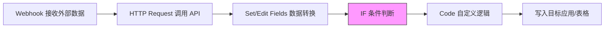

# 第23章 n8n 自动化工作流与 AI 智能集成

> 本节介绍开源可视化平台 n8n，教读者搭建客户管理、内容运营、智能通知、AI 助手等工作流，重点掌握 Webhook、HTTP Request、Set/Edit Fields、IF 等 5 个常用节点与数据流引用语法，实现跨应用手动"数字搬运工"自动化。

---

## 23.1 大白话：n8n 是开源的可视化自动化平台

n8n 是开源的可视化自动化平台，像搭积木一样连接不同软件。比如"收到客户邮件 → 自动录入表格 → 发钉钉通知"，全程不用手动复制粘贴。重点掌握 5 个常用节点，90% 的问题都出在数据引用语法上。

---

## 32.2 什么是 n8n

### 32.2.1 什么是 n8n

简单来说：n8n 是一个开源的、可视化的自动化平台。它让你无需写代码，就能像搭积木一样连接不同的应用和服务（如邮件、表格、文档、数据库、AI 模型、甚至你公司的内部系统），创建自动执行任务的「工作流」（Workflow）。

想象一下：每天在不同软件之间切换——在企业微信收到客户咨询，手动复制到飞书记录，再打开腾讯文档更新状态，最后还得提醒自己用钉钉通知同事……这些重复的琐事，不仅耗费精力，还容易出错。

而 n8n 就是为了终结这种「数字搬运工」生涯而生的强大工具！

一旦你设置好了工作流，n8n 就会 24 小时监控触发条件。一旦条件满足，它会立刻启动，严格按照你的流程图，在后台高效完成所有串联的任务。

### n8n 能做什么

- **客户管理自动化**：新客户注册后，自动发送欢迎邮件，同时录入 CRM（如 Notion 或 Airtable），并通过 Slack 通知销售团队
- **内容运营**：订阅 RSS 获取最新文章后，自动生成摘要，并利用 AI 进行改写或翻译，最终发布到 Twitter 或 LinkedIn
- **智能通知**：实时监控商品价格、股票行情或天气变化，当低于预期或出现异常时，自动通过短信或邮件提醒你
- **数据桥梁**：收集 Google Form 提交的数据后，自动同步到 Google Sheets 和 Notion 数据库，并生成详细的 PDF 报告，通过邮件发送
- **AI 助手集成**：收到特定邮件时，让 AI 分析内容并草拟回复建议，你只需审核后发送即可
- **内部流程自动化**：审批流程、报告生成、数据备份以及跨部门数据同步等繁琐任务

---

## 32.3 项目完整操作思路

了解 n8n 核心概念 > 部署环境配置（关键） > 掌握节点操作 > 构建内容自动化生产线（关键） > 集成 AI 实现智能工作流（关键）

### 32.3.1 操作重点

#### 重点 1：理解数据是怎么流动的（最重要）

学习 n8n，需要理解每个节点输出的数据结构是什么样的。比如：

- 如何用 `{{ $json.fieldName }}` 引用上一个节点的数据？
- 如何用 `{{ $node["节点名"].json.fieldName }}` 引用任意节点的数据？
- 90% 的 n8n 问题都是因为不理解数据结构或引用错误。

#### 重点 2：需要掌握这 5 个最常用的节点

1. **Webhook** - 接收外部数据
2. **HTTP Request** - 调用 API
3. **Set/Edit Fields** - 数据转换
4. **IF** - 条件判断
5. **Code** - 自定义逻辑

掌握这 5 个，你就能完成大部分自动化需求。其他节点都是锦上添花。

#### 重点 3：有调试思维

学会用"执行到此节点"功能查看每一步的数据。出错时先看错误信息，再检查数据结构。善用固定数据功能来测试。n8n 的本质就是：数据从一个节点流向另一个节点，你要做的就是控制这个流动过程。理解了数据流，其他都是细节。

### 新手入门建议&避坑指南

- **完全不懂技术能学会吗？** 答：可以。n8n 采用可视化拖拽方式，像搭积木一样连接不同服务，无需编程基础。
- **n8n 和 Zapier、Make 有什么区别？** 答：最大优势是可自托管、无限制执行、支持复杂逻辑和代码，核心功能完全免费。相比 Zapier 成本节省 40-60%，比 Make 有更强的代码集成能力。
- **部署会很复杂吗？** 答：提供多种部署方式：Docker（推荐，一条命令搞定）、npm 快速测试、n8n Cloud 零维护。

---

## 32.4 n8n 工作流数据流向 Mermaid 图

---

## 小练习

在 n8n 中搭建一个最小工作流：定时触发 → 获取一个公开 API 数据 → 将结果写入飞书多维表格，运行成功并查看表格新增记录。

> **参考步骤**：
>
> 1. 安装 n8n（Docker 一条命令搞定）
> 2. 创建新工作流
> 3. 添加"定时触发"节点（每小时执行一次）
> 4. 添加"HTTP Request"节点（调用公开 API，如天气预报 API）
> 5. 添加"Set/Edit Fields"节点（提取需要的数据字段）
> 6. 添加飞书多维表格节点（将数据写入表格）
> 7. 保存并激活工作流
> 8. 检查表格是否有新记录
