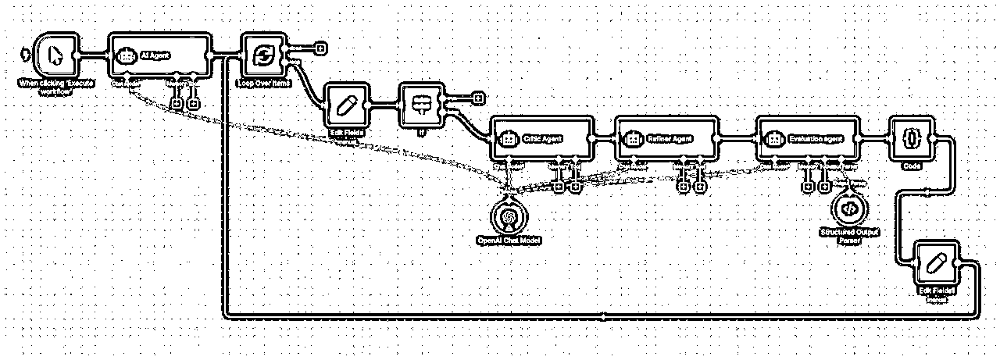
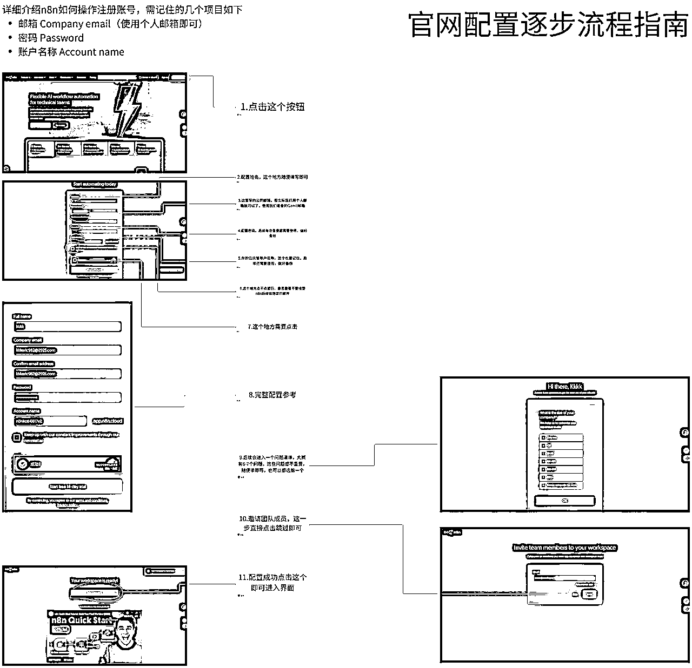
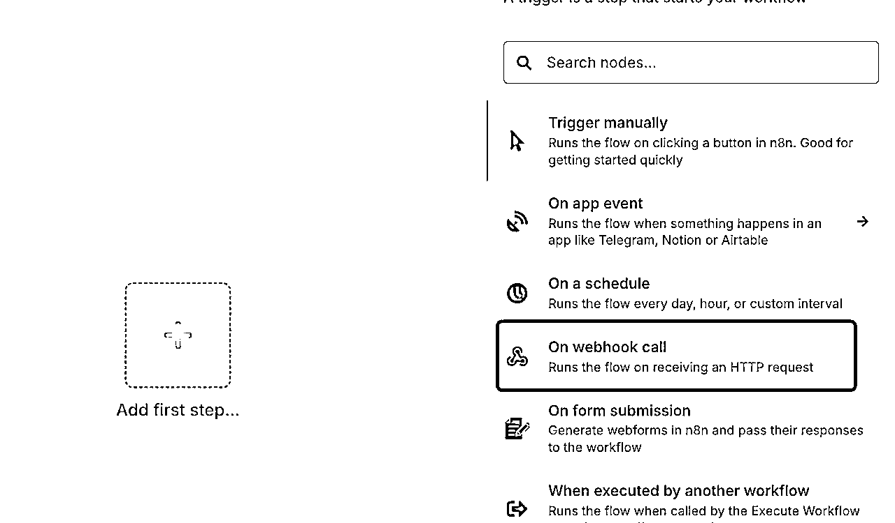
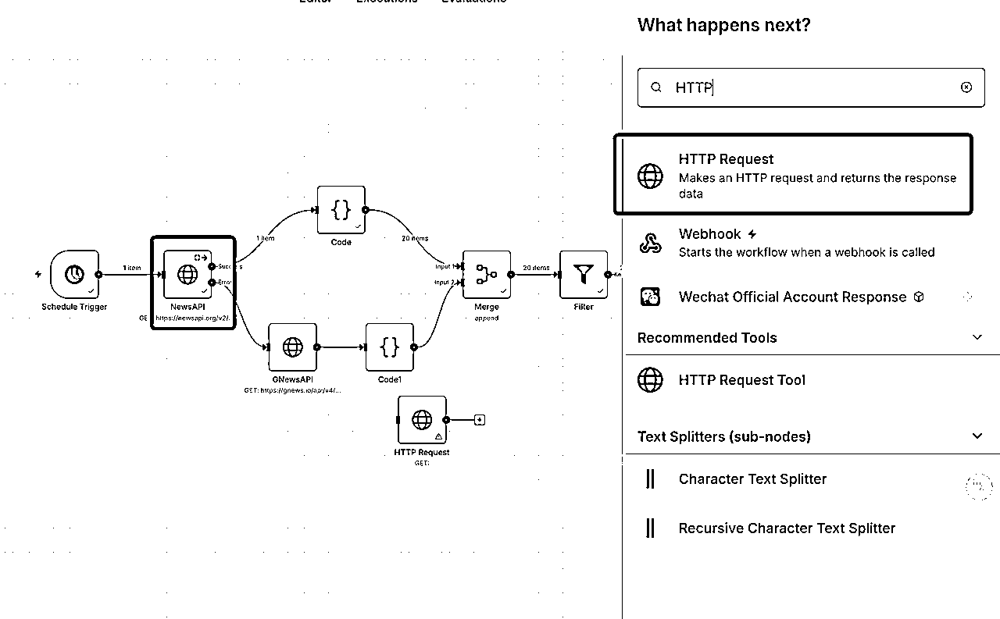
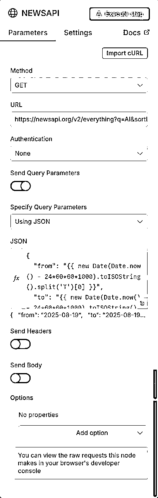
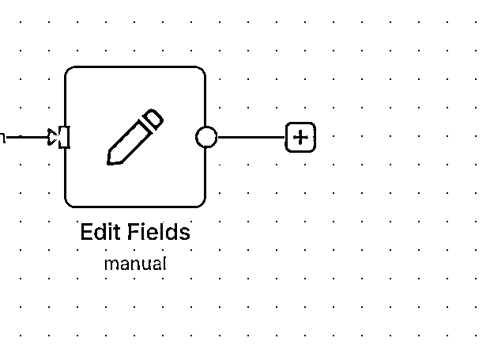
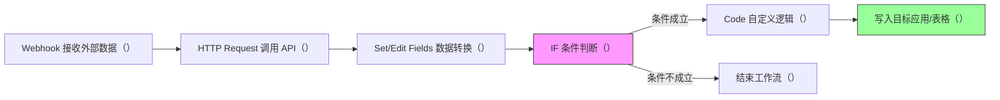

# 第23章 n8n 自动化工作流与 AI 智能集成

> 本章介绍开源可视化平台 n8n，教读者搭建客户管理、内容运营、智能通知、AI 助手等工作流，重点掌握 Webhook、HTTP Request、Set/Edit Fields、IF 等 5 个常用节点与数据流引用语法，实现跨应用手动“数字搬运工”自动化。

在正式开始之前，先说两句“废话”宽宽心：这一章不需要你会写程序，不需要你了解什么是 API、什么是 JSON，甚至不需要你以前碰过任何自动化工具。你只需要会用浏览器打开网页、会在电脑上安装软件，就足够读完并动手做完本章的全部内容了。我们会把每一个“听起来很吓人”的名词，都用大白话掰开揉碎讲清楚。

---

## 23.1 大白话：n8n 是开源的可视化自动化平台

n8n 是开源的可视化自动化平台，像搭积木一样连接不同软件。比如“收到客户邮件 → 自动录入表格 → 发钉钉通知”，全程不用手动复制粘贴。重点掌握 5 个常用节点，90% 的问题都出在数据引用语法上。

你可以把 n8n 想象成一个“数字搬运工”的自动化指挥官。在日常办公里，我们经常要在不同的软件之间反复切换：在企业微信里收到客户咨询，手动复制客户姓名和问题，再打开飞书多维表格粘贴进去记录，接着打开钉钉通知销售同事跟进，最后还要在个人笔记里做个备注。这套动作每天重复几十次，不仅浪费时间，还很容易漏掉某一步、复制错内容。

而 n8n 就是为了终结这种“数字搬运工”生涯而生的强大工具！它让你无需写代码，就能像搭积木一样，把不同的应用和服务（比如邮件、表格、文档、数据库、AI 模型、甚至你公司的内部系统）连接起来，创建自动执行任务的“工作流”（Workflow）。

一旦你设置好了工作流，n8n 就会 24 小时监控触发条件。一旦条件满足，它会立刻启动，严格按照你的流程图，在后台高效完成所有串联的任务。你只需要坐在那里等结果，偶尔检查一下就行。

**n8n 能做什么：**从下面 23.2 节的完整清单里，你能找到自己最想自动化的那一件事。先通过一张图建立直观印象：



> **图片说明**：n8n 的概念示意图（图源：《n8n 自动化工作流丨实战手册 2025 年 9 月航海》）。图中展示了 n8n 工作流把不同节点串联起来的样子，就像搭积木一样直观。

---

## 23.2 什么是 n8n

### 23.2.1 什么是 n8n

简单来说：n8n 是一个开源的、可视化的自动化平台。它让你无需写代码，就能像搭积木一样连接不同的应用和服务（如邮件、表格、文档、数据库、AI 模型、甚至你公司的内部系统），创建自动执行任务的「工作流」（Workflow）。

想象一下：每天在不同软件之间切换——在企业微信收到客户咨询，手动复制到飞书记录，再打开腾讯文档更新状态，最后还得提醒自己用钉钉通知同事……这些重复的琐事，不仅耗费精力，还容易出错。

而 n8n 就是为了终结这种「数字搬运工」生涯而生的强大工具！

一旦你设置好了工作流，n8n 就会 24 小时监控触发条件。一旦条件满足，它会立刻启动，严格按照你的流程图，在后台高效完成所有串联的任务。



> **图片说明**：n8n 官网首页截图（图源：《n8n 自动化工作流丨实战手册 2025 年 9 月航海》）。n8n 的官网地址是 https://n8n.io/，这里可以了解更多关于 n8n 的信息。

**大白话**：n8n 就像是你公司里一个特别勤快、从不睡觉、也不犯错的助理。你把规则告诉它一次（“每天早上 8 点抓取新闻，写成摘要存进飞书表格”），之后它就自动重复干这件事，你再也不用亲手去搬运数据了。

n8n 的名字本身也很有意思：n 代表“多个”（node，节点），8 代表“无穷大”（∞ 翻过来像 8），n 代表“连接”（connect）。合起来就是“无数个节点、无限连接”的自动化平台。

### n8n 能做什么

n8n 是一个理想的自动化工具，无论是日常流程还是结合 AI 的智能应用，都能轻松实现。下面是六个最典型的场景，看看有没有你的“痛点”：

- **客户管理自动化**：新客户注册后，自动发送欢迎邮件，同时录入 CRM（如 Notion 或 Airtable），并通过 Slack 通知销售团队，让每个客户都受到及时关注。
- **内容运营**：订阅 RSS 获取最新文章后，自动生成摘要，并利用 AI 进行改写或翻译，最终发布到 Twitter 或 LinkedIn，让内容更高效传播。
- **智能通知**：实时监控商品价格、股票行情或天气变化，当低于预期或出现异常时，自动通过短信或邮件提醒你，确保重要信息不错过。
- **数据桥梁**：收集 Google Form 提交的数据后，自动同步到 Google Sheets 和 Notion 数据库，并生成详细的 PDF 报告，通过邮件发送，减少繁琐操作。
- **AI 助手集成**：收到特定邮件时，让 AI 分析内容并草拟回复建议，你只需审核后发送即可，提升沟通效率。
- **内部流程自动化**：审批流程、报告生成、数据备份以及跨部门数据同步等繁琐任务，n8n 帮助你轻松完成，减少手动操作的压力。


> **图片说明**：n8n 能实现的自动化场景示意（图源：《n8n 自动化工作流丨实战手册 2025 年 9 月航海》）。

**延伸知识：n8n 和 Zapier、Make 有什么区别？**

市面上自动化工具不少，最出名的有 Zapier 和 Make。那 n8n 和它们有什么不同呢？

- **Zapier**：非常好用，新手友好，但按“任务数”收费，用得多了费用很高，而且不能自己部署到自己的服务器上，数据都存在对方云端。
- **Make**：功能强大，可视化程度也高，但同样是订阅制收费，复杂逻辑配置起来门槛不低。
- **n8n**：核心优势是**可自托管**——你可以把 n8n 装在自己的电脑或服务器上，核心功能完全免费，执行次数不限制，数据完全掌握在自己手里。同时 n8n 支持写自定义代码节点（Code 节点），能实现更复杂的逻辑，这在 Zapier 和 Make 里要收很贵的钱才能用。

简单来说，Zapier 和 Make 像是“租来的自动化管家”，用得舒服但每月要交租金；n8n 则像是“自己买来的自动化机器人”，初始需要花点时间装和配，但之后可以无限使用，且你完全掌控它。

---

## 23.3 项目完整操作思路

了解 n8n 核心概念 > 部署环境配置（关键） > 掌握节点操作 > 构建内容自动化生产线（关键） > 集成 AI 实现智能工作流（关键）

这是学习 n8n 的完整路径，五步一环，环环相扣。下面我们逐一展开。

### 23.3.1 操作重点

#### 重点 1：理解数据是怎么流动的（最重要）

学习 n8n，需要理解每个节点输出的数据结构是什么样的。n8n 的本质就是：数据从一个节点流向另一个节点，你要做的就是控制这个流动过程。理解了数据流，其他都是细节。

在 n8n 里，每个节点运行完后都会产出一些数据，下一个节点可以把这些数据当作输入。常见的引用语法有两种：

1. **引用上一个节点的数据**：`{{ $json.fieldName }}`
   - 这是最常用的写法。比如上一个节点输出了一个字段叫 `customer_name`，那在下一个节点里就可以用 `{{ $json.customer_name }}` 把它引用过来。

2. **引用任意节点的数据**：`{{ $node["节点名"].json.fieldName }}`
   - 有时候你需要引用不是“紧邻上一个”而是更早某个节点的数据，就用这种写法。把方括号里的“节点名”换成你要引用的节点名称，再跟上 `.json.字段名` 即可。

**大白话**：你可以把 n8n 的数据流想象成一条传送带。第一个节点把包裹放上传送带，第二个节点拿到包裹拆开看里面是什么，第三个节点根据里面的东西决定下一步怎么办。`{{ $json.fieldName }}` 就是“拿上一个节点传下来的包裹里的某一样东西”，而 `{{ $node["节点名"].json.fieldName }}` 则是“跳过中间几个节点，直接去找某个特定节点传下来的包裹”。

90% 的 n8n 问题都是因为不理解数据结构或引用错误。所以学 n8n 时，养成一个好习惯：每个节点运行完，先点开查看它输出的数据长什么样，再决定下一个节点怎么引用。

#### 重点 2：需要掌握这 5 个最常用的节点

1. **Webhook** - 接收外部数据
2. **HTTP Request** - 调用 API
3. **Set/Edit Fields** - 数据转换
4. **IF** - 条件判断
5. **Code** - 自定义逻辑

掌握这 5 个，你就能完成大部分自动化需求。其他节点都是锦上添花。

下面我们逐个讲解这 5 个节点，每个节点都配一个具体例子，手把手教你怎么用。

**1) Webhook 节点——接收外部数据**

Webhook 节点会生成一个专属的 URL 链接。当任何外部应用或服务向这个 URL 发送一个 HTTP 请求（通常是 POST 请求）时，n8n 工作流就会被立即触发，并能接收到请求中附带的数据。

**大白话**：Webhook 就像是 n8n 的一个“专属门铃”。你把这个门铃的地址（URL）告诉给另一个软件，那软件一有新动作（比如有新订单、有新邮件），就会按一次门铃，n8n 听到门铃声就立刻开始干活。

**例子**：你有一个网页表单，用户提交后希望立刻通知到飞书群。你可以在 n8n 里加一个 Webhook 节点，把生成的 Webhook URL 填到表单工具的“提交后通知”设置里。以后每次有人提交表单，表单工具就会向这个 URL 发一条请求，n8n 工作流就被触发，把表单内容发到飞书群。



> **图片说明**：Webhook 节点示意（图源：《n8n 自动化工作流丨实战手册 2025 年 9 月航海》）。Webhook 节点会显示一个专属的 URL，外部系统向这个 URL 发请求即可触发工作流。

**2) HTTP Request 节点——调用 API**

HTTP Request 节点用来向任何支持 HTTP 协议的服务发送请求。调用第三方 API 获取数据、向 webhook 发送通知、对接自建系统接口，都靠它。

**大白话**：如果 Webhook 是 n8n 的“门铃”（别人按门铃通知 n8n），那 HTTP Request 就是 n8n 的“外出电话”（n8n 主动给别人打电话去要数据）。

**例子**：每天早上 8 点，自动从新闻 API 抓取今天的 AI 相关新闻，然后写入飞书表格。你就需要用 HTTP Request 节点，配置好新闻 API 的网址、请求方式（GET），n8n 就会自动去请求新闻数据，拿到结果后再传给下一个节点。



> **图片说明**：HTTP Request 节点在工作流中的位置（图源：《n8n 自动化工作流丨实战手册 2025 年 9 月航海》）。HTTP Request 节点与 Schedule Trigger 节点连接，定时去抓取数据。

HTTP Request 节点的常见参数设置如下表所示：

| 参数 | 示例值 | 作用 |
|------|--------|------|
| Method | GET | 请求方式，GET 表示获取数据，POST 表示发送数据 |
| URL | https://newsapi.org/v2/everything?q=AI&... | 要请求的接口地址 |
| Authentication | None | 权鉴方式，不需要鉴权时选 None |
| Specify Query Parameters | Using JSON | 是否用 JSON 形式传参数 |
| JSON | `{"language": "en", "pagesize": 20}` | 发送的查询参数，如语言、每页条数等 |



> **图片说明**：HTTP Request 节点的参数设置界面（图源：《n8n 自动化工作流丨实战手册 2025 年 9 月航海》）。可以看到 Method、URL、查询参数等配置项。

下面是一段 n8n 中 HTTP Request 节点的 JSON 配置示例（可直接粘贴到 n8n 工作流节点中，每一行都有注释说明）：

```json
{
  "name": "HTTP Request",
  "type": "n8n-nodes-base.httpRequest",
  "position": [400, 300],
  "parameters": {
    "method": "GET",
    "url": "https://newsapi.org/v2/everything",
    "authentication": "none",
    "jsonParameters": true,
    "options": {},
    "queryParametersUi": {
      "parameter": [
        {
          "name": "q",
          "value": "AI"
        },
        {
          "name": "sortBy",
          "value": "relevancy"
        },
        {
          "name": "language",
          "value": "en"
        },
        {
          "name": "pageSize",
          "value": "20"
        },
        {
          "name": "apiKey",
          "value": "你自己的 API Key"
        }
      ]
    }
  }
}
```

**代码逐行注释：**

```json
{
  "name": "HTTP Request",                    // 节点名称，在 n8n 画布上显示的名字
  "type": "n8n-nodes-base.httpRequest",     // 节点类型，固定写法，表示这是一个 HTTP 请求节点
  "position": [400, 300],                   // 节点在画布上的坐标位置 [X, Y]
  "parameters": {                           // 节点的具体配置参数
    "method": "GET",                        // 请求方法，GET=获取数据，POST=提交数据
    "url": "https://newsapi.org/v2/everything", // 目标接口地址，替换成你要调用的 API 地址
    "authentication": "none",               // 权鉴方式，"none" 表示不需要 API Key 或 Token
    "jsonParameters": true,                 // 是否以 JSON 形式发送参数
    "options": {},                          // 其他高级选项，留空即可
    "queryParametersUi": {                  // 查询参数配置（URL 后面跟的 ?key=value 部分）
      "parameter": [                        // 参数列表，每一项是一个键值对
        {
          "name": "q",                      // 参数名，这里表示搜索关键词
          "value": "AI"                     // 参数值，搜索 AI 相关新闻
        },
        {
          "name": "sortBy",
          "value": "relevancy"              // 按相关性排序
        },
        {
          "name": "language",
          "value": "en"                     // 限定英文新闻
        },
        {
          "name": "pageSize",
          "value": "20"                     // 每页返回 20 条
        },
        {
          "name": "apiKey",
          "value": "你自己的 API Key"       // 这里填你在新闻 API 平台申请的密钥
        }
      ]
    }
  }
}
```

**3) Set/Edit Fields 节点——数据转换**

Set（原名 Edit Fields）是最常用的数据处理节点之一。它的功能非常纯粹：添加、修改或删除数据字段。你可以保留输入的原始数据，同时创建新的字段；也可以直接修改现有字段的值；或者删除不需要的字段。

**大白话**：Set 节点就像是一个“数据整理员”。上一个节点传来一堆数据，Set 节点帮你挑出有用的字段，改个好听的名字，丢掉不用的字段，整理好后传给下一个节点。

**例子**：从新闻 API 拿到的数据里包含很多字段（标题、链接、发布时间、作者、正文摘要……），但你只想把“标题”和“发布时间”存进飞书表格。这时就用 Set 节点，把这两个字段提取出来，重新命名为 `title` 和 `date`，删除其他字段。



> **图片说明**：Set 节点的配置示例（图源：《n8n 自动化工作流丨实战手册 2025 年 9 月航海》）。将“姓名”和“年龄”字段修改为 `name` 和 `age`。

Set 节点中的数据引用示例（用 `{{ $json.fieldName }}` 语法）：

- 引用上一个节点的标题字段：`{{ $json.title }}`
- 引用上一个节点的发布时间字段：`{{ $json.publishedAt }}`
- 引用更早某个节点的数据：`{{ $node["Schedule Trigger"].json.startTime }}`

**4) IF 节点——条件判断**

IF 节点是条件分支节点，用来根据条件把数据分发到不同的执行路径。

**大白话**：IF 节点就像是一个“分道口”。它会检查某个条件，如果条件成立（真），数据就走“走”这条路；如果不成立（假），就走“不走”那条路。就像你早上看天气，下雨就带伞，不下雨就不带伞。

**例子**：监控商品价格，当价格低于预期时发送钉钉通知，否则什么都不做。IF 节点判断“当前价格 < 预期价格”，成立则走通知分支，不成立则结束。


> **图片说明**：IF 节点示意（图源：《n8n 自动化工作流丨实战手册 2025 年 9 月航海》）。IF 节点根据条件把数据分成不同的分支。

IF 节点的常见判断条件包括：
- 等于（==）：字段值是否等于某个固定值
- 不等于（!=）：字段值是否不等于某个固定值
- 大于（>）、小于（<）：数值比较，适合价格、温度、库存等场景
- 包含（contains）：文本是否包含某个关键词

**5) Code 节点——自定义逻辑**

Code 节点是“万能节点”。当 n8n 现有的所有节点都无法满足你复杂的数据处理需求时，你可以使用这个节点，直接用 JavaScript 或 Python 编写代码来对数据进行任意操作。

**大白话**：前面 4 个节点都是 n8n 现成的“积木”，搭积木搭不出的复杂功能，就用 Code 节点自己写代码实现。它相当于给 n8n 开了一个“后门”，让会写代码的人可以做任意复杂的逻辑。

下面是一个 Code 节点的完整示例代码（JavaScript），功能是把输入数据中的价格字段转换成带“元”单位的字符串，并判断是否超过预算：

```javascript
// ===== n8n Code 节点示例：处理价格数据并判断是否超过预算 =====

// 第 1 步：获取上一个节点传来的所有数据项
// items 是一个数组，每个元素代表一条数据，items[0] 就是第一条数据
const items = this.getInputData();

// 第 2 步：创建一个空数组，用来存放处理后的结果
const results = [];

// 第 3 步：遍历每一条数据，进行处理
for (let i = 0; i < items.length; i++) {
  // 取出当前数据项的 JSON 内容
  const item = items[i].json;
  
  // 从数据中读取价格字段（假设字段名叫 price），如果没有则默认 0
  const price = item.price || 0;
  
  // 定义预算阈值，超过这个价格就算“贵”
  const budget = 100;
  
  // 处理：把价格格式化成带“元”单位的字符串，保留 2 位小数
  const priceText = price.toFixed(2) + " 元";
  
  // 判断：价格是否超过预算？
  const overBudget = price > budget;
  
  // 第 4 步：把处理后的结果添加到结果数组中
  // 返回的每个对象都会成为下一个节点的输入数据
  results.push({
    json: {
      originalPrice: price,        // 原始价格数字
      priceText: priceText,        // 格式化后的价格字符串
      overBudget: overBudget,      // 是否超过预算（true/false）
      message: overBudget ? "价格超过预算，建议放弃" : "价格在预算内，可以考虑"
    }
  });
}

// 第 5 步：返回处理后的结果，交给 n8n 流向下一个节点
return results;
```

**代码逐行注释：**

```javascript
const items = this.getInputData();  // 拿到上一个节点输出的所有数据（数组形式）
const results = [];                 // 准备一个空数组，装处理后的数据
for (let i = 0; i < items.length; i++) {  // 循环处理每一条数据
  const item = items[i].json;       // 取出第 i 条数据的内容
  const price = item.price || 0;    // 读取 price 字段，没有则默认 0
  const budget = 100;               // 设定预算阈值为 100 元
  const priceText = price.toFixed(2) + " 元";  // 把数字转成“XX.XX 元”的字符串
  const overBudget = price > budget;       // 判断是否超过预算
  results.push({                    // 向结果数组添加一条处理后的数据
    json: {
      originalPrice: price,         // 原始价格
      priceText: priceText,         // 格式化后的价格文本
      overBudget: overBudget,       // 布尔值，是否超预算
      message: overBudget ? "价格超过预算，建议放弃" : "价格在预算内，可以考虑"  // 根据条件生成提示语
    }
  });
}
return results;                     // 把所有处理结果返回给 n8n，继续向下流转
```

#### 重点 3：有调试思维

学会用“执行到此节点”功能查看每一步的数据。出错时先看错误信息，再检查数据结构。善用固定数据功能来测试。

**大白话**：写工作流的时候，别指望一次就搞对。好的做法是：先跑通前两个节点，确认数据没问题，再加第三个节点；出错了不要慌，先看 n8n 的执行日志，报错通常会告诉你是哪个节点、哪个字段出了问题，对照着检查数据引用语法就能解决大部分问题。

---

### 新手入门建议&避坑指南

- **完全不懂技术能学会吗？** 答：可以。n8n 采用可视化拖拽方式，像搭积木一样连接不同服务，无需编程基础。
- **n8n 和 Zapier、Make 有什么区别？** 答：最大优势是可自托管、无限制执行、支持复杂逻辑和代码，核心功能完全免费。相比 Zapier 成本节省 40-60%，比 Make 有更强的代码集成能力。
- **部署会很复杂吗？** 答：提供多种部署方式：Docker（推荐，一条命令搞定）、npm 快速测试、n8n Cloud 零维护。
- **能实现哪些自动化？** 答：内容多平台分发、数据定时备份同步、邮件自动处理、AI 协作流程、团队协作自动化等。

---

## 23.4 n8n 工作流数据流向 Mermaid 图

把 n8n 工作流中数据如何从一个节点流向另一个节点，画成一张图，帮你建立整体印象：



**图中节点说明（全角括号用于标注节点作用）：**
- Webhook 接收外部数据（）：工作流的入口，等待外部系统触发
- HTTP Request 调用 API（）：主动去外部服务抓取或发送数据
- Set/Edit Fields 数据转换（）：挑选、重命名、整理需要的字段
- IF 条件判断（）：根据条件把数据分到不同分支
- Code 自定义逻辑（）：写代码实现复杂处理
- 写入目标应用/表格（）：把最终结果存到飞书、Notion、Google Sheets 等

> **大白话**：这张图展示了 n8n 工作流最典型的“数据传送带”。数据从 Webhook 进门，经过 HTTP Request 抓外部数据，再经过 Set 整理，IF 分流，Code 深度处理，最后写入目标表格。每个环节都在加工数据，你要做的就是把每个环节配好。

---

## 小练习

在 n8n 中搭建一个最小工作流：定时触发 → 获取一个公开 API 数据 → 将结果写入飞书多维表格，运行成功并查看表格新增记录。

> **参考步骤**：
>
> 1. 安装 n8n（Docker 一条命令搞定）
> 2. 创建新工作流
> 3. 添加“定时触发”节点（每小时执行一次）
> 4. 添加“HTTP Request”节点（调用公开 API，如天气预报 API）
> 5. 添加“Set/Edit Fields”节点（提取需要的数据字段）
> 6. 添加飞书多维表格节点（将数据写入表格）
> 7. 保存并激活工作流
> 8. 检查表格是否有新记录

---

## 本章小结

通过本章，你应该已经了解：

1. **n8n 是什么**：一个开源的、可视化的自动化平台，像搭积木一样连接不同软件，核心优势是可自托管、免费、无限制执行，专门终结“数字搬运工”生涯。
2. **学习路径**：了解核心概念 → 部署环境（Docker 最省心）→ 掌握节点 → 搭建自动化生产线 → 集成 AI，五步一环，环环相扣。
3. **五大常用节点**：Webhook（接收外部数据）、HTTP Request（调用 API）、Set/Edit Fields（数据转换）、IF（条件判断）、Code（自定义逻辑），掌握这 5 个就能完成大部分自动化需求。
4. **数据引用语法**：`{{ $json.fieldName }}` 引用上一节点数据，`{{ $node["节点名"].json.fieldName }}` 引用任意节点数据——90% 的 n8n 问题都出在这里，遇到报错先检查它。
5. **调试思维**：用“执行到此节点”逐步查看数据，出错先看错误信息、再查数据结构，善用固定数据功能做测试。

下一章，我们讲 MCP（模型上下文协议）——它让 AI 大模型从“建议者”变成“执行者”，与 n8n 的自动化思路一脉相承，却走向了另一个方向。
