# 第24章 MCP：让大模型从"建议者"变"执行者"

> 本节教从零掌握 MCP（模型上下文协议）配置与使用，让 AI 调用外部工具执行跨应用任务（搜索、读写文件、调 API）。实战覆盖内容创作、信息整理、图像制作、职场提效、数据分析等场景，以 Trae/Cursor 为主要载体。

在正式开始之前，先说两句“废话”宽宽心：这一章不需要你会写程序，不需要你了解什么是协议、什么是服务器，甚至不需要你以前接触过任何 AI 开发工具。你只需要会安装软件、会在设置里粘贴一段文字，就足够读完并动手做完本章的全部内容了。我们会把每一个“听起来很吓人”的名词，都用大白话掰开揉碎讲清楚。

---

## 24.1 大白话：给 AI 装上"手脚"

过去 AI 只能"出主意"，你还得自己动手执行。MCP 就像给 AI 装上了"手脚"和"万能 USB 接口"，让它能直接读写文件、调用 API、操作其他 App，真正从"建议者"变成"执行者"。

你可以这样理解：现在的 AI 大模型，就像一个读过很多书、特别聪明的“大脑”。你问它“怎么写周报”，它能给你写出漂亮的周报模板；你问它“杭州有什么好玩的地方”，它能给你列出一份旅游清单。但问题来了：它只能“说”，不能“做”。

比如你让它“帮我查一下明天杭州的天气，并把结果存到我的电脑文档里”，没有 MCP 的时候，AI 只能告诉你：“你可以打开天气网站查询，然后手动复制到文档里。”它给你建议，但具体的查天气、存文档，还得你亲自动手。

有了 MCP 之后，情况就变了。AI 不仅能告诉你“明天杭州可能下雨”，它还能直接调用天气 API 抓取数据，然后调用文件系统工具，把结果写成一个文档保存在你电脑的指定文件夹里。从“出主意”到“动手做”，这就是 MCP 带来的变化。

所以 MCP 的核心价值，就一句话：**让 AI 从一个只会聊天的“建议者”，变成一个真正能干活的“执行者”。**

---

## 24.2 MCP 工作原理 Mermaid 图

把 MCP 的工作原理画成一张图，你一看就懂：

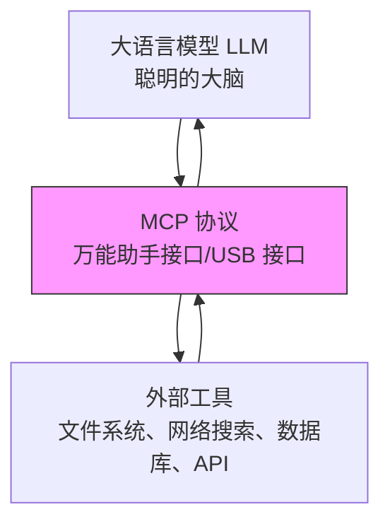

**图中三个角色说明：**

- **大语言模型 LLM（聪明的大脑）**：负责理解你的自然语言指令，决定要调用什么工具、做什么事。比如 DeepSeek、Claude、GPT 都属于这类模型。
- **MCP 协议（万能助手接口/USB 接口）**：连接大脑和外部工具的桥梁。它规定了一套标准，让不同的 AI 模型和不同的外部工具都能“说同一种话”，互相理解。
- **外部工具（文件系统、网络搜索、数据库、API）**：AI 真正动手去操作的对象。比如读写你电脑上的文件、调用高德地图 API 查天气、读取数据库里的销售数据等。

**大白话**：MCP 就像电脑上的 USB 接口。以前，每种外设（鼠标、键盘、耳机、打印机）都要装不同的接口，非常麻烦；有了 USB 标准后，所有外设都插同一个接口，即插即用。MCP 就是 AI 世界的“USB 接口”，让各种 AI 模型和各种外部工具都能通过同一套标准连接起来。

**延伸理解：从 M×N 到 M+N**

在 MCP 出现之前，如果 M 个大模型都要对接 N 个外部工具，就得建 M×N 个“专用连接”——每个模型和每个工具之间都要单独开发适配，工作量随着模型和工具的增长呈爆炸式上升。有了 MCP 之后，每个模型只需对接一次 MCP 协议，每个工具也只需实现一次 MCP 服务端，问题就从 M×N 变成了 M+N。连接数大大减少，开发门槛大大降低。

```mermaid
graph LR
    subgraph 过去：M 乘 N 个专用连接
    A1[模型 1] -->|专用对接| T1[工具 1]
    A1 -->|专用对接| T2[工具 2]
    A2[模型 2] -->|专用对接| T1
    A2 -->|专用对接| T2
    end
    subgraph 现在：M 加 N，都走 MCP
    B1[模型 1] --> MCP2[MCP 协议] --> W1[工具 1]
    B2[模型 2] --> MCP2
    W2[工具 2] --> MCP2
    end
    style MCP2 fill:#f9f,stroke:#333
```

**通信机制：MCP 的三种“传话”方式**

根据 MCP 的规范，当前支持 3 种通信机制。什么是通信机制呢？说得直白一些，就是 AI 客户端和 MCP 服务之间“传话”的方式：

| 通信机制 | 工作方式 | 优点 | 缺点 | 适合谁 |
|---------|---------|------|------|--------|
| stdio（标准输入输出） | 客户端和服务端都运行在你本地电脑上，通过程序的标准输入输出传话，全程不联网 | 无需外部网络依赖、通信速度快、可靠性高且易于调试 | 配置复杂，需提前安装命令行工具；单进程通信；资源开销大 | 本地运行的 MCP 服务（默认方式） |
| SSE（服务器发送事件） | 服务端部署在云端，客户端配置一个 URL 地址，通过网络调用远程服务 | 配置简单，基本一个链接就能解决；适合实时数据流 | 需保持长连接、断线不能自动恢复；用别人提供的服务端，安全性有待商榷 | 高德地图等云端 MCP 服务 |
| Streamable HTTP（可流式 HTTP） | MCP 最新支持的传输方式，像升级版的 HTTP 通信，双方可以随时互发消息 | 支持双向实时通信；解决 SSE 的断线恢复和单向通信问题 | 实现稍复杂，生态和工具支持还在完善中 | 需要双向互动的远程场景 |

**大白话**：stdio 就像“两个人在同一个屋里面对面说话”，快但都得在本地；SSE 就像“打电话给远方的客服”，方便但线路要保持畅通；Streamable HTTP 就像“🛰️语音通话”，随时说随时听，还能断线重连。

---

## 24.3 项目概述

### 24.3.1 MCP 的核心价值

过去，我们和 AI 的互动，多半是"你说 AI 听，AI 说完你再照着做"。你是否也曾希望 AI 能更主动、更直接地帮你处理那些繁琐的、跨应用的复杂任务？

MCP（模型-上下文协议）的出现，就如同给 AI 大模型装上了一个灵活的"手脚"和"万能 USB 接口"。它让 AI 不再仅仅是一个聪明的"大脑"，而是能够直接调用外部工具、执行复杂任务、与真实世界交互的"智能体"。这意味着，AI 能帮你搜索最新信息、读写文件、调用 API、操作其他 App……真正实现从"建议者"到"执行者"的转变。

本节将带你从零开始，掌握配置和使用 MCP 的全流程。你将学习到：

1. **理解核心**：深入浅出地了解 MCP 的核心价值、工作原理及其为 AI 带来的革命性能力。
2. **环境搭建**：完成关键的环境准备工作，为 MCP 的顺畅运行打下坚实基础（即便你是技术新手，也能跟着做）。
3. **配置掌握**：学习如何查找、获取 MCP 服务，并掌握简易配置流程，让 AI 连接上"手脚"。
4. **实战为王**：实战应用 MCP 工作流，探索 MCP 如何赋能内容创作、信息整理、图像制作、职场提效、数据分析等关键场景，让效率倍增。

不过，在开始探索之前，也想温馨提示：MCP 的配置和调试可能遇到一些小挑战，这需要一些耐心和细致。本节会提供详尽指导，跟着步骤一步步来，就一定能配成功。学习 MCP 更像学习一项技能，需要你积极动手尝试，将其融入你的实际工作流中，才能真正发挥它的威力。

**MCP 能干什么？先看两个视角的真实例子。**

**程序员视角**：

- **开发部署**：程序员每开发完一个项目，需要把项目部署到测试环境中，涉及 GitHub API（代码合并）、Jenkins API（构建镜像）、Slack API（通知团队）等平台，这些平台用起来都有门槛。有了 MCP 之后，用自然语言把需求发给大模型，大模型去调用 MCP 的服务，通过链式方式调用相关 API，项目部署就非常方便了。
- **数据库查询**：以前查询“某集团部门上个季度的销售额”，需要编写精准的 SQL 语句，不同人写的 SQL 质量参差不齐。现在只需把这句话发给大模型，大模型通过 MCP 把它精准转化为对应的 SQL 语句，进而完成查询。
- **Manus 智能体**：Manus 的一次任务执行需要进行网页搜索、网页访问、信息获取等几十个外部工具的调用。如果用平常的开发方式，就要编写几十个外部函数，每个函数轻松几百行代码。有了 MCP，只要支持对应的协议，就可以非常轻松地借助大模型和 AI 客户端访问各种数据源和工具。

**大众用户视角**：

- **旅游规划**：要出去旅行时，借助 MCP 访问天气的 API、交通的 API、地图的 API，生成一份带实时数据的行程方案，省去大量查资料的时间。
- **联网搜索**：并非所有大模型都支持联网功能，即使联网也可能不包含你习惯用的搜索引擎。有了 MCP，只需简单配置，不管什么搜索引擎都能接入。
- **业绩查询**：你是公司员工，需要查询上季度营业额。借助 MCP，大模型可以调用 CRM 系统 API（获取客户数据）+ 财务系统 API（调取报表）+ 邮件 API（发送总结报告），组合起来把这件事完成。

### 24.3.2 2025 年是智能体的元年

2025 年是智能体的元年，也注定了是智能体集中爆发的一年。但是，在 AI 智能体的世界里，有两个互联领域的重大挑战。

**第一个挑战**：智能体 Agent 如何与外部的工具进行交互：比如如何访问数据库，执行代码……

**第二个挑战**：同一个平台的不同的 Agent 之间。以及不同平台的不同的 Agent 之间如何通过协作的方式共同来完成任务。

这两个挑战，就涉及到了标准化的协议。在计算机的世界里，标准化的协议是实现高效沟通的基础。这里 MCP 就是用来解决第一个挑战的。最近谷歌发布了 A2A 协议，它就是用来解决第二个问题的。

可以说！MCP 的出现必然会大幅加快智能体普及的进程。甚至说大语言模型，尤其是像 DeepSeek + MCP 就约等于智能体。

如果大模型不能够使用外部的工具，那大语言模型其实就是一个简单的聊天机器人。甚至连查询天气、查询当前时间的功能都做不到。所以调用工具是大模型进化为智能体的一个关键。

那 MCP 就是大语言模型连接万物的一个接口，我们只需要简单的几行代码就可以去接入这样的海量的外部的工具。这样智能体的开发门槛大大的降低了。特别是现在还有 Cursor、Windsurf 这些 AI 编程工具的崛起，也可以让一些不是程序员的普通人，小白也可以通过简单的配置去开发自己的智能体。

**去哪里找 MCP 服务？**

随着越来越多的服务接入 MCP 协议，AI 能直接调用的工具将呈指数级增长。常用的 MCP 服务查找渠道有：

| 渠道 | 网址 | 特点 |
|------|------|------|
| GitHub 官方仓库 | github.com/modelcontextprotocol/servers | MCP 官方维护的服务器列表，最权威 |
| awesome-MCP-servers | github.com/punkpeye/awesome-MCP-servers | 社区整理的热门 MCP 服务大全（有中文版） |
| Glama | glama.ai/mcp/servers | 分类清晰的 MCP 服务目录 |
| Smithery | smithery.ai | MCP 服务注册中心，可按功能搜索 |
| MCP.so | mcp.so | 收录大量 MCP 服务器的导航站 |
| 阿里云百炼 | 百炼控制台 | 国内云厂商提供的 MCP 服务市场 |

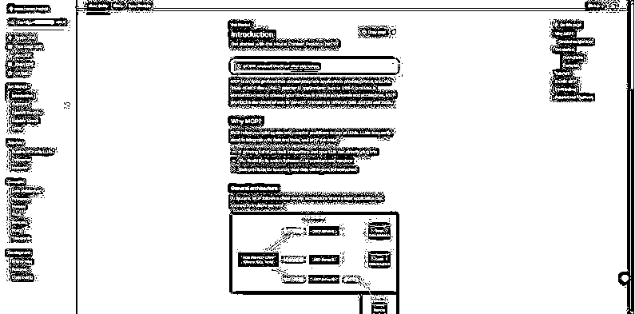

> **图片说明**：MCP 官网首页截图（图源：《MCP 应用探索 实战手册》）。MCP 的全称是 Model Context Protocol，即模型上下文协议，2024 年 11 月底由 Anthropic 公司推出，Anthropic 就是 Claude 系列模型的开发公司。

**温馨提示**：目前社区的 MCP 服务还比较混乱，有很多缺少教程和文档，一些代码功能也有问题，大家只能凭经验和参考官方文档慢慢摸索。换一个角度讲，这也是第一个吃螃蟹的代价——当然，红利你也会吃到。

### 24.3.3 如何理解 LLM 和 MCP

LLM 就是相当于你有一个超级聪明的机器人朋友，名字叫"语言大师"，它读了全世界的书和文章，能用中文、英文跟你聊天，帮你写文章、回答问题、编故事。

这个"语言大师"就是 LLM（大语言模型）。它靠以前读过的东西，猜测你想说什么，帮你写出很合理的内容。今天你让它写一封请假邮件，它就会根据它学过的写邮件的套路，帮你写出一封很合适的请假邮件。

但是现在你不只是想让它写邮件，你还想让它发邮件。不幸的是，这个"语言大师"有个小问题：它只能用脑子里的知识回答问题，它没有"手脚"，没法直接去操作你的电脑或联网查询实时信息。

这时候，你需要一个"万能助手接口"，让"语言大师"可以去调用其他工具，比如帮你发邮件、读取文件、查询天气。

这个"万能助手接口"就是 MCP（模型上下文协议）。

总之，LLM 就是那个聪明的机器人朋友，能用语言帮你写东西、回答问题；MCP 就是那个连接大脑与外部世界的万能接口，让 AI 能真正动手去做事。

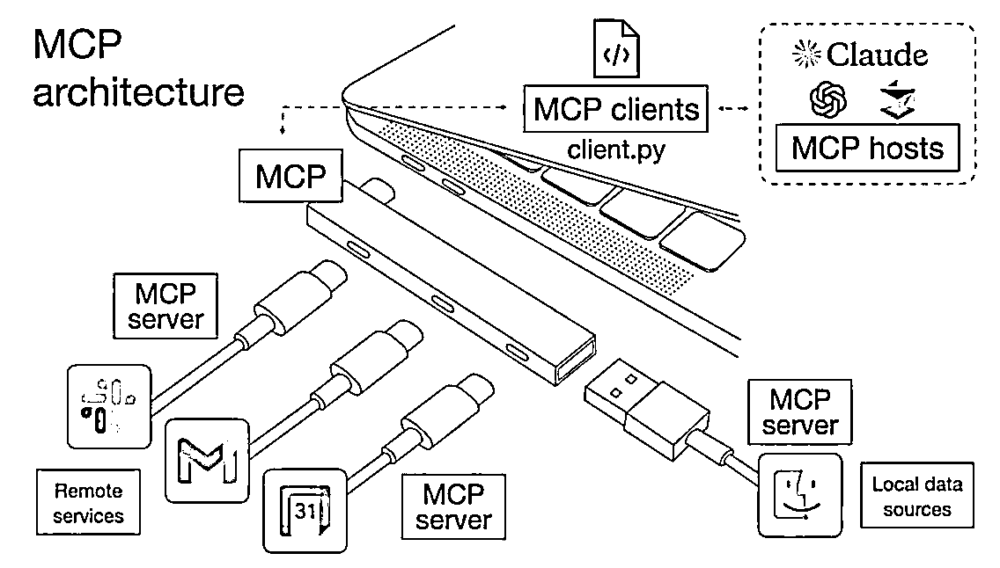

> **图片说明**：MCP 就像 USB 接口的类比（图源：《MCP 应用探索 实战手册》）。USB 让各种外设通过统一接口连接电脑，MCP 则让各种 AI 模型通过统一协议连接外部工具。

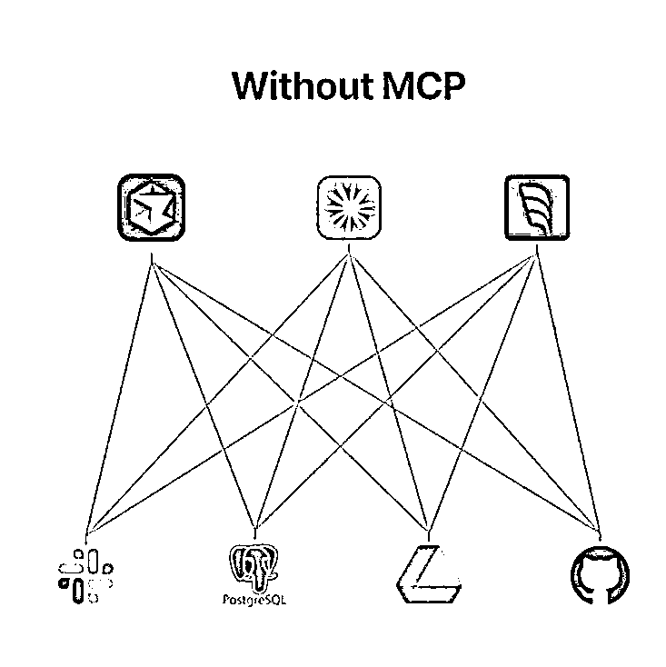

> **图片说明**：传统 AI 集成外部工具是 M×N 的问题（图源：《MCP 应用探索 实战手册》）。M 个大模型，每个都要和 N 个外部工具单独对接，需要建立 M×N 个连接，工作量巨大。

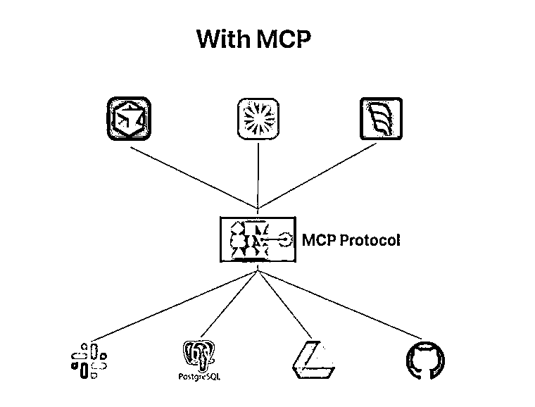

> **图片说明**：有了 MCP 协议后，变成 M+N 的问题（图源：《MCP 应用探索 实战手册》）。每个大模型只需对接 MCP 协议，每个外部工具只需实现 MCP 服务端，双方通过 MCP 互通，连接数大大减少。

### 24.3.4 第一阶段：掌握基础，配好环境

完成本章节的学习和实操，即可完成航线图第一阶段：

- 第一阶段：掌握基础，配好环境（共 3 天）
  1. 理解 MCP 核心概念、工作原理及其价值（约 1 天）
  2. 学习在 Trae、Cursor 基础操作与 MCP 管理界面（约 2 天）
  3. 学习如何查找 MCP 服务及获取配置信息（约 1 天）

**第一步：安装必要的开发环境（重要）**

除了 Cherry Studio 通过自己内置的 bun 和 uv 两个应用单独起环境外，包括 Cursor、Cline、Trae、Windsurf 等主流 AI 工具在内，我们都需要额外安装 MCP 服务所必要的开发环境。

我们要使用 MCP 服务，大部分都选择了 stdio 这种方式。stdio 的本地环境目前流行的有两种：

- 一种是 Python 编写的服务，要安装 **uv**；
- 一种是 TypeScript 编写的服务，要安装 **npx**。

当然目前主流的就是 Python 和 TypeScript。为了能够正常地使用这些 MCP 服务，我们需要安装对应的开发软件：

1. **安装 Node.js（自带 npx）**：一般来说，v22 以后的 Node.js 都自带 npx，只要安装好 Node.js，通过 `npx -v` 查看版本号，就可以知道是否安装好 npx 了。
2. **安装 Python**：没有安装 Python 的读者，去 Python 官网下载安装包，一路“下一步”即可。
3. **安装 uv**：电脑安装好 Python 后，在命令行执行下面的命令：

```bash
# 方式一：用 Python 的包管理器 pip 安装 uv（推荐，最简单）
pip install uv

# 方式二：Windows 下也可以通过 PowerShell 运行命令来安装 uv
powershell -ExecutionPolicy ByPass -c "irm https://astral.sh/uv/install.ps1 | iex"
```

安装好后，重启终端并运行以下命令检查是否正常：

```bash
# 查看 uv 版本号，能正常输出版本号说明安装成功
uv --version

# 查看 uvx 帮助信息，能输出帮助说明说明 uvx 可用
uvx --help
```

安装好 uv 后，我们才可以使用通过 uvx 启动的 MCP 服务；安装好 npx 后，我们才可以使用通过 npx 启动的 MCP 服务。这两样工具就像“启动器”，MCP 服务本身则是一个个需要被启动的小程序。

**第二步：安装 Trae**

Trae 是一款支持 MCP 功能的 AI 原生 IDE，可以通过官网下载安装。安装完成后打开 Trae，你会看到类似下面的欢迎界面。

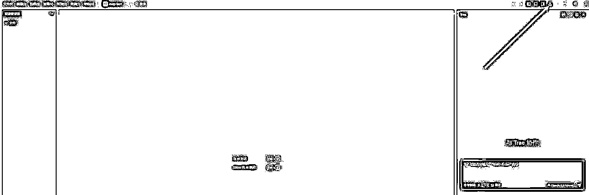

> **图片说明**：Trae 安装/首次打开界面（图源：《MCP 应用探索 实战手册》）。

**第三步：认识 Trae 的 MCP 管理界面**

打开 Trae 后，找到设置中的 MCP 选项，点击进入 MCP 管理界面。点击“添加”，就可以看到 Trae 提供的 MCP 市场；如果想要配置自己的 MCP 服务，就点击“手动配置”，再选择“原始配置”，它会打开一个 `mcp.json` 的文件，我们就在这里面配置 MCP 服务。

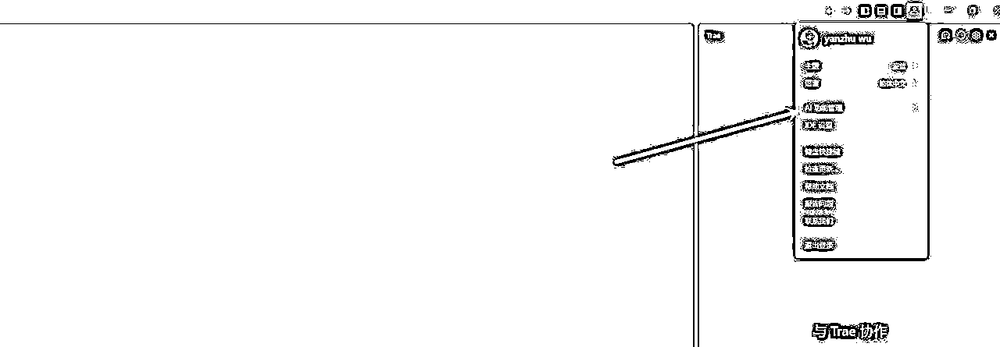

> **图片说明**：Trae 设置界面（图源：《MCP 应用探索 实战手册》）。

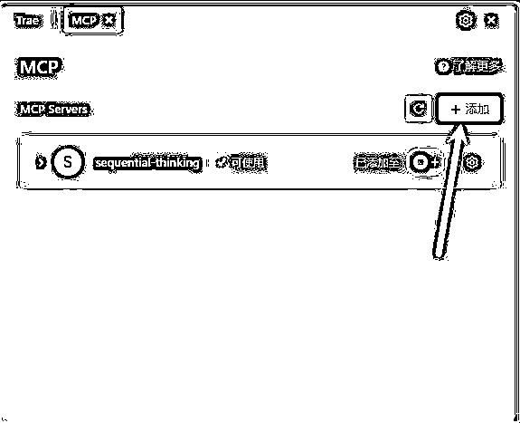

> **图片说明**：点击 MCP 选项进入管理页面（图源：《MCP 应用探索 实战手册》）。

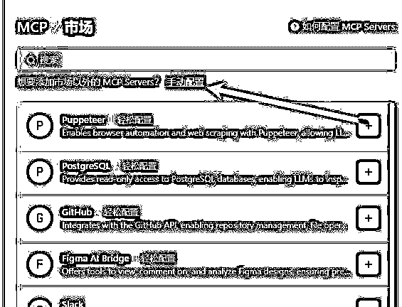

> **图片说明**：点击添加，进入 MCP 市场与手动配置选项（图源：《MCP 应用探索 实战手册》）。

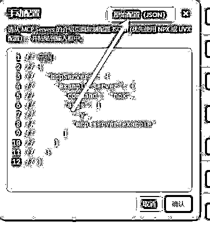

> **图片说明**：选择原始配置，打开 mcp.json 文件（图源：《MCP 应用探索 实战手册》）。

---

## 24.4 实战场景

MCP 赋能内容创作、信息整理、图像制作、职场提效、数据分析等场景：

| 场景 | MCP 服务示例 | 实现功能 |
|------|-------------|---------|
| 内容创作 | 网络搜索、文件系统 | 搜索最新信息、读写草稿文件 |
| 信息整理 | 网络搜索、数据库 | 收集整理行业资料 |
| 图像制作 | 图像生成 API | 生成设计素材 |
| 职场提效 | 文件系统、邮件 API | 自动处理文档、发送邮件 |
| 数据分析 | 数据库、API | 读取数据、生成报表 |

下面我们以最常用的文件系统 MCP 服务为例，演示在 Trae 中从配置到使用的全过程。走完这一遍，其他 MCP 服务的配置方法都是类似的。

**第一步：编写 MCP 配置文件**

下面是一个常见的 MCP 配置文件示例（文件系统 MCP 服务，Windows 版），每一行都有详细注释：

```json
{
  "mcpServers": {
    "filesystem": {
      "command": "cmd",
      "args": [
        "/c",
        "npx",
        "-y",
        "@modelcontextprotocol/server-filesystem",
        "C:\\code\\MCP\\MCP-test"
      ]
    }
  }
}
```

**配置文件逐行注释：**

```text
{                                                    ← 配置文件开始
  "mcpServers": {                                    ← 所有 MCP 服务的集合，固定写法
    "filesystem": {                                  ← 服务名称，可以自己起名，AI 会按这个名字调用
      "command": "cmd",                              ← 启动服务的命令；Windows 下用 cmd，macOS/Linux 下可直接写 npx
      "args": [                                      ← 传给命令的参数列表，按顺序逐个排列
        "/c",                                        ← cmd 的参数，表示“执行后面的命令后结束”
        "npx",                                       ← 用 npx 这个启动器来运行服务
        "-y",                                        ← 自动确认安装，不再弹窗询问
        "@modelcontextprotocol/server-filesystem",   ← 文件系统 MCP 服务的软件包名（官方出品）
        "C:\\code\\MCP\\MCP-test"                    ← 授权给 AI 访问的文件夹路径，AI 只能读写这个目录
      ]
    }
  }
}                                                    ← 配置文件结束
```

> **大白话**：这个配置文件的意思是，告诉 Trae：帮我启动一个名为 “filesystem” 的 MCP 服务，用 `npx` 运行官方的文件系统服务器，并且只允许 AI 访问 `C:\code\MCP\MCP-test` 这个文件夹。这样 AI 就不会随意读写你电脑上的其他文件，比较安全。

**第二步：粘贴配置并检查状态**

把上面的代码粘贴进 `mcp.json` 文件，把路径 `C:\\code\\MCP\\MCP-test` 改成你自己电脑上一个真实存在的文件夹路径（注意 Windows 路径里的反斜杠 `\` 要写成两个 `\\`），然后保存。Trae 会自动检测配置并显示 MCP 服务的状态。

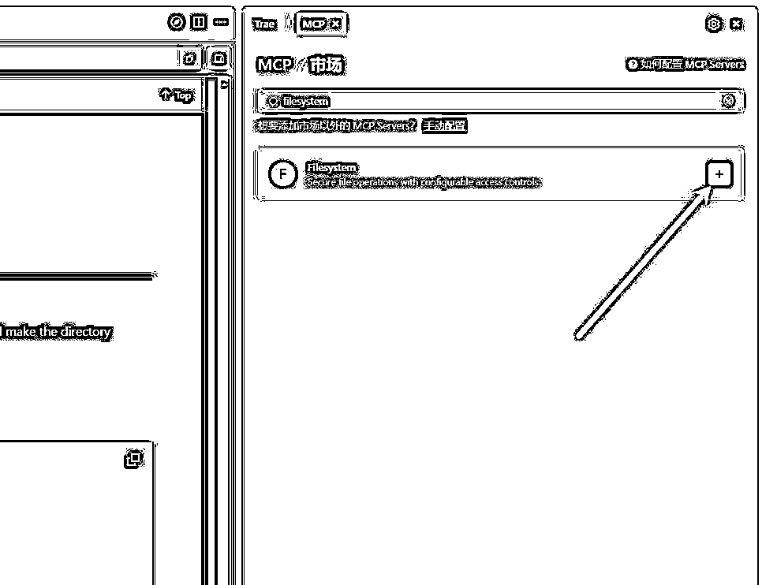

> **图片说明**：将配置代码粘贴到 mcp.json 文件中（图源：《MCP 应用探索 实战手册》）。

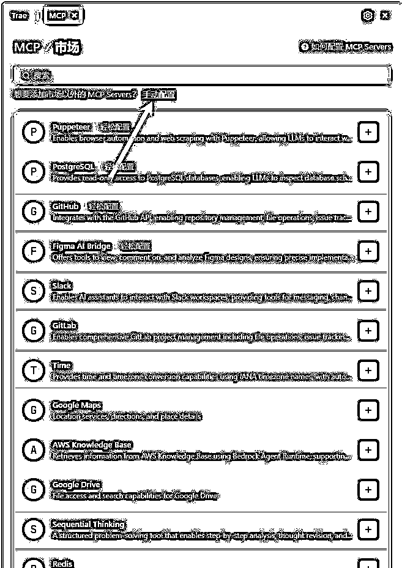

> **图片说明**：在 Trae 中添加 MCP 服务后查看状态（图源：《MCP 应用探索 实战手册》）。

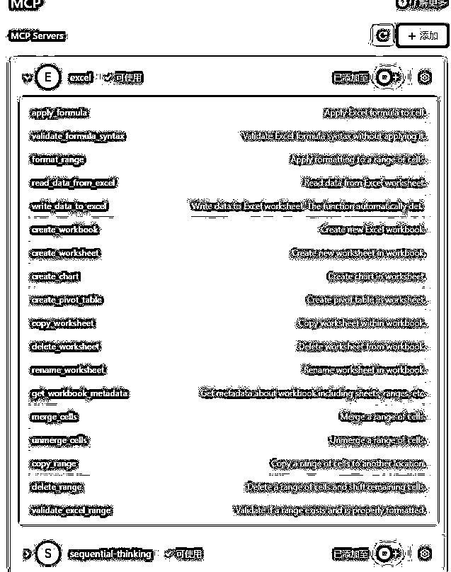

> **图片说明**：MCP 服务状态显示页面，可以看到服务是否已连接及可用的功能列表（图源：《MCP 应用探索 实战手册》）。

**第三步：让 AI 真正“执行”任务**

根据 Trae 的要求，MCP 要在智能体（Agent）中才能使用，所以我们要先选择一个智能体，然后再输入指令。配置好文件系统 MCP 服务后，在 Trae 的智能体对话框中输入类似下面的提示词：

> 现在交给你一个任务：请读取我电脑上 C:\code\MCP\MCP-test 目录下的文件，把文件内容读出来，并基于内容回答我的问题。

AI 收到指令后，会调用文件系统 MCP 服务，去读取指定文件夹里的文件内容，然后基于文件内容给你回答。这就是从“建议者”（只告诉你怎么读文件）到“执行者”（直接帮你读取文件并回答）的转变。

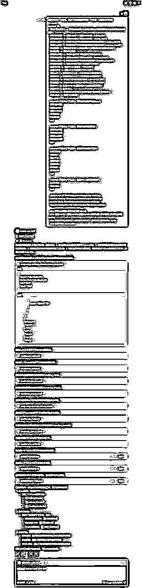

> **图片说明**：AI 基于 MCP 服务读取本地文件并回答问题的最终效果（图源：《MCP 应用探索 实战手册》）。

**其他常见 MCP 服务的配置思路**

- **高德地图服务（SSE 方式）**：先到高德开放平台注册开发者、创建应用、申请一个 Key，然后在 mcp.json 里粘贴一段配置，把 URL 中的 Key 换成你自己的即可。这种云端服务用 URL 就能接入，不用在本地装任何东西。
- **Excel 服务（uv 方式）**：先把 Excel MCP 服务的代码下载到本地，在终端进入项目目录执行 `uv venv` 和 `uv pip install -e .` 安装依赖，再用 `uv run excel-mcp-server sse` 启动服务，最后在 mcp.json 里填入服务地址（如 `http://localhost:8000/sse`）和授权目录。
- **filesystem 服务（Trae 内置）**：Trae 内置了这个服务，直接在 MCP 市场搜索添加即可；如果用其他客户端没有内置，可以按上面第一步的方法手动配置。

你会发现规律：**不同 MCP 服务的配置，区别只在于“启动命令”和“参数”这两块，整体框架都是同一个 mcpServers 结构**。学会一个，就等于学会了一类。

---

## 24.5 小练习

在 Trae 或 Cursor 中配置一个 MCP 服务（如文件系统或网络搜索），让 AI 读取本地一个文件的内容并基于内容回答问题，验证 AI 能"执行"而不仅是"建议"。

**参考步骤**：

1. 安装 Trae 或 Cursor
2. 在 MCP 管理界面中查找可用的 MCP 服务
3. 配置文件系统 MCP 服务（指定可访问的文件夹路径）
4. 让 AI 读取本地一个文件的内容
5. 基于文件内容提问，验证 AI 能基于真实数据回答问题

> **自查提示**：如果 AI 回答“我无法访问你的文件”，大概率是三件事出了问题：一是 mcp.json 里的路径写错了（Windows 路径要用双反斜杠）；二是 MCP 服务状态没有变成“已连接”；三是你没有在智能体模式下对话（MCP 只在智能体中生效）。逐项排查，一般两分钟内就能定位问题。

---

## 本章小结

通过本章，你应该已经了解：

1. **MCP 是什么**：模型上下文协议（Model Context Protocol），2024 年 11 月底由 Anthropic 公司推出，就像 AI 世界的“USB 接口”，让大模型通过统一标准连接外部工具。
2. **为什么重要**：不能调用工具的大模型只是聊天机器人，连查天气、查时间都做不到；MCP 让 AI 从“建议者”变成“执行者”，DeepSeek + MCP 就约等于智能体。
3. **核心类比**：LLM 是聪明的“语言大师”大脑，MCP 是给它装上的“手脚”和“万能接口”；集成问题从 M×N 降到 M+N。
4. **三种通信机制**：stdio（本地面对面）、SSE（远程打电话）、Streamable HTTP（双向🛰️语音），本地服务用 stdio，云端服务用 URL 接入。
5. **配置三步走**：装好环境（Node.js/npx、Python/uv）→ 在 Trae/Cursor 的 mcp.json 里粘贴配置（改路径、改密钥）→ 在智能体中下指令验证。
6. **安全边界**：文件系统服务只能访问你授权的文件夹，配置里的路径就是 AI 的“活动范围”，圈得越小越安全。

下一章，我们将在 MCP 的基础上更进一步，学习如何搭建能自动干活的 AI 员工（AI Agent），把重复工作真正交给 AI。
