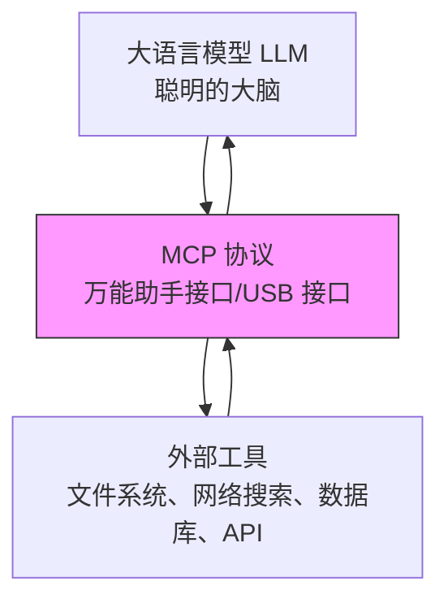

# 第24章 MCP：让大模型从"建议者"变"执行者"

> 本节教从零掌握 MCP（模型上下文协议）配置与使用，让 AI 调用外部工具执行跨应用任务（搜索、读写文件、调 API）。实战覆盖内容创作、信息整理、图像制作、职场提效、数据分析等场景，以 Trae/Cursor 为主要载体。

## 24.1 大白话：给 AI 装上"手脚"

过去 AI 只能"出主意"，你还得自己动手执行。MCP 就像给 AI 装上了"手脚"和"万能 USB 接口"，让它能直接读写文件、调用 API、操作其他 App，真正从"建议者"变成"执行者"。

## 24.2 MCP 工作原理 Mermaid 图

## 24.3 项目概述

### 24.3.1 MCP 的核心价值

过去，我们和 AI 的互动，多半是"你说 AI 听，AI 说完你再照着做"。你是否也曾希望 AI 能更主动、更直接地帮你处理那些繁琐的、跨应用的复杂任务？

MCP（模型-上下文协议）的出现，就如同给 AI 大模型装上了一个灵活的"手脚"和"万能 USB 接口"。它让 AI 不再仅仅是一个聪明的"大脑"，而是能够直接调用外部工具、执行复杂任务、与真实世界交互的"智能体"。这意味着，AI 能帮你搜索最新信息、读写文件、调用 API、操作其他 App……真正实现从"建议者"到"执行者"的转变。

### 24.3.2 2025 年是智能体的元年

2025 年是智能体的元年，也注定了是智能体集中爆发的一年。但是，在 AI 智能体的世界里，有两个互联领域的重大挑战。

**第一个挑战**：智能体 Agent 如何与外部的工具进行交互：比如如何访问数据库，执行代码……

**第二个挑战**：同一个平台的不同的 Agent 之间。以及不同平台的不同的 Agent 之间如何通过协作的方式共同来完成任务。

这两个挑战，就涉及到了标准化的协议。在计算机的世界里，标准化的协议是实现高效沟通的基础。这里 MCP 就是用来解决第一个挑战的。最近谷歌发布了 A2A 协议，它就是用来解决第二个问题的。

可以说！MCP 的出现必然的会大幅加快智能体普及的进程。甚至说大语言模型，尤其是像 DeepSeek + MCP 就约等于智能体。

如果大模型不能够使用外部的工具，那大语言模型其实就是一个简单的聊天机器人。甚至连查询天气，查询当前的时间的功能都做不到。所以调用工具是大模型进化为智能体的一个关键。

那 MCP 就是大语言模型连接万物的一个接口，我们只需要简单的几行代码就可以去接入这样的海量的外部的工具。那这样智能体的开发门槛大大的降低了。特别是现在还有 cursor、windsurf 这些 AI coding 工具的崛起。也可以让我们一些不是程序员的普通人，小白也可以通过代码去开发自己的智能体。

### 24.3.3 如何理解 LLM 和 MCP

LLM 就是相当于你有一个超级聪明的机器人朋友，名字叫"语言大师"，它读了全世界的书和文章，能用中文、英文跟你聊天，帮你写文章、回答问题、编故事。

这个"语言大师"就是 LLM（大语言模型）。它靠以前读过的东西，猜测你想说什么，帮你写出很合理的内容。今天你让它写一封请假邮件，它就会根据它学过的写邮件的套路，帮你写出一封很合适的请假邮件。

但是现在你不只是想让它写邮件，你还想让它发邮件。可惜的是这个"语言大师"有个小问题：它只能用脑子里的知识回答问题。

这时候，你需要一个"万能助手接口"，让"语言大师"可以去调用其他工具，比如帮你发邮件。

这个"万能助手接口"就是 MCP（模型上下文协议）。

总之，LLM 就是那个聪明的机器人朋友，能用语言帮你写东西、回答问题。

### 24.3.4 第一阶段：掌握基础，配好环境

完成本章节的学习和实操，即可完成航线图第一阶段：

- 第一阶段：掌握基础，配好环境（共 3 天）
  1. 理解 MCP 核心概念、工作原理及其价值（约 1 天）
  2. 学习在 Trae、Cursor 基础操作与 MCP 管理界面（约 2 天）
  3. 学习如何查找 MCP 服务及获取配置信息（约 1 天）

## 24.4 实战场景

MCP 赋能内容创作、信息整理、图像制作、职场提效、数据分析等场景：

| 场景 | MCP 服务示例 | 实现功能 |
|------|-------------|---------|
| 内容创作 | 网络搜索、文件系统 | 搜索最新信息、读写草稿文件 |
| 信息整理 | 网络搜索、数据库 | 收集整理行业资料 |
| 图像制作 | 图像生成 API | 生成设计素材 |
| 职场提效 | 文件系统、邮件 API | 自动处理文档、发送邮件 |
| 数据分析 | 数据库、API | 读取数据、生成报表 |

## 24.5 小练习

在 Trae 或 Cursor 中配置一个 MCP 服务（如文件系统或网络搜索），让 AI 读取本地一个文件的内容并基于内容回答问题，验证 AI 能"执行"而不仅是"建议"。

**参考步骤**：

1. 安装 Trae 或 Cursor
2. 在 MCP 管理界面中查找可用的 MCP 服务
3. 配置文件系统 MCP 服务（指定可访问的文件夹路径）
4. 让 AI 读取本地一个文件的内容
5. 基于文件内容提问，验证 AI 能基于真实数据回答问题
