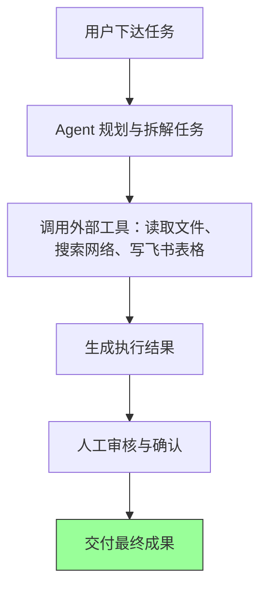
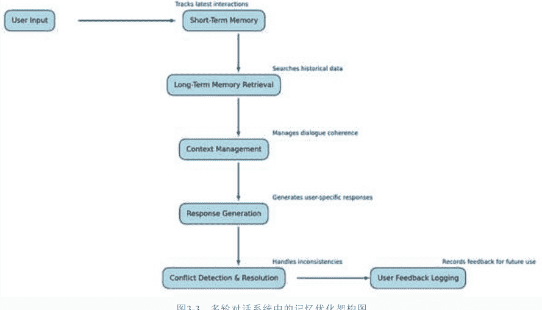
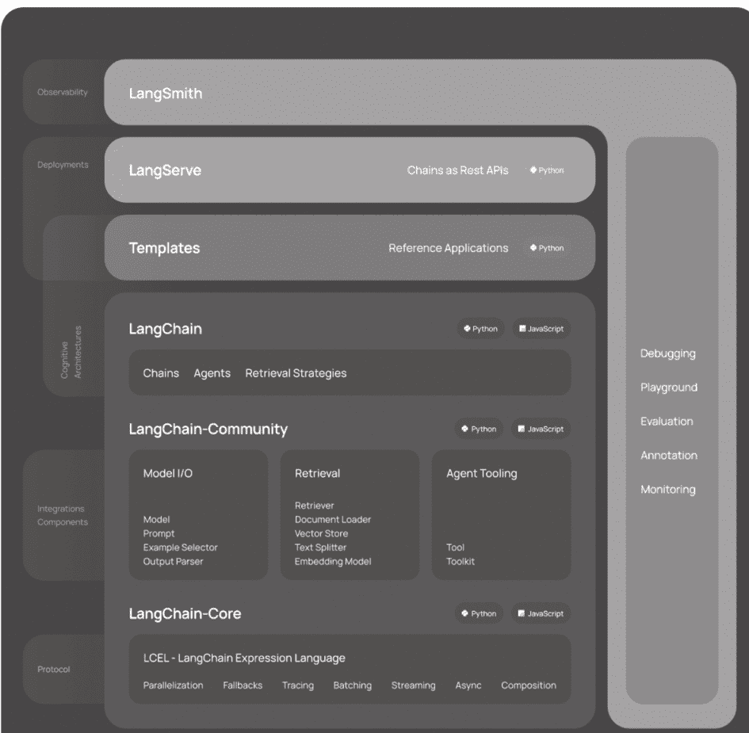
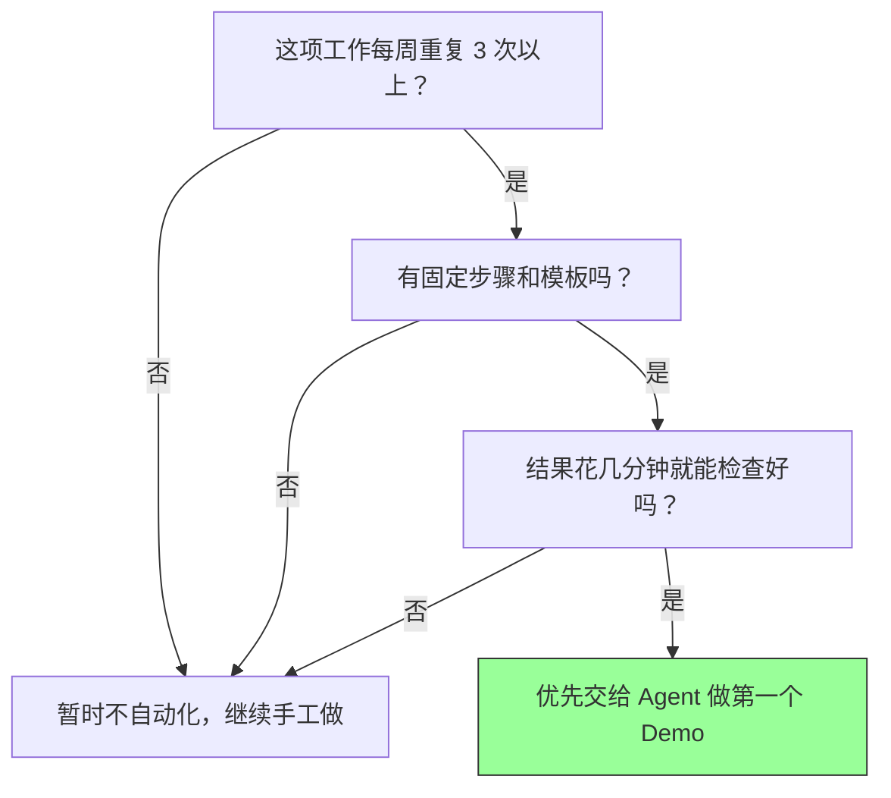
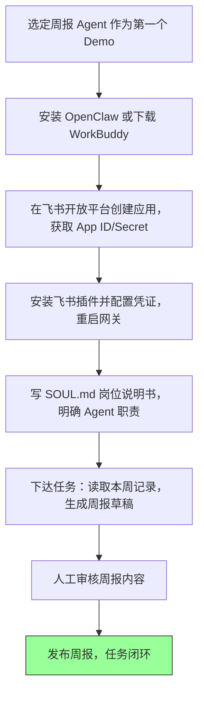

# 第25章 AI Agent 架构师：搭建自动干活的 AI 员工

> 本节教用 Codex + Hermes + 飞书 CLI 搭第一个 Agent，把每周重复 3 次以上的工作（周报、纪要、内容草稿、数据表）交给"AI 员工"自动执行，从最小可运行版到多 Agent 团队与企业 AI 服务。案例包括双 Agent YouTube 矩阵 130 万订阅、3 个 AI 员工月省 3000、写作 Agent 月产 30 篇。

## 25.1 大白话：Agent 是能"自动干活"的 AI 员工

说"Agent"的时候，很多人脑子里浮现的是聊天机器人：你发一句话，它回一句话，问答结束。但这只算 Agent 的一半，甚至不到一半。

普通的 AI（比如你每天在手机上跟 DeepSeek、ChatGPT 聊天的那个）更像是一个"只能答疑的实习生"：你问什么，它答什么；你不问，它就沉默着；它不会自己想"今天得帮老板写周报了"，也不会主动去翻你的文件夹抓数据，更不会把写好的内容交到飞书群里。

而 **Agent（智能体）**，你可以把它理解为一个"能自动干活的 AI 员工"。它不只是会说话，而且会干活：你给它一个固定的工作流程（比如"每周一早上，把上周的聊天记录整理成周报，发到飞书指定群"），它就能自己抓资料、拆任务、写草稿、存表格，最后把结果摆在你面前，等你检查把关。

用大白话分三点，Agent 跟普通 AI 的区别：

1. **它会自己拆任务。** 你对普通 AI 说"帮我做周报"，它只能给你一篇泛泛而谈的模板；你对 Agent 说同样的话，它会先想："得先找本周的聊天记录，再把重点工作提取出来，然后按周报模板填内容，最后发飞书。" 大任务被拆成一个个小步骤，逐一执行。
2. **它有"手"，能调用工具。** 普通 AI 只能输出文本；Agent 可以读你的文件、搜网络、写飞书表格、发邮件、调日历，甚至操作你电脑上的软件。换句话说，它不只是"嘴上说说"，还能"动手做"。
3. **它有"主动性"和"闭环"。** 传统 AI 是"被动响应"——你不发消息，它什么都不干。Agent 可以按时间定时启动（比如每周五下午 3 点自动跑一次），把执行结果汇报给你，你检查后再发布，形成"下达任务 → 自动执行 → 人工审核 → 交付成果"的完整闭环。

> **大白话**：如果把 AI 比作人，普通 AI 是个"嘴特别甜但手特别短"的顾问，什么都能聊，什么动作都做不了；Agent 则是个"既能思考又能动手"的员工，能代表你在电脑里完成一段真实的工作流程。

### 25.1.1 什么样的工作适合交给 Agent

不是所有工作都适合丢给 Agent。作为新手，你可以用下面这个简单的"三题自测法"来判断一项工作能不能交给 AI 员工：

- **重复性**：这项工作是不是每周/每月都要重复做 3 次以上？（比如周报、月度数据汇总、内容选题）
- **规则性**：有没有固定的步骤或模板可循？（比如"先看聊天记录，再提取重点，最后按 Markdown 模板写周报"）
- **可核查性**：结果出来后，你花几分钟就能看懂并判断好坏？（比如周报里的数字对不对、有没有漏掉的重要事项）

三个问题都答"是"，就很适合做成 Agent。反过来，下面这些工作**暂时不适合**交给 Agent：

- 一次性的、只做一次就不用再碰的任务（部署 Agent 的成本可能比你亲自干还高）；
- 需要拍板定夺、承担责任的决策（比如"这个供应商要不要签"）；
- 目标特别模糊、连你自己都说不清楚要什么结果的任务（Agent 没有读心术，你说不清楚，它也干不好）。

### 25.1.2 Chatbot 与 Agent 的本质差异

市面上常见的客服机器人、各种"AI 助手"小程序，大部分其实是 Chatbot（聊天机器人），不是 Agent。二者看起来都能聊天，但本质完全不同。下表用大白话把差异摊开来说：

| 对比维度 | Chatbot（聊天机器人） | Agent（智能体 / AI 员工） |
| :--- | :--- | :--- |
| 核心定位 | 对话交互界面，是你和系统的"沟通窗口" | 自主智能实体，是代表你完成目标的"数字代理人" |
| 响应模式 | 被动响应，必须由你先发问才输出内容 | 主动行动，能根据目标自己感知环境、规划路径并持续执行 |
| 能力边界 | 局限于文本生成、FAQ 问答和简单信息查询 | 具备感知、决策、执行、反馈的完整闭环，能解决复杂任务 |
| 价值输出 | 主要传递信息，输出文本或简单结果 | 主要交付结果，能完成全流程任务并给出最终成果 |
| 你的角色 | 你是操作者，每一步都要亲自下指令 | 你是决策者，只需设定目标，Agent 自主执行 |
| 工具调用 | 无，或只支持有限的预设工具 | 能自主识别、调用并协同多种工具（读文件、写表格、搜网络等） |
| 记忆能力 | 上下文有限，容易"失忆"，逻辑容易断裂 | 具备短期记忆和长期记忆，能维持长周期任务的一致性 |

举个生活化的例子，安排一次商务旅行：

- **Chatbot**：你说"帮我安排下周去上海的商务旅行"，它会回复"请告诉我具体日期、参会人和酒店偏好"，需要你一步步把所有细节都提供出来，本质上还是个信息查询工具。
- **Agent**：你说"帮我安排下周去上海见张总，尽量周三下午，不要和我现有行程冲突"，它会自动查你和对方的日历，找到双方都有空的时间段，发送会议邀请、订机票订酒店，同步到日历里，全程你不用手动操作，真正完成了从"想"到"做"的闭环。

## 25.2 AI Agent 架构 Mermaid 图

把 Agent 能力拆开来看，本质上由四个层级组成：感知层（拿信息）、决策层（想办法）、执行层（干活）、反馈层（报结果）。下面这张图，就是本书第 25 章反复会用到的 Agent 工作流程图：



### 25.2.1 逐节点讲透这张图

**第一步：用户下达任务（A）。** 你在飞书群里发一句话，或者在定时任务里设好触发时间，告诉 Agent 要干什么。这时候你扮演的是"老板"角色，只需要说清楚目标，不需要教它每一步怎么操作。

**第二步：Agent 规划与拆解任务（B）。** Agent 拿到任务后，会在"脑子"里先打草稿：这件事要分几步？先干哪一步？需要用到什么工具？比如"写周报"会被拆成"读取飞书群聊记录 → 提取本周完成的工作 → 提取遇到的问题 → 按周报模板组织语言"。

**第三步：调用外部工具（C）。** Agent 开始"动手"：读你的聊天记录文件、搜索网络上的资料、往飞书表格里写数据、生成 Markdown 文档。这一步体现了 Agent 的"手"——它不只是嘴上说说，能真正触达外部系统。

**第四步：生成执行结果（D）。** 工具调用结束后，Agent 把各步骤的结果拼装起来，形成一份初稿。

**第五步：人工审核与确认（E）。** 这是最关键的一步，也是新手最容易忽略的一步。Agent 做出来的东西，你必须过一眼，确认无误后才能发布。AI 有时候会"自信地胡说八道"（幻觉），人工审核是最后一道防线。

**第六步：交付最终成果（F）。** 审核通过后，周报发到飞书群、纪要存入文档库、数据表更新完毕，任务完成。

### 25.2.2 Agent 的"脑"和"手"：两张架构图

为了让你更直观地理解 Agent 内部是怎么运转的，下面两张图分别来自素材书中的架构图。第一张是 Agent 感知—决策—执行—反馈的闭环（素材出自《OpenClawAI 助理一本通：24 小时全自动工作流》图 1-1）：


> **图片说明**：Agent 感知环境信息 → 基于知识与规则做决策 → 调用工具执行 → 将结果回传并修正策略，形成持续优化的闭环工作流。

Agent 的"脑"负责理解你的模糊需求、把目标拆成子任务、遇到意外时切换备选方案；Agent 的"手"负责调用 API、操作办公软件、访问数据库和互联网，把决策变成现实行动。只有"脑"没有"手"，就是空谈；只有"手"没有"脑"，就是盲目乱动，两者缺一不可。

第二张图展示了 Agent 的记忆系统是怎么组织的（素材出自《AI Agent 开发与应用：基于大模型的智能体构建》图 3-3 记忆优化架构图）：



> **图片说明**：记忆优化架构图，结合了短期记忆、长期记忆、上下文管理和冲突检测等关键步骤，各模块之间通过箭头表示数据流。

大白话记两种记忆：

- **短期记忆**：就像人正在谈话时的工作台面，存着刚才说过的话和当前的任务进度，对话结束或切换话题后就可以丢弃。
- **长期记忆**：就像人的笔记本或档案柜，把你的喜好、历史任务、行业知识持久化保存（比如"记住某个品牌的种草文案风格"），下次做类似任务时直接调用，实现"一次学习，终身复用"。

### 25.2.3 Agent 能调用什么工具

新手最容易误解的一点是：Agent 本身不"知道"怎么操作飞书、怎么写 Excel，它只是"知道该调用哪个工具"，真正干活的是工具。常见的工具大致分三类：

| 工具类型 | 能做什么 | 举个新手容易理解的例子 |
| :--- | :--- | :--- |
| 文件类工具 | 读取/写入本地文档、PDF、图片 | 把本周的 Word 会议纪要读进来，提取重点 |
| 表格与协作类工具 | 读写飞书多维表格、钉钉、企业微信 | 自动往"周报汇总表"里新增一行，把本周工作量填进去 |
| 网络与 API 类工具 | 搜索网页、调用天气/股价/地图接口 | 每天早上自动抓取行业新闻标题，摘要后发给你 |

还有第三类比较高级的工具，是**代码执行工具**：Agent 自己写一小段 Python 代码，在沙箱里运行，用来算表格、画图表、处理数据。新手初期可以先不用，等跑通了第一个 Demo 再尝试。

如果你以后想深入 Agent 开发，还会接触到专门的 Agent 开发框架，比如 LangChain。它把模型、工具、记忆、向量数据库等能力做成一个个标准化模块，让你像搭积木一样组装自己的 Agent（下图为其框架结构，素材出自《AI Agent 实战指南：构建高效、可协作的智能体》图 2-7）：



> **图片说明**：LangChain 框架结构图。它不仅可以用于构建智能体，还支持多种模型和向量数据库，各核心支持模块化组合。本书读者初期了解有这样一个框架即可，不必深究。

> **核心提醒**：Agent 调用工具时，你需要提前给它授权（比如登录飞书开放平台、生成 API 密钥），并且每一步工具调用都建议先在"人工审核"节点确认，不要一开始就把 Agent 完全开放到你的财务系统或客户数据库里。

## 25.3 关卡 0：开船第一课

### 25.3.1 本期主线

本期的主线很明确：**用 Hermes + Codex + 飞书 CLI，搭建一个能"自动干活"的 AI Agent，并把你一项每周重复做 3 次以上的工作交给它自动化完成。**

先给三个名词打个"大白话"标签，方便你后面读章节时不用每次都查字典：

- **Codex**：用来写代码的 AI 模型。在这里你可以把它理解为"帮你写搭建 Agent 所需代码的助手"，比如写一个"读文件 → 生成周报 → 存文件"的自动化脚本。
- **Hermes**：Agent 的运行框架或调度层，负责把"用户任务"分发给合适的 Agent 去执行，类似一个"工头"，安排哪个工人干哪一步活。
- **飞书 CLI**：用来在命令行里操作飞书的工具（比如发消息、读群聊记录、写表格），让 Agent 能跟飞书这个"办公战场"打交道。

如果你暂时不想折腾命令行和本地部署，素材书里还介绍了几个"开箱即用"的替代方案，新手可以优先选这些：

1. **WorkBuddy（腾讯版"免部署龙虾"）**：零配置，下载即用，适合不想搞复杂安装的用户，覆盖邮件处理、日程管理、项目协作等办公场景。下载地址：https://www.codebuddy.cn/work/
2. **Kimi Claw**：Moonshot 团队把 OpenClaw 能力集成到浏览器里，打开网页登录就能用，电脑上不用装任何东西，手机也能打开。
3. **有道 LobsterAI**：Windows/Mac 桌面客户端，双击安装包就能运行，对 DeepSeek、通义千问、智谱 GLM 等国产模型适配较好，免费使用（只付模型 API 费用）。
4. **ZeelinClaw**：支持挂载本地大模型，适合想完全零 API 费用、电脑配置较高（建议 16GB 以上内存）的用户。
5. **MaxClaw**：MiniMax 团队做的优化分支，启动快、内存占用低，适合 8GB 内存的老笔记本。

> **建议**：如果你是完全零基础，第一周优先用 WorkBuddy 或 Kimi Claw 这种"下载即用"的工具先把"Agent 能干活"的感觉跑通；等你熟悉了流程，再尝试本地部署 OpenClaw + 飞书 CLI 的完整方案，那时你对每个配置项的作用已经有概念了，不容易被报错劝退。

### 25.3.2 别人都如何使用 Agent

在动手搭建之前，先看三个真实案例，感受"AI 员工"能带来什么样的变化。这些案例都来自素材书中对生财圈朋友的采访记录。

**案例一：一个人 + 两个 AI 员工 = 4 个 YouTube 频道、130 万订阅、2.25 亿播放。**

生财圈友 @天才老师 搭建了"煤老板（策略）+ 翠花（执行）"的双 Agent 架构：一个 Agent 负责选题和策略（相当于老板），另一个 Agent 负责写脚本、剪辑建议和发布（相当于员工）。一个人就这样运营了 4 个 AI Shorts 频道，积累了 130 万订阅、2.25 亿播放量。过去制作一条短视频要花 4~5 小时，有了双 Agent 后压到约 20 分钟；2026 年 2 月单月产出 41 条视频，其中 14 条百万播放、1 条千万播放。

**案例二：不懂技术 + 3 个 AI 员工 = 每月省下 3000 元。**

生财圈友 @瑾糖🍀🌊 本身不懂技术，但把自己业务里的重复动作拆出来，做了 3 个 AI 员工：电商商品采集 Agent、闲鱼运营 Agent、小红书内容生产 Agent。原本准备招人来做的机械工作，现在变成"每天花几分钟交代任务，剩下交给 AI 跑流程"，每月大约省下 3000 元的人力成本。

**案例三：10 天搭出写作 Agent，月产从 10 篇提升到 30 篇。**

生财圈友 @小宝｜优势人生主理人 用 Claude 搭建了一套自动化写作系统。单篇文章从 3~4 小时降到 45~60 分钟，月产量从 10 篇左右提升到 30 篇左右。关键不在于模型多强，而在于他把写作流程拆成了"选题 Agent → 草稿 Agent → 校对 Agent"的多个岗位，每个 Agent 只做自己擅长的一步。

这三个案例共享一个规律：**Agent 不是用来替代你做决策的，而是用来替你把重复的、有规律的、可检查的体力活和初级脑力活自动化。**

### 25.3.3 航海期间需要交付什么

本期为期 21 天，你需要完成必修关卡 1~6 的所有作业，并最终完成一个可运行、可展示的 Agent。

你最终需要至少提交 3 样东西作为佐证：

| 你交什么 | 证明什么 | 是什么 |
| :--- | :--- | :--- |
| Agent 网址链接 | 它能被公开看见 | 一个别人点开就能访问的展示网页链接 |
| 1 次成功运行截图 | 它最近真的自动干过活 | 输入前 → 运行中 → 输出后的证据 |
| 使用说明书 | 别人知道它省了什么人工、怎么用 | AI 生成的一份说明文档 |

> **废话一句**：这三样东西里，"1 次成功运行截图"最能打脸。很多人搭完 Agent 只留了一堆代码，却没有一张图证明它真的跑过，到时候别人问"你这个 Agent 到底能干什么"，你只能尴尬地笑。所以跑通后，第一件事就是按下截图键，把"输入 → 运行中 → 输出"三段截个图存好。

关于使用说明书，素材建议新手可以让 AI 直接生成，不需要你自己从零写。一份合格的 Agent 使用说明书至少包含：

1. **这个 Agent 能干什么**（一句话岗位定义）；
2. **怎么启动它**（点哪里、运行什么命令）；
3. **输入是什么**（需要你提供什么数据，格式如何）；
4. **输出是什么**（生成的内容存在哪里，长什么样）；
5. **你需要检查什么**（发布前必须过一眼的几个关键点）；
6. **常见问题及修复方法**（比如"如果提示 Token 爆炸，怎么缩短输入文本"）。

为帮你判断哪些周常工作值得先自动化，下面是一个简单的筛选流程图，你可以对着自己每周的工作逐条过一遍：



## 25.4 关卡 1：用模板跑通第一个最小 Agent Demo

关卡 1 的目标只有一个：**验证整个流程能否跑通。** 不要一开始就想做一个能管全公司业务的大 Agent，先做一个"最小闭环"，跑通一次，再往上加功能。

### 25.4.1 选一个最小闭环：周报 Agent

新手建议的第一个 Demo 是"周报 Agent"：你把上周的飞书群聊记录（或一段工作日志文本）丢给它，它自动生成一份 Markdown 格式的周报草稿，存到指定文件夹，你检查后发布。输入明确、输出可核查、步骤固定，正好符合 25.1.1 的三题自测法。

### 25.4.2 三步走：准备环境 → 接入飞书 → 下达任务

**第一步：准备运行环境。**

如果你选用 OpenClaw 本地部署方案，首先需要在电脑上安装 Node.js 环境（OpenClaw 基于 Node.js 运行），然后在终端执行：

```bash
# 安装 OpenClaw（示例命令，以官方最新版为准）
npm install -g openclaw

# 启动 OpenClaw 网关服务
openclaw gateway start
```

> **新手防坑**：终端里第一次运行 `openclaw gateway start` 可能会提示缺少某些依赖或配置文件，不要慌，按提示一条条补齐即可。所有配置文件都是纯文本，改错了随时能改回来，完全在你掌控之中。

如果你不想装本地环境，直接用前面提到的 WorkBuddy、Kimi Claw 或有道 LobsterAI，下载安装包双击运行，这一步就省掉了。

**第二步：接入飞书（让 Agent 能"动手"写飞书表格）。**

要让 Agent 能把周报发到飞书，你需要在飞书开放平台创建一个企业自建应用，拿到 App ID 和 App Secret，再在 OpenClaw 里安装飞书插件。具体命令如下（素材出自《OpenClawAI 助理一本通：24 小时全自动工作流》第 6.1 节）：

```bash
# 1. 安装飞书插件
openclaw plugins install @m1heng-clawd/feishu

# 2. 配置飞书 App ID（把下面的引号内容换成你自己的）
openclaw config set channels.feishu.appId "你的飞书App ID"

# 3. 配置飞书 App Secret
openclaw config set channels.feishu.appSecret "你的飞书App Secret"

# 4. 启用飞书通道
openclaw config set channels.feishu.enabled true

# 5. 配置长连接方式（无需公网 IP）
openclaw config set channels.feishu.connectionMode websocket

# 6. 重启网关使配置生效
openclaw gateway restart
```

> **安全提醒**：App ID 和 App Secret 就是你飞书应用的"门禁卡"和"密码"，千万不要发到群里、贴到网上、上传到公开的 GitHub 仓库。别人拿到之后，花的是你的钱、看的是你的数据。

**第三步：下达任务，看 Agent 自动跑一次。**

环境准备好后，你可以在终端里给 Agent 下达第一个正式任务：

```text
请读取本周（周一至今天）的飞书群聊记录，提取本周完成的主要工作，按周报 Markdown 模板生成周报草稿，存入飞书指定文件夹。
```

Agent 收到任务后，会按 25.2 的架构图走一遍：规划拆解 → 调用飞书工具读取记录 → 生成周报 → 等你审核 → 交付成果。你只需要打开生成的 Markdown 文件，改改错别字、补充漏掉的事项，然后点击发布，第一个 AI 员工就正式上岗了。

### 25.4.3 给 Agent"立岗位说明书"（SOUL.md）

当你要让 Agent 不只干一次，而是持续干同一件事时，需要给它写一份"岗位说明书"。在 OpenClaw 体系里，这份说明书就叫 **SOUL.md**，它是每个 Agent 的"灵魂"和工作指南，用自然语言描述 Agent 的身份定位、核心能力和工作流程。

素材书中给出了一个写作团队的 SOUL.md 范例（任务规划师）：

```markdown
##### SOUL.md: 任务规划师

###### 身份定位
你是 AI 写作团队的组长，负责理解用户需求，拆解任务，并协调写作 Agent 和校对 Agent 完成工作。你不直接创作内容，而是通过调用其他 Agent 来获取结果。

###### 核心能力
1. 需求分析：准确判断用户需要什么类型的文章。
2. 任务拆解：将复杂需求分解为"写作"和"校对"两个子任务。
3. 工具使用：能够调用"写作助手"和"校对助手"两个工具。
4. 结果汇总：将写作 Agent 的初稿和校对 Agent 的优化稿整合后回复用户。
```

新手第一个 Demo 可以先写一个简单的 SOUL.md：

```markdown
##### SOUL.md: 周报 Agent

###### 身份定位
你是周报 Agent，负责把用户提供的本周工作记录，整理成一份结构化的周报草稿。

###### 核心能力
1. 读取输入文本（飞书群聊记录或工作日志）。
2. 提取本周完成的主要工作、遇到的问题、下周计划。
3. 按 Markdown 周报模板组织输出。

###### 工作流程
1. 先通读全部输入记录，不要漏掉任何日期。
2. 把零散的工作事项归并到对应的模板栏目里。
3. 输出 Markdown 格式，不要编造不存在的工作内容。
```

保存好后，你可以在终端里创建独立的 Agent 工作区（素材中的命令示例）：

```bash
# 创建规划 Agent，指定模型和独立工作区
openclaw agents add planner --model moonshot-v1 --workspace ~/.openclaw/workspace-planner
openclaw agents set-identity --agent planner --name "任务规划师" --emoji "📋"

# 创建写作 Agent
openclaw agents add writer --model moonshot-v1 --workspace ~/.openclaw/workspace-writer
openclaw agents set-identity --agent writer --name "技术写手" --emoji "✍️"
```

每个 Agent 拥有独立的工作区，意味着它们有自己的知识库和行为风格，互不干扰，这正是多 Agent 协作的基础。

### 25.4.4 最小 Agent 的完整代码示例（可选，不编程可跳过）

如果你想亲手写代码跑通最小 Demo，下面是一段完整的 Python 脚本。它的作用是：读取一个本地文本文件（模拟本周聊天记录），调用 DeepSeek 接口生成周报，并把结果写入另一个文件。DeepSeek 的 API 与 OpenAI 格式兼容，所以直接用 OpenAI 的官方库就能调用。

运行前，先在命令行执行 `pip install openai` 安装依赖库，并把代码里的 `sk-xxx` 换成你自己的 API 密钥。

```python
# ===== 最小 Agent Demo：把本周工作记录变成周报草稿 =====

# 第 1 步：导入需要的库
import os
from openai import OpenAI   # DeepSeek 接口与 OpenAI 格式兼容，直接复用这个库

# 第 2 步：创建客户端连接
#   api_key：你的 DeepSeek API 密钥（相当于"取餐暗号"，注意保密，不要发到网上）
#   base_url：告诉程序去 DeepSeek 的服务器，而不是 OpenAI 的服务器
client = OpenAI(
    api_key="sk-在这里填入你自己的 API 密钥",
    base_url="https://api.deepseek.com"
)

# 第 3 步：读取输入文件（模拟"本周飞书群聊记录"）
#   假设当前目录下有一个 week_log.txt，里面是你本周的零散工作记录
input_path = "week_log.txt"
if not os.path.exists(input_path):
    print(f"错误：找不到输入文件 {input_path}，请先准备好本周的工作记录文本。")
    exit(1)

with open(input_path, "r", encoding="utf-8") as f:
    week_log = f.read()

# 第 4 步：构造发给 AI 的对话
#   system：给 AI 的"人设说明"，规定它以什么身份、按什么要求回答
#   user：你实际要说的话，把本周记录放进去
messages = [
    {
        "role": "system",
        "content": (
            "你是一个周报生成助手。请根据用户提供的本周工作记录，"
            "生成一份结构化的周报草稿。周报必须包含以下三个部分："
            "（一）本周完成工作；（二）遇到的问题与解决方案；（三）下周工作计划。"
            "要求：只根据提供的记录作答，不要编造不存在的工作；"
            "输出使用 Markdown 格式。"
        ),
    },
    {
        "role": "user",
        "content": f"以下是本周的工作记录，请生成周报草稿：\n\n{week_log}",
    },
]

# 第 5 步：发起对话请求
#   model="deepseek-chat"：指定使用 DeepSeek V3 模型，日常对话足够用
#   如果想用更强的推理能力，可以改为 model="deepseek-reasoner"（即 DeepSeek R1）
response = client.chat.completions.create(
    model="deepseek-chat",
    messages=messages,
    temperature=0.7,   # 温度参数，0~1 之间，越低越稳重，越高越有创造力，新手建议 0.7 左右
)

# 第 6 步：取出 AI 的回答并保存到文件
#   response.choices[0].message.content 是固定写法，表示"第一个回答的正文"
weekly_report = response.choices[0].message.content

output_path = "weekly_report_draft.md"
with open(output_path, "w", encoding="utf-8") as f:
    f.write(weekly_report)

print(f"周报草稿已生成，保存至：{output_path}")
print("\n----- 周报草稿预览 -----\n")
print(weekly_report)
```

运行这段脚本后，如果一切正常，你会看到终端打印出生成的周报草稿，并且同目录下多了一个 `weekly_report_draft.md` 文件。接下来你只需要打开这个文件，检查里面的工作事项有没有遗漏或错误，确认无误后发布，就是一次完整的"AI 员工自动干活"闭环。

代码里每一行都写了注释，如果你不懂编程，大致知道这段程序在干什么就行：读文件 → 发给 AI → 把 AI 的回答存成文件。这也是本书后面所有自动化工作流的第一块积木：**程序把你的问题发给 API，AI 把回答递回来。**

### 25.4.5 把 Agent 变成"闹钟"：定时任务（Cron Job）

周报 Agent 跑通一次以后，你可能会想："每周五下午 3 点，它能不能自动自己跑一次，不用我每次都输入任务？" 这就是定时任务（Cron Job）的用武之地。

Cron 做的只有一件事：把"什么时候做什么事"提前告诉系统，时间一到，事情就自己发生。在 OpenClaw 体系里，定时任务不再只是机械跑脚本，而是定时唤醒一个 AI Agent，让它去思考、判断、再行动。

OpenClaw 的 Cron Job 系统由四个核心组件构成（素材出自《OpenClawAI 助理一本通：24 小时全自动工作流》表 5-1）：

| 组件 | 一句话说明 | 主要负责什么 | 不负责什么 |
| :--- | :--- | :--- | :--- |
| CronStore | 专门用来"存任务"的地方 | 保存/读取所有定时任务，防止重启丢失 | 不管时间，不执行任务 |
| CronOps | 人操作任务的"控制面板" | 新建、修改、删除任务 | 不管什么时候执行 |
| CronTimer | 盯着时间的"闹钟" | 计算下一个要执行的任务时间，时间到时触发 | 不执行任务内容 |
| executeJob | 真正"干活"的执行器 | 决定如何运行任务 | 不负责定时，不保存任务 |

OpenClaw 的定时任务有两种执行模式：

- **Main Session（主会话模式）**：任务放进你当前正在使用的主对话里执行，能访问之前的对话历史和偏好，适合个性化内容提醒（比如每日简报）。
- **Isolated Session（独立会话模式）**：为每个定时任务创建全新的独立上下文，不读主对话历史，不污染主聊天记录，适合不需要背景信息的固定任务。

下面是一个定时任务的 JSON 配置示例（素材中的简化示例，实际字段以你使用的平台为准）：

```json
{
    "sessionTarget": "main",
    "payload": {
        "kind": "systemEvent",
        "text": "每周五下午 3 点：生成本周周报草稿"
    },
    "wakeMode": "now"
}
```

- `sessionTarget: "main"`：这条任务要在"主会话"里执行，能拿到你之前的对话背景。
- `payload`：任务真正要带过去的内容，`kind: "systemEvent"` 表示这是一个系统事件，`text` 是事件文字。
- `wakeMode: "now"`：立刻唤醒。

> **大白话**：定时任务就像给 Agent 设闹钟。你不需要守在电脑前提醒它"周五下午写周报"，时间一到，它自己醒过来干活，然后把结果留在你的对话里，等你审核。

### 25.4.6 跑通检查清单

跑完第一个 Demo 后，对照下面的清单自查，每一项都打勾才算真正"跑通"：

| 环节 | 预期现象 | 常见问题 | 怎么修 |
| :--- | :--- | :--- | :--- |
| 环境安装 | 终端能运行 `openclaw` 命令，不报"命令未找到" | Node.js 版本过低 | 升级到官方推荐版本 |
| 飞书接入 | 能在飞书群里 @ 机器人并收到回复 | App ID/Secret 填错 | 回飞书开放平台重新复制 |
| 读取记录 | Agent 能读出本周聊天记录的主要内容 | 读到空内容 | 检查群聊权限和事件订阅配置 |
| 生成周报 | 输出 Markdown 格式，包含三个核心部分 | 输出太泛泛而谈 | 在 SOUL.md 里补充具体模板要求 |
| 人工审核 | 你花几分钟就能看懂并判断好坏 | AI 编造不存在的工作 | 追问"这条数据的来源是什么"并核对 |
| 交付成果 | 周报发布到飞书指定文件夹 | 发不到指定文件夹 | 检查飞书文件夹权限和路径 |

### 25.4.7 最小 Agent 的执行流程图

把关卡 1 的全部步骤画成一张图，跑不通的时候照着走一遍：



## 25.5 关卡 2：定岗位，完成 Agent 岗位卡

跑通了最小 Demo，你已经知道 Agent 能干什么了。下一步不是继续堆功能，而是**定岗位**——给你的 Agent 写一张"岗位卡"，明确它叫什么、做什么、用什么输入、产出什么、怎么判断做得好、哪些事暂时不做。岗位卡写清楚了，以后换一个任务（比如从周报改成会议纪要），只需要改岗位卡，不需要重新搭建 Agent。

### 25.5.1 Agent 岗位卡模板

下面是本书统一使用的 Agent 岗位卡模板（保留原稿结构，逐字段展开如下）：

| 字段 | 说明 | 示例（周报 Agent） |
| :--- | :--- | :--- |
| 岗位名称 | Agent 的名字 | 周报 Agent |
| 一句话岗位定义 | Agent 做什么 | 自动生成本周工作周报 |
| 输入 | Agent 需要什么数据 | 本周飞书群聊记录（文本格式） |
| 处理动作 | Agent 做什么操作 | 读取本周（周一至今天）的飞书对话记录 |
| 输出 | Agent 产出什么 | 周报文档（Markdown 格式，推送到飞书指定文件夹） |
| 成功标准 | 如何判断完成 | 生成的周报包含本周主要工作内容 |
| 人工兜底 | 人工需要做什么 | 检查周报内容，确认无误后发布 |
| 本期不做 | 暂时不处理什么 | 不处理历史数据，只处理本周 |

### 25.5.2 逐字段填写指南（新手必读）

下面把每个字段怎么填说得更细一些，你可以直接对着填自己的 Agent：

1. **岗位名称**：起一个直观的名字，方便你和团队成员呼叫。比如"周报 Agent""会议纪要 Agent""商品采集 Agent"。不要起得太抽象，比如"智能助理 001"就不好，别人不知道它干什么的。
2. **一句话岗位定义**：用一句话说清它的核心职责。测试标准是：一个不熟悉你业务的人，读完这句话能大概明白这个 Agent 是干嘛的。
3. **输入**：列出 Agent 需要哪些数据才能干活，以及数据的格式。比如"本周飞书群聊记录（纯文本）""上月销售表格（Excel）"。输入越不明确，Agent 干出来的结果越偏。
4. **处理动作**：把 Agent 干活的步骤拆成动词短语，比如"读取本周（周一至今天）的飞书对话记录""提取完成的工作事项""按 Markdown 模板组织语言"。步骤越细，Agent 越不容易跑偏。
5. **输出**：Agent 最终交给你什么，格式是什么，存在哪里。比如"周报文档（Markdown 格式，推送到飞书指定文件夹）"。
6. **成功标准**：怎么判断 Agent 干好了？要具体、可检查。比如"生成的周报包含本周主要工作内容（至少 3 项）""问题和解决方案对应清晰"。避免写"周报写得好"这种主观话。
7. **人工兜底**：AI 员工干完后，你要做什么？通常是"检查内容，确认无误后发布"。永远不要让 Agent 在没有人工兜底的情况下直接对外发布涉及金额、客户信息的内容。
8. **本期不做**：明确划定边界，避免 Agent 越俎代庖。比如"不处理历史数据，只处理本周""不涉及薪资数据，只处理考勤统计"。写清"不做什么"比写清"做什么"更能防止出错。

下面是一个填好所有字段的完整范例，你可以直接套用：

| 字段 | 周报 Agent 填写范例 |
| :--- | :--- |
| 岗位名称 | 本周工作周报 Agent |
| 一句话岗位定义 | 自动把本周飞书群聊记录整理成 Markdown 格式的周报草稿 |
| 输入 | 本周（周一至今天）的飞书群聊记录文本，以及用户补充的零散工作日志 |
| 处理动作 | 1. 读取全部聊天记录和日志；2. 提取本周完成的主要工作；3. 提取遇到的问题和解决方案；4. 提取下周工作计划；5. 按周报 Markdown 模板输出 |
| 输出 | 周报草稿文档（Markdown 格式），保存到飞书指定文件夹 |
| 成功标准 | 包含"本周完成工作/遇到的问题与解决方案/下周工作计划"三个部分；主要工作至少 3 项；没有编造不存在的工作内容 |
| 人工兜底 | 人工检查周报内容，修正错误和遗漏，确认无误后发布到团队群 |
| 本期不做 | 不处理历史周报数据；不处理涉及薪资和客户隐私的内容；不自动发布，需人工确认 |

### 25.5.3 岗位卡与 SKILL.md 的关系

这里可能会让新手混淆一个概念：岗位卡和第 26 章要讲的 SKILL.md 有什么区别？

用大白话说：**岗位卡是给人看的"招聘启事"，SKILL.md 是给 AI 看的"操作说明书"。** 岗位卡帮你理清这个 Agent 应该干什么，SKILL.md 把这些要求翻译成 AI 能执行的步骤和规则。你可以把填好的岗位卡内容，直接搬到 SKILL.md 的相应字段里（任务目标、任务描述、输入数据、执行步骤、成功标准），这样 SKILL.md 就写出来大半了。

岗位卡 → Agent 的映射关系，画成一张图如下：


### 25.5.4 岗位卡自检清单

写完岗位卡后，对照下面 5 条自检，任何一条没做到，就先别急着上线：

1. 岗位名称是否直观？旁边的人能一眼看懂它干什么？
2. 一句话岗位定义是否只有一句？有没有啰嗦成两三句？
3. 输入是否指定了具体数据源和格式？比如"飞书群聊记录（纯文本）"而非"一些记录"。
4. 成功标准是否可检查？避免"写得好""比较全面"这类主观描述。
5. 「本期不做」是否写了至少一条？给 Agent 划边界，比给它添加权限更重要。

## 小练习

用任一 Agent 框架（Codex/Hermes 或国内平替 WorkBuddy）搭建一个最小 Agent，让它自动生成一份本周工作周报草稿，输出内容后人工检查并保存。

**建议交付物**（交给你的带教老师或团队）：
1. 一个能访问的 Agent 展示页面链接（或运行截图）；
2. 一张"输入 → 运行中 → 输出"的运行截图；
3. 一份 200 字以内的使用说明书，写明这个 Agent 节省了多少人工时间。

## 本章小结

通过本章，你应该已经了解：

1. **Agent 是什么**：能"自动干活"的 AI 员工，不仅能聊天，还能自己拆任务、调用工具、交付结果，跟普通的一问一答 AI（Chatbot）有本质区别。
2. **Agent 的四层架构**：感知层拿信息、决策层想办法、执行层干活、反馈层报结果，人工审核是最后一道防线，涉及金额、日期、人名的关键内容必须人工核对。
3. **Agent 的"脑"和"手"**："脑"负责理解需求和拆解目标，"手"负责读写文件、操作表格、调用网络 API，两者缺一不可。
4. **适合自动化的工作**：每周重复 3 次以上、有固定步骤和模板、结果花几分钟就能检查的工作，优先交给 Agent；一次性任务、拍板决策、目标模糊的任务暂时不适合。
5. **关卡 0 的主线**：用 Codex + Hermes + 飞书 CLI（或 WorkBuddy/Kimi Claw 等免部署方案）搭第一个 Agent，21 天内完成必修关卡 1~6，交付 Agent 链接、1 次运行截图和使用说明书。
6. **关卡 1 的核心**：选一个最小闭环（如周报 Agent），三步走——准备环境、接入飞书、下达任务；可选编写 Python 脚本直接调用 DeepSeek API，实现"读文件 → 生成周报 → 存文件"的完整闭环。
7. **定时任务（Cron Job）**：给 Agent 设闹钟，让它按固定时间自动唤醒执行，支持主会话模式（带上下文）和独立会话模式（全新上下文）两种方式。
8. **关卡 2 的岗位卡**：8 个字段（岗位名称、一句话定义、输入、处理动作、输出、成功标准、人工兜底、本期不做），写清"做什么"更要写清"不做什么"；岗位卡是 SKILL.md 的人版，两者可直接对应搬移。

下一章，我们将学习如何把个人经验和 SOP 封装成 AI 可调用的 Skill，也就是写 SKILL.md，让 Agent 不只按"通用方法"干活，还能按"你的方法"干活。
