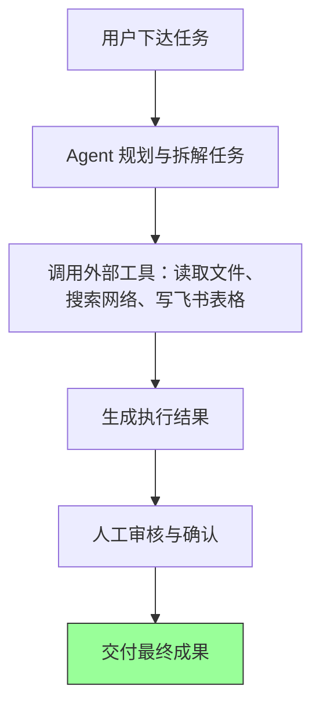

# 第25章 AI Agent 架构师：搭建自动干活的 AI 员工

> 本节教用 Codex + Hermes + 飞书 CLI 搭第一个 Agent，把每周重复 3 次以上的工作（周报、纪要、内容草稿、数据表）交给"AI 员工"自动执行，从最小可运行版到多 Agent 团队与企业 AI 服务。案例包括双 Agent YouTube 矩阵 130 万订阅、3 个 AI 员工月省 3000、写作 Agent 月产 30 篇。

## 25.1 大白话：Agent 是能"自动干活"的 AI 员工

Agent 是能"自动干活"的 AI 员工，不像普通 AI 只能一问一答。你把固定的工作流程（比如每周写周报）交给它，它按你的规则自动抓资料、写草稿、存表格，你只需要检查把关。

## 25.2 AI Agent 架构 Mermaid 图

## 25.3 关卡 0：开船第一课

### 25.3.1 本期主线

用 Hermes + Codex + 飞书 CLI 搭一个能自动干活的 AI Agent。将一项你每周重复做 3 次以上的工作，交给它去实现自动化。

### 25.3.2 别人都如何使用 Agent

**案例一**：一个人 + 两个 AI 员工 = 4 个 YouTube 频道、130 万订阅、2.25 亿播放。生财圈友 @天才老师 搭建了"煤老板（策略）+ 翠花（执行）"的双 Agent 架构，一个人做到了 4 个 AI Shorts 频道、130 万订阅、2.25 亿播放。过去一条视频要 4-5 小时，后来压到约 20 分钟；2026 年 2 月产出 41 条视频，其中 14 条百万播放、1 条千万播放。

**案例二**：不懂技术 + 3 个 AI 员工 = 每月省下 3000 元。生财圈友 @瑾糖🍀🌊 把自己业务里的重复动作拆出来，做了 3 个 AI 员工：电商商品采集 Agent、闲鱼运营 Agent、小红书内容生产 Agent。原本准备招人做的机械活，现在变成"每天花几分钟交代任务，剩下交给 AI 跑流程"。

**案例三**：10 天搭出写作 Agent，月产从 10 篇提升到 30 篇。生财圈友 @小宝｜优势人生主理人 用 Claude 搭建了一套自动化写作系统。单篇文章从 3-4 小时降到 45-60 分钟，月产从 10 篇左右提升到 30 篇左右。

### 25.3.3 航海期间需要交付什么

21 天内，你需要完成必修关卡 1-6 的所有作业，并最终完成一个可运行、可展示的 Agent。

你最终需要至少提交 3 样东西作为佐证：

| 你交什么 | 证明什么 | 是什么 |
|---------|---------|--------|
| Agent 网址链接 | 它能被公开看见 | 一个别人点开就能访问的展示网页链接 |
| 1 次成功运行截图 | 它最近真的自动干过活 | 输入前 → 运行中 → 输出后的证据 |
| 使用说明书 | 别人知道它省了什么人工、怎么用 | AI 生成的一份说明文档 |

## 25.4 关卡 1：用模板跑通第一个最小 Agent Demo

使用模板快速搭建第一个 Agent，验证整个流程能否跑通。

## 25.5 关卡 2：定岗位，完成 Agent 岗位卡

### 25.5.1 Agent 岗位卡模板

| 字段 | 说明 | 示例（周报 Agent） |
|------|------|------------------|
| 岗位名称 | Agent 的名字 | 周报 Agent |
| 一句话岗位定义 | Agent 做什么 | 自动生成本周工作周报 |
| 输入 | Agent 需要什么数据 | 本周飞书群聊记录（文本格式） |
| 处理动作 | Agent 做什么操作 | 读取本周（周一至今天）的飞书对话记录 |
| 输出 | Agent 产出什么 | 周报文档（Markdown 格式，推送到飞书指定文件夹） |
| 成功标准 | 如何判断完成 | 生成的周报包含本周主要工作内容 |
| 人工兜底 | 人工需要做什么 | 检查周报内容，确认无误后发布 |
| 本期不做 | 暂时不处理什么 | 不处理历史数据，只处理本周 |

## 25.6 对应素材

- `202608-ai-agent` > 引言、关卡 0 开船第一课（本期主线：Codex + Hermes + 飞书 CLI 搭能自动干活的 AI Agent；交付物：Agent 网址链接、1 次成功运行截图、使用说明书）
- `202608-ai-agent` > 2. 别人都如何使用 Agent（双 Agent YouTube 矩阵 130 万订阅、3 个 AI 员工月省 3000、写作 Agent 月产 30 篇案例）

## 小练习

用任一 Agent 框架（Codex/Hermes 或国内平替 WorkBuddy）搭建一个最小 Agent，让它自动生成一份本周工作周报草稿，输出内容后人工检查并保存。
