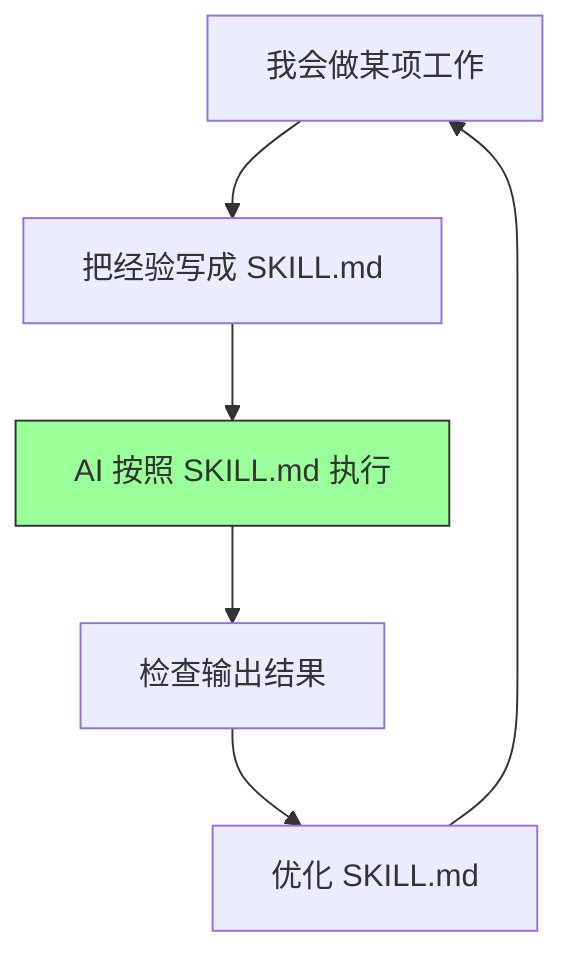

# 第26章 技能封装：把个人经验/SOP 变成 AI 可调用的 Skill

> 本节教把业务经验/SOP 提炼成可复制、可调用、可共享的 Skill 能力包（以 SKILL.md 为核心），从体验现成 Skill 到做出解决自己真实问题的 Skill，把"我会做"变成"AI 能按我的方法做"。包含任务卡制与 Skill 黑客松。

## 26.1 大白话：Skill 就像给 AI 写"操作说明书"

Skill 就像给 AI 写一份"操作说明书"，把你擅长的工作（比如写周报、选爆款标题）写成标准步骤，以后 AI 就能照着你的方法做，不需要你每次都重新教。

## 26.2 SKILL.md 核心结构

一份 SKILL.md 包含：

| 字段 | 说明 | 示例 |
|------|------|------|
| 任务目标 | 这项 Skill 要完成什么 | 写一份周报 |
| 任务描述 | 详细说明任务要求 | 基于本周聊天记录生成周报 |
| 作业交付模板 | 输出什么格式的内容 | Markdown 格式周报 |
| 输入数据 | 需要什么输入 | 飞书群聊记录 |
| 执行步骤 | 分步骤说明怎么做 | 1. 读取记录 2. 提取重点 3. 生成周报 |
| 成功标准 | 如何判断做得好 | 包含本周主要工作，逻辑清晰 |

## 26.3 从体验现成 Skill 到做出解决真实问题的 Skill

### 26.3.1 第一步：体验现成 Skill

先尝试别人做好的 Skill，理解 Skill 的结构和效果，明白"AI 能按我的方法做"是什么意思。

### 26.3.2 第二步：做出解决自己真实问题的 Skill

针对自己业务里的真实问题，做出专属 Skill。不要做通用的，要做解决你具体痛点的。

**例如**：
- 通用 Skill："写一篇文章" → 效果一般，不够精准
- 专属 Skill："根据我过去 10 篇小红书爆款的风格，写一篇关于护肤品的种草文案" → 效果好，符合你的人设

## 26.4 任务卡制与 Skill 黑客松

### 26.4.1 任务卡制

炼术营采用任务卡制推进学习进度，每个任务卡是一个具体的小目标，完成后打卡进入下一关。

### 26.4.2 Skill 黑客松

通过 Skill 黑客松的形式让大家互相分享、迭代自己做出的 Skill。看看别人怎么写 SKILL.md，学习好的写法，改进自己的 Skill。

## 26.5 技能封装 Mermaid 图



## 26.6 对应素材

- `202608-agent-skills` > Agent Skills 炼术营（技能封装、SKILL.md 核心、任务卡制）
- `202608-ai-agent` > 关卡 0 开船第一课（把重复工作流程交给 Agent 自动执行）

## 小练习

写一份 SKILL.md，把你擅长的一项具体工作（如"写周报""选爆款标题"）封装为 Skill，包含任务目标、任务描述、作业交付模板，并尝试让 AI 按该 Skill 执行一次。

**参考 SKILL.md 模板**：

```markdown
# Skill: 周报生成

## 任务目标
基于本周的工作聊天记录，生成一份结构化的周报。

## 任务描述
用户会提供一周的飞书群聊记录，你需要：
1. 读取所有聊天记录
2. 提取本周完成的主要工作事项
3. 提取遇到的问题和解决方案
4. 提取下周的计划
5. 按照下面的模板输出周报

## 作业交付模板
# 本周工作周报

## 一、本周完成工作
1. ...
2. ...

## 二、遇到的问题与解决方案
1. 问题：...
   解决方案：...

## 三、下周工作计划
1. ...
2. ...

## 输入数据
飞书群聊记录文本

## 成功标准
- 包含本周主要工作内容（至少 3 项）
- 问题和解决方案对应清晰
- 下周计划具体可执行
- 格式符合上述模板
```
