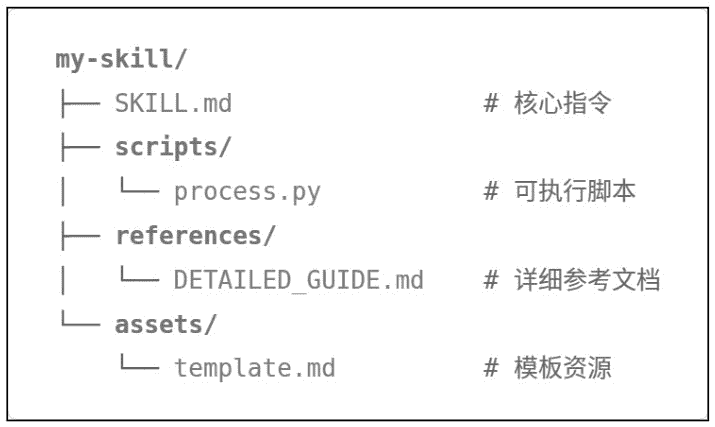
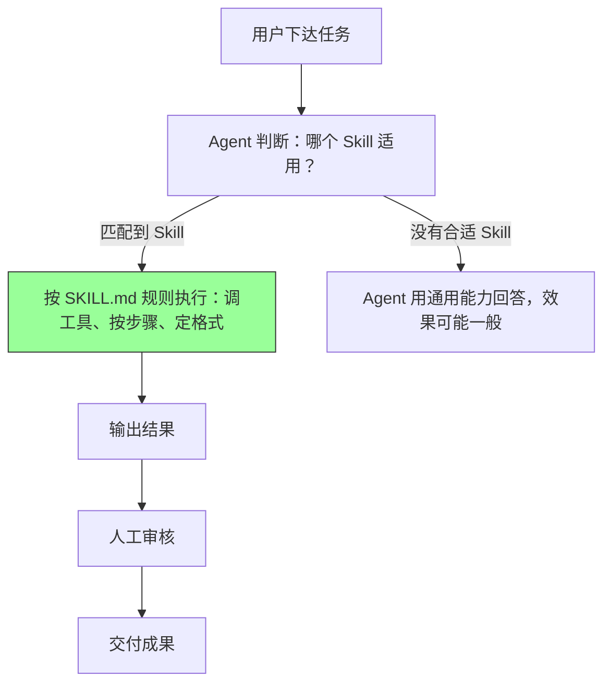
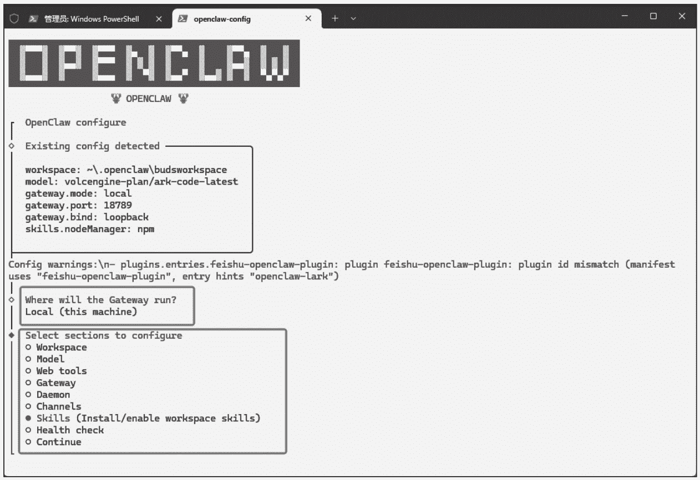
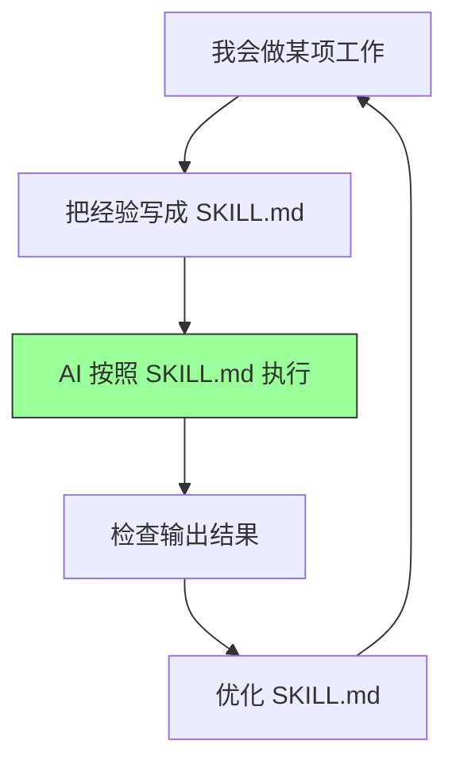

# 第26章 技能封装：把个人经验/SOP 变成 AI 可调用的 Skill

> 本节教把业务经验/SOP 提炼成可复制、可调用、可共享的 Skill 能力包（以 SKILL.md 为核心），从体验现成 Skill 到做出解决自己真实问题的 Skill，把"我会做"变成"AI 能按我的方法做"。包含任务卡制与 Skill 黑客松。

## 26.1 大白话：Skill 就像给 AI 写"操作说明书"

你学会了搭 Agent（第 25 章），Agent 现在能自己拆任务、调工具、出结果了。但这时候你可能会碰到一个新问题：Agent 干活的"通用方法"不一定是你的方法。

比如你擅长写小红书爆款标题，有自己的一套选词和排版习惯；Agent 只会按它学过的互联网大数据写，出来的标题可能贴不上你的人设。每次你都得在对话框里重新教它"标题要带情绪词、要带数字、要控制在 20 个字以内"，教完这一次，下一次又得重新教。这很浪费时间，也容易教漏。

这时候就需要 **Skill（技能）**。

> **大白话**：Skill 就像给 AI 写一份"操作说明书"，把你擅长的工作（比如写周报、选爆款标题、整理会议纪要）写成标准步骤，以后 AI 就能照着你的方法做，不需要你每次都重新教。

Skill 的核心文件叫 **SKILL.md**（注意：全大写，必须这样写，`skill.md`、`Skill.md` 都不行）。它是一个 Markdown 文件，用来描述 AI 应该如何完成某个任务：需要调用哪些工具、按照什么步骤执行、输出结果应该是什么格式。一个 Skill 通常由一个目录组成，最核心的文件就是 SKILL.md，基本结构如下图所示（素材出自《AI 时代生存手册：零基础养"龙虾"》图 4-38）：



> **图片说明**：Skill 的基本结构，一个典型的 Skill 目录以 SKILL.md 为核心，描述 AI 应该如何完成某个任务。

从形式上看，一个 Skill 并不一定包含复杂的代码，它更像是一份"操作手册"。当 OpenClaw 启动时，它会自动扫描已有的 Skill，并加载这些能力说明。当它在执行任务时，如果判断某个 Skill 可以帮助完成目标，就会按照其中的规则执行。

### 26.1.1 提示词、SOP、Skill 三者有什么区别

新手很容易把这三个概念混在一起，下表用大白话把它们摊开来说：

| 概念 | 一句话是什么 | 给谁看 | 核心作用 | 例子 |
| :--- | :--- | :--- | :--- | :--- |
| 提示词（Prompt） | 你发给 AI 的一句话指令 | 人临时输入 | 这一次把 AI 引导到正确答案 | "帮我写一份周报" |
| SOP | 你总结的工作标准流程 | 人自己看 | 保证人工操作不出错、可交接 | 周报写作 SOP 文档 |
| Skill | 把 SOP 翻译成 AI 能执行的"操作说明书" | AI 自动读取 | 让 AI 重复你的方法，而不仅仅是通用做法 | SKILL.md：读记录→提重点→写周报→推飞书 |

你可以这样理解三者的关系：提示词是你当下对 AI 说的话，SOP 是你自己总结的工作笔记，而 Skill 是把 SOP 打包成 AI 能直接调用的"能力包"。有了 Skill，你就不是在每次都重新教 AI，而是让 AI 直接"继承"你的工作方法。

### 26.1.2 Skill 在 Agent 工作流里处于什么位置

如果把 Agent 比作一个员工，那 Skill 就是这份员工的"岗位操作手册"。下图展示了 Skill 在整个 Agent 执行流程中的位置：



有了 Skill，Agent 就不再是"通晓一切但不懂你偏好的通才"，而会变成"按你的标准操作的专员"。

## 26.2 SKILL.md 核心结构

一份 SKILL.md 包含下面这些核心字段（保留原稿表格结构，逐字段展开如下）：

| 字段 | 说明 | 示例 |
| :--- | :--- | :--- |
| 任务目标 | 这项 Skill 要完成什么 | 写一份周报 |
| 任务描述 | 详细说明任务要求 | 基于本周聊天记录生成周报 |
| 作业交付模板 | 输出什么格式的内容 | Markdown 格式周报 |
| 输入数据 | 需要什么输入 | 飞书群聊记录 |
| 执行步骤 | 分步骤说明怎么做 | 1. 读取记录 2. 提取重点 3. 生成周报 |
| 成功标准 | 如何判断做得好 | 包含本周主要工作，逻辑清晰 |

### 26.2.1 逐字段填写指南

1. **任务目标**：用一句话说清这项 Skill 要干什么。比如"写一份周报""选三个小红书爆款标题""把会议录音转成待办事项清单"。目标越具体，AI 越不容易跑偏。
2. **任务描述**：把任务的背景、场景、要求都写清楚。比如"用户会提供一周的飞书群聊记录，你需要读取全部记录，提取本周完成的工作、遇到的问题、下周计划，最后按周报模板输出。"多给 AI 一些上下文，输出才更贴合你的真实需求。
3. **作业交付模板**：规定 AI 输出什么格式、什么样子的内容。比如"Markdown 格式周报，包含一、二、三三个标题"。有了模板，AI 的输出才方便你直接复制粘贴使用，不用再花时间整理格式。
4. **输入数据**：说明 AI 需要什么输入才能干活。比如"飞书群聊记录文本""上月销售 Excel 表格""待润色的文案初稿"。输入不明确，AI 就会瞎猜，猜得越多，出错概率越大。
5. **执行步骤**：把工作拆成 1、2、3…… 个动作，每个动作用动词开头。比如"1. 读取所有聊天记录 2. 提取本周完成的主要工作事项 3. 提取遇到的问题和解决方案 4. 按模板输出周报"。步骤越细，AI 越稳。
6. **成功标准**：怎么判断 AI 做得好？要具体、可检查。比如"包含本周主要工作（至少 3 项）""问题和解决方案对应清晰""下周计划具体可执行""格式符合模板"。避免写"写得好""比较全面"这种主观描述。

### 26.2.2 SKILL.md 的 YAML 前置元数据（进阶）

除了上面这几个正文字段，SKILL.md 顶部还可以加一段 **YAML Frontmatter（前置元数据）**，用来声明 Skill 的身份标识和行为边界（素材出自《Claude Code 实战：Harness 工程之道》）：

```yaml
---
name: skill-名字
  # 【唯一标识符】最多 64 个字符，若省略默认使用目录名
description: >
  一句话描述这个 Skill 干什么，什么情况下该启动它。
  # 【触发描述】最多 1024 个字符，AI 会根据这段描述判断
  # "当前任务是否需要激活此 Skill"
allowed-tools:
  - Read        # 允许调用的工具列表，只读文件
  - Grep        # 允许搜索文件内容
  - Glob        # 允许查找文件路径
---
```

> **大白话**：Frontmatter 就是 SKILL.md 的"门牌牌"和"行为守则"。`name` 是它的名字，`description` 告诉 AI 什么时候该用它，`allowed-tools` 限定它只能用哪些工具（比如只读文件，不能修改或删除），这是"最小权限原则"——给 AI 能力的同时，也给它划好不可越界的红线。

### 26.2.3 两个重要规矩

1. **文件名必须是全大写的 `SKILL.md`**。素材特别强调：`skill.md`、`Skill.md`、`SKILL.MD` 统统无效，AI 的加载器执行的是精确字符串匹配，不是模糊搜索。
2. **Skills 目录内严禁放置 `README.md`**。给人看的介绍文档应该放在父目录里；AI 激活一个 Skill 时会贪婪地读取目录下的 Markdown 文件作为上下文，如果混进 README，会干扰 AI 对指令的理解，引入不必要的噪声。

### 26.2.4 一份完整的、带注释的 SKILL.md 模板

下面是一份可以直接复制使用的模板，每一段都写了说明，你可以把"<> "里的内容替换成你自己的业务：

```markdown
---
name: weekly-report-skill
  # 唯一标识符，建议用英文字母和连字符，最多 64 个字符
description: >
  基于本周飞书群聊记录生成 Markdown 格式的周报草稿。
  当用户要求"写周报""生成本周工作总结"时启动此 Skill。
allowed-tools:
  - Read   # 只读取文件，不修改、不删除，符合最小权限原则
---

# Skill: 周报生成

## 任务目标
基于本周的工作聊天记录，生成一份结构化的周报草稿。

## 任务描述
用户会提供一周的飞书群聊记录（文本格式）。你需要：
1. 读取所有聊天记录；
2. 提取本周完成的主要工作事项；
3. 提取遇到的问题和解决方案；
4. 提取下周的工作计划；
5. 按照下面的作业交付模板输出周报。

## 作业交付模板
# 本周工作周报

## 一、本周完成工作
1. ...
2. ...

## 二、遇到的问题与解决方案
1. 问题：...
   解决方案：...

## 三、下周工作计划
1. ...
2. ...

## 输入数据
飞书群聊记录文本

## 执行步骤
1. 先通读全部输入记录，不要漏掉任何日期和人名。
2. 把零散的工作事项归并到对应的模板栏目里。
3. 只根据提供的记录作答，不要编造不存在的工作内容。
4. 输出 Markdown 格式，标题层级与上述模板保持一致。

## 成功标准
- 包含本周主要工作内容（至少 3 项）
- 问题和解决方案对应清晰
- 下周计划具体可执行
- 格式符合上述模板
- 不编造不存在的工作内容

## 人工兜底
人工检查周报内容，确认无误后发布。

## 本期不做
不处理历史数据，只处理本周；不处理涉及薪资和客户隐私的内容。
```

把这份模板保存为 `SKILL.md`，放进一个专门的文件夹（比如 `skills/周报生成/`），以后你跟 AI 说"写周报"，它就能按这份说明书办事了。

## 26.3 从体验现成 Skill 到做出解决真实问题的 Skill

### 26.3.1 第一步：体验现成 Skill

不要一开始就试图写一个完美的 Skill，先尝试别人做好的，理解 Skill 的结构和效果，明白"AI 能按我的方法做"是什么意思。

素材书介绍了两种最常见的 Skill 安装方式，新手优先掌握这两种：

**（1）通过 ClawHub 安装（OpenClaw 官方推荐）**

ClawHub 是 OpenClaw 官方推荐的 Skill 注册中心，你不仅可以在这里发现 Skill，还可以在这里上传自己的 Skill。安装步骤大致如下（素材出自《AI 时代生存手册：零基础养"龙虾"》图 4-39 至图 4-43）：

1. 在终端执行 `OpenClaw configure` 进入 OpenClaw 配置界面；
2. 系统询问"Where will the Gateway run?"时，选择 `Local(this machine)`；
3. 用键盘方向键选择 `Skills` 并回车确认，进入 Skill 选择界面（如图 4-39 所示）：
   
   > **图片说明**：在 OpenClaw 配置界面中选择"Skills"项，进入 Skill 安装界面。
4. 使用空格键选中 `clawhub` 并回车确认（如图 4-40 所示），接着选择安装方式为 `npm`（如图 4-41 所示）；
5. 安装完成后，根据需要配置其他服务的 API（可全部跳过），即可完成 ClawHub 服务安装（如图 4-42 所示）。

接下来你就可以在 ClawHub 官网顶部选择"Skills"，把他人分享的 Skill 下载到本地（如图 4-43 所示），下载完成后发送给机器人，让它帮你安装。也可以直接给机器人发指令，例如"去 ClawHub 找到'Skill Vetter'这个 Skill 并帮我安装"。

> **特别说明**：Skill Vetter 是一个"安全审核"Skill，安装这个 Skill 后，在安装其他 Skill 前，系统都可以用它来检查其他 Skill 的安全性，因此推荐优先安装。

**（2）通过腾讯公司的 SkillHub 安装**

SkillHub 是专为中文用户优化的 Skills 社区，支持高速下载，可以轻松查找 ClawHub 提供的海量 Skill。进入 SkillHub 官网后，顶部导航栏选择"官方推荐"，即可看到官方从海量 Skill 中挑选出的 50 个值得安装的"精选 Skill"；也可以选择"ClawHub 技能"，按分类选择 Skill 安装（如图 4-44、图 4-45 所示）。安装很简单，选择需要安装的 Skill 后，新手建议选择第一种安装方式，也就是直接复制提示词并发送给机器人，让机器人自行安装 Skill（如图 4-46 所示）。

无论通过 ClawHub 还是 SkillHub 安装 Skill，真正适合安装进你的"AI 员工"里的，都应是来源清晰、用途明确、风险较低的通用型 Skill。比如搜索、内容整理、信息摘要、知识管理类 Skill，用途清楚、输出容易核查，使用频率也高。反过来，来路不明、描述模糊、需要大量系统权限的 Skill，即使看起来"很强"，也不建议安装。

> **体验现成 Skill 的三件事**：安装一个现成 Skill 后，不要只看它能不能跑，还要观察（1）它的输出是否符合你的预期格式；（2）它调用了哪些工具，是否超出了你的授权范围；（3）它出错时会不会诚实地说"我不知道"，而不是编造答案。这三件事做清楚，你就真的理解 Skill 了。

### 26.3.2 第二步：做出解决自己真实问题的 Skill

体验完现成 Skill 后，下一步是针对自己业务里的真实问题，做出专属 Skill。**不要做通用的，要做解决你具体痛点的。**

下面这个对比很有启发（素材原稿）：

- 通用 Skill："写一篇文章" → 效果一般，不够精准，因为 AI 不知道你要什么风格、给谁看。
- 专属 Skill："根据我过去 10 篇小红书爆款的风格，写一篇关于护肤品的种草文案" → 效果好，符合你的人设，因为它封装了你的真实经验。

#### 四步做出一个专属 Skill

**第一步：选一个真实痛点。** 选一项你每周重复做 3 次以上、有固定步骤、结果好检查的工作。比如"把飞书群聊记录整理成周报""把产品卖点整理成小红书爆款标题""把会议录音转成待办事项清单"。

**第二步：收集自己的样例。** 把你过去做过的 3~5 份同类工作收集起来，作为"参考样例"。Skill 最宝贵的不是模板，而是你积累下来的判断标准——比如你知道什么标题会爆、什么表述会被客户投诉。

**第三步：写 SKILL.md。** 按照 26.2 的模板，把任务目标、任务描述、交付模板、输入数据、执行步骤、成功标准写完。执行步骤要写到"AI 按图索骥就能做"的程度，不要留模糊地带。

**第四步：测试并迭代。** 让 AI 按你的 SKILL.md 执行一次，对比输出和你亲手做的版本，找出差距，回头修改 SKILL.md。通常需要改 2~3 次才能稳定下来，这很正常。

#### 一个完整的专属 Skill 示例

假设你是一名运营，每周要根据产品卖点写 3 条小红书爆款标题。下面是封装后的专属 Skill（可直接保存为 `SKILL.md`）：

```markdown
---
name: xiaohongshu-title-skill
description: >
  根据产品卖点和目标人群，写出符合我个人风格的小红书爆款标题。
  当用户提供产品信息并要求"写标题"时启动此 Skill。
allowed-tools:
  - Read
---

# Skill: 小红书爆款标题生成

## 任务目标
根据用户提供的产品卖点，生成 3 条符合"我"个人风格的小红书爆款标题。

## 任务描述
用户会提供产品名称、核心卖点、目标人群。你需要参考以下我的个人风格要求：
1. 标题带情绪词（如"救命""绝绝子""好用到哭"）；
2. 标题带数字或对比（如"3 步""普通人 vs 资深人"）；
3. 控制在 20 个字以内；
4. 不要用过于夸张的医疗或减肥承诺，避免违规。

## 作业交付模板
## 小红书标题建议（共 3 条）

1. 标题一：……
   适用场景：……
2. 标题二：……
   适用场景：……
3. 标题三：……
   适用场景：……

## 输入数据
产品名称、核心卖点、目标人群（文本格式）

## 执行步骤
1. 先读取用户提供的产品信息；
2. 按照上面的 4 条风格要求，分别构思 3 条标题；
3. 每条标题后标注适用场景；
4. 输出 Markdown 格式，严格符合上述模板。

## 成功标准
- 生成恰好 3 条标题
- 每条标题含情绪词或数字
- 每条标题不超过 20 个字
- 没有出现违规承诺用语
- 格式符合交付模板

## 人工兜底
人工检查标题是否符合品牌调性，发布前最终确认。

## 本期不做
不负责写正文内容，只生成标题；不涉及医疗、减肥等敏感类目的承诺用语。
```

这个 Skill 一写好，以后你只要把产品信息丢给 AI，它就能按你的风格出标题，不需要你每次重新讲"带情绪词""控制 20 字"。

## 26.4 任务卡制与 Skill 黑客松

### 26.4.1 任务卡制

炼术营采用任务卡制推进学习进度，每个任务卡是一个具体的小目标，完成后打卡进入下一关。

一张任务卡建议包含下面这些字段：

| 字段 | 说明 |
| :--- | :--- |
| 任务名称 | 这一关要干什么 |
| 任务目标 | 完成后能达到什么效果 |
| 验收标准 | 怎么判断这关过了 |
| 预计耗时 | 建议花多少时间 |
| 所需 Skill | 需要用到哪些 Skill |

新手做 Skill 时，可以把每个 Skill 的开发拆成若干任务卡，比如：

- 任务卡 1：体验一个现成 Skill，记录它的输入输出；
- 任务卡 2：写第一个 SKILL.md，封装一个自己常做的小工作；
- 任务卡 3：让 AI 按 SKILL.md 执行一次，对比输出，修改 SKILL.md；
- 任务卡 4：把 Skill 分享给同事，让他们按你的 Skill 试一次，收集反馈并优化。

### 26.4.2 Skill 黑客松

通过 Skill 黑客松的形式让大家互相分享、迭代自己做出的 Skill。看看别人怎么写 SKILL.md，学习好的写法，改进自己的 Skill。

一次 Skill 黑客松建议按下面的流程进行：

1. **分享（每人 5 分钟）**：展示你做的 Skill，说明它解决了什么痛点，SKILL.md 长什么样。
2. **实践（每人 10 分钟）**：把别人的 Skill 安装到自己的环境里，用真实数据跑一次，看看能不能跑通。
3. **点评**：提出"好在哪里""还能改进哪里"，重点看 SKILL.md 的执行步骤是否足够细、成功标准是否可检查。
4. **迭代**：根据点评修改自己的 SKILL.md，再次测试，直到稳定输出。

Skill 黑客松的评分维度建议：

| 维度 | 说明 |
| :--- | :--- |
| 解决真实问题 | 是否解决了分享者的实际业务痛点，而不仅仅是 demo |
| 步骤清晰 | SKILL.md 的执行步骤是否足够细，AI 按图索骥就能做 |
| 成功标准可检查 | 怎么判断做得好是否具体、可验证 |
| 可复用性 | 换一个人、换一组数据，能否继续工作 |
| 安全性 | 是否只请求必要的工具权限，不越界访问敏感数据 |

## 26.5 技能封装 Mermaid 图

把"我会做某项工作"变成"AI 按 SKILL.md 执行"的完整闭环，画成下面这张图（保留原稿 Mermaid 结构）：



### 26.5.1 逐节点讲透

1. **我会做某项工作**：一切的起点是你自己的经验。不要试图封装你不会做的事，AI 也教不会你不会的东西。
2. **把经验写成 SKILL.md**：把你的 SOP 翻译成 26.2 里的字段，写成 SKILL.md，保存到 Skill 目录里。
3. **AI 按照 SKILL.md 执行**：AI 加载你的 Skill，按你定义的步骤、使用你指定的工具、输出你规定的格式来完成任务。
4. **检查输出结果**：每次执行后，人工要过一遍结果，对比你亲手做的版本，找出差距。
5. **优化 SKILL.md**：根据检查结果修改 SKILL.md（步骤太粗？加细；输出格式不对？改模板；AI 编造内容？加"不要编造"的规则）。优化后再回到第 3 步，形成持续迭代的闭环。

## 26.6 对应素材

- `202608-agent-skills` > Agent Skills 炼术营（技能封装、SKILL.md 核心、任务卡制）
- `202608-ai-agent` > 关卡 0 开船第一课（把重复工作流程交给 Agent 自动执行）

> **说明**：上述素材目录 `202608-agent-skills` 和 `202608-ai-agent` 在本仓库中暂未收录，本章相关内容实际取材于《AI 时代生存手册：零基础养"龙虾"》（Skill 基本结构、ClawHub/SkillHub 安装步骤）、《零基础玩转 OpenClaw：让"龙虾"替你 24 小时赚钱》（policy-faq SKILL.md 完整示例，含 YAML 前置元数据、规则与输出格式）、《零基础玩转 OpenClaw》（SKILL.md 编写步骤）以及《Claude Code 实战：Harness 工程之道》（SKILL.md YAML Frontmatter 字段说明、500 行以内建议、最小权限原则）。

## 小练习

写一份 SKILL.md，把你擅长的一项具体工作（如"写周报""选爆款标题"）封装为 Skill，包含任务目标、任务描述、作业交付模板，并尝试让 AI 按该 Skill 执行一次。

**参考 SKILL.md 模板**（保留原稿模板结构，逐字段展开如下）：

```markdown
# Skill: 周报生成

## 任务目标
基于本周的工作聊天记录，生成一份结构化的周报。

## 任务描述
用户会提供一周的飞书群聊记录，你需要：
1. 读取所有聊天记录
2. 提取本周完成的主要工作事项
3. 提取遇到的问题和解决方案
4. 提取下周的计划
5. 按照下面的模板输出周报

## 作业交付模板
# 本周工作周报

## 一、本周完成工作
1. ...
2. ...

## 二、遇到的问题与解决方案
1. 问题：...
   解决方案：...

## 三、下周工作计划
1. ...
2. ...

## 输入数据
飞书群聊记录文本

## 成功标准
- 包含本周主要工作内容（至少 3 项）
- 问题和解决方案对应清晰
- 下周计划具体可执行
- 格式符合上述模板
```

**建议交付物**：
1. 一份你自己写的 SKILL.md 文件；
2. 一次让 AI 按该 Skill 执行的输入输出对比截图；
3. 一句话复盘：这次封装后，AI 的输出跟你亲手做的版本有什么不同，下一步还要改哪里。

## 本章小结

通过本章，你应该已经了解：

1. **Skill 是什么**：给 AI 写的"操作说明书"，核心文件是 SKILL.md，把你擅长的工作写成标准步骤，以后 AI 就能按你的方法做，不需要每次重新教。
2. **Skill 在 Agent 里的位置**：Agent 收到任务后，先判断哪个 Skill 适用，匹配到就按 SKILL.md 规则执行（调工具、按步骤、定格式），没有合适 Skill 就只能用通用能力回答，效果可能一般。
3. **SKILL.md 的核心字段**：任务目标、任务描述、作业交付模板、输入数据、执行步骤、成功标准，六个字段缺一不可，步骤越细、标准越具体，AI 越稳。
4. **两个重要规矩**：文件名必须全大写 `SKILL.md`；Skills 目录内严禁放置 `README.md`，避免干扰 AI 对指令的理解。
5. **YAML 前置元数据（进阶）**：`name`、`description`、`allowed-tools` 分别声明 Skill 名字、触发描述和允许调用的工具，体现最小权限原则。
6. **从体验到创造**：先安装 ClawHub/SkillHub 上的现成 Skill，观察它的输入输出和工具调用；再针对自己真实痛点，按四步法（选痛点、收样例、写 SKILL.md、测试迭代）做出专属 Skill。专属 Skill 比通用 Skill 效果好，因为它封装了你的真实经验。
7. **任务卡制与 Skill 黑客松**：用任务卡把 Skill 开发拆成可打卡的小目标；通过黑客松互相分享、实践、点评、迭代，看看别人怎么写 SKILL.md，改进自己的 Skill。
8. **技能封装闭环**：我会做某项工作 → 把经验写成 SKILL.md → AI 按照 SKILL.md 执行 → 检查输出结果 → 优化 SKILL.md → 回到执行，持续迭代。

下一章，我们将把 Agent 和 Skill 结合起来，搭建一支能按你的标准自动干活的"AI 团队"。
