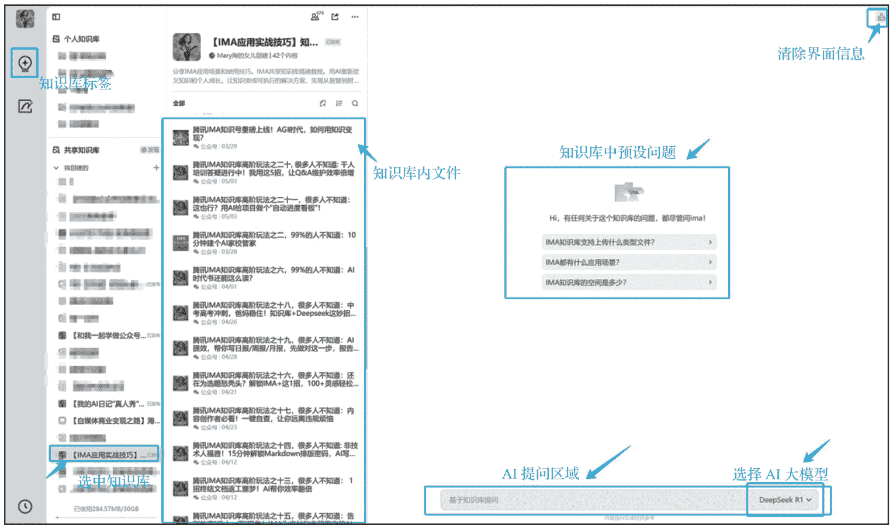
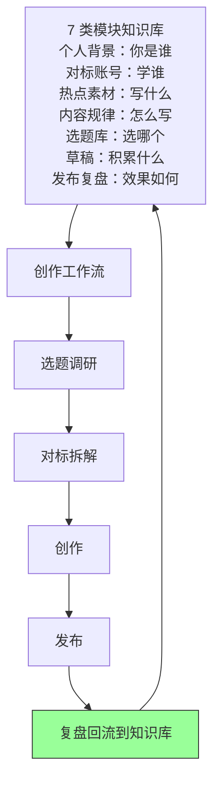
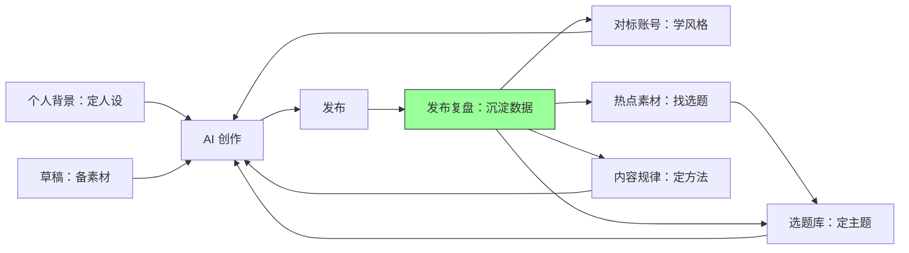
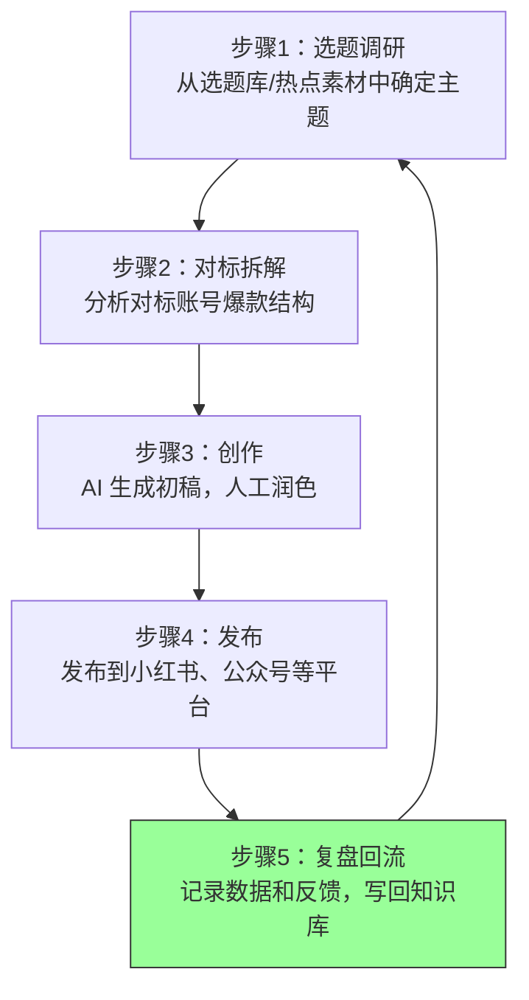
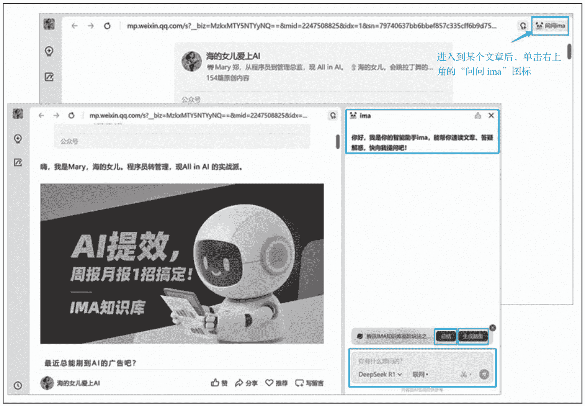

# 第27章 AI 第二大脑：内容创作系统与知识库搭建

> 本章教你用 Obsidian + Codex 搭建“AI 可读、可复用、能持续迭代”的内容创作系统：7 类模块知识库（个人背景、对标账号、热点素材、内容规律、选题库、草稿、发布复盘）+ 创作工作流（选题调研 → 对标拆解 → 创作 → 发布 → 复盘回流），解决每次创作从零开始的问题。同时介绍 AI 知识库在公众号智能客服、团队培训、行程规划等场景的应用。

在正式开始之前，先说两句“废话”宽宽心：本章不需要你有任何编程基础，不需要你懂什么向量数据库、RAG 或检索增强生成，甚至不需要你以前用过 Obsidian。你只需要会在电脑上新建文件夹、会复制粘贴文字，就足够读完并动手做完本章的全部内容了。我们会把每一个“听起来很吓人”的名词，都用大白话掰开揉碎讲清楚。

---

## 32.1 大白话：每次写东西都从零开始太累了

你有没有过这样的经历：今天要写一篇公众号文章，明天要发一条小红书笔记，后天要准备一次内部培训的课件。每次面对空白文档，你都要从零开始——找选题、找素材、找结构、找灵感，好不容易写完一篇，下次又得重新来过，之前积累的那些好文章、好素材、好对标全都散落在聊天记录、浏览器收藏夹和各种文件夹里，翻起来费劲，用起来更费劲。

建立“第二大脑”，就是把你过去写过的文章、找过的对标、积累的选题、收集过的所有热点素材，都整理整齐地放进同一个“库”里，让 AI 能读取这些素材，直接帮你生成新内容，不再是“白纸写字”。

> **大白话**：什么是“第二大脑”？你可以把它理解为你电脑里的一个“超级记事本”，只不过这个记事本不光能存东西，还能“读懂”里面的内容，能帮你找关联、能帮你总结、甚至能基于你过去积累的素材，写出新文章。它不取代你的大脑，只是把你的大脑“外置”了一份备份，随时可调用。

这就好比做饭：如果你每次做菜都要从零开始去菜市场买菜、洗菜、切菜，做一顿饭得花大半天；但如果你有一个整理得井井有条的“智能冰箱”，里面已经洗好切好分门别类放着各种食材，下次做菜只需要从冰箱里拿出几样，稍微炒一下就能上桌。AI 知识库就是你的“智能冰箱”，创作素材就是“食材”，而 AI 就是那个帮你洗切配菜的助手。

为什么现在特别需要这个“第二大脑”？因为我们正处在信息爆炸的时代，每天刷到的文章、看到的视频、读过的报告多得数不过来。如果没有一个地方把有价值的信息沉淀下来，这些信息就像流过的水，一转身就忘了。AI 知识库的核心理念非常简单：它是一个能够更好地收集、整理、理解和智能运营信息的“伙伴”或“管家”。它能理解你存进去的文字、图片、网页；能发现信息之间的关联，把零散的点串成线、织成网；你还可以用普通话跟它对话，让它查找、总结，甚至基于资料进行简单的推理和创作。



> **图片说明**：腾讯 ima 知识库的 AI 问答界面（图源：《AI 知识库：个人与企业的智慧玩法》）。左侧是知识库标签和内部文件列表，右侧是 AI 提问区域，下方可以选择 AI 大模型（如 DeepSeek R1）。这展示了一个 AI 知识库长什么样：你存进去的文件都在左边，右边用普通话跟 AI 对话，AI 基于库里的内容回答问题。

举个身边的例子：支付宝的智能客服能对答如流，正是依靠 AI 在庞大的“服务问答知识库”中快速检索、理解并生成答案。你每天可能都在不知不觉中与各种形态的“AI 知识库”互动。而由你自己构建、用于提升学习和工作效率的 AI 知识库，自然也就不是什么“高科技玩具”了，更像一个人人都可以轻松掌握和使用的强大效率工具。

当然，也有几个常见的误解需要提前拍散：

1. **“太难了，不是技术专家肯定用不了”**。现代 AI 知识库工具，尤其是面向普通用户的，操作已极其简单友好，设计理念就是“人人可用”。用户无须懂编程或复杂算法，只要会用计算机或智能手机，基本就能上手。
2. **“不就是个数据库，冷冰冰的”**。如果只把 AI 知识库当成高级“网盘”或“文件柜”，就太小看它了。它不仅能存储信息，还能动态学习你的习惯与偏好，智能关联信息，发现隐藏联系，激发新洞察和创意。你卡壳时，还能跟它交流获得启发。
3. **“东西不多，用不着这么高级的工具”**。无论信息量大小，AI 知识库都能提供独特的价值。信息少时，重在“精耕细作”，让信息井井有条，需要时更容易找到；信息多时，重在“化繁为简”，从汪洋大海中快速定位所需信息，避免知识变成“死海”。

所以，建立“第二大脑”的最终目的，不是为了把资料堆得越多越好，而是为了让信息“活”起来——让过去写过的每一篇文章、每一个选题、每一个对标账号，都能在下次创作时被 AI 快速调用，成为新内容的养分。这样，创作就从“苦苦寻找”变成了“轻松调用”，甚至变成了“素材找上门”。

---

## 32.2 AI 第二大脑内容创作系统 Mermaid 图

把“第二大脑”如何服务内容创作的整体逻辑画成一张图，你就能一眼看出：7 类模块知识库是地基，创作工作流是房子，而复盘回流则让整个系统能够不断自我进化：



这张图里最重要的一环，是最后的“复盘回流”。很多新手建立知识库后，只顾着往里面丢资料，却忘了把发布后的数据、读者反馈写回来。如果复盘不回流，知识库就成了一个“信息坟墓”，越积越多却越来越难用；只有把发布后的真实数据（阅读量、点赞、评论、转化）和读者反馈写回知识库，下次写类似内容时，AI 才能基于这些真实数据给出更好的建议，整个系统才能“越用越聪明”。

你可以把整个系统想象成一个不断循环的生态：知识库喂给 AI 素材，AI 帮你创作，创作发布后产生数据，数据再回流到知识库，下一轮创作在更高的基础上开始。这就是“AI 可读、可复用、能持续迭代”的含义。

---

## 32.3 7 类模块知识库

第二大脑的核心是 7 类模块知识库。每一类存什么、有什么作用，下面逐个讲解，并且每类都给出一个可以直接照着建的目录结构示例。你完全可以按照下面的结构，在 Obsidian（或者任何笔记软件，甚至本地文件夹）里一一创建出来。

| 模块 | 存什么内容 | 作用 |
|------|-----------|------|
| 个人背景 | 你的专长、经历、风格偏好 | 让 AI 了解你是谁，生成内容更符合你的人设 |
| 对标账号 | 优秀账号列表、爆款文章、风格特点 | 让 AI 学习对标风格，生成更符合平台调性的内容 |
| 热点素材 | 行业热点、节日节点、趋势话题 | 选题时直接调用，不必每次从零找热点 |
| 内容规律 | 爆款标题公式、开头结构、排版习惯 | 让 AI 按照经过验证的规律写作 |
| 选题库 | 已构思的选题、优先级、预计发布时间 | 选题不再发愁，直接从库里选 |
| 草稿 | 曾经写过的文章、片段、灵感 | 下次创作时直接复用，不必从零开始 |
| 发布复盘 | 发布后的数据、读者反馈、改进点 | 不断总结规律，优化后续内容 |

下面我们逐个模块展开，讲清楚每类该放什么，以及具体的目录结构怎么设计。

**模块 1：个人背景（你是谁）**

这个模块存放关于“你自己”的信息，目的是让 AI 了解你的身份、专长和风格，生成出来的内容才会更像“你写的”，而不是一篇没有人格的机器文案。

建议存放的内容：
- 你的专长领域（比如 AI 工具测评、职场效率、母婴育儿等）
- 你的过往经历和成就（可以作为写作中的信任背书）
- 你的写作风格偏好（喜欢幽默风趣，还是严肃专业？喜欢长句还是短句？）
- 你常用的“人设设定”（比如“资深产品经理”“养娃宝妈”“独立开发者”）

目录结构示例：

```
01-个人背景/
├── 专长与经历.md
├── 写作风格偏好.md
└── 人设设定.md
```

**模块 2：对标账号（学谁）**

内容创作不需要凭空发明，找几个在同领域做得好的账号作为对标，分析他们的爆款结构和写作技巧，是提升内容质量最快捷的方式。这个模块存放你关注的对标账号列表，以及对他们的拆解笔记。

建议存放的内容：
- 对标账号清单（平台、账号名、粉丝量级、主要内容方向）
- 对标账号的爆款文章（全文或关键片段）
- 风格特点分析（标题怎么写、开头怎么切入、结尾怎么收尾、排版习惯如何）

目录结构示例：

```
02-对标账号/
├── 账号清单.md
├── 风格分析/
│   └── 账号A-标题与开头风格.md
└── 爆款拆解/
    ├── 文章1-结构拆解.md
    └── 文章2-爆款原因分析.md
```

> **大白话**：对标拆解不是“抄袭”，而是“学习”。就像学画画的人先要临摹名家的画作，了解构图和用色，内容创作者也要先拆解爆款，了解结构和节奏，之后才能发展出自己的风格。

**模块 3：热点素材（写什么）**

选题是创作的第一步，也是最难的一步。很多创作者卡壳，是因为不知道“写什么好”。热点素材模块就是为了解决这个问题：把行业热点、节日节点、趋势话题都收集起来，选题时直接从库里调用，不必每次从零开始找热点。

建议存放的内容：
- 行业热点事件（你所在领域近期发生的重大新闻、政策变化、产品发布）
- 节日节点（情人节、618、双11、开学季等与内容相关的时间节点）
- 趋势话题（社交媒体上近期高频讨论的关键词、梗、观点）

目录结构示例：

```
03-热点素材/
├── 行业热点/
│   └── 2025年11月-AI工具更新汇总.md
├── 节日节点/
│   └── 双12-内容创作选题建议.md
└── 趋势话题/
    └── 近期高频关键词记录.md
```

**模块 4：内容规律（怎么写）**

平台不同，内容规律也不同。小红书喜欢短句加表情符号，公众号适合深度长文，抖音讲究前3秒留住观众。把你总结出的爆款标题公式、开头结构、排版习惯都整理在这里，让 AI 按照经过验证的规律来写作。

建议存放的内容：
- 爆款标题公式（比如“数字+利益点+痛点”的标题模板）
- 开头结构（如何在前100字抓住读者注意力）
- 排版习惯（段落长度、小标题使用、表情符号位置）
- 不同平台的内容差异对比表

目录结构示例：

```
04-内容规律/
├── 爆款标题公式.md
├── 开头结构/
│   └── 公众号开篇3种范式.md
├── 排版习惯.md
└── 平台差异对比/
    └── 小红书vs公众号写作差异.md
```

**模块 5：选题库（选哪个）**

有了热点素材和内容规律，接下来就要把“想写的主题”变成“可执行的选题”。选题库存放已构思的选题、优先级、预计发布时间，选题时直接从库里挑，不必每次面对空白发呆。

建议存放的内容：
- 已构思的选题列表（选题名称、相关关键词、目标平台）
- 选题优先级（高/中/低，以及理由）
- 预计发布时间（哪周、哪天发布）
- 选题来源（来自热点素材、来自读者评论、来自对标拆解）

目录结构示例：

```
05-选题库/
├── 待选题.md
├── 已选题.md
└── 发布计划/
    └── 2025年12月发布排期.md
```

**模块 6：草稿（积累什么）**

草稿模块存放你曾经写过的文章、片段、灵感，以及还没写完的初稿。下次创作时，可以直接从这里复用素材，不必从零开始。哪怕只是一个零散的想法，也值得存下来，因为它可能在某个未来的选题里派上用场。

建议存放的内容：
- 已发布的文章（全文，方便以后引用或二次创作）
- 写作片段（好句子、好开头、好结尾）
- 灵感记录（突然想到的点子、观察到的细节）
- 初稿模板（常用文章结构的骨架）

目录结构示例：

```
06-草稿/
├── 已发布文章/
│   ├── 2025年/
│   └── 2024年/
├── 片段灵感/
│   └── 好开头集锦.md
└── 初稿模板/
    └── 公众号通用结构.md
```

**模块 7：发布复盘（效果如何）**

发布不是结束，而是新循环的开始。发布复盘模块记录发布后的数据（阅读量、点赞、评论、转发、转化）和读者反馈，写回知识库，供下次创作参考。只有不断复盘，才能总结出“什么样的选题更容易爆”“什么样的标题点击率更高”这样的规律。

建议存放的内容：
- 发布数据记录（每篇内容的平台、发布时间、各项指标）
- 读者反馈（评论区高频问题、读者私信、建议）
- 改进点（本次做得好的、下次要避开的、要尝试的新方向）

目录结构示例：

```
07-发布复盘/
├── 数据记录/
│   └── 11月文章数据表.md
├── 读者反馈/
│   └── 高频评论整理.md
└── 改进点/
    └── 下月优化计划.md
```

7 个模块的关系可以用一张图来帮你理清：个人背景决定 AI 以什么人设写作，对标账号提供风格参考，热点素材提供选题来源，内容规律提供写作方法论，选题库决定“下次写什么”，草稿提供可复用素材，发布复盘则把真实数据沉淀回来，反哺前面 6 个模块，形成闭环。



---

## 32.4 创作工作流

有了 7 类模块知识库，还需要一套能跑通的创作工作流，把知识库里的素材变成真正发布出去的内容。本章的创作工作流包含五个步骤：选题调研 → 对标拆解 → 创作 → 发布 → 复盘回流。

### 32.4.1 五个步骤

下面是每个步骤的具体做法，以及 AI 在其中的作用。

**步骤 1：选题调研**

从选题库或热点素材中确定本次创作主题。如果选题库里有现成的选题，直接挑一个优先级高的；如果没有，去热点素材模块翻看近期的行业热点和节日节点，结合个人背景模块里的专长方向，确定一个既有热度又适合你写的主题。

AI 可以在这里帮你：把热点素材模块里的几个热点丢给 AI，让它基于你的个人背景（专长、风格），提出 5~10 个具体的选题建议，并给出每个选题的预计受众和发布平台建议。你从中挑选最感兴趣的一个，记录到选题库里。

**步骤 2：对标拆解**

选题确定后，找对标账号模块里相关的账号，分析他们在同主题上的爆款结构和写作技巧。看对方的标题怎么写、开头怎么切入、正文怎么分段、结尾怎么引导互动、排版用了什么样的小标题和表情符号。

AI 可以在这里帮你：把对标账号的几篇爆款文章全文贴给 AI，让它拆解文章结构，提炼出可复用的写作模板（比如“痛点开头→案例支撑→方法论→行动建议→互动结尾”）。把这个模板记录下来，作为本次创作的骨架。

**步骤 3：创作**

基于知识库素材，用 AI 生成初稿，再由人工润色。具体操作：把选题、对标拆解出的结构模板、热点素材模块里的相关数据、个人背景模块里的风格偏好，一起作为提示词发给 AI，让它生成初稿。初稿出来后，你需要人工润色——检查事实准确性、调整语气、加入个人观点，确保内容有“人味”。

AI 可以在这里帮你：生成文章大纲、展开各个段落、根据选定平台（小红书/公众号）调整语言风格、甚至直接给出配图建议和排版提示。

**步骤 4：发布**

把润色后的内容发布到小红书、公众号等平台。发布时要注意平台差异：小红书配图和标签很重要，公众号注重摘要和封面，抖音视频前3秒决定完播率。发布完成后，记录发布时间和平台，为后续复盘做准备。

**步骤 5：复盘回流**

发布后，记录阅读量、点赞、评论、转发等数据，整理读者反馈，写回知识库的发布复盘模块。下次写类似内容时，AI 就能基于这些真实数据给出更好的建议。比如你发现“带数字的标题点击率更高”“晚上8点发布互动更多”，这些规律就应该沉淀到内容规律模块和选题库里，指导下一轮创作。

五个步骤的关系可以用一张图来展示，也是一个不断循环的过程：



### 32.4.2 复盘回流的关键

复盘不是结束，而是新循环的开始。把发布后的数据（阅读量、点赞、评论）和读者反馈写回知识库，下次写类似内容时，AI 就能基于这些真实数据给出更好的建议。

复盘回流的具体做法可以很简单：

1. 发布后第1天、第3天、第7天，分别记录一次数据；
2. 把评论区读者问得最多的问题，整理成“读者反馈”文档；
3. 把本次做得好的地方和需要改进的地方，写成“改进点”文档；
4. 把验证过的标题公式、开头结构，沉淀到内容规律模块。

> **大白话**：复盘就像“赛后复盘录像”。运动员比赛结束后会看回放，找出哪里做得好、哪里失误了，下次比赛才能避免重复错误。内容创作也一样，不复盘就相当于每次都盲目出发，复盘了才能越写越准。

**进阶补充：用几行代码让 AI 读取你的知识库（可选，不编程可直接跳过）**

前面讲的创作工作流，用 Obsidian + AI 对话框手动复制粘贴就能完成。但如果你好奇“程序是怎么自动读取知识库、再喂给 AI 的”，下面是一段完整可运行的 Python 示例代码。它的作用是：扫描你的知识库文件夹，把所有 Markdown 文件的内容读出来，拼成一段“上下文”，再发给 AI，让 AI 基于你的知识库回答问题。运行前需要在电脑上装好 Python，并在命令行执行 `pip install openai` 安装依赖库。

```python
# ===== 程序作用：读取本地知识库文件夹，把内容喂给 AI，让它基于你的素材回答问题 =====

# 第 1 步：导入需要的库
import os                      # os 库用来遍历文件夹、读取文件路径
from openai import OpenAI      # OpenAI 官方库（DeepSeek 接口与 OpenAI 格式兼容，直接用这个库）

# 第 2 步：创建 AI 客户端连接
#   - api_key：填你在平台创建的密钥（相当于取餐暗号，注意保密，不要发给别人）
#   - base_url：告诉程序去哪找 DeepSeek 的服务器
client = OpenAI(
    api_key="sk-在这里填入你自己的API密钥",
    base_url="https://api.deepseek.com"
)

# 第 3 步：定义一个函数，扫描知识库文件夹，把所有 .md 文件的内容拼在一起
def 读取知识库(知识库路径):
    所有内容 = []  # 用一个列表存放每个文件的内容
    # os.walk 会一层一层走进文件夹，把所有子文件夹里的文件都找出来
    for 当前目录, 子文件夹列表, 文件列表 in os.walk(知识库路径):
        for 文件名 in 文件列表:
            # 只处理 Markdown 文件（.md 结尾），其他文件跳过
            if 文件名.endswith(".md"):
                文件完整路径 = os.path.join(当前目录, 文件名)
                # 打开文件并读取全部文字（utf-8 是通用的文字编码，能正常显示中文）
                with open(文件完整路径, "r", encoding="utf-8") as 文件:
                    所有内容.append(f"【文件：{文件名}】\n{文件.read()}")
    # 把所有文件的内容用分隔线拼成一个大字符串
    return "\n\n---\n\n".join(所有内容)

# 第 4 步：读取知识库（把路径改成你自己的知识库文件夹位置）
知识库内容 = 读取知识库("./我的知识库")   # 把这里改成你自己的知识库文件夹位置

# 第 5 步：把“知识库内容 + 你的问题”一起发给 AI
response = client.chat.completions.create(
    model="deepseek-chat",
    messages=[
        # system：告诉 AI 它的角色，以及“只根据知识库内容回答”
        {"role": "system", "content": "你是我的创作助手。请只根据我提供的知识库素材回答问题，如果素材里没有相关信息，请直说。"},
        # user：先附上知识库内容，再附上我的问题
        {"role": "user", "content": f"以下是我的知识库素材：\n{知识库内容}\n\n我的问题是：基于这些素材，帮我提出 5 个新选题"}
    ]
)

# 第 6 步：打印 AI 的回答
print(response.choices[0].message.content)
```

运行后，AI 就会基于你知识库里的真实素材来提选题，而不是凭空发挥。这个“读取文件 → 拼上下文 → 发给 AI”的动作，就是所有 AI 知识库产品（包括第 28 章内容工厂）最核心的底层逻辑，专业术语叫“检索增强生成”，你只需要记住大白话版本：**先翻资料，再回答**。

除了内容创作，AI 知识库还能用在很多别的场景里。最常见的有三个：

**公众号智能客服**。你把公众号过去发过的所有文章存进 AI 知识库，读者在公众号里提问，AI 基于知识库里的文章直接回答，还标明出处。这就相当于给公众号装了一个“24 小时在线的智能客服”，不需要你每条消息都亲自回复。

**团队培训**。把公司的入职手册、业务流程、常见问题都存进知识库，新员工培训时可以直接问 AI：“报销流程怎么走？”“这个产品的卖点是什么？”AI 基于团队自己的资料回答，答案比通用 AI 更准确、更符合公司实际。

**行程规划**。把你收集的旅行攻略、酒店信息、景点门票等都存进知识库，出行前问 AI：“帮我规划一个三天两夜的杭州行程，重点玩自然风景，预算 3000 元左右。”AI 会基于你存进去的资料，给出一份个性化的行程建议。

这些场景的共同点在于：AI 不再是凭空胡说八道，而是基于你自己积累的资料回答问题，这也是“第二大脑”最大的价值——让 AI 真正“懂你”，懂你的业务、懂你的风格、懂你的受众。



> **图片说明**：在微信公众号文章页面点击右上角“问问 ima”图标，AI 侧边栏弹出并基于当前文章内容回答问题，模型选择为 DeepSeek R1（图源：《AI 知识库：个人与企业的智慧玩法》）。这展示了 AI 知识库在公众号场景下的应用：读者读文章时随时可以向 AI 提问，获得基于文章内容的解答。

---

## 32.6 对应素材

- `202506-aizhishiku` > AI 知识库（Obsidian + Codex 内容创作系统）
- `202509-xhszhishiku` > AI 知识库（如存在）
- `202512-neironggongchang` > 开船第一课（内容工厂 Agent 三个核心模块：选题中心、创作中心、发布模块）

---

## 小练习

在 Obsidian 中建立一个包含 7 个模块的个人知识库框架，向其中导入 3 篇你曾写过的文章作为“草稿”模块素材，尝试用 AI 基于现有素材生成一个新选题。

**操作建议**：
1. 在 Obsidian 中新建一个知识库，按本章 32.3 节的目录结构，创建 7 个模块文件夹；
2. 找出你电脑或手机里曾经写过的 3 篇文章（哪怕是朋友圈长文、群聊总结都可以），复制到“06-草稿/已发布文章”文件夹中；
3. 在 AI 对话框里，把这 3 篇文章的标题和摘要发给 AI，结合你的个人背景（专长、风格），请它基于这些素材提 5 个新选题，并给出每个选题的适合发布平台；
4. 从中选中一个选题，记录到“05-选题库/待选题.md”中，作为下次创作的起点。

---

## 本章小结

通过本章，你应该已经了解：

1. **为什么需要“第二大脑”**：每次创作从零开始太累，把过去的文章、对标、选题、热点素材整理到一个知识库里，让 AI 能读取这些素材，创作就不再是“白纸写字”。
2. **7 类模块知识库**：个人背景（定人设）、对标账号（学风格）、热点素材（找选题）、内容规律（定方法）、选题库（定主题）、草稿（备素材）、发布复盘（沉淀数据）。每类模块都有对应的目录结构示例，可以直接照着建。
3. **创作工作流五步走**：选题调研 → 对标拆解 → 创作 → 发布 → 复盘回流。其中复盘回流是关键，把发布数据和读者反馈写回知识库，系统才能“越用越聪明”。
4. **AI 知识库的场景应用**：除了内容创作，还可以用于公众号智能客服、团队培训、行程规划等场景，让 AI 基于你的私有知识库给出更精准的回答。
5. **AI 是辅助，不是替代**：建立知识库和创作工作流的最终目的，是提高你的创作效率，但选题的方向、内容的质量把关、最终的发布决策，仍然需要你的人工判断。AI 是锦上添花，不是雪中送炭。

下一章，我们将进入第七部分的最后一章——内容工厂 Agent：选题、创作、分发全链路自动化，教你用 Claude Code/Codex + Next.js + SQLite 把上述创作工作流进一步自动化，真正实现“输入关键词，输出已发布内容”的内容流水线。
