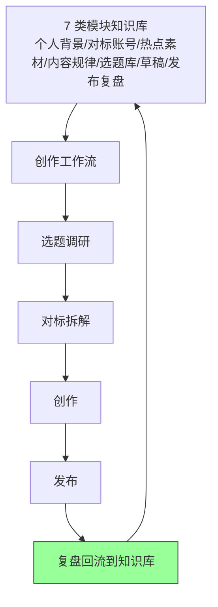

# 第27章 AI 第二大脑：内容创作系统与知识库搭建

> 本节教用 Obsidian + Codex 搭"AI 可读、可复用、能持续迭代"的内容创作系统：7 类模块知识库（个人背景、对标账号、热点素材、内容规律、选题库、草稿、发布复盘）+ 创作工作流（选题调研 → 对标拆解 → 创作 → 发布 → 复盘回流），解决每次创作从零开始的问题。同时介绍 AI 知识库在公众号智能客服、团队培训、行程规划等场景的应用。

## 27.1 大白话：每次写东西都从零开始太累了

建立"第二大脑"就是把你过去写过的文章、找过的对标、积累的选题都整理好，下次创作时 AI 能读取这些素材，直接帮你生成新内容，不再是"白纸写字"。

## 27.2 AI 第二大脑内容创作系统 Mermaid 图

## 27.3 7 类模块知识库

| 模块 | 存什么内容 | 作用 |
|------|-----------|------|
| 个人背景 | 你的专长、经历、风格偏好 | 让 AI 了解你是谁，生成内容更符合你的人设 |
| 对标账号 | 优秀账号列表、爆款文章、风格特点 | 让 AI 学习对标风格，生成更符合平台调性的内容 |
| 热点素材 | 行业热点、节日节点、趋势话题 | 选题时直接调用，不必每次从零找热点 |
| 内容规律 | 爆款标题公式、开头结构、排版习惯 | 让 AI 按照经过验证的规律写作 |
| 选题库 | 已构思的选题、优先级、预计发布时间 | 选题不再发愁，直接从库里选 |
| 草稿 | 曾经写过的文章、片段、灵感 | 下次创作时直接复用，不必从零开始 |
| 发布复盘 | 发布后的数据、读者反馈、改进点 | 不断总结规律，优化后续内容 |

## 27.4 创作工作流

### 27.4.1 五个步骤

1. **选题调研**：从选题库或热点素材中确定本次创作主题
2. **对标拆解**：找相关对标账号，分析其爆款结构和写作技巧
3. **创作**：基于知识库素材，用 AI 生成初稿，人工润色
4. **发布**：发布到小红书、公众号等平台
5. **复盘回流**：记录发布数据和反馈，写回知识库，供下次创作参考

### 27.4.2 复盘回流的关键

复盘不是结束，而是新循环的开始。把发布后的数据（阅读量、点赞、评论）和读者反馈写回知识库，下次写类似内容时，AI 就能基于这些真实数据给出更好的建议。

## 27.6 对应素材

- `202506-aizhishiku` > AI 知识库（Obsidian + Codex 内容创作系统）
- `202509-xhszhishiku` > AI 知识库（如存在）
- `202512-neironggongchang` > 开船第一课（内容工厂 Agent 三个核心模块：选题中心、创作中心、发布模块）

## 小练习

在 Obsidian 中建立一个包含 7 个模块的个人知识库框架，向其中导入 3 篇你曾写过的文章作为"草稿"模块素材，尝试用 AI 基于现有素材生成一个新选题。
