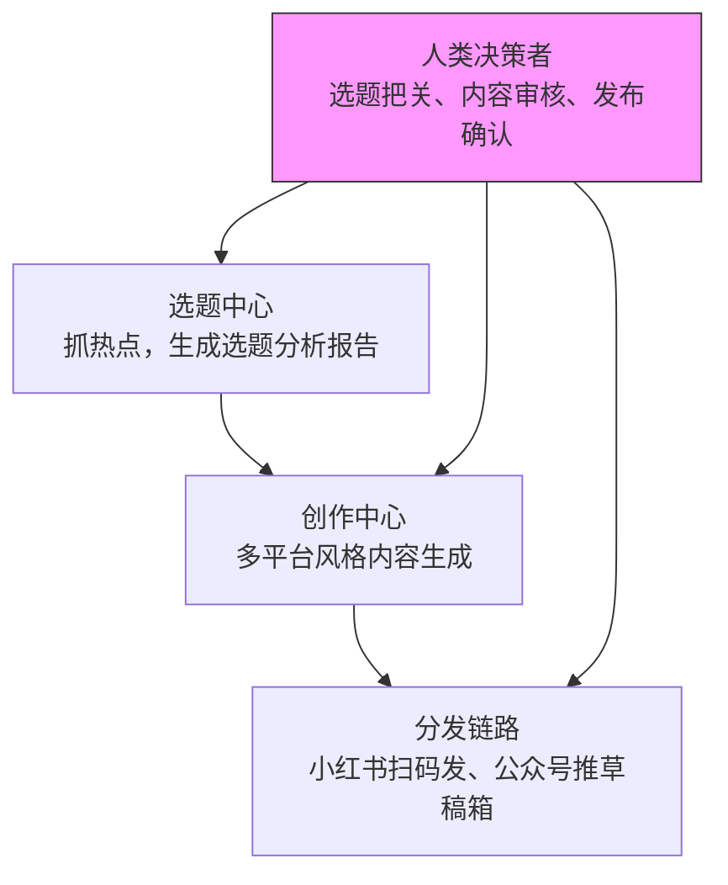
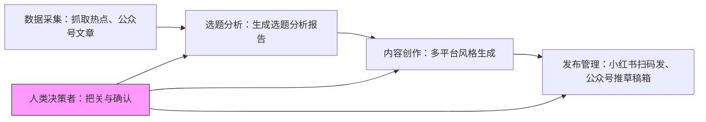

# 第28章 内容工厂 Agent：选题、创作、分发全链路自动化

> 本章教零基础读者用 Claude Code/Codex + Next.js + SQLite 开发“内容工厂”Agent，含选题中心（抓热点出分析报告）、创作中心（多平台风格生成）、分发链路（📕扫码发、👸号推草稿箱）。人负责决策，AI 写代码，每章配提示词与视频教程，群里提供完整源代码。

在正式开始之前，先说两句“废话”宽宽心：本章不需要你会写代码，不需要你了解前端、后端、数据库什么的，甚至不需要你以前碰过 Next.js 或 SQLite。你只需要会在电脑上安装软件、会在浏览器里打开网页，就足够读完并动手尝试本章的内容了。我们会把每一个“听起来很吓人”的名词，都用大白话掰开揉碎讲清楚。

---

## 28.1 大白话：内容工厂就是“自动化内容流水线”

你有没有觉得，做自媒体太累了？每天要想选题、要找素材、要写文案、要改排版、要发布到📕、👸号、抖音……一个平台发一遍，三个平台就得发三遍，内容做完了一整天也过去了，还没时间跟家人吃饭。

如果说第二大脑（第 27 章讲的知识库）是“智能冰箱”，把食材洗好切好放在那里，那“内容工厂”就是“自动化流水线”：原材料进去一端，经过选题、写作、分发几个工位，成品内容从另一端直接出炉。你不需要亲自搬每一件原料，也不需要亲自拧每一个螺丝，你只需要站在流水线尽头，负责“拍板”决策——这个选题行不行、这篇文章能不能发、这个时间点发不合适，其他的重复劳动都交给 AI 和程序去完成。

> **大白话**：什么是“内容工厂 Agent”？你可以把它理解为一个“AI 员工团队”。其中一个员工负责抓热点（选题中心），一个员工负责写文案（创作中心），一个员工负责发布（分发链路），而你就是这个工厂的厂长，只管点头说“这个发、那个不发”。AI 不会替你做最终决定，但可以帮你把 90% 的体力活都干完。

内容工厂特别适合想做自媒体矩阵、批量产出内容的读者。比如你想同时经营📕、👸号、抖音三个平台，每天各发 1～2 篇，传统做法可能需要好几个人，而有了内容工厂，一个人配合 AI 就能搞定。

当然，内容工厂也不是“啥都不用做的自动提款机”。选题的方向、内容的质量把关、最终发布的决定，仍然需要你的人工判断。这就是本章反复强调的一点：**人负责决策，AI 负责代码和执行**。

---

## 28.2 内容工厂 Agent 系统架构 Mermaid 图

把内容工厂 Agent 的整体架构画成一张图，你就能一眼看出：选题中心是源头，创作中心是加工车间，分发链路是出货渠道，而你（人类决策者）贯穿始终，在三个环节都有“拍板”权：



这张图里有几个关键点：

1. **选题中心是一切的起点**。没有好选题，后面写得再好也没人看。选题中心的作用是：抓取热点（比如行业新闻、节日节点、社交媒体高频话题），并生成选题分析报告，告诉你“这个选题值不值得做，适合发在哪个平台”。
2. **创作中心是加工车间**。拿到选题报告后，创作中心负责生成适配不同平台风格的内容。比如同一个选题，在📕上用短句加表情符号，在👸号上用深度长文结构，在抖音上用前 3 秒留住观众的脚本。
3. **分发链路是出货渠道**。内容生成后，不需要你手动复制粘贴到每个平台，而是通过分发链路实现：📕扫码即发，👸号自动推送草稿箱，做到一键发布。
4. **人类决策者贯穿始终**。你在选题时把关（这个选题行不行）、在创作时审核（这篇文章能不能发）、在分发时确认（这个时间点发不合适）。AI 是助手，你才是厂长。


> **图片说明**：内容工厂 Agent 系统架构示意图——选题中心、创作中心、分发链路三个模块依次相连，人类决策者贯穿三个环节进行选题把关、内容审核、发布确认（链接位置留空，素材库暂无对应插图，可对照上方 Mermaid 图理解）。

为了让你更直观地理解内容在工厂里是怎么流转的，下面是一张数据流向图，展示了“数据采集 → 选题分析 → 内容创作 → 发布管理”四个环节是怎么串起来的：



内容从左往右流动：先采集数据，再分析出选题，接着生成内容，最后发布出去；而你作为厂长，在中间的每个环节都可以伸手调整方向。

---

## 28.3 什么是内容工厂 Agent

大家好，我是钱塘江鲤，这次航海我将和大家一步步构建一个内容工厂 Agent，我们主要是使用 Next.js 和 SQLite 数据库，借助 Claude Code 或 Codex 等 AI 编程工具实现一个内容工厂的核心功能链路。

项目分为三个核心模块：内容采集与选题分析、内容创作、发布模块。

我们首先会讲解一些关于 AI 编程的基本背景知识，然后按章节逐步完成各个模块的开发，每章提供相应的 Claude/Codex 提示词和所有对话详情，本次航海中涉及到的所有提示词在手册中都有体现，方便大家更快地理解如何利用 AI 工具完整开发一个内容工厂。

另外为了让大家有更好的体验感，可以让不同基础不同行业的圈友都能在这次航海中有自己的收获，除了每章的提示词和视频教程外，我们还会在航海群中提供完整的源代码，让大家真正地把项目搭起来用起来。

我们本次航海构建的内容工厂 Agent 是一个高度灵活的自动化脚手架，它可以根据你的具体需求组合运用，适配多种内容创作场景，在本次航海的学习，你将拥有：

- 一个智能的“选题中心”（输入关键词，自动抓取热点，生成精准的选题分析报告）
- 一个高效的“创作中心”（一键生成适配📕、👸号等不同平台风格的内容）
- 一个闭环的“分发链路”（📕扫码即发，👸号自动推送草稿箱，实现一键发布）

> **大白话**：什么是“AI 编程工具”Claude Code 或 Codex？简单说，就是一个比你更会写代码的“AI 程序员助手”。你不用死记硬背各种编程语法，只需要用普通话把需求描述清楚（比如“我要一个页面，能输入关键词，然后显示选题分析报告”），AI 就会帮你写出代码。如果代码运行报错了，你把报错信息复制给 AI，它会帮你修好。未来的编程，不再是死记语法，而是如何清晰地描述需求、引导 AI 生成最优解。

---

## 28.4 项目完整操作思路

### 28.4.1 项目完整操作思路

本次航海使用 AI 编程方式构建内容工厂，核心思路是通过自然语言与 Claude Code 等 AI 工具对话完成开发。安装并配置 AI 编程工具后，与 AI 反复沟通明确需求并生成页面原型，接着按“数据采集-选题分析-内容创作-发布管理”四个模块逐步实现功能。每个模块都遵循“描述需求→AI 出方案→确认→AI coding→测试”的循环，遇到错误直接将浏览器控制台的报错信息交给 AI 修复，最终通过人机协作快速完成从 0 到 1 的产品开发。整个过程人负责产品方向和决策，AI 负责代码实现。

你可以把这个开发循环想象成点外卖：你（描述需求）告诉 AI 你想吃什么，AI（出方案）给你推荐几家店和几道菜，你确认后点单（确认），餐厅出餐（AI coding），你尝一口看看合不合口味（测试），如果味道不对，就退回去让厨师调整（把报错交给 AI 修复）。几个循环下来，一个符合你口味的“外卖”就做好了。

### 28.4.2 操作重点

整个内容工厂的开发按以下重点推进，你可以把它当成一张路线图，跟着走就不会迷路：

**环境搭建与工具配置** → **构建选题采集与分析 agent** → **开发 AI 内容二创与多平台适配功能** → **打通👸号与📕官方发布接口与分发** → **系统集成与工作流优化**

- **环境搭建与工具配置**：安装 VS Code、Node.js，激活并配置 Claude Code 或 Codex，让电脑变成一个能跑 AI 编程的开发环境。
- **构建选题采集与分析 agent**：做出“选题中心”，输入关键词就能抓热点、出分析报告。
- **开发 AI 内容二创与多平台适配功能**：做出“创作中心”，一篇内容自动变成适合📕、👸号等不同平台的版本。
- **打通👸号与📕官方发布接口与分发**：做出“分发链路”，📕扫码即发，👸号自动推送草稿箱。
- **系统集成与工作流优化**：把三个模块连成一条流水线，把人机协作的节点理顺，让内容工厂真正跑起来。

---

## 28.5 快速上手 AI 编程工具

### 28.5.1 理解 AI 辅助编程与传统编程的区别

恭喜你，正式开启内容工厂 Agent 的第一步。在这里，我们将从零开始，理解什么是 AI 辅助编程，它与传统编程的根本区别是什么，以及如何快速安装你的开发环境和 Claude Code 或 Codex 等 AI 编程工具。

**第一：理解 AI 辅助编程的核心逻辑**

我们会带你了解 AI 编程的原理，认识「人机协作」的新模式。你将明白：未来的编程，不再是死记语法，而是如何清晰地描述需求、引导 AI 生成最优解。掌握这一思维方式，你的生产力将呈指数级提升。

传统编程像是“亲自做菜”：你要懂食材（语法）、懂刀工（API）、懂火候（调试），每一步都要亲手来，忘了一点盐或放错了火候，菜就做不好了。而 AI 辅助编程像是“当厂长”：你不需要亲自切菜炒菜，只需要清楚地告诉 AI 你想要什么菜、什么口味、给多少人吃，AI 去炒，你负责尝一口、定好坏、决定上不上桌。

> **大白话**：会用 AI 编程，不代表你要变成程序员，而代表你变成了一个“能清晰表达需求的厂长”。AI 写代码，你负责验收。就像你不用会修车就能开车，不用会造纸就能写字。

**第二：准备开发环境与工具安装**

我们将带你完成 VS Code 与 Node.js 的安装与配置，让你轻松建立起可以运行项目的本地环境。无论你使用 Mac 还是 Windows，只需照着步骤操作，就能顺利进入 AI 编程的世界。

- **VS Code**：微软推出的免费代码编辑器，支持 Windows、macOS、Linux，是大多数 AI 编程工具的默认运行环境。
- **Node.js**：JavaScript 的运行环境，Next.js 项目需要它来运行。安装 Node.js 时会自带 npm（包管理器），用来安装项目需要的各种工具库。

**第三：激活并配置 AI 编程助手**

通过本章，你将完成 Claude Code 或 Codex 的安装、登录与配置。我们同时提供了国内模型（如 GLM4.6）的使用方案，让你可以顺利体验 AI 编程的全流程。

### 28.5.2 准备开发环境并安装 Claude Code/Codex

1. **开发环境介绍**

内容工厂项目基于 Next.js（React 框架）和 SQLite（轻量级数据库）开发。Next.js 用来做网页页面和接口，SQLite 用来存储选题、内容、发布记录等数据。SQLite 的特点是不需要单独安装数据库服务器，所有数据都存在一个普通文件里，非常适合新手入门。

2. **如何安装开发环境**

建议按以下步骤操作：

（1）**安装 VS Code**：访问 code.visualstudio.com，下载对应 Windows 或 macOS 版本，一路点击“下一步”完成安装。

（2）**安装 Node.js**：访问 nodejs.org，下载 LTS 版本（长期支持版，更稳定），安装时保持默认选项即可。安装完成后，在终端（命令行）输入 `node -v` 和 `npm -v`，如果都出版本号，就说明安装成功。

（3）**创建项目文件夹并初始化 Next.js 项目**：在电脑任意位置新建一个文件夹，比如 `content-factory`，用来存放后面所有的代码文件。在终端进入该文件夹后，用 Next.js 官方脚手架创建项目：

```bash
# 创建一个名为 content-factory 的 Next.js 项目（脚手架会自动生成项目骨架）
npx create-next-app@latest content-factory

# 进入项目文件夹
cd content-factory

# 启动开发服务器，浏览器打开 http://localhost:3000 就能看到页面
npm run dev
```

安装过程中脚手架会问几个问题（项目名、是否用 TypeScript 等），新手一路按回车用默认选项即可。

3. **安装 Claude Code**

Claude Code 是 Anthropic 推出的 AI 编程助手，可以直接在终端里与 Claude 对话来写代码、修报错、跑测试。安装方式通常是通过 npm（需要先装好 Node.js）：

```bash
# 通过 npm 全局安装 Claude Code（Windows 建议以管理员身份打开 PowerShell 再执行）
npm install -g @anthropic-ai/claude-code

# 安装完成后验证：能打印出版本号就说明安装成功
claude -v
```

安装完成后在终端输入 `claude`，按提示登录自己的账号，就可以在项目文件夹里开始使用了。

4. **安装 Codex**

Codex 是 OpenAI 提供的 AI 编程模型，通常也是通过 npm 安装 CLI 工具（安装后运行 `codex` 命令，按提示登录 OpenAI 账号即可）：

```bash
# 通过 npm 全局安装 Codex CLI（具体命令以 OpenAI 官方文档为准）
npm install -g @openai/codex
```

如果你已经有 OpenAI 账号和 API 密钥，也可以在支持 Codex 的编辑器（如通过相关插件的 VS Code）里登录使用。两个工具选一个熟悉即可，也可以都装了对比着用。

### 28.5.3 激活并配置你的 Claude Code/Codex 账号

1. **Claude Code 登录与使用**

安装完成后，在终端输入 `claude` 并按照提示完成登录。登录成功后，你可以直接在终端里输入需求，比如“帮我新建一个 Next.js 项目，里面有一个选题分析页面”，Claude Code 就会帮你生成相应的代码文件。

2. **Codex 的登录与使用**

Codex 需要 OpenAI 账号和 API 密钥。在编辑器中配置好 API 密钥后，就可以在代码注释里写下你的需求，让 Codex 自动补全或生成代码。

> **国内模型方案**：如果你在使用海外模型时遇到网络问题，也可以考虑使用国内模型（如 GLM4.6）作为 AI 编程助手，很多国内平台都提供了类似的代码生成能力，配置方式类似，只需把 API 地址和密钥换成国内平台的即可。

环境准备好之后，就可以开始动手开发内容工厂的各个模块了。下面是每个模块的具体开发思路。

---

## 28.6 内容工厂各模块开发

### 28.6.1 页面原型设计

1. **本章概要**

页面原型是内容工厂的“外壳”，决定了用户（也就是你这个厂长）怎么跟系统交互。原型设计的目标是：先做出能看能点的页面，再在这个基础上接 AI 能力和数据库，而不是一上来就写复杂的后端逻辑。

2. **视频版教程**

航海群中配套有页面原型设计的视频版教程，建议先看视频，再对照本章文字步骤动手做，效果更好。

3. **生成初版原型**

安装并配置好 Claude Code/Codex 后，在项目文件夹里初始化一个 Next.js 项目。然后把你的需求用自然语言描述给 AI，比如：“我要一个内容工厂首页，上面有一个输入框，可以输入关键词，点击按钮后生成选题分析报告；下面是一个列表，显示所有历史选题。”AI 会生成相应的页面代码和组件。

初版原型不需要完美，只要页面能打开、按钮能点、输入框能输入就行。后续再逐步接 AI 接口和数据库，让原型变成真正能用的系统。

4. **处理报错信息**

AI 生成的代码不一定第一次就能运行。如果浏览器控制台或终端报错了，不要慌，也不要自己硬改代码。把报错信息完整复制，发给 AI，说“这个报错怎么修”，AI 通常会给出修复后的代码。你把修复后的代码替换进去，再运行一次，直到不报错为止。

5. **调试完成第一版原型**

经过几轮“AI 生成 → 运行报错 → 报错交给 AI 修复 → 再运行”的循环，第一版页面原型就完成了。此时你应该能看到一个能输入关键词、展示选题列表的简单页面，作为内容工厂的起点。

### 28.6.2 获取👸号数据

1. **视频版教程**

航海群中配套有获取👸号数据的视频版教程，建议配合观看。

2. **获取👸号数据**

选题中心的第一步是“抓热点”，👸号文章是重要的热点来源之一。在这个模块，你需要让系统能够获取👸号里的文章数据（标题、摘要、发布时间、阅读量等），作为选题分析的原材料。

具体做法可以分两步：先找到👸号数据的获取方式（常见思路包括第三方数据平台、公开接口或手动导入，具体以航海群视频教程演示的方式为准），再把获取到的数据存入 SQLite 数据库，供后续的选题分析 agent 使用。

3. **处理项目报错信息**

在对接👸号数据时，常见的问题包括：接口调用失败、数据格式不对、返回的字段缺失等。遇到报错时，同样把完整的报错信息发给 AI 修复，不要猜测原因，直接把控制台输出贴过去，让 AI 告诉你改哪一行。

4. **对已有内容进行优化**

数据能获取到之后，不要立刻追求完美。先确保数据能正确存入数据库、在页面上能正确显示，再考虑优化：比如给数据加分类、加标签、加搜索功能，让选题分析时能更快地找到相关素材。

### 28.6.3 新增选题分析功能

1. **视频版教程**

航海群中配套有新增选题分析功能的视频版教程，建议配合观看。

2. **选题分析功能怎么做**

选题分析是内容工厂的“核心大脑”。有了👸号数据之后，选题分析 agent 负责把数据变成选题报告：输入关键词，AI 自动抓取相关热点，分析哪些选题有爆款潜力，生成包含选题背景、目标读者、建议标题、内容大纲、发布平台建议的分析报告，并保存到数据库中，供创作中心调用。

这个功能的开发也遵循“描述需求→AI 出方案→确认→AI coding→测试”的循环。先让 AI 实现一个最简单的版本（比如只生成文本报告），再逐步加上数据库存储、页面展示、历史记录查看等功能。

为了让没有编程基础的读者也能看懂内容工厂的“内脏”，下面给出两个关键代码示例（示例代码，字段和地址请按自己的项目实际情况调整；实际开发中这些代码都可以直接让 Claude Code/Codex 帮你生成）。

**示例 1：SQLite 数据库表设计**

内容工厂的数据都存在一个 SQLite 数据文件里（比如 `content_factory.db`），不需要单独安装数据库服务器。数据库里最基本的三张表是：选题表、内容表、发布记录表。

```sql
-- ============================================
-- 内容工厂 Agent 数据库表设计示例（SQLite）
-- SQLite 的特点：整个数据库就是电脑里的一个普通文件，
-- 不需要安装数据库服务器软件，特别适合新手入门
-- ============================================

-- 表 1：选题表 —— 记录每一个选题及其分析结果
CREATE TABLE IF NOT EXISTS topics (
    id INTEGER PRIMARY KEY AUTOINCREMENT,  -- 选题编号，自动递增
    title TEXT NOT NULL,                   -- 选题标题（比如“AI 写作工具横评”）
    source TEXT,                           -- 选题来源（热点素材、公众号文章、对标账号等）
    status TEXT DEFAULT 'pending',         -- 状态：pending 待分析 / analyzed 已分析 / done 已完成
    analysis_report TEXT,                  -- AI 生成的选题分析报告（长文本）
    created_at TIMESTAMP DEFAULT CURRENT_TIMESTAMP  -- 创建时间，自动记录
);

-- 表 2：内容表 —— 记录 AI 为每个选题生成的各平台内容
CREATE TABLE IF NOT EXISTS contents (
    id INTEGER PRIMARY KEY AUTOINCREMENT,  -- 内容编号，自动递增
    topic_id INTEGER,                      -- 关联的选题编号（说明这条内容属于哪个选题）
    platform TEXT,                         -- 目标平台：小红书 / 公众号 / 抖音等
    style TEXT,                            -- 写作风格：爆款风 / 专业风 / 幽默风等
    draft TEXT,                            -- AI 生成的初稿
    final_text TEXT,                       -- 人工润色后的最终文案
    status TEXT DEFAULT 'draft',           -- 状态：draft 草稿 / reviewed 已审核 / published 已发布
    created_at TIMESTAMP DEFAULT CURRENT_TIMESTAMP,
    FOREIGN KEY (topic_id) REFERENCES topics(id)   -- 外键：指向 topics 表
);

-- 表 3：发布记录表 —— 记录每一次分发动作的结果
CREATE TABLE IF NOT EXISTS publish_logs (
    id INTEGER PRIMARY KEY AUTOINCREMENT,  -- 记录编号，自动递增
    content_id INTEGER,                    -- 关联的内容编号
    platform TEXT,                         -- 发布到哪个平台
    channel TEXT,                          -- 分发方式：小红书扫码 / 公众号草稿箱等
    result TEXT,                           -- 发布结果：成功 / 失败
    remark TEXT,                           -- 备注（比如失败原因）
    created_at TIMESTAMP DEFAULT CURRENT_TIMESTAMP,
    FOREIGN KEY (content_id) REFERENCES contents(id)  -- 外键：指向 contents 表
);
```

**示例 2：选题分析接口（Next.js 后端代码）**

下面是一个 Next.js 接口文件的示例。它的作用是：接收你在网页上输入的关键词，调用 AI 接口生成选题分析报告，然后把结果存进 SQLite 数据库。每一行都有注释，跟着读一遍就能看懂大概逻辑。

```javascript
// 文件位置：app/api/analyze-topic/route.js
// 作用：选题分析接口 —— 接收关键词，调用 AI 生成分析报告，并存入 SQLite 数据库

import { NextResponse } from 'next/server';  // Next.js 提供的响应工具
import { OpenAI } from 'openai';             // OpenAI 官方库（DeepSeek 接口兼容，可直接复用）
import Database from 'better-sqlite3';       // 操作 SQLite 数据库的库

// 第 1 步：初始化 AI 客户端
//   - apiKey 从环境变量里读取（密钥不要写死在代码里，避免泄露）
//   - baseURL 指向 DeepSeek 的服务器
const openai = new OpenAI({
    apiKey: process.env.DEEPSEEK_API_KEY,
    baseURL: 'https://api.deepseek.com',
});

// 第 2 步：打开 SQLite 数据库文件（没有会自动创建）
const db = new Database('./content_factory.db');

// 第 3 步：定义接口的处理函数（前端用 POST 方式把关键词发过来）
export async function POST(request) {
    try {
        // 第 4 步：从请求里取出用户输入的关键词
        const { keyword } = await request.json();

        // 第 5 步：调用 AI，生成选题分析报告
        const response = await openai.chat.completions.create({
            model: 'deepseek-chat',   // 使用的模型
            messages: [
                // system：给 AI 的“人设说明”
                { role: 'system', content: '你是一个专业的内容选题分析师，擅长根据关键词生成选题分析报告。' },
                // user：你实际要说的话（提示词模板，可根据需要调整）
                { role: 'user', content: `请针对关键词“${keyword}”生成一份选题分析报告，包含：1）选题背景；2）目标读者；3）建议标题（3 个）；4）内容大纲；5）发布平台建议。` },
            ],
        });

        // 第 6 步：从 AI 的回答里取出报告正文
        const report = response.choices[0].message.content;

        // 第 7 步：把选题和分析报告写入数据库的 topics 表
        const stmt = db.prepare(
            'INSERT INTO topics (title, source, status, analysis_report) VALUES (?, ?, ?, ?)'
        );
        const info = stmt.run(keyword, '用户输入', 'analyzed', report);

        // 第 8 步：把结果返回给前端页面展示
        return NextResponse.json({
            success: true,
            topicId: info.lastInsertRowid,  // 新插入选题的编号
            report: report,                 // 分析报告全文
        });
    } catch (error) {
        // 第 9 步：出错时返回错误信息（新手可以把这段报错原样复制给 AI 修复）
        return NextResponse.json({ success: false, error: error.message }, { status: 500 });
    }
}
```

这段代码体现了内容工厂开发的核心模式：**前端页面收集输入 → 后端接口调用 AI → 结果存入数据库 → 返回给页面展示**。后续的“创作中心”“分发链路”模块，本质上都是在这个模式上重复：换个提示词、换张表、换个展示页面而已。

---


## 小练习

用 AI 生成一个内容工厂的系统架构简图（文字描述即可），标注选题、创作、分发三个环节分别由哪些工具或 Agent 负责，并写下你作为人类决策者需要介入的节点。

**操作建议**：
1. 打开 Claude Code、Codex 或任意 AI 对话工具，输入类似下面的提示词：“请帮我画一个内容工厂 Agent 的系统架构简图（用文字描述），包含选题中心、创作中心、分发链路三个模块，分别标注每个模块由哪些工具或 Agent 负责，并指出人类决策者需要在哪些节点介入（比如选题把关、内容审核、发布确认）。”
2. 把 AI 生成的文字描述记录下来，对照本章 28.2 节的 Mermaid 图，看看有没有遗漏的环节。
3. 写下你个人最关心的 1～2 个介入节点（比如“我只在发布前最后确认一次”），作为你未来使用内容工厂的决策原则。

---

## 本章小结

通过本章，你应该已经了解：

1. **什么是内容工厂**：一套“自动化内容流水线”，选题、写作、发布都由 AI 辅助完成，你只需要负责拍板决策。适合想做自媒体矩阵、批量产出内容的读者。
2. **系统架构**：选题中心（抓热点、生成选题分析报告）→ 创作中心（多平台风格内容生成）→ 分发链路（📕扫码发、👸号推草稿箱），人类决策者在三个环节都有拍板权。
3. **技术栈**：使用 Next.js 搭建页面和接口，SQLite 存储选题、内容、发布记录，Claude Code 或 Codex 作为 AI 编程助手。
4. **开发思路**：通过自然语言与 AI 工具对话完成开发，按“数据采集-选题分析-内容创作-发布管理”四个模块逐步实现，每个模块遵循“描述需求→AI 出方案→确认→AI coding→测试”的循环。
5. **开发环境**：安装 VS Code 与 Node.js，激活并配置 Claude Code 或 Codex，如有需要可使用国内模型（如 GLM4.6）。
6. **人负责决策，AI 负责代码**：选题的方向、内容的质量把关、最终的发布决定，仍然需要人工判断，AI 是助手，你才是厂长。

下一章，我们将进入第八部分“AI 商业变现：从接单到产品出海”，学习如何把 AI 能力转化为收入，覆盖 AI 电商、AI 赋能 IP、AI 服务接单等方向。
