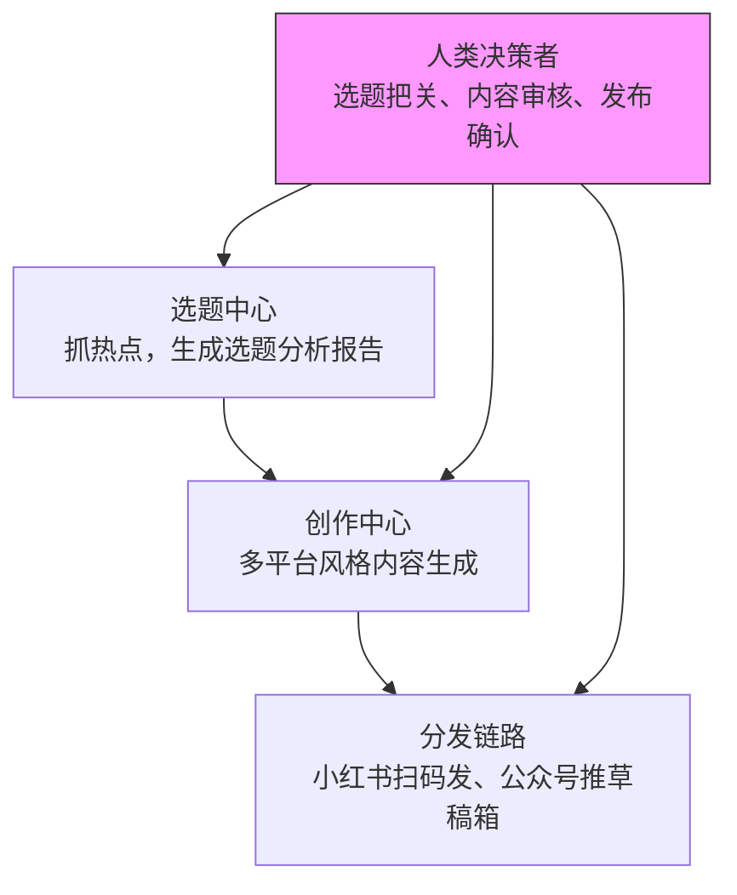

# 第28章 内容工厂 Agent：选题、创作、分发全链路自动化

> 本节教零基础读者用 Claude Code/Codex + Next.js + SQLite 开发"内容工厂"Agent，含选题中心（抓热点出分析报告）、创作中心（多平台风格生成）、分发链路（小红书扫码发、公众号推草稿箱）。人负责决策，AI 写代码，每章配提示词与视频教程，群里提供完整源代码。

## 28.1 大白话：内容工厂就是"自动化内容流水线"

内容工厂就是一套"自动化内容流水线"，选题、写作、发布都由 AI 辅助完成，你只需要负责拍板决策。适合想做自媒体矩阵、批量产出内容的读者。

## 28.2 内容工厂 Agent 系统架构 Mermaid 图

## 28.3 什么是内容工厂 Agent

大家好，我是钱塘江鲤，这次航海我将和大家一步步构建一个内容工厂 Agent，我们主要是使用 Next.js 和 SQLite 数据库，借助 Claude Code 或 Codex 等 AI 编程工具实现一个内容工厂的核心功能链路。

项目分为三个核心模块：内容采集与选题分析、内容创作、发布模块。

我们首先会讲解一些关于 AI 编程的基本背景知识，然后按章节逐步完成各个模块的开发，每章提供相应的 Claude/Codex 提示词和所有对话详情，本次航海中涉及到的所有提示词在手册中都有体现，方便大家更快地理解如何利用 AI 工具完整开发一个内容工厂。

另外为了让大家有更好的体验感，可以让不同基础不同行业的圈友都能在这次航海中有自己的收获，除了每章的提示词和视频教程外，我们还会在航海群中提供完整的源代码，让大家真正地把项目搭起来用起来。

我们本次航海构建的内容工厂 Agent 是一个高度灵活的自动化脚手架，它可以根据你的具体需求组合运用，适配多种内容创作场景，在本次航海的学习，你将拥有：

- 一个智能的"选题中心"（输入关键词，自动抓取热点，生成精准的选题分析报告）
- 一个高效的"创作中心"（一键生成适配小红书、公众号等不同平台风格的内容）
- 一个闭环的"分发链路"（小红书扫码即发，公众号自动推送草稿箱，实现一键发布）

## 28.4 项目完整操作思路

### 28.4.1 项目完整操作思路

本次航海使用 AI 编程方式构建内容工厂，核心思路是通过自然语言与 Claude Code 等 AI 工具对话完成开发。安装并配置 AI 编程工具后，与 AI 反复沟通明确需求并生成页面原型，接着按"数据采集-选题分析-内容创作-发布管理"四个模块逐步实现功能。每个模块都遵循"描述需求→AI 出方案→确认→AI coding→测试"的循环，遇到错误直接将浏览器控制台的报错信息交给 AI 修复，最终通过人机协作快速完成从 0 到 1 的产品开发。整个过程人负责产品方向和决策，AI 负责代码实现。

### 28.4.2 操作重点

环境搭建与工具配置 > 构建选题采集与分析 agent > 开发 AI 内容二创与多平台适配功能 > 打通公众号与小红书官方发布接口与分发 > 系统集成与工作流优化

## 28.5 快速上手 AI 编程工具

### 28.5.1 理解 AI 辅助编程与传统编程的区别

恭喜你，正式开启内容工厂 Agent 的第一步。在这里，我们将从零开始，理解什么是 AI 辅助编程，它与传统编程的根本区别是什么，以及如何快速安装你的开发环境和 Claude Code 或/Codex 等 AI 编程工具。

**第一：理解 AI 辅助编程的核心逻辑**

我们会带你了解 AI 编程的原理，认识「人机协作」的新模式。你将明白：未来的编程，不再是死记语法，而是如何清晰地描述需求、引导 AI 生成最优解。掌握这一思维方式，你的生产力将呈指数级提升。

**第二：准备开发环境与工具安装**

我们将带你完成 VS Code 与 Node.js 的安装与配置，让你轻松建立起可以运行项目的本地环境。无论你使用 Mac 还是 Windows，只需照着步骤操作，就能顺利进入 AI 编程的世界。

**第三：激活并配置 AI 编程助手**

通过本章，你将完成 Claude Code 或 Codex 的安装、登录与配置。我们同时提供了国内模型（如 GLM4.6）的使用方案，让你可以顺利体验 AI 编程的全流程。

### 28.5.2 准备开发环境并安装 Claude Code/Codex

1. 开发环境介绍
2. 如何安装开发环境
3. 安装 Claude code
4. 安装 Codex

### 28.5.3 激活并配置你的 Claude Code/Codex 账号

1. Claude Code 登录与使用
2. Codex 的登录与使用

## 28.6 内容工厂各模块开发

### 28.6.1 页面原型设计

1. 本章概要
2. 视频版教程
3. 生成初版原型
4. 处理报错信息
5. 调试完成第一版原型

### 28.6.2 获取公众号数据

1. 视频版教程
2. 获取公众号数据
3. 处理项目报错信息
4. 对已有内容进行优化

### 28.6.3 新增选题分析功能

1. 视频版教程
2. ...

## 28.7 对应素材

- `202512-neironggongchang` > 开船第一课（什么是内容工厂 Agent，Next.js + SQLite，三个核心模块：选题中心、创作中心、分发链路）
- `202512-neironggongchang` > 必修篇（一、快速上手 AI 编程工具；数据采集-选题分析-内容创作-发布管理四个模块）

## 小练习

用 AI 生成一个内容工厂的系统架构简图（文字描述即可），标注选题、创作、分发三个环节分别由哪些工具或 Agent 负责，并写下你作为人类决策者需要介入的节点。
