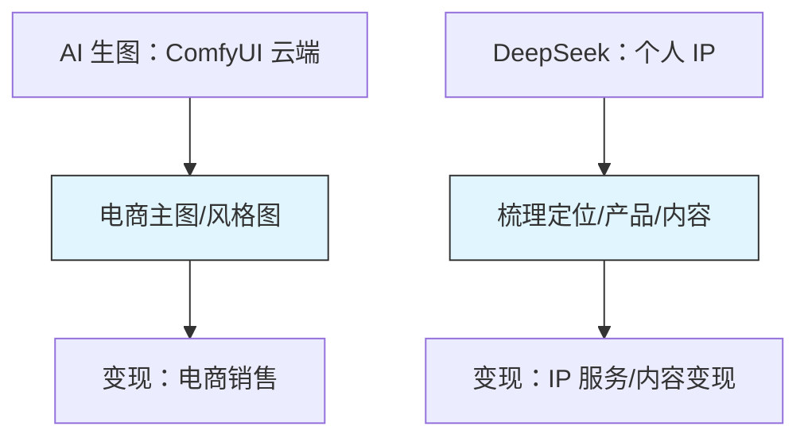

# 第29章 AI 电商与 AI 赋能 IP 定位

> 本节介绍用 AI 生图（ComfyUI 云端部署）做电商图像制作（风格转换、高清化、扩图），以及用 AI（尤其 DeepSeek）做个人 IP：梳理定位、梳理产品、提效内容创作，解决 AI 文案"AI 味"重的问题，效率提升 5–10 倍。

## 29.1 大白话：不会做电商图？用 AI 生图就能做主图、风格图

不会做电商图？用 AI 生图就能做主图、风格图。不会定位个人 IP？用 AI 帮你梳理"你是谁、解决谁的问题、凭什么被信任"。重点是让 AI 内容少一点"AI 味"，多一点人味。

## 29.2 用 AI 生图做电商图像：ComfyUI 云端工作流

### 29.2.1 云端部署优势

使用 ComfyUI 时遇到的第一个问题就是：到底是选择本地部署，还是线上部署？

**本地部署：成本高、麻烦多**
- 首先得有一台高性能电脑，尤其是显卡，比如 RTX 4070 16G，甚至 RTX 4090 24G，才能流畅运行 ComfyUI
- 硬件贵：一张顶级显卡几万元，不是每个人都愿意花这个钱
- 性能要求高：普通显卡跑不动大模型，生成图片要么慢得让人崩溃，要么直接失败
- 维护麻烦：你还得自己下载模型、装插件、调试环境，网络一出问题就得折腾半天

**云端部署：省钱、省心、高效**
- 开箱即用：云端平台已经把模型、插件和工作流都准备好了。你不需要自己配置，打开网页就能用，省时省力。这对初学者尤其友好，不用头疼技术细节，直接上手创作
- 随时随地用：只要有网，就算用普通笔记本电脑，你都能随时登录云端平台开始工作。灵活性超强，不管在家、在学校还是出差，创作都不受限
- 顶级性能：云端提供的算力，比如 RTX 4090 级别，秒杀大部分本地设备。跑大模型、生成高清图完全无压力，告别卡顿，效率翻倍。而且平台会不断更新资源，你总是用最新的技术

云端部署也有一些小问题：
- 费用超低：租用 4090 算力，1 小时才 2 元左右，比买显卡便宜太多了，几万元的硬件钱够你在云端用好几年
- 排队可控：高峰期可能要等一下，但换个时间用就行，完全不影响大局
- 上手简单：界面稍微适应一下就习惯了，学习成本几乎为零

云端部署平台有很多，你可以选择自己认为合适的。

### 29.2.2 电商图像制作场景

| 场景 | 说明 | 示例 |
|------|------|------|
| 主图制作 | 商品主图，突出卖点 | 护肤品主图、服装模特图 |
| 风格转换 | 同一商品不同风格 | 年轻潮流风、稳重商务风、奢华高端风 |
| 高清化 | 低分辨率图片变高清 | 旧产品图重新使用 |
| 扩图 | 小图扩展为大尺寸海报 | 主图变成促销海报 |

## 29.3 用 AI（尤其 DeepSeek）做个人 IP

### 29.3.1 个人 IP 三要素

用 DeepSeek 等 AI 工具做个人 IP：梳理定位（你是谁）、梳理产品（解决谁的问题）、提效内容创作（凭什么被信任）。

### 29.3.2 解决 AI 文案"AI 味"重的问题

AI 生成的内容容易有"AI 味"，通过整体框架和提示词优化，避免机械重复的结构化输出，增加人味儿，让文案更有灵魂。

效率提升 5–10 倍。

## 29.4 AI 电商与 IP 定位 Mermaid 图

## 29.5 对应素材

- `202503-aidianshang` > AI 赋能电商（AI 生图做电商图像，ComfyUI 云端工作流）
- `202503-aifunengip` > AI 赋能 IP（DeepSeek 做个人 IP：定位、产品、内容创作）

## 小练习

用 ComfyUI 云端工作流为一件虚拟商品生成一张主图，并用 DeepSeek 为该商品写一份 IP 定位方案（你是谁/解决谁的问题/凭什么被信任）。
