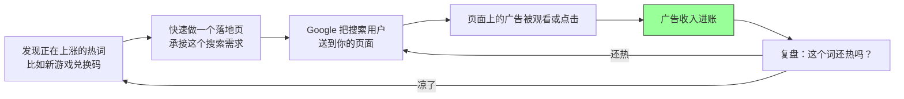
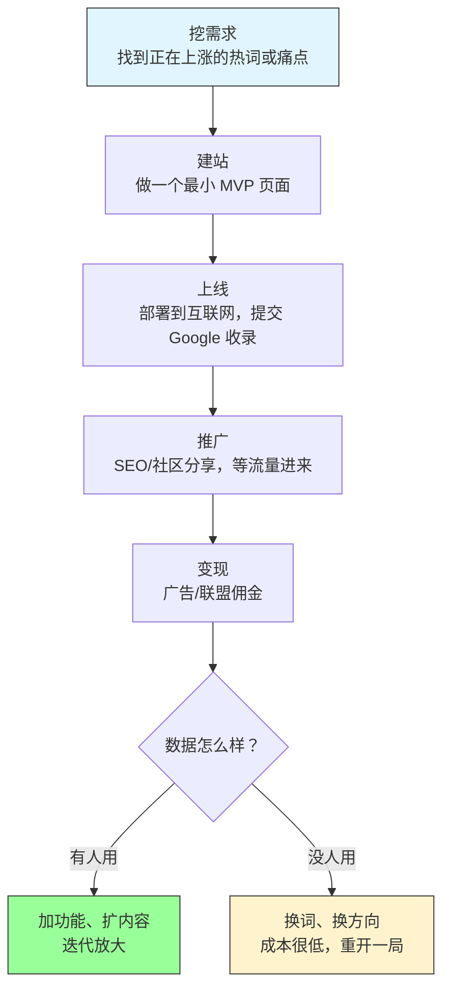
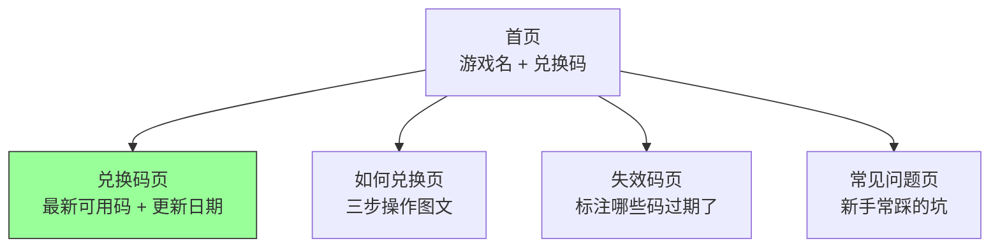
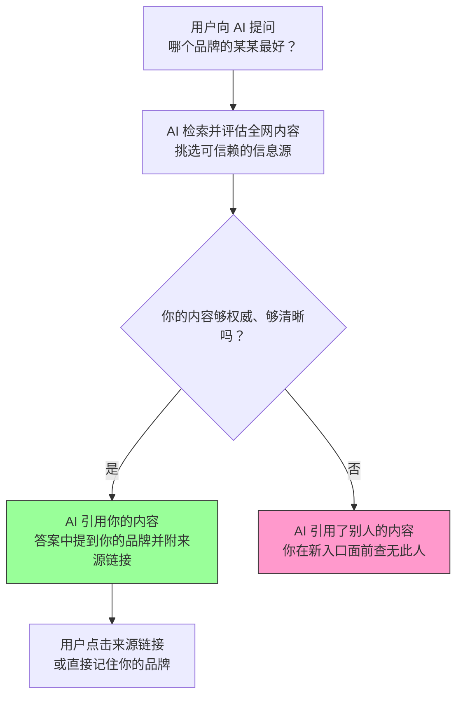
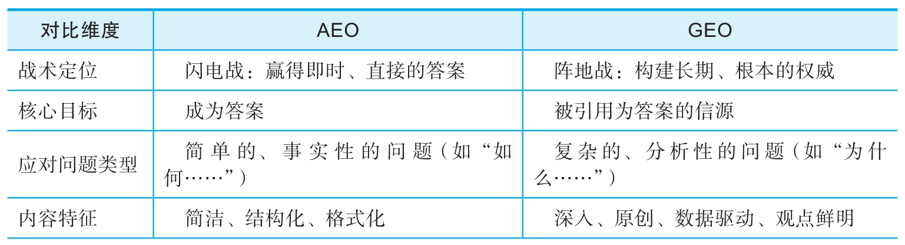
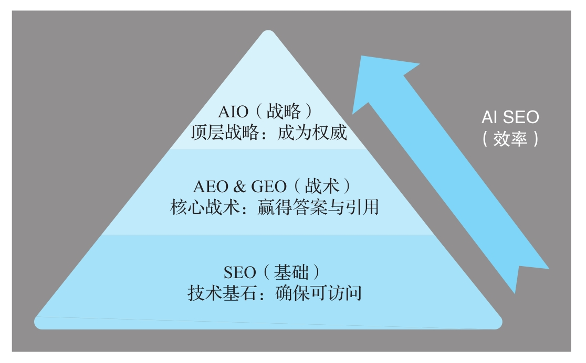

# 第29章 AI 电商与 AI 赋能 IP 定位

> 本节介绍用 AI 生图（ComfyUI 云端部署）做电商图像制作（风格转换、高清化、扩图），以及用 AI（尤其 DeepSeek）做个人 IP：梳理定位、梳理产品、提效内容创作，解决 AI 文案“AI 味”重的问题，效率提升 5–10 倍。

在正式开始之前，先说两句“废话”宽宽心：本章不需要你会写代码，不需要你懂设计，更不需要你有海外生活经验。你只需要会用浏览器打开网页、会把 AI 生成的内容复制粘贴到文件里，就足够跟着本章把“选词—建站—变现”这条链路走通一遍了。我们会把每一个“听起来很唬人”的名词，都用大白话掰开揉碎讲清楚。另外提前说一句：本章和第 32 章（AI 产品出海）是“一套功夫拆两集讲”的关系——这一章带你把整体地图看明白，第 32 章再带你逐块落地，读的时候可以两章对照着翻。

---

## 32.1 大白话：出海做网站，找个正在上涨的“热词”

出海做网站，不要做大家都做的大网站，找个正在上涨的“热词”（比如某个新游戏的兑换码），快速做个落地页承接 Google 搜索流量，靠广告变现。这是出海里变现天花板最高领域之一。

> **大白话**：国内做网站竞争太卷了，大家都在做同样的东西。出海做网站，不需要做大家都做的大平台，找个正在上涨的“热词”（比如某个新游戏的兑换码），快速做个落地页承接 Google 搜索流量，靠广告变现。热词本身自带搜索流量，你不需要从零开始找用户。

我们先解释两个词，后面整章都会反复用到：

- **热词**：就是“最近搜索量正在快速上涨的关键词”。比如一款新游戏上线，全世界的玩家都跑去 Google 搜“某某游戏兑换码”，这个词的搜索量在几天内翻几倍——它就是个热词。
- **落地页（Landing Page）**：就是“用户搜索后落地的第一个网页”。可以把它理解成一张专门接住某种搜索需求的“网”，页面上通常只有一个主题、几段文字、几张图，简单直接。

把这两个词连起来，这门生意的逻辑就特别直白：玩家在 Google 上搜“某某游戏兑换码”，你的网页恰好就是讲“某某游戏兑换码”的，Google 就把玩家送到你的网页上；玩家在页面上看到了广告（后面细讲 AdSense），看一眼或点一下，你就有收入。整个流程里你最值钱的动作只有一个——**比别人早发现这个词**。

> **大白话**：热词就像一家刚开业的网红奶茶店门口排的长队。队是别人排的（搜索需求天然存在），你只需要在队伍旁边支个摊卖水（建个页面承接需求），就能做成生意。你不需要花钱拉人排队，只需要眼睛尖、出手快。

把这门生意的完整闭环画成一张图，你一眼就能看明白钱是怎么流动的：



这张图里最值得注意的是最后那个“复盘”箭头：热词是有生命周期的，词凉了流量就没了，所以要不停地回到第一步找下一个词。这也是为什么这门生意对新手友好——**单个站可以很小，但“找词—建站—变现”这套动作可以反复做**，做熟了就是一项可以带走的手艺。

---

## 32.2 海外工具站：挖掘热词快速建站

### 32.2.1 为什么做海外工具站？

相比于国内的卷度，海外竞争要小很多，流量池也更大。海外工具站有一定的壁垒，不是小个体或者小团队可以轻易复制的，能活的比较滋润，做的好的工具站，一年也能有上百万利润，而且进可攻融资成为 SaaS 独角兽，退可守赚钱闷声发财。想象空间是非常大的。

另外海外还是非常依赖谷歌的搜索流量，短期没什么大的危机，做好了工具站，能力可以迁移到下一个工具需求再来一遍。

这段话里有两个词值得展开解释一下。

第一个是**壁垒**。大白话就是“别人想抄你，得费多大劲”。国内做网站，一个点火起来，三个月内能冒出几百个一模一样的；海外工具站因为涉及英文产品思维、谷歌 SEO 经验、海外用户的习惯积累，这些都不是抄一个页面就能抄走的，所以能“活得比较滋润”。

第二个是 **SaaS**。SaaS 的全称是 Software as a Service（软件即服务），大白话就是“软件不卖断，按月收租”。比如你做一个在线图片压缩工具，用户免费用基本功能，高级功能每月付 9.9 美元——只要用户还在用，就一直付钱，这就是“收租”模式。工具站做到一定规模，往 SaaS 方向升级是很自然的路径，所以说“进可攻融资成为 SaaS 独角兽，退可守赚钱闷声发财”。

### 32.2.2 什么样的人适合做海外工具站？

1. 有一定产品设计、开发和营销产品的能力的人；
2. 适合对海外市场感兴趣，有耐心试错、对挖掘用户需求和开发工具有一定了解的人。

而且如果做出的工具站有稳定的流量，可以考虑长久去做，日常花一点时间运营即可实现“躺赚”。

但这个项目也有一定的门槛和挑战：
1. 开发容易推广难，网站上线后需要持续关注流量和优化；
2. 有一定的技术门槛，如果自己开发能力不足，建议通过自学、工具辅助或者找合作伙伴解决。

看到“有开发能力”“懂营销”这几个字先别急着关页——这里说的是“理想状态”，不是“入场券”。本书的读者即使完全不会写代码，也完全可以用 AI 编程工具（本书第 28 章讲过怎么用 Claude Code、Codex 这类工具“说人话写代码”）把简单工具站做出来；而“挖掘用户需求”这件事，恰恰是 AI 最擅长帮忙的，下一小节我们就给你可以直接抄的提示词。

另外要跟大家提前说明的是，这期航海的手册，是在往期航海手册的基础上升级而成，考虑到大家找需求偏好以及技术背景不同，必修篇保留了多种找需求，制作产品的方法。

### 32.2.3 英文工具站基础介绍

做海外工具站，核心思路是从 0 到 1 建立一个最小 MVP（最小可行性产品），验证需求后再迭代扩大。不要试图一开始就做一个完美的大网站，先跑通“挖需求→建站→上线→推广→变现”的全流程。

先解释 **MVP（Minimum Viable Product，最小可行性产品）**。大白话：别一上来就开大饭店，先摆个摊。摆摊成本低、出手快，今天出摊明天就能知道有没有人买；真有人买，再租店面、招厨师也不迟。做网站也一样：先用一个最简陋但能用的版本放到网上，看看有没有真实用户来、来了留不留得住，验证完了再加功能。整个流程画成一张图就是：



**第一步“挖需求”，让 AI 当你的军师。**新手最容易犯的错，是闷头拍脑袋想“我觉得外国人需要一个某某工具”。正确姿势是让 AI 帮你系统地扫一遍市场。你可以把下面这条提示词直接抄进 DeepSeek、ChatGPT 或豆包（改掉方括号里的内容即可）：

```text
请扮演市场分析专家，帮我分析以下方向的商业潜力：
1. [你的方向，例如：在线图片压缩工具] + 海外市场的结合点。
2. 目前该方向的内容供给情况（有哪些竞品网站）。
3. 用户搜索量和增长趋势（哪些相关关键词正在上涨）。
4. 潜在变现模式和客单价。
5. 进入门槛和竞争壁垒。
请用表格输出，并给出具体数据和案例支撑。
```

等 AI 给出几个候选方向后，再追问一句做交叉验证：

```text
请帮我分析以下关键词在 Google 上的搜索趋势：
1. [关键词 1]
2. [关键词 2]
3. [关键词 3]
并预测这些需求在未来 6 个月的走向，标注哪些属于“正在上涨”的热词。
```

> **大白话**：这两条提示词的思路，来自“用 AI 找高变现赛道”的三步法——先让 AI 扫市场，再让 AI 拆竞品，最后让 AI 验证需求是不是真的在涨。AI 找的机会不一定全对，但它能把你的“拍脑袋”变成“有依据的假设”，这就赢过大多数人了。

**第二步“建站”，一个 HTML 页面就能开工。**路线 A 的热词站不需要登录、不需要支付、不需要数据库（这些词不懂没关系，意思是“技术上极简单”），一个 HTML 文件就是一个完整的网站。下面给你一份可以直接使用的落地页模板，注释写得非常细，把它存成 `index.html`，用浏览器打开就能看到效果：

```html
<!DOCTYPE html>
<!-- 声明这是 HTML5 文档，浏览器看到这行就知道按最新标准渲染 -->
<html lang="en">
<!-- lang="en" 表示页面主要内容是英文，做海外站要写 en -->
<head>
    <!-- 网页的“后台信息区”，用户看不到，但浏览器和 Google 会读 -->
    <meta charset="UTF-8">
    <!-- 字符编码，保证中英文都不乱码 -->
    <meta name="viewport" content="width=device-width, initial-scale=1.0">
    <!-- 让页面在手机上也能正常缩放显示 -->
    <title>Pet Simulator 99 Codes - All Working Codes (November 2026)</title>
    <!-- 网页标题：非常重要！Google 搜索结果里显示的大标题就是它，
         写法套路 = 关键词 + 承诺（全部可用）+ 时间（显得更新鲜） -->
    <meta name="description" content="All working Pet Simulator 99 codes in one page. Updated daily. Copy and redeem them in seconds.">
    <!-- 页面描述：Google 结果里标题下面那两行小字，写清楚“来这里能得到什么” -->
    <style>
        /* 样式区：控制页面长什么样。这里只保留最必要的几条 */
        body { font-family: Arial, sans-serif; max-width: 720px; margin: 0 auto; padding: 20px; }
        /* 正文居中排版，宽度限制在 720 像素，手机电脑都好看 */
        h1 { color: #2c3e50; }
        /* 大标题用深色，显得干净 */
        .code-box { background: #f4f6f8; border: 1px solid #ddd; padding: 12px; margin: 10px 0; border-radius: 6px; }
        /* 每个兑换码装在一个灰色小盒子里，方便用户“照着抄” */
        .code-box b { font-size: 18px; letter-spacing: 1px; }
        /* 兑换码本身加大加粗 */
    </style>
</head>
<body>
    <!-- 网页的“可见内容区”，用户看到的一切都写在这里 -->
    <h1>Pet Simulator 99 Codes (November 2026)</h1>
    <!-- 页面主标题，和 title 标签保持一致的关键词 -->
    <p>Here are all working codes. We update this page every day.</p>
    <!-- 开头一句话讲清价值：全部可用 + 每日更新 -->

    <h2>Working Codes</h2>
    <div class="code-box"><b>CODE-EXAMPLE-1</b> — Redeem for free diamonds</div>
    <!-- 一个兑换码盒子：码 + 一句话说明奖励是什么 -->
    <div class="code-box"><b>CODE-EXAMPLE-2</b> — Redeem for free boosts</div>

    <h2>How to Redeem</h2>
    <p>1. Open the game. 2. Tap the basket icon. 3. Paste the code. 4. Press Redeem.</p>
    <!-- “怎么兑换”步骤：玩家搜兑换码时几乎必搜这个问题，写上能多接一波搜索 -->

    <h2>FAQ</h2>
    <p><b>Why is my code not working?</b><br>Codes expire fast. If one fails, it is probably expired — try the others.</p>
    <!-- 常见问题：既是给用户看的，也是 Google 喜欢的“问答型内容” -->

    <p>Last updated: November 10, 2026</p>
    <!-- 更新日期：告诉用户（和 Google）这个页面是活的，不是没人管的老页面 -->
</body>
</html>
```

这份模板里藏了热词站内容页的通用骨架：**标题（带关键词和日期）→ 核心答案（兑换码列表）→ 操作步骤 → 常见问题 → 更新日期**。你换成任何热词，都照这个骨架填。至于“网站怎么放到互联网上”，现在的主流做法是用 Vercel、Cloudflare Pages 这类免费托管平台，把一个文件夹拖上去就得到一个能访问的网址，全程点鼠标即可，本书第 32 章会一步步演示。

---

## 32.3 出海游戏网站：两条路径，选“热词游戏站”

### 32.3.1 路线 A：追热词，赚搜索的钱（本手册主线）

发现一个正在涨的搜索词 → 快速做一个网站承接这些搜索 → 靠广告赚钱。

用户在搜一个新东西的信息，你比别人先给到完整答案。你切的是用户实实在在的信息需求。只是这个需求有时效性——词不热了，搜索就少了。

不需要登录、不需要支付、不需要数据库。一个 HTML 页面就能上线，几天内能跑通，最快拿到正反馈。

**案例**：cursor-ide.com（蹭 Cursor 词，单页落地页，月访问 455K）、nanobanana.ai（蹭 nano banana 词，两个月千万访问，已经迁移了）。

给你解释一下这两个案例“蹭”的到底是什么：Cursor 是一款爆火的 AI 编程编辑器，无数人去 Google 搜它的官网和用法；nano banana 是一款爆火的 AI 生图功能。这两个站的共同做法是：**抢在官方或大站之前，把“大家正在搜这个词”的流量用一个小页面接住**。cursor-ide.com 只是一个单页落地页，月访问就有 45.5 万——这就是热词的威力。

### 32.3.2 路线 B：切长期需求，赚用户的钱

发现一个长期存在的用户痛点 → 做一个工具或产品持续解决它 → 用户订阅付费。

用户一直有这个需要——“我要批量处理图片”“我要生成 AI 视频”。需求不跟着词走，只要痛点还在，生意就在。SEO 起量慢（3-6 个月），但一旦跑通，收入更稳定。

需要做登录、支付、数据库、多语言，门槛比路线 A 高。

**案例**：Pollo.ai（AI 视频品牌站，月访问 620 万）。

两条路线放在一起对比，差别就非常清楚了：

| 对比项 | 路线 A：追热词 | 路线 B：切长期需求 |
|--------|---------------|-------------------|
| 赚谁的钱 | 广告主（用户看广告） | 用户（直接订阅付费） |
| 起量速度 | 快，几天到几周 | 慢，SEO 起量要 3-6 个月 |
| 技术门槛 | 低，一个 HTML 页面 | 高，要做登录、支付、数据库、多语言 |
| 需求寿命 | 短，词凉了流量就没了 | 长，痛点在生意就在 |
| 适合谁 | 新手第一站 | 有产品经验的老手 |

**本手册的主线是路线 A。**

路线 A 更适合新手切入，主要原因是：词本身自带搜索流量，你不需要从零开始找用户；正反馈路径短——找词、建站、上线、看数据，几天到几周就能跑完一圈。

路线 B 如果你前期有产品经验、技术基础或海外市场认知，走起来也合适。但如果完全是纯新手，一上来做登录、支付、数据库，难度会大不少。

> **大白话**：路线 A 像“练摊”，一晚上就能开张，赚到的是零钱，但你能快速学会“看行情、进货、吆喝”这一整套动作；路线 B 像“开店”，装修半年、回头客稳定，但新手一上来很容易被房租（技术门槛）压垮。先练摊，后开店，是稳妥的次序。

### 32.3.3 什么是游戏热词站？

**路线 A 里有一个特别适合新手的切入方向：游戏热词站。**

它的逻辑很简单：玩家已经在 Google 搜一个游戏问题，你做一个小网站，把答案接住。你不是开发游戏，不是做 App，不是写游戏评测。你做的事情比这些都轻——围绕一个海外正在变热的游戏，把玩家最常搜的问题整理成页面。Google 给你流量，你靠广告赚钱。

来看看已经跑通的人是怎么做的。

**Genshin Builds：角色攻略站**

Genshin Builds（genshin-builds.com）专门服务原神玩家：这个角色怎么培养？用什么武器？配什么队伍？材料去哪刷？页面结构很清晰——角色、Builds、Teams、Tierlist、Wiki、材料、武器、圣遗物、计算器。

这类站的核心不是新闻，而是**长期有人反复查的资料页**。玩家养角色、换配队、刷材料，每次都要回来查。Semrush 显示它 2026 年 5 月约 59.7 万访问量。

**Pro Game Guides 的 codes 页面：兑换码站**

还有一种最轻的起步方向：玩家不想深度阅读，他们只想快速拿到可用兑换码。

Pro Game Guides 是一个大站，覆盖 Roblox、Fortnite、Minecraft 等大量游戏。我们不用照抄它的体量——只看它的一个动作：把玩家高频搜索的 codes 整理成页面，并持续更新。对新手来说，不需要一上来就做成大站，只要先选一个具体游戏，做出“最新兑换码 + 如何兑换 + 失效码 + 常见问题”这几个页面，就已经是一个很清晰的起步方向了。

把一个最小游戏热词站的页面结构画出来，其实就是一棵简简单单的小树：



四个页面，每个页面照着 32.2.3 节的 HTML 模板填内容，一个周末就能做完——这就是“最小 MVP”在游戏站上的样子。

### 32.3.4 游戏热词站怎么赚钱？

**主要方式：广告（AdSense）。** Google 自动在你的网站上匹配广告，有人看或点你就有收入。

> **大白话**：AdSense（谷歌广告联盟）可以理解成“广告位的自动中介”。你把网页上某块地方申请成“广告位”，Google 就自动把广告填进去；广告主付钱给 Google，Google 分你一份。你完全不用去谈广告、不用管广告内容，挂上就行——这是全世界个人网站最主流的变现方式。

其他可选方式：游戏相关联盟项目（Humble Bundle Partner、Nexus.gg 等，推荐游戏拿佣金）。

> **大白话**：“联盟项目”就是“带客拿提成”。你在页面里推荐某个游戏（附上专属链接），玩家通过你的链接去买了游戏，平台分你一部分佣金。它和 AdSense 不冲突，可以同时挂着。

**本次预期**：广告不是立刻就能赚到，需要先有流量。日访问几百的时候，AdSense 收入可能每天只有几毛到几块钱。本期的第一目标不是赚钱——是先跑通从找词到上线到有数据的完整流程。

请务必把这句话读三遍：**第一目标是跑通流程，不是赚钱**。很多新手第一天上线、第二天就去看收入，看到几毛钱就心灰意冷弃坑了。正确的预期是：把它当成一次“小成本创业演习”，第一轮跑通，你收获的是一套可复用的方法和一份真实数据；收益是跑通之后指数增长的部分。

**跑通以后，你可以往哪走？**

走完这一期，你做出来的不只是一个游戏攻略站。你掌握的是一整套热词站的方法：
- 怎么发现一个正在被搜索的词
- 怎么判断它值不值得做
- 怎么快速建站承接流量

这三条能力是通用的——下个月 AI 圈冒出新工具、新游戏、新事件，你都可以再用一遍，这就是本手册说的“能力可以迁移到下一个工具需求再来一遍”。

---

## 32.4 GEO：让 AI 推荐你的品牌或独立站

介绍 **GEO（生成式引擎优化）**，让 AI 在回答问题时推荐你的品牌或独立站，应对“用户开始直接问 AI”的零点击搜索趋势。

过去用户搜关键词，看到一堆链接自己点（SEO）；现在用户直接问 AI，AI 直接给答案并提到品牌名（GEO）。如果你的品牌没出现在 AI 答案里，就等于在新入口面前“查无此人”。

先用一个真实的场景感受一下这个变化。过去你想给公司挑一款客户管理软件（CRM），操作流程几乎是固定的：打开搜索引擎，输入“中小企业 CRM 推荐”，然后在一堆蓝色链接里逐个点开、逐个排查，关掉广告弹窗，在十几篇互相抄袭的评测文里费力找答案——整个过程与其说是决策，不如说是一场“信息筛选劳动”。而现在，用户会直接对 AI 说：“我是一家 50 人规模的 SaaS 公司，需要一款能与 Slack 和 Gmail 集成、单人月费不超过 50 美元的 CRM，请推荐三款并用表格对比。”几秒钟后，AI 给出三款软件的名字、对比表格，甚至补充一句“考虑到你的团队规模，A 方案的线索评分功能可能最有价值”——用户看完可能就直接去注册了，**根本没点过任何一条搜索链接**。这就是“零点击搜索”趋势：用户跳过了“排名列表”，直接拥抱“最终答案”。

**GEO（Generative Engine Optimization，生成式引擎优化）**：简单讲，它的核心逻辑是：让你的内容能被 AI 看见、理解、引用，最后被推荐出去。（可能你还听过 AEO、AISEO，其实都是一回事，GEO 是最专业的叫法）

GEO 和 SEO 的核心区别：
- **SEO：针对搜索引擎算法。** 让你在搜索列表里排名靠前，像是在货架上抢个好位置，让用户一眼看到你，但不知道你好不好用；SEO 是授人以鱼竿（给你链接，你自己点）。
- **GEO：针对 AI 生成式搜索的引用逻辑。** 让 AI 在回答问题时，直接引用你的推荐语，像是让超市导购员（AI）直接把你的产品（内容）推荐给顾客。GEO 是直接喂到嘴里（直接给你答案，并说是从你这儿来的）。

AI 就像个懂行的导购，用户问哪家强，它直接报你的名字，还顺便说了你为啥强。

用一张图把“用户提问 → AI 生成答案 → 引用你的内容”这条链路画出来：



GEO 实战中有两个最重要的概念，都来自《AIO 和 GEO 实战》这本手册，这里用大白话讲给你：

**第一，打造 AI 无法拒绝的“可引用块”。**所谓可引用块，就是一段高度凝练、信息密集、含着硬数据的内容片段。AI 生成答案时，特别喜欢引用两类东西：一是具体的数据（比如“根据我们对 5000 家企业的调研，采用自动化流程的企业员工满意度平均提升了 23%”），二是观点鲜明的结论。因为 AI 引用一个具体数字或专家观点，能让它自己的答案显得更可信。所以你要有意识地在页面里埋这种“片段”：独立完整、脱离上下文也能读懂、带数字、用加粗或引用格式突出显示。

**第二，把它们装在“可链接资产”上。**可引用块负责传播，可链接资产负责承接。典型的可链接资产包括：原创行业研究报告、对一个主题进行系统阐述的“终极指南”、免费的在线小工具或数据库。当 AI 在答案里采纳了你的可引用块，它极大概率会把承载它的页面作为来源链接展示出来——这一展示，就是最直接的权威认证。

| 对比维度 | AEO | GEO |
|---------|-----|-----|
| 战术定位 | 闪电战：赢得即时、直接的答案 | 阵地战：构建长期、根本的权威 |
| 核心目标 | 成为答案 | 被引用为答案的信源 |
| 应对问题类型 | 简单的、事实性的问题（如“如何……”） | 复杂的、分析性的问题（如“为什么……”） |
| 内容特征 | 简洁、结构化、格式化 | 深入、原创、数据驱动、观点鲜明 |



> **图片说明**：AEO 与 GEO 的战术对比表（图源：《AIO 和 GEO 实战：如何成为 AI 推荐的答案》）。AEO 争的是“简单问题被直接答出”，GEO 争的是“复杂问题里被点名引用”，两者是一套组合拳，不是二选一。

那 GEO 和传统的 SEO、以及更高的 AIO 战略是什么关系？下面这张金字塔图说得很清楚：SEO 是技术基石（确保网站能被正常访问和抓取），AEO 和 GEO 是核心战术（赢得答案与引用），AIO 是顶层战略（成为权威），而 AI 工具则全程提效。



> **图片说明**：AIO 战略协同金字塔（图源：《AIO 和 GEO 实战：如何成为 AI 推荐的答案》）。从下往上看：先用 SEO 打好技术地基，再用 AEO/GEO 两条战术路线赢得答案与引用，最终在顶层实现“AI 认为你很权威”的战略目标；右侧的 AI SEO 表示整个流程都可以用 AI 工具十倍化执行效率。

**适合人群**：这本手册适合如果你的商品客单价比较高，用户决策复杂，喜欢在下单前“问一问”，比如 B2B 企业、SaaS 软件、卖工业设备、专业服务机构（律所/留学/咨询/医美/装修/旅游/3C 数码）、跨境独立站运营负责人。

> **大白话**：为什么强调“客单价高”？因为 GEO 是“长效资产”，见效慢、投入大，就像在市中心买商铺——买得起的人卖高价商品才划算。一瓶 2 元的矿泉水，靠 AI 推荐引流再转化，算下来不划算；一套 20 万元的工业设备，只要 AI 推荐带来一个客户，投入就全回来了。所以便宜货走流量，贵重品走信任，GEO 做的就是“信任”这门生意。

**阅读前的提醒**：
1. GEO 是长效资产，需要持续维护，且维护成本并不低，想要入局的伙伴建议看完本手册再做决策。
2. 现在的 AI 模型具备极强的数据交叉验证能力，千万不要尝试“隐藏文本”、“伪造数据”等作弊手段。一旦被判定为低质量信源，域名的权重损失将难以挽回。

第二条提醒值得再敲一次黑板：AI 之间会互相“对答案”。你页面上写的数据，AI 会拿去和其他来源交叉验证，对不上就不再信你；一旦被打上“低质量信源”的标签，整个域名的信任分会一起受损，很难翻身。所以 GEO 的正道只有一条：**老老实实产出真实、原创、可验证的内容**，这恰恰也是本章从头到尾在讲的事——无论是热词站还是 GEO，AI 时代流量的底层逻辑都从“骗算法”变成了“被信任”。

---

## 32.5 对应素材

- `202409-chuhaigongjuzhan` > 出海工具站（海外工具站建站，承接搜索流量）
- `202608-ai-chanpin-chuhai` > AI 产品出海-热词游戏站（热词游戏站，攻略/兑换码，Google 流量广告变现）

---

## 小练习

用关键词挖掘工具找出 1–2 个正在上涨的海外热词，用 AI 快速生成一个落地页标题与简介，并标注该热词的搜索意图与变现方式。

> **参考模板**：
>
> | 热词 | 搜索意图 | 变现方式 | 落地页标题 | 简介 |
> |------|---------|---------|-----------|------|
> | 某游戏兑换码 | 寻找免费兑换码 | 广告联盟 | XX 游戏兑换码免费领取 | 最新 XX 游戏兑换码免费领取，每日更新 |
> | 某 AI 工具替代方案 | 寻找替代工具 | 联盟营销 | XX 工具最佳替代方案 | 寻找 XX 工具的免费替代方案，功能对比与价格 |

做完小练习后，还可以再进一步：把你的落地页标题和简介拿去问一次 AI（比如问 DeepSeek“我想找 XX 游戏的兑换码，你会推荐哪些网站？”），观察 AI 的回答里有没有提到类似定位的站点——这就是对你所选热词的一次“GEO 现状摸底”。

---

## 本章小结

通过本章，你应该已经了解：

1. **热词站的生意本质**：找一个正在上涨的搜索热词，用最简单的页面承接 Google 搜索流量，靠广告变现；热词自带流量，你不需要从零找用户，正反馈路径只要几天到几周。
2. **海外工具站的账**：海外竞争小、流量池大，做得好的工具站一年能有上百万利润，进可攻 SaaS 融资、退可守闷声赚钱；核心打法是从最小 MVP 开始，跑通“挖需求→建站→上线→推广→变现”全流程再迭代。
3. **两条路线怎么选**：路线 A（追热词、赚广告的钱）技术门槛低、起量快，是新手主线；路线 B（切长期需求、赚订阅的钱）收入更稳但要做登录、支付、数据库，适合有经验后再升级。
4. **游戏热词站**：新手最友好的切入方向，围绕一个正在变热的游戏做“兑换码 + 如何兑换 + 失效码 + 常见问题”四个页面即可起步；第一目标是跑通流程，不是赚钱。
5. **GEO（生成式引擎优化）**：用户正在从“搜链接”转向“直接问 AI”，GEO 就是让 AI 在回答里看见你、引用你、推荐你；两大抓手是“可引用块”（带硬数据的凝练片段）和“可链接资产”（原创报告、终极指南、免费工具）；它是适合高客单价业务的长效资产，切忌任何作弊手段。

下一章，我们转向第八部分的另一条变现路径——AI 服务接单：不需要建站、不需要等流量，做出样品就能收钱，聊聊 AI 视频、AI PPT、AI 剧本三个确定性最高的接单方向。
