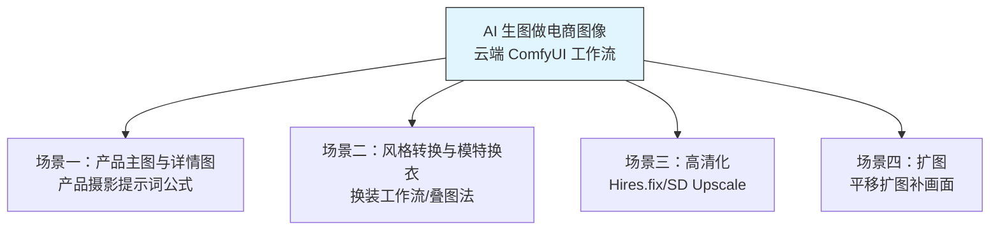
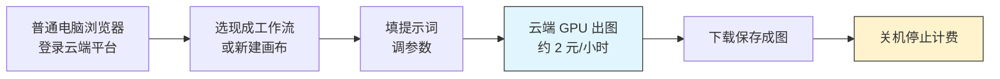
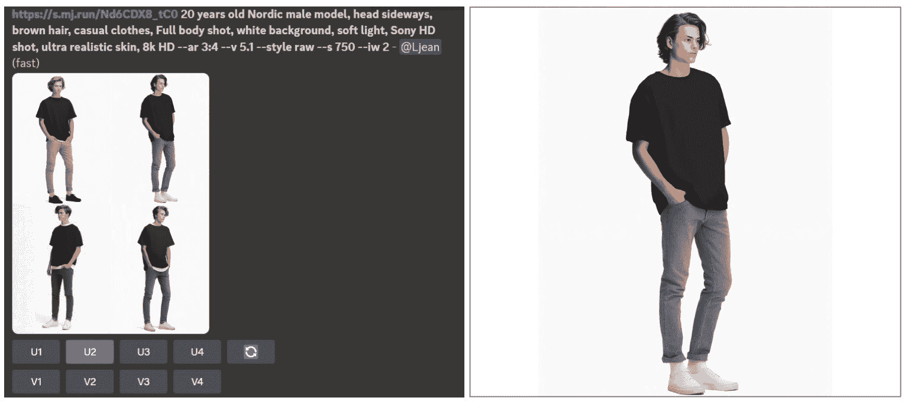
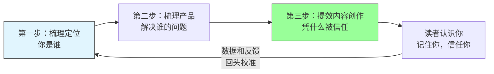
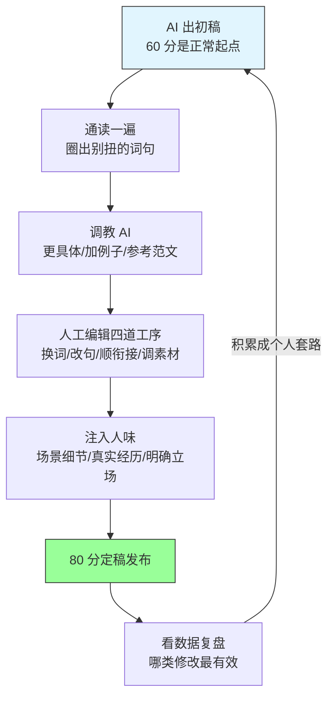

# 第29章 AI 电商与 AI 赋能 IP 定位

> 本节介绍用 AI 生图（ComfyUI 云端部署）做电商图像制作（风格转换、高清化、扩图），以及用 AI（尤其 DeepSeek）做个人 IP：梳理定位、梳理产品、提效内容创作，解决 AI 文案“AI 味”重的问题，效率提升 5–10 倍。

在正式开始之前，照例先说两句“废话”宽宽心：本章不需要你会画画、不需要你懂摄影，更不需要你有一台高配置电脑。你只需要会用浏览器打开网页、会在对话框里打字，就足够跟着本章把“做一张能上架的电商图”“搭一套自己的 IP 定位”这两件事走通一遍了。我们会把每一个“听起来很专业”的名词，都用大白话掰开揉碎讲清楚。

本章是第八部分“AI 商业变现”的第一章，讲两条互相独立的变现路子：

- **第一条：用 AI 生图做电商图像**。开网店的老板永远缺图——产品主图、详情页、模特图、活动海报，传统做法要么请摄影师、要么请设计师，都贵。AI 生图把这些活儿的成本打了下来，会用工具的人就能做出以前要专业团队才做得出的图。
- **第二条：用 AI 做个人 IP**。“IP”这个词听着玄，说白了就是“提到某个领域，别人能想到你”。以前做 IP 要靠团队，现在用 DeepSeek 这类工具，就能帮你梳理定位、梳理产品、量产内容，一个人也能转起来。

两条路子共享同一个前提：**让 AI 产出的东西少一点“AI 味”，多一点“人味”**。所以本章最后专门用一节，来解决这个所有 AI 用户都躲不开的问题。

另外交代一下和前面章节的关系：AI 绘画工具本身（Midjourney、Stable Diffusion）怎么注册、怎么出图，第 9 章已经讲过；提示词怎么写、LoRA 怎么控制风格，第 10 章讲过；ComfyUI 节点工作流和云端部署，第 12 章讲过。本章不再重复这些基本功，而是站在它们肩膀上，聚焦一个字：**用**——把出图能力变成电商里值钱的交付物。至于做出手艺之后怎么直接换成钱（接单），下一章第 30 章会专门讲。

---

## 29.1 用 AI 生图做电商图像：ComfyUI 云端工作流

### 29.1.1 电商图像是一门什么样的活儿？

先看一段《AI 电商设计基础与实战》里的原话：

> 早期的电商行业组织节日活动可能需要好几个产品设计师进行构想，而现在一个掌握 Midjourney 的设计师就能使用 AI 来完成整个电商活动的创意。使用 AI 拍摄的图像在同样的真实场景下，耗费的时间、金钱都是巨大的，但是可以把方案执行得更高效。

这段话翻译成大白话：以前电商店铺做一套活动图，是“好几个设计师 + 摄影棚 + 样品快递”的团队活儿；现在是一个人 + AI 的单人活儿。省下的不只是设计费，还有样品寄来寄去的快递费、摄影师按天算的档期费、修图师按张算的修图费。

再往深一层说，成本结构的变化比“省了多少钱”更值得注意。《AI 超级个体》算过一笔账：2024 年之前，一套完整的内容生产（文案 2000 元 + 设计 1000 元 + 视频 3000 元 + 投放 5000 元）大约要 11000 元；2025 年，同样的产出可能只需要 AI 订阅费 200 元加上人工监督 2 小时，实际成本不到 500 元。**固定成本趋近于零，边际成本几乎消失**——这就是为什么“会用 AI 生图”对普通人是一个真实的生意切口，而不只是个玩具。

电商图像这个大类里，最适合新手切进来的有四个场景，本章逐一演示：



| 场景 | 传统做法 | AI 做法 | 交付物 |
|------|---------|---------|--------|
| 产品主图/详情图 | 摄影棚实拍 + 修图 | 提示词直接生成 | 一张张可上架的成品图 |
| 模特换衣/风格转换 | 每套服装请一次模特 | 一张底图反复换装 | 同款多色/多场景模特图 |
| 高清化 | 高价买高分辨率原片 | Hires.fix 放大修复 | 符合平台尺寸的清晰大图 |
| 扩图 | 重拍或裁切 | 平移扩图补出画面外内容 | 任意比例的海报横竖版 |

### 29.1.2 出图三件套：Stable Diffusion、ComfyUI 与云端算力

动手之前，把三个反复出现的名字一次讲清楚。

**第一个：Stable Diffusion（常简称为 SD）**。它是一种基于扩散模型的 AI 图像生成技术，特点是完全开源——你可以把整个程序装到自己电脑上，没有任何使用限制，完全免费。它画出的图画质可以和实物照片相媲美，还能借助 LoRA、ControlNet 等衍生功能，精确控制艺术风格、角色细节、姿态、动作和构图（这两个插件第 10 章讲过）。

**第二个：ComfyUI**。第 12 章讲过，它是专为 Stable Diffusion 这类模型设计的“节点+工作流”界面：把选模型、写提示词、采样、放大这些步骤变成一个个方块，连线之后就能一键出图。你不用自己从零搭，云端平台上有很多现成工作流可以直接套用。

**第三个：云端算力**。这是新手最该关心的一环。SD 本地部署对显卡要求不低——按《AI 电商设计基础与实战》的实测，一张显存 8GB 的 RTX 3070 画一张 512×512 的图大约要 10 秒，而“能运行”和“顺畅运行”是两回事，出满意的商业图要反复尝试调整，显卡弱就是浪费时间。云端部署把这些门槛全部绕开：模型、插件、工作流都预装好了，普通笔记本电脑登录网页就能用，云端算力（如 RTX 4090）每小时只要 2 元左右（第 12.4 节详细对比过各家平台）。

把整个云端出图的过程画成一张图，就是下面这五步，其中最值得记住的是最后一步“关机”：



### 29.1.3 场景一：产品主图与详情图

这是需求量最大的场景。产品摄影是一个专门为突出产品卖点而设立的摄影门类，电商、产品推广都靠它。传统上，早期电商的化妆品详情图要用“3D 软件+后期合成”来制作；现在，类似的场景图完全可以交给 AI 生图。

写这类提示词，《AI 电商设计基础与实战》给出了一个万能公式：

> **产品摄影 + 主体 + 环境 + 角度 + 相机 + 质量提示词**

六个槽位各自管一件事：**主体**说清楚拍的是什么产品；**环境**说清楚放在什么场景里；**角度**说清楚从哪个方向拍；**相机**借专业器材的“名头”提升真实感；**质量提示词**（最高质量、8K 这类词）负责把分辨率和质感往上拉。

拿一款护肤品实战一下。把下面这条提示词发给 Midjourney（或者套进 ComfyUI 的文生图工作流，效果思路一致）：

```text
Product photography, Still Life photography, All natural skin care products,
nature, wood, flowers, minimalist style, focus on product, natural realistic
photography, front view, commercial photography, epic light texture,
highest quality, HD 8K --ar 3:4 --v 5.1 --s 750
```

翻译成中文就是：产品摄影，静物摄影，全天然护肤品，自然、木材、花卉（环境），极简主义风格，专注于产品，自然逼真摄影，正视图（角度），商业摄影（相机），史诗般的光影质感，最高质量，HD 8K（质量提示词），画幅比例 3:4。


> **图片说明**：按“产品摄影+主体+环境+角度+相机+质量提示词”公式生成的护肤品产品图（图源：《AI 电商设计基础与实战》）。木材、花卉的自然环境配上极简风格，产品居中聚焦——这类图直接可用作电商主图。

除了护肤品这种“静物摆拍”，家电类产品常用“固定场景”的拍法，比如把搅拌器放进一个明亮的日式厨房。这时可以用“叠图”技巧：先找（或生成）一张场景参考图，和产品一起喂给 AI，让它参考场景的光线和配色。对应提示词的思路是：

```text
（叠图）+ Real photoshoot taken in a minimalist Japanese-style bright kitchen,
with a food blender on the dining table, fruits and glasses on the table.
The overall color scheme is soft and bright champagne, with professional
lighting, shadow, volumetric, definition --s 750 --iw 2
```

大白话：这是一张在极简日式明亮厨房里拍的实拍风格照片，餐桌上有食物搅拌器、水果和玻璃杯，整体配色是柔和明亮的香槟色。**--iw 2** 这个参数表示“图片参考权重为 2”，数值越高，AI 越尊重你给的那张参考图。

### 29.1.4 场景二：风格转换与模特换衣

服装类目有个经典难题：同一件衣服，往往需要不同模特、不同场景的展示图，请一次模特就是一次钱。AI 生图的解法分两档。

**第一档（推荐新手）：ComfyUI 模特换装工作流。**第 12.5.2 节列过这个现成工作流：上传一张模特原图和目标衣服的图片，AI 自动完成换装，衣服的褶皱、光影都会自动匹配，还能顺手把背景从工作室换到海边。你不需要懂节点怎么连，套模板、传图、点生成就行。

**第二档（想精细控制）：Midjourney 叠图换衣法。**《AI 电商设计基础与实战》给出的完整步骤是三步：

1. **先画一张背景干净的商业模特图**。用下面的提示词生成（也可以拿自己实拍的模特图）：

```text
（叠图）, 20 years old Nordic male model, head sideways, brown hair,
casual clothes, Full body shot, white background, soft light, Sony HD shot,
ultra realistic skin, 8K HD --ar 3:4 --v 5.1 --style raw --s 750
```

翻译：20 岁的北欧男模，侧着头，棕色头发，休闲服，全身拍摄，白色背景，柔和光线，索尼高清拍摄，超逼真皮肤，8K 高清。

2. **抠图叠加**。在 Photoshop（或任意能抠图的工具）里把模特图和要换的衣服图叠到一起，把合成图发送到 Discord 里的 Midjourney，拿到图片链接。

3. **链接+提示词一起出图**。把上一步的图片链接和第 1 步的提示词叠加输入，加上 **--iw 2** 参数，就能得到换衣成功的模特图。这个方法适用于电商换装、服装设计等场景。



> **图片说明**：用“叠图+--iw 2”参数生成的换装模特图（图源：《AI 电商设计基础与实战》）。模特身着的衣服已替换为指定的款式，姿态、光线保持自然——同一张底图可以反复换出不同服装。

**风格转换**的思路和换衣一致：第 12.5.2 节的“图生图”工作流就是干这个的——保持原图构图不变，把风格改成水墨、油画、动漫，或者只重绘局部（比如把衣服换个颜色）。电商里的典型用法是：同一张产品图，批量生成“极简白底”“ ins 风桌面”“国潮红金”等多个风格版本，供店铺不同活动选用。

### 29.1.5 场景三：高清化——让图能上架

AI 生图有个天然的坑：模型通常按 512×512 或 768×768 这类小分辨率出图，直接拿去上架，放大一看细节发糊，平台审核和买家都不买账。而如果直接把生成分辨率调大，又会带来新问题——《AI 电商设计基础与实战》提醒过：分辨率设定过高，显存可能扛不住，还容易生成多个人物等不符合预期的元素。所以标准做法是：**先用低分辨率出图，再用高清修复技术放大**。

Stable Diffusion 的 WebUI 里主要有三种放大修复的玩法，按省事程度排序：

1. **文生图时勾选“高清修复”（Hires.fix）**。生成图像时勾选“放大算法”复选框即可，不同的放大算法模型效果相差不大。它会在出图的同时顺手把细节做扎实，是最省心的方式。
2. **SD Upscale 脚本放大**。对已经生成的图，在“脚本”区域选择 SD Upscale，“缩放系数”设为 2 就是放大两倍。如果效果不理想，可以把“重绘幅度”调小一点、“图块重叠像素”调大一点。
3. **“附加功能”里放大**。位于“附加功能”标签内，用 AI 算法把成品图放大到预定尺寸，类似无损高清修复。因为无须经历再扩散的过程，速度很快，几秒就能完成，适合批量处理已有图。


> **图片说明**：开启高清修复前后的效果对比（图源：《AI 电商设计基础与实战》）。未开启高清修复时乍看还不错，细看面部等细节发虚；开启后放大观察，细节明显更扎实，达到可交付的上架标准。

图生图本身就是一轮高清修复，所以走图生图路线出的图，通常不需要再单独做这一步。

### 29.1.6 场景四：扩图——把图“撑”到需要的尺寸

最后一个场景最容易被新手忽略，但特别实用：**图是现成的，尺寸不合用**。比如你有一张很满意的竖版产品图，但活动页需要一个横版 banner，重拍没条件，硬拉变形又难看。“扩图”（让 AI 把画面外的内容补出来）就是解药。

以 Midjourney 的“平移扩图”为例，操作只有三步：

1. 用 imagine 指令生成一张图片，放大其中一张；
2. 单击图片下方的方向箭头按钮（上、下、左、右），选择要扩展的方向，Midjourney 就会在原图的基础上朝那个方向补出新的画面；
3. 对扩展后的图继续放大、继续扩，直到画幅满足需求；也可以用 Zoom Out（缩小）功能把镜头拉远，让画面四周生成更多细节。

大白话理解：扩图就像“把窗帘往两边拉开”——窗帘后面的景色不是你画的，是 AI 根据画面里已有的线索（地板的纹路、光线的方向、桌面的延伸）合理脑补出来的。方向按钮每按一次，画布就往外长一截。

### 29.1.7 云端使用的三条省钱军规

最后把云端工作流的使用纪律汇总一下，都来自前人的经验教训：

1. **用完立刻关机**。云端按使用时长计费（RTX 4090 级别约 2 元/小时），挂机不干活也在扣钱。生成完这一批图，先关机再干别的。
2. **成图随手保存**。云端部署过程中必须妥善保存自己创建的图像，别把云桌面当网盘用。
3. **记住数据保留期**。关机后数据一般保留 15 天，15 天内不续用就会被清除，以便释放给其他用户。重要成图务必下载到本地。

> **大白话**：把云端算力当成“共享充电宝”——用的时候插上，用完马上还，别整夜揣在兜里；充电宝（数据）到期不取，平台就清空了。

---

## 29.2 用 AI 做个人 IP：梳理定位与产品

### 29.2.1 为什么 AI 越强，越要做个人 IP

很多人一听“做个人 IP”就摇头：我一个大普通人，没什么惊天动地的经历，凭什么做 IP？《AI 超级个体》里有一段话，正好回答这个问题：

> AI 可以生成完美的文案、精美的图片、流畅的视频，但它永远无法生成“你昨天踩过的坑”和“你刚刚顿悟的方法”。

作者做过一个实验：让 ChatGPT 写“社恐如何在职场生存”，它给出的建议四平八稳，全是正确的废话；但当作者写自己因为社恐在年会上假装接电话躲到厕所，却意外听到领导对自己真实评价的经历时，评论区炸了。**AI 可以总结道理，但给不出细节；而细节，恰恰是建立信任的关键。**

所以 AI 时代做个人 IP，逻辑不是“我要比 AI 写得好”，而是三步：



下面把三步逐一拆开。这三步全部可以用 DeepSeek、ChatGPT、豆包这类对话工具完成——它们只输出文字，所以哪家都行，顺手用哪个就用哪个。

### 29.2.2 第一步：梳理定位——你是谁

定位是最容易“拍脑袋翻车”的一步。大多数人选方向的方式是“看谁火就学谁”，《AI 超级个体》管这叫挤进红海。书里有个扎心的计算：2024 年中国 AI 数字人市场规模 41.2 亿元，同比增长 85.3%，听着很诱人；但天眼查数据显示，现存数字人相关企业已达 114.4 万家——**平均每家企业只能分到约 3600 元的市场份额**。需求是真的，竞争也是真的。

正确姿势是让 AI 帮你系统地扫一遍市场，而不是凭感觉下场。书里给了一套“用 AI 寻找蓝海的三步法”，三条提示词都可以直接抄进 DeepSeek（改掉方括号里的内容即可）：

**第一步，AI 市场扫描**：

```text
请扮演市场分析专家，帮我分析以下领域的商业潜力：
1. [你的专业领域] + AI 的结合点。
2. 目前该领域的内容供给情况。
3. 用户搜索量和增长趋势。
4. 潜在变现模式和客单价。
5. 进入门槛和竞争壁垒。
请给出具体数据和案例支撑。
```

**第二步，AI 竞品分析**（有了候选方向后）：

```text
请扮演竞品分析师，帮我分析 [你的目标赛道] 相关的账号：
1. 列出该领域 TOP20 的账号名单。
2. 分析它们的内容策略、更新频率、爆款特征。
3. 找出它们的内容空白点。
4. 分析它们的变现路径和大概收入。
输出格式：表格 + 详细分析。
```

**第三步，AI 验证需求**（最后确认这条路是不是真的在涨）：

```text
请帮我分析以下关键词在各平台的搜索趋势：
1. [关键词 1]
2. [关键词 2]
3. [关键词 3]
4. [关键词 4]
并预测这些需求在未来 6 个月的走向。
```

> **大白话**：这三步的分工是——第一步“这池子里有没有鱼”，第二步“已经在钓鱼的人钓得怎么样、哪里没人钓”，第三步“鱼是不是正在往这边游”。AI 给的答案不一定全对（第 1 章讲过幻觉问题，关键数据要人工核对），但它能把你的“拍脑袋”变成“有依据的假设”。

有了大方向，再让 AI 帮你把自己“装”进这个方向里。这是差异化定位的关键一步——同样做母婴，你是“妇产科护士妈妈”还是“全职爸爸”，人设完全不同。直接抄这条：

```text
基于我的背景：[列出你的经历、技能、性格特点]
帮我设计 3 个差异化的 IP 定位：
1. 定位名称  2. 目标人群  3. 核心价值主张
4. 与竞品的差异点  5. 记忆点设计
要求：每个定位都要有独特性，避免同质化。
```

书里还总结了 AI 差异化的三个维度，帮你判断 AI 给的定位好不好：

- **维度一：找“交叉地带”**。最容易做出差异化的地方，往往在两个领域的交叉点——李子柒是“传统文化×视觉美学”，董宇辉是“英语教学×直播带货”。你可以让 AI“将 [领域 A] 和 [领域 B] 进行创意组合，生成 10 个独特的定位方向”。
- **维度二：挖“隐藏需求”**。用户嘴上说的和实际要的常常不是一回事——李子柒的粉丝嘴上说“喜欢田园生活”，实际需求是“逃离焦虑，寻找诗意”。让 AI 分析“他们嘴上说需要什么？实际行为暴露了什么需求？”
- **维度三：造“新概念”**。给定位起一个朗朗上口的标签，比如“与辉同行”四个字，把“买东西”升级成了“一起成长”。让 AI 一次给你五个备选方案和配套 slogan。

最后记住：**定位不是一次性定死的**。书里的建议是每个月用 AI 做一次“定位体检”——把过去 30 天的数据表现喂给 AI（哪些内容超预期、哪些低于预期、评论区冒出了什么新需求、竞品有什么新动作），让它给出微调建议。李子柒自己也是一路进化的：从美食制作，到田园生活，再到文化输出、非遗传承。

### 29.2.3 第二步：梳理产品——解决谁的问题

定位回答“你是谁”，产品回答“你拿什么换钱”。这里说的“产品”不一定是实体货，更多时候是**你的经验**。

很多人卡在“我的经验不值钱”这个想法上。《AI 超级个体》纠正了这个误区：真正能打动人、能变现的独特经验，不在于经历的“罕见性”，而在于你是否拥有**可被他人借鉴的“解决问题能力”**。内容创作者本质上是“问题诊断师”——别人身上的痛点，你能不能开出有效的“内容处方”，决定了你的经验有没有价值。

按这个标准，书里列了四类“看似平凡、却最能变现”的经验，对号入座找找自己的：

| 经验类型 | 是什么 | 例子 |
|---------|--------|------|
| 失败复盘型 | 从错误中提炼方法论 | 复盘项目失败的五个关键节点；坦白自己情绪化操作亏了 30 万元 |
| 细分领域积累型 | 比 90% 的人多懂一点 | 三年📕运营的增粉策略；宝妈总结的“婴儿辅食时间表” |
| 生活技能优化型 | 从日常里挖共同价值 | 用 AI 整理账本从月光族变理财达人；每天 10 分钟徒手训练吸粉百万 |
| 逆袭转变型 | 从“我变了”到“你也能变” | 从月光族到理财高手；职场小白成长为团队领袖的路径拆解 |

这四类的共同点：**它们能立刻被用上**。在信息爆炸的今天，用户没有耐心崇拜“专家”，他们只想知道“我现在就能怎么做？”。

那怎么判断某个经验值不值得包装成产品？书里给了一个最简判断：看它是不是**有结构、有复用价值的经验模型**，具体拆成两个硬条件：

- **痛点的普遍性**：它要能解决足够多人的痛点。“如何用 100 天从 0 到 1 学会英语口语”远比“如何准备剑桥博士面试”更有市场，因为前者受众面广、转化链路短。筛选经验时，第一步不是问“我擅长什么”，而是问“别人缺什么”。
- **解决方案的可复制性**：你的方法别人能照着做出来。凡是能写成清单、模板、步骤的经验，都是可复制的，也就都可交付。

定位和产品都初具雏形后，别急着全情投入，先让 AI 帮你做一次“纸上开业的压力测试”（这条提示词同样来自《AI 超级个体》）：

```text
假设有一个博主的定位是 [你的定位]，请预测：
1. 什么样的人会关注？
2. 他们最关心什么问题？
3. 什么内容最容易成为爆款？
4. 可能遇到什么质疑？
5. 如何建立信任？
```

AI 预测的“可能遇到的质疑”尤其值钱——它会提前替你把最难堪的问题问出来，你可以在产品里提前准备好答案。

### 29.2.4 第三步：提效内容创作——凭什么被信任

定位和产品都有了，最后一步是持续产出内容，让陌生人一步步变成信任你的人。这一步恰恰是 AI 提效最猛的地方。

《AI 新个体：用 DeepSeek 重塑一人公司》给出一组判断：AI 生成内容的质量已经能达到 60 分的水平，甚至比大多数人手写的好；未来创作者之间的竞争，不再是写作能力的比拼，而是**看谁能把 AI 的输出从 60 分调教到 80 分甚至更高**。本期航海手册给出的参考数字是：内容生产效率提升 5–10 倍。

提效的创作流程分三步：

1. **选题：让 AI 找热门话题**。以前要花大量时间刷网站找灵感，现在直接说：“我要写一篇👸号文章，但不知道写什么，你帮我找找市面上最热门的选题。”AI 能迅速分析当前趋势，给出选题方向。
2. **口述成文：把脑子里的想法倒给 AI**。找到选题后，用口述的方式向 AI 输出你的观点，能讲多少讲多少，然后让 AI 根据你的思路生成一篇 2000 字左右的文章。初稿可能一般，但这就是调教的起点（调教方法见 29.3 节）。
3. **持续产出：用“内容矩阵”摊薄成本**。《AI 超级个体》把这套打法叫“内容矩阵”——每个内容都是可复用的模块，每条流程都是可优化的算法。一次深挖的经验，可以拆成📕图文、👸号长文、短视频口播稿等多种形态，一次劳动多次收获。

用两个真实案例感受一下“信任资产”的威力，数据都来自《AI 超级个体》：

- **李子柒**：YouTube 2010 万订阅者，130 个视频总播放量超 32 亿次；停更三年多期间，每月 YouTube 广告分成仍达约 78 万元；2024 年 11 月复出后，24 小时内三个新视频累计播放超 640 万次。**停更 1217 天，老视频依然持续产生收入**——这就是 IP 的“长尾效应”：内容不会因为你不更新而立刻失效，信任是持续复利的。
- **董宇辉**：2024 年直播 631 场，带货销售额超 102 亿元，抖音粉丝从 0 涨到 2863 万。反面对照是东方甄选“去董宇辉化”之后，2025 财年上半年净亏损 9650 万元（上年同期盈利 1.6 亿元）。**个人 IP 的价值是可以量化的：人走了，账目立刻变脸。**

把本节三步收进一张表，方便你对照执行：

| 三步 | 回答的问题 | AI 帮你做什么 | 产出物 |
|------|-----------|--------------|--------|
| 梳理定位 | 你是谁 | 扫市场、析竞品、验需求、设计人设 | 1–3 个差异化定位方案 |
| 梳理产品 | 解决谁的问题 | 筛选经验、判断痛点、模拟市场反应 | 有结构、可复制的经验产品 |
| 提效内容创作 | 凭什么被信任 | 找选题、口述成文、多形态分发 | 持续更新的内容矩阵 |

---

## 29.3 解决 AI 文案“AI 味”重的问题

### 29.3.1 先看一个“AI 味”现场

《DeepSeek 文案变现》记录了一个真实场景：一位美妆公司老板用 AI 写中秋节朋友圈祝福，她的提问是“我是一个美妆公司老板，中秋节需要写一篇朋友圈祝福文案，怎么写？”AI 给出了这样的回答（节选）：

> 作为美妆行业的从业者，我深知美丽不仅仅是外在的妆容，更是内心那份对生活的热爱与追求。中秋佳节，让我们一起用美妆点缀生活，用美丽传递温暖，让爱与美同行。感谢每一位支持我们、陪伴我们成长的朋友和客户。……愿这轮明月带去我的祝福：愿你的肌肤如月光般皎洁无瑕，愿你的生活如美妆般绚烂多彩。中秋快乐，阖家幸福！

书里的点评很到位：这段文案金句频出，产品与祝福融合得也不错，**然而如果直接发在朋友圈，可能会让用户感到一种缺乏温度、过度营销的感觉**——就像一台冷冰冰的推销机器在说话，发几天就快被朋友“拉黑”了。

这段文字就是典型的“AI 味”：辞藻漂亮、结构工整、面面俱到，但读不出“这是一个真人在对另一个真人说话”。你在各种 AI 生成内容里见过的“让我们一起”“不仅是……更是……”“愿……愿……”高频套话，都是它的标志性气味。

### 29.3.2 AI 味从哪儿来？

AI 味不是玄学，它的根源第 1 章就讲过：大模型是“按概率猜下一个字”的机器。**概率最高的词，往往就是最多人用、最四平八稳的词**——所以 AI 的默认输出天然偏向“平均化”：安全的比喻、工整的排比、滴水不漏的漂亮话。你自己不干预，它就永远停在“平均分”附近。

另一个推手是人的懒惰。《哈佛商业评论》2025 年 9 月有一篇引发争议的文章——《AI 生成的“工作垃圾”正在摧毁知识经济》，研究者发现了一个悖论：AI 工具越普及，高质量内容反而越稀缺。原因是当每个人都能用 AI 生成内容时，大部分人选择了最省力的方式：**直接复制粘贴 AI 的输出**。结果是领英上 80% 的“思想领袖”发布着一模一样的“深度思考”帖子。这些内容看起来专业、读起来流畅，但就是没有灵魂，用户很快就能分辨出“AI 味儿”。

> **大白话**：AI 像一台“普通话最标准的复读机”——它说的每句话都无可挑剔，但也毫无个性。而读者要的不是标准普通话，是“人话”。好消息是：正因为大部分人懒得改，**愿意动手改的人反而成了稀缺品**，这就是机会。

### 29.3.3 解法一：调教 AI，而不是一次性下单

第一类解法，是把 AI 当成一个可以反复沟通的学徒，而不是一台按一次按钮就出结果的售货机。《AI 新个体》的经验是：初稿 60 分是正常起点，**通过调教把质量提上去，这个过程可能需要 5 次以上的调整**。下面五条调教指令可以原样抄用：

1. **“你的文章写得不够具体，要更加具体。”**——高质量的文章需要详细阐述和具体细节，而不是泛泛而谈。AI 会尝试补充更多具体信息和数据。
2. **“你的文章缺少例子，需要更多的例子。”**——举例子是增强可读性和可信度的重要手段，AI 会在文章中加入更多案例。
3. **“你的文章 AI 味太重，参考这篇文章的风格。”**——直接点破问题，并给它一篇你喜欢的范文（比如某位你欣赏的作者的文章），让 AI 模仿那种风格。
4. **“你的文章写得太浅显了，要深刻一点。”**——观点不够深时，让 AI 重新梳理逻辑，挖掘更深层次的内容。
5. **“你的文章开头不够吸引人，开头的写作方式要符合市面上的爆款文章。”**——让 AI 用更有钩子的方式重写开头。

前期这样一轮轮调教，可能比自己写还费时间；但书里提醒，**一旦掌握调教技巧，创作效率会大幅提升，文章质量也会越来越高**——调教经验是可以积累复用的，手写的功力没法一键复制。

### 29.3.4 解法二：人工编辑的四道工序

第二类解法，是自己动手改。《ChatGPT 写作超简单》的作者把“给 AI 文稿做人工编辑”总结成了一套工序，它有个朴素的出发点：**把 AI 生成的内容视为草稿，通过人工编辑去掉“AI 味道”，引入“个人味道”**。四道工序如下。

**第一道：替换词语。**AI 常用一些“是那个意思但读起来别扭”的词。书里的真实修改示例：

| AI 原文 | 改成 | 为什么 |
|---------|------|--------|
| 一些（方法） | 3 种典型 | 数字比模糊量词更清晰、具体 |
| 一些（同事） | 有些 | 更符合日常说话习惯 |
| 谨慎 | 慎重 | 更口语、更顺 |
| 避免（误会） | 以免 | 读起来更流畅 |
| 脱颖而出（逃离流水线） | 逃离 | 原词与句意不匹配，属于用词不当 |

你替换的词语越多，个人风格就越明显——**用什么词，本身就是你的“声音”**。

**第二道：修改句子。**AI 容易在被动句、倒装句、语序、多重定语、复句这几类句式上出问题。书里给了两组修改对比：

- AI 版：“一个已经工作多年的人可能感到满足于目前的工作状态。” → 改成：“一个已经工作多年的人可能对目前的工作状态比较满意。”
- AI 版：“艾米明白，那个寄信人或许永远都无法被找到，但这并不重要了。”（拗口的被字句）→ 改成：“艾米明白，她可能永远也无法找到那个寄信人，但这并不重要了。”

**第三道：优化衔接。**AI 特别爱用“然而”“尽管”“在这篇文章中”这类书面连接词，段落之间常常转折生硬。书里的经验：“然而”多数时候换成“不过”更顺；“在这篇文章中”换成“接下来”更自然；段落之间“然而”“尽管”连用时，往往删掉一个、改用顺着前文语气的说法即可。

**第四道：调整素材。**AI 生成的文章常有三类素材问题：数据错误、数据不能有效证明结论、缺少数值。另外它编的例子常常是“放之四海皆准”的虚例。书里的做法是拿真实案例替换虚例——作者用自己同事经营淘宝店的真实故事替换了 AI 编的泛泛例子，“真实且贴合分论点，比 ChatGPT 构造的虚例效果好不少”。同时提醒一句第 1 章的老规矩：**AI 给的数据必须人工核对来源**，读者可能原谅你的观点，但不会原谅你的错误。

### 29.3.5 解法三：往文案里加“人”的东西

前两个解法是“减法”（去掉机器味），第三类解法是“加法”（加进只有你有的东西）。

**加法一：场景化的细节。**回到 29.3.1 那个美妆老板的例子。《DeepSeek 文案变现》让 DeepSeek 重写后，文案结尾出现了这样一句：

> 今夜风柔，适合想念
> ——××美妆创始人·写于奔赴工厂盯新品打样的深夜

书里点评：“这句极有画面感的文字，很好地通过**细节的场景化描述**去除了 AI 味，增加了能激发用户共鸣的情感温度。”“创业第 9 年”“深夜奔赴工厂”——这些具体到时间、地点、动作的细节，AI 编不出来，只能你提供，或者你确认。

**加法二：你自己的真实经历。**《AI 创收》里总结了一个“40—40—20 法则”，专门用来平衡 AI 效率和个人特色：

> **40% 的 AI 基础生成内容 + 40% 的个人专业知识 + 20% 的个性化表达。**

具体做法包括把个人经历直接“喂”进 AI 生成稿，书里给了示范提示词：

```text
请将我的个人体验“上周尝试最新的皮肤 AI 分析仪，发现我被诊断为敏感肌而非
之前认为的混合肌，使用针对性的产品后，皮肤状况改善了 30%”融入这篇 AI 生成
的“智能肌肤分析”文章中，使其更具真实感和说服力，同时突出 AI 诊断的精准性。
```

**加法三：情绪与立场。**《AI 超级个体》在分析 2025 年平台算法时提到，情感强度是算法判断“高互动潜力”的信号，但情绪词之外，**内容必须专业、可验证**——99% 的消费者因 AI 建议调整购买计划后，80% 还会去电商、社交媒体或线下做二次验证。所以“人味”不等于煽情，而是“敢下判断 + 给得出依据”。

把三类解法串成一条工作流，就是从 60 分到 80 分的完整路径：



最后强调一次顺序：**调教和编辑做的是“及格线以上”，真实细节做的是“天花板”**。AI 负责把文章写满，你负责让文章像你。

---

## 小练习

用 ComfyUI 云端工作流为一件虚拟商品（自己随便定一个，比如一款手冲咖啡壶）生成一张产品主图，并用 DeepSeek 为该商品背后的店铺写一份 IP 定位方案（你是谁/解决谁的问题/凭什么被信任）。

> **复盘参考**：
> - **主图部分**：套用 29.1.3 节的公式写提示词——“产品摄影+主体（手冲咖啡壶）+环境（原木桌面、晨光窗边）+角度（45 度俯拍）+相机（商业摄影）+质量提示词（8K 高清）”，生成后开启高清修复再交付；顺手记录一下本次云端算力的用时和费用，感受一下“2 元/小时”是什么量级。
> - **IP 定位部分**：先把 29.2.2 节的“人设组合”提示词发给 DeepSeek，拿到 3 个候选定位后，再用“市场扫描”提示词验证哪个方向竞争最小；最后用 29.2.3 节的“压力测试”提示词，让 AI 预测“可能遇到的质疑”，并提前写下你的回答。
> - 做完这两件事你会发现：图和文案都不难，难的是“知道自己要什么”——而这正是本章想帮你建立的判断力。

---

## 本章小结

通过本章，你应该已经了解：

1. **电商图像的成本革命**：以前一套活动图要“好几个设计师+摄影棚”，现在一个人+AI 就能完成；内容生产的固定成本趋近于零，这让“会用 AI 生图”成为普通人的真实生意切口。
2. **云端工作流**：Stable Diffusion 开源免费，ComfyUI 用节点工作流降低操作门槛，云端算力（RTX 4090 约 2 元/小时）让普通笔记本也能干专业的活；三条军规——用完关机、成图随手存、数据只留 15 天。
3. **四个电商图像场景**：产品主图（“产品摄影+主体+环境+角度+相机+质量提示词”公式）、模特换衣（换装工作流/叠图法+--iw 2）、高清化（Hires.fix/SD Upscale/附加功能放大）、扩图（Midjourney 平移扩图补画面）。
4. **个人 IP 三步法**：梳理定位（用 AI 扫市场、析竞品、验需求，警惕“平均每家只分到 3600 元”式的红海陷阱）、梳理产品（四种值钱经验：失败复盘、细分积累、生活技能、逆袭转变）、提效内容创作（选题→口述成文→调教，效率提升 5–10 倍）。
5. **信任是 IP 的复利**：AI 可以总结道理但给不出细节，“你昨天踩过的坑”才是差异化优势；李子柒停更三年月分成约 78 万元的案例说明，IP 是长尾资产。
6. **去“AI 味”的三类解法**：调教 AI（五条指令，5 次以上迭代）、人工编辑（换词、改句、顺衔接、调素材四道工序）、注入人味（场景化细节、真实经历、40—40—20 法则）——AI 负责写满，你负责写像你。

下一章，我们转向第八部分的第二条变现路径——AI 服务接单：不需要先攒粉丝、不需要先建渠道，做出样品就能收钱。我们会聊 AI 视频、AI PPT、AI 剧本三个确定性最高的接单方向。
