# 第30章 AI 服务接单：AI 视频、AI PPT、AI 剧本交付

> 本节聚焦三个确定性高方向：AI 视频、AI PPT、AI 剧本。教读者学会工具 → 找对标 → 产出作品 → 接单变现的共用链路，交付物明确、决策门槛低，适合无粉丝人脉的普通人快速赚到第一笔 AI 相关收入。

在正式开始之前，照例先说两句“废话”宽宽心：这一章不需要你会设计、不需要你懂拍摄剪辑，甚至不需要你有任何“作品集”。你只需要会用浏览器打开网页、会在对话框里打字描述需求，就足够跟着本章把“学工具—找对标—做样品—接第一单”这条链路走通一遍了。我们会把每一个“听起来很专业”的名词，都用大白话掰开揉碎讲清楚。另外提前说一句：上一章（第 29 章）讲的变现路径要先“建站、等流量”，这一章的路径不用等——**做出样品就能收钱**，两章对照着读，你对“AI 变现”的全貌会更清楚。

---

## 30.1 大白话：不用先积粉丝，直接做样品就能收钱

过去，做一套商业 PPT 要找设计师，拍一条产品视频要找拍摄团队，写一个短剧剧本要找专业编剧。这些服务动辄几千上万，只有预算充足的公司才请得起。

现在，AI 把这些事情的成本打下来了。一个会用 AI 工具的人，可以在几小时内完成过去专业团队几天的工作量，交付质量还不差。这意味着两件事：

**第一，原来没有高预算的需求，可以被满足了。** 一个开奶茶店的老板想要一套开业宣传视频，一个创业者需要一份融资 PPT，一个自媒体博主想要一篇深度文章，他们不需要顶级团队，他们需要的是"够用、快速、便宜"的解决方案。

**第二，能用 AI 高效交付的人，就是他们要找的服务商。** 这个人可以是你。

AI 服务不是什么高深的概念，本质上就是：**别人不会用 AI（或者懒得用），你会，你帮他做，他付钱。**

> **大白话**：你可以把“接单”理解成“接零活”。以前做零活得靠手艺（会设计、会拍摄、会写剧本），现在手艺的大部分被 AI 接管了，剩下的是三件 AI 替代不了的事：**听懂客户想要什么、把关 AI 做出来的东西够不够好、按时把东西交到客户手上**。这三件事不需要科班出身，只需要你肯拆解、肯沟通、肯交付。

传统外包和 AI 服务到底差在哪儿？我们把账摆在一起看：

| 对比项 | 传统外包（设计师/拍摄团队） | AI 服务（一个人 + AI 工具） |
|--------|---------------------------|---------------------------|
| 一条 30 秒宣传片 | 几千到上万元，周期一周起 | 几十到几百元，当天到两天交付 |
| 一套 20 页商业 PPT | 几千元起，反复沟通改稿 | 几百元左右，半天出初稿 |
| 谁能干 | 专业团队，设备和人手缺一不可 | 会用 AI 工具的普通人，一台电脑即可 |
| 利润从哪来 | 靠人力和时间堆出来 | 靠“会用工具”的效率差 |

这张表不是让你去打价格战，而是让你看清楚：**你的竞争优势来自效率差，客户的购买理由来自“够用、快速、便宜”**。看清这一点，后面所有动作都不容易跑偏。

把“一单服务”从发生到结束画成一张图，你对接单这件事就有完整的心里预期了：

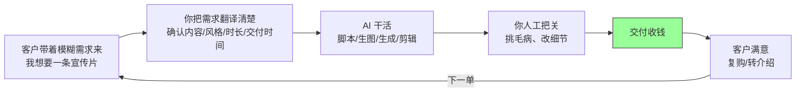

注意图里 AI 只占了“干活”那一个格子，前后两头——**翻译需求**和**把关交付**——都是人在做。这就是本章反复会出现的一个判断：AI 负责把活干出来，你负责让这活变成客户愿意付钱的东西。

本章聚焦三个确定性高、启动快、正反馈明显的方向：**AI 视频、AI PPT、AI 剧本**。这三个方向有一个共同特点：**交付物明确，客户一看就懂，决策门槛低。** 不需要你有粉丝量、不需要行业人脉，做出成品就能直接展示，可以自己玩流量接单，也可接第三方的单。

不过从学习周期和接单速度来看，优先推荐 **AI PPT / AI 视频** 定制。AI 剧本定制需要一定的剧本/写作基础，适合有一定写作基础的读者。除了这三个方向，大家也可以根据自己能力、兴趣爱好选择其他 AI 服务方向。

---

## 30.2 共用链路：学会工具 → 找对标 → 产出作品 → 接单变现

三个方向的底层逻辑一致：**学会工具 → 找到对标 → 产出作品 → 接单变现**。

四个环节画成一条闭环，就是下面这张图——它同时适用于本章三个方向，记住了它，就等于记住了 AI 服务接单的“总路线图”：

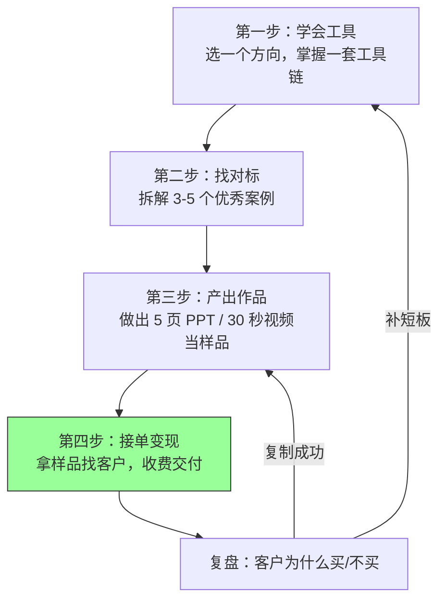

下面把每一步拆开讲。

### 30.2.1 第一步：学会工具

先掌握一个工具，不要三个同时做。根据你选择的方向：

| 方向 | 推荐工具 |
|------|---------|
| AI 视频 | 脚本：豆包、ChatGPT、Gemini、DeepSeek；生图：即梦、Nanobanana；视频：即梦、可灵 |
| AI PPT | 即梦、星流、豆包 |
| AI 剧本 | Gemini、Claude、ChatGPT（优先 Gemini）；国内平替：豆包、Kimi |

> **大白话**：这张表初看有点密，其实拆开就三个角色——**动嘴的、画画的、拍片的**。“脚本”是写方案的 AI（它只输出文字，所以豆包、DeepSeek 这些聊天工具都能干）；“生图”是把文字变成画面的 AI（即梦、Nanobanana）；“视频”是让画面动起来的 AI（即梦、可灵）。做 PPT 和剧本反而更简单，核心就是聊天工具加一个生成平台。

为什么强调“不要三个同时做”？因为三个方向的工具链互不通用，同时学等于同时浅尝辄止，最后哪个都做不出能交付的样品。**接单市场只认“能交付的样品”，不认“我三个都会一点”。**

### 30.2.2 第二步：找对标

找已经在做这类服务的对标账号，看他们的交付物、定价、服务范围。不要一上来就追求原创，**先模仿，再创新**。拆解 3-5 个优秀案例，搞清楚"好的标准长什么样"，然后照着做。

> **大白话**：“对标”就是“抄作业的学霸”。你不用发明“接单怎么做”，市面上已经有人做成了，把他们找出来，看三样东西：**作品长什么样（交付物）、卖多少钱（定价）、介绍自己怎么说（话术）**。这三个问题的答案凑齐了，你的“作业模板”就有了。

具体怎么找？给你三个最省事的入口：

1. **小红书**：搜“AI PPT 定制”“AI 视频代做”“短视频脚本代写”，出来的高赞笔记就是现成的对标，笔记里的配图就是他们的样品；
2. **闲鱼/淘宝**：搜同样的关键词，看销量高的商家，商品页写了什么服务范围、什么价格、多少天交付——这就是一份公开的“定价参考表”；
3. **抖音/B 站**：搜“AI 视频”相关关键词，看哪些博主在用 AI 工具做成品，他们的评论区经常有“接单吗”的留言——那既是需求信号，也是你的潜在客户池。

每找一个对标，建议用一张表记下来，拆 3-5 个之后，规律自己就浮出来了：

| 拆解项 | 要看什么 | 记下来做什么用 |
|--------|---------|---------------|
| 交付物 | 作品的时长/页数/风格/完成度 | 定你自己样品的“及格线” |
| 定价 | 单价、档位（基础版/进阶版）、加急费 | 给自己定一个不心虚的价格 |
| 话术 | 怎么介绍服务、怎么报交付时间 | 直接借鉴成你的接单文案 |

### 30.2.3 第三步：产出作品

做出 5 页 PPT 或 30 秒短视频脚本，作为样本作品。这是你接单的"敲门砖"，没有样品，客户不敢下单。

> **大白话**：客户不认识你，他只认两样东西——**你做过什么**和**做出来是什么样**。样品就是替你说话的“哑巴销售”：一个客户点开你发的 5 页 PPT，比你说一百句“我很专业”都管用。所以这一步的目标不是“学会”，是“拿出看得见的东西”。

给样品定一个最小标准，避免陷入“再改改才敢发”的完美主义：**PPT 样品 5 页、主题选一个常见场景（比如“新产品上市汇报”）；视频样品 30 秒、有完整脚本 + 画面；剧本样品一集 3-5 分钟的短剧分镜脚本。** 做完存进一个文件夹，再截几张图，你的“作品集”就算开张了。

### 30.2.4 第四步：接单变现

拿着样本作品去找可能需要的客户，出成品就能收钱。不要免费接单"攒经验"，哪怕第一单只收几十块，也要建立"我的服务是有价值的"认知。免费做只会吸引不尊重你时间的客户。

> **大白话**：“免费”是最贵的定价。免费单会消耗你所有的时间，吸引来的客户还最爱反复改——因为不花钱的东西，人是不心疼的。收几十块钱，钱不重要，重要的是双方都进入了“这是正式服务”的状态：你认真交付，他认真反馈。

去哪儿找第一批客户？按“门槛从低到高”排，新手从上往下试：

1. **闲鱼**：挂一个“AI 视频/PPT 代做”的服务链接，附上样品图，平台自带流量，有人搜就能看到；
2. **小红书/朋友圈**：把样品做成一条笔记或九宫格发出去，注明“可接单”，熟人介绍往往是最快的第一单；
3. **社群**：本书航海社群里就有需求方，同好群里也常有“求一份 PPT”的求助；
4. **承接平台**：猪八戒、淘宝这类服务市场，适合跑通流程后再入驻，因为通常要交保证金。

第一单建议怎么谈？记住三句话：**先问清楚需求（做什么、给谁看、什么时候要）→ 报价时报“价格 + 交付时间 + 修改次数”三件套 → 收一半定金再开工。** 这三句话能帮你避开新手 90% 的扯皮。

---

## 30.3 三个确定性高方向

| 方向 | 交付物示例 | 目标客户 | 核心能力 |
|------|-----------|---------|---------|
| AI 视频 | 30 秒短视频脚本/成片 | 自媒体博主、培训机构、电商品牌方 | 视觉表达与需求翻译（把客户模糊需求变成具体画面） |
| AI PPT | 5 页 PPT | 公司行政、企业培训、汇报人员 | 审美与商业理解（理解客户汇报场景和信息逻辑） |
| AI 剧本 | 短视频剧本、网络电影剧本 | 短视频制作团队、网络电影制片 | 情绪设计（爽感、节奏、钩子） |

这张表建议你打印出来贴在桌边：**“交付物”一栏决定你练什么，“目标客户”一栏决定你去哪儿找单，“核心能力”一栏决定你往哪个方向变强。** 下面逐个方向展开。

### 30.3.1 AI 视频：视觉表达与需求翻译

AI 视频的核心是**视觉表达和需求翻译**。客户说"我要一条产品宣传片"，你要能把这句话变成具体的画面：什么内容放在前面、什么节奏能留住人、产品卖点用什么画面呈现、整体调性是高级感还是接地气。

AI 帮你省掉了拍摄团队和专业设备，但"把客户模糊的需求变成一条能用的视频"，这些判断力是壁垒。

> **大白话**：什么叫“需求翻译”？客户嘴上说的是“高级一点”，你得翻译成 AI 能执行的提示词：“暗色背景、金属质感、慢镜头特写、克制的字幕”。客户说“年轻化一点”，你得翻译成“快节奏剪辑、明快配色、口语化文案”。**AI 听不懂“感觉”，只听得懂“画面描述”**——中间这道翻译，就是你的价值。

一条 30 秒的 AI 宣传片，完整制作流水线是下面这五步，每一步用什么工具、产出什么，都标在图里了：

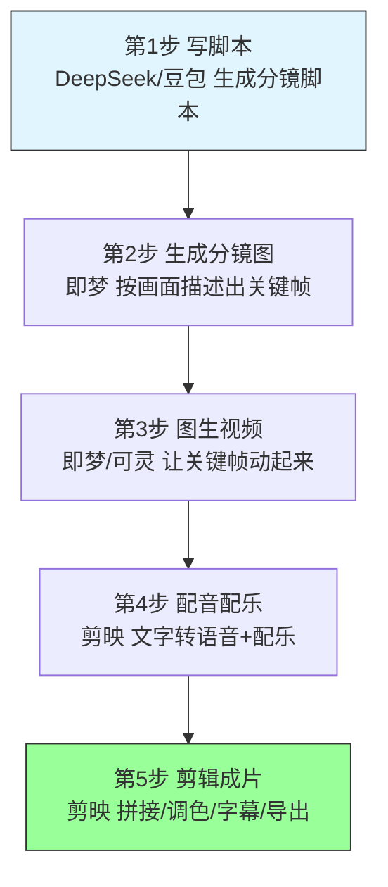

**第 1 步是整条流水线的地基**——脚本写清楚了，后面每一步都顺；脚本含糊，后面步步返工。所以这里给你一条可以直接抄的脚本提示词，把它发给 DeepSeek 或豆包（改掉方括号里的内容即可）：

```text
你是一位商业短视频导演。请为[产品/主题，例如：一家新开的奶茶店]写一条 30 秒宣传视频的分镜脚本，要求：
1. 用表格输出，包含 5 列：镜头号、时长（秒）、画面描述（给 AI 生图用的具体画面）、口播文案（配音念的话）、备注；
2. 总时长控制在 30 秒，共 6-8 个镜头；
3. 前 3 秒必须有一个抓眼球的钩子；
4. 画面描述要具体到“什么主体、什么动作、什么光线、什么景别”，能直接复制给 AI 生图工具使用；
5. 结尾有一个明确的行动号召（比如：到店、关注、下单）。
```

拿到分镜表格后，把“画面描述”一列逐条复制进即梦生成关键帧图片，再把图片交给即梦或可灵做“图生视频”，最后在剪映里配音、配乐、拼节奏。中间两个关键环节的实物长这样——左边是分镜表对应的分镜图，右边是剪辑导出的成片画面：

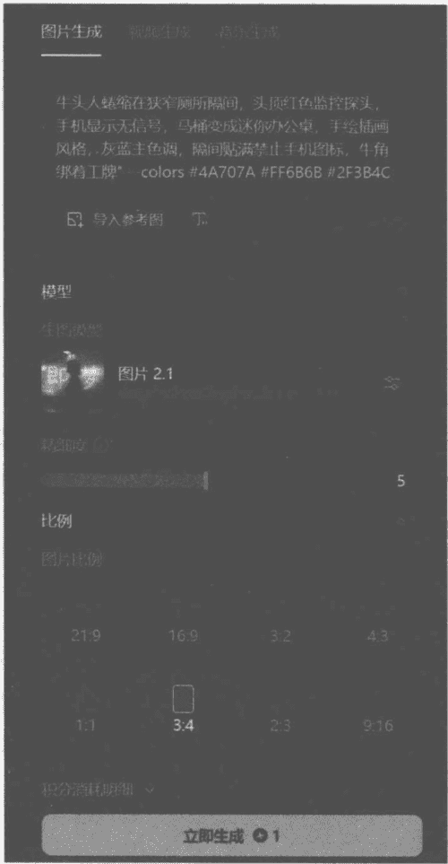

> **图片说明**：按分镜脚本在即梦中生成关键帧画面。每一条“画面描述”生成一张图，生成的图就是后面“图生视频”的原料。

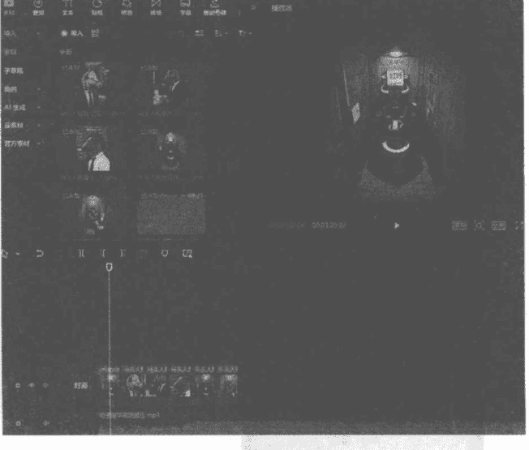

> **图片说明**：剪映中剪辑完成的成片画面。配音、字幕、节奏都在这一步收口，导出的视频就是交付给客户的最终作品。

新手在这一步最常见的坑是：**把 30 秒塞了 20 个镜头**。镜头越多，AI 生成失败率越高，剪辑难度越大。30 秒 6-8 个镜头是经过验证的稳妥配比——每个镜头 4 秒左右，节奏紧凑，工作量也可控。

### 30.3.2 AI PPT：审美与商业理解

AI PPT 的核心**不是技术，是审美和商业理解**。客户要的不是"AI 生成的 PPT"，是"能上台用的 PPT"。重点在于理解客户的汇报场景和信息逻辑，AI 只是帮你加速执行。

> **大白话**：什么叫“能上台用”？就是客户拿着它站在会议室里，讲得顺、不丢人。所以你拿到单子先问三个问题：**这份 PPT 是讲给谁听的？他要听到的重点是什么？总共讲几分钟？** 答案决定页数、详略和风格。这三个问题问完，你已经比 80% 只会闷头生成的同行专业了。

一套能交付的 PPT，制作流水线是四步：

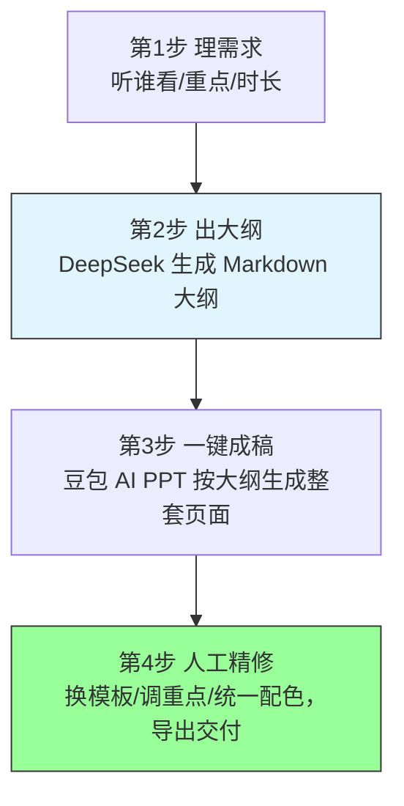

**第 2 步“出大纲”是 AI 真正提效的地方**——大纲对了，生成出来的 PPT 就有了骨架。给你一条直接可抄的大纲提示词：

```text
你是一位资深商业顾问。请为主题“[汇报主题，例如：Q4 新媒体运营复盘]”设计一份 PPT 大纲：
1. 用 Markdown 格式输出，一级标题为章节名，二级标题为每页标题；
2. 每页标题下给出 3-5 条要点，每条要点不超过 20 字；
3. 全文控制在 12-15 页；
4. 第 1 页为封面（主标题+副标题），最后一页为结论与下一步行动；
5. 数据页请标注“此处放数据图”，方便后续填充。
```

大纲生成后，最顺手的组合是 **DeepSeek 出大纲 → 豆包 AI PPT 一键成稿**：把 Markdown 大纲粘贴进豆包的“AI PPT”功能，几十秒就能得到一整套排版好的页面，再挑一个贴合场合的模板即可。实际操作界面长这样：

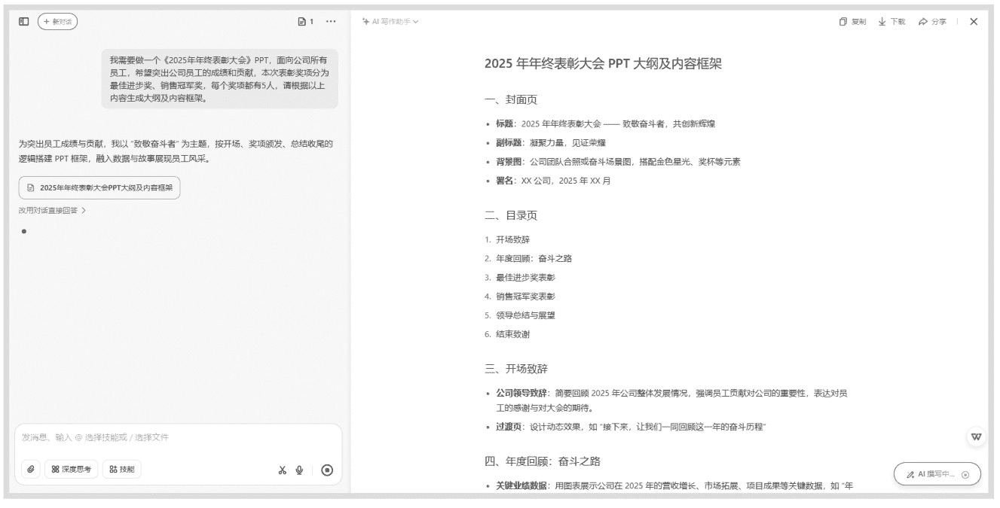

> **图片说明**：把 DeepSeek 生成的 Markdown 大纲粘贴进豆包，让它基于大纲生成 PPT 的对话界面。

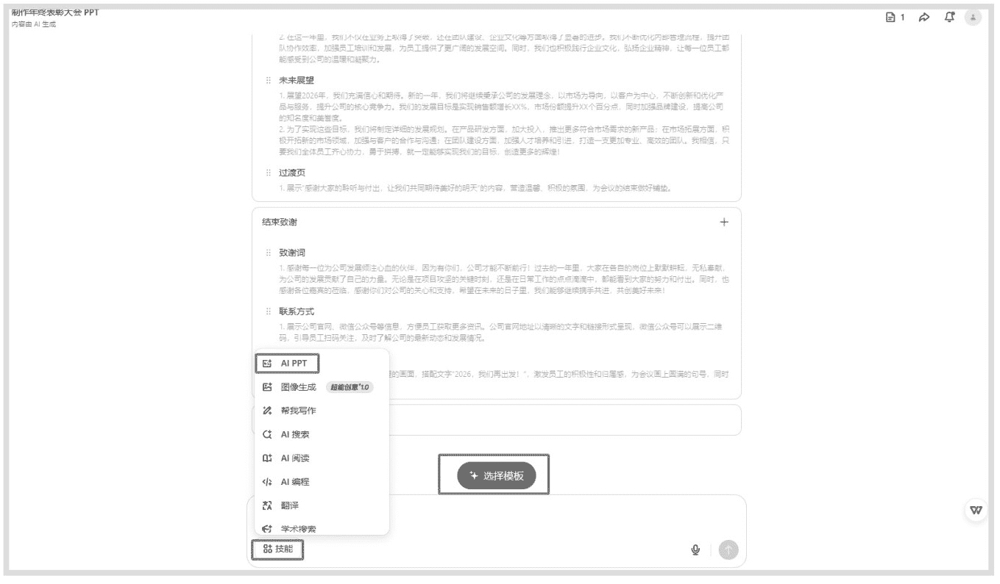

> **图片说明**：豆包对话框中的“AI PPT”功能入口。选择该功能后，豆包会引导你输入主题或直接粘贴大纲。

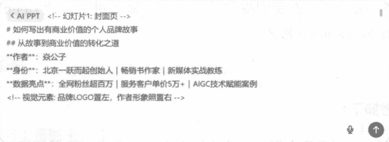

> **图片说明**：AI PPT 生成过程界面。平台根据大纲自动逐页生成内容并套用版式，等待片刻即可得到整套初稿。

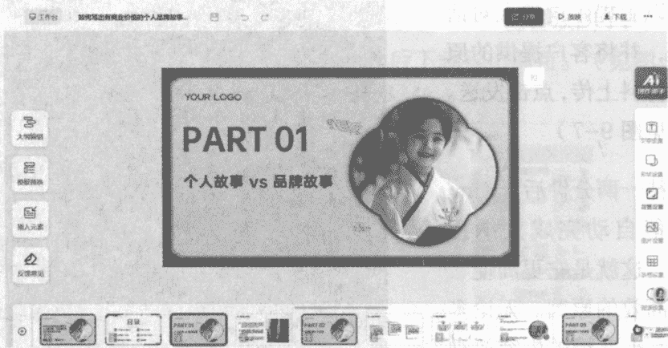

> **图片说明**：生成完成后的 PPT 成品页面。初稿通常已可用，交付前再做最后一轮人工精修：统一字体配色、突出客户最关心的数据、删掉空话页。

**第 4 步人工精修是收费的底气所在。**AI 生成的初稿是“及格线”，客户付钱买的是“从及格到能上台”的那一段：你帮他判断哪页信息太多要拆、哪个数据该放大、哪句话该删。给不想写代码的读者一个选项：第 2 步的大纲也可以不打开网页、直接用一小段程序生成，代码照抄就能跑（需要先按第 1 章的方法申请一个 DeepSeek API 密钥，并在命令行执行 `pip install openai` 装好依赖库）：

```python
# ===== 程序作用：调用 DeepSeek API，自动生成一份 PPT 大纲，并保存为 outline.md =====

# 第 1 步：导入 OpenAI 官方库（DeepSeek 接口与 OpenAI 格式兼容，直接用这个库）
from openai import OpenAI

# 第 2 步：创建客户端连接
#   - api_key：填你自己的 DeepSeek API 密钥（相当于“取餐暗号”，注意保密，别发到群里）
#   - base_url：告诉程序去 DeepSeek 的服务器取结果，而不是 OpenAI 的
client = OpenAI(
    api_key="sk-在这里填入你自己的API密钥",
    base_url="https://api.deepseek.com"
)

# 第 3 步：发起请求，让 DeepSeek 按上面那条提示词生成大纲
#   - model="deepseek-chat"：用日常对话模型即可，又快又便宜
#   - messages：system 是“人设说明”，user 里放你这次的主题
response = client.chat.completions.create(
    model="deepseek-chat",
    messages=[
        {"role": "system", "content": "你是一位资深商业顾问，擅长设计逻辑清晰的 PPT 大纲。"},
        {"role": "user", "content": "请为主题“Q4 新媒体运营复盘”设计一份 12-15 页的 PPT 大纲，用 Markdown 格式输出：一级标题为章节名，二级标题为每页标题，每页配 3-5 条不超过 20 字的要点；第 1 页为封面，最后一页为结论与下一步行动；数据页标注“此处放数据图”。"},
    ],
)

# 第 4 步：取出 AI 回答的正文，保存成 outline.md 文件
#   - encoding="utf-8" 保证中文不乱码
#   - 这个 outline.md 就可以直接粘贴进豆包的 AI PPT 功能了
outline = response.choices[0].message.content
with open("outline.md", "w", encoding="utf-8") as f:
    f.write(outline)

print("大纲已生成，保存在 outline.md，打开即可查看")
```

运行后，当前文件夹里会多出一个 `outline.md`，用记事本打开就是一份大纲。不会编程也没关系——直接在 DeepSeek 网页里对话生成，效果完全一样；这段代码只是给愿意“多一步自动化”的读者留的门。

### 30.3.3 AI 剧本：情绪设计

AI 剧本的核心是**情绪设计**。漫剧剧本更接近网文逻辑，重爽感、重节奏、重钩子。AI 帮提效，但什么时候该爽、什么时候设悬念，需要对故事节奏的理解。

> **大白话**：什么叫“情绪设计”？就是给观众装一个“情绪闹钟”：每 15 秒提醒一次“接下来有更刺激的”。开头 3 秒一个钩子（“他推开家门，发现饭桌上摆着两副碗筷，可他明明一个人住”），中段每隔几个镜头一个反转，结尾留悬念引导看下一集。**观众说不清为什么停不下来，但你能设计出来——这就是剧本单子值钱的地方。**

如果你还想把剧本往前推一步、做成“能播放的漫剧”，整条生产线是六步（素材体系《AI 漫剧创作一本通》把它总结为“选题→剧本→分镜→生成→配音→成片”的五步路径，本手册按实际操作拆成六步，本质一致）：

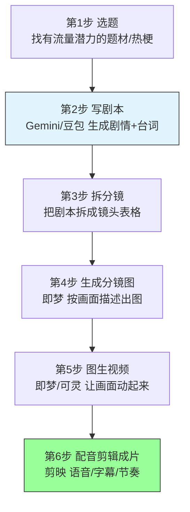

第 2 步写剧本，给你一条可以直接抄的提示词（这条提示词本身长这样，发给 Gemini、ChatGPT 或国内平替豆包、Kimi 都可以）：

```text
你是一位短视频短剧编剧。请以“[题材，例如：办公室怪谈]”为主题写一集短剧剧本，要求：
1. 时长 3 分钟左右，开头 3 秒必须有一个强钩子；
2. 按“场景 → 画面描述 → 台词/旁白 → 情绪提示”的结构逐场输出；
3. 中段安排两次反转，结尾留一个悬念钩子引导看下一集；
4. 最后把全剧整理成一张分镜表：镜头号、时长（秒）、画面描述（可直接用于 AI 生图）、台词/旁白、备注。
```

实际使用时，把这条提示词发给 AI 的样子如下：

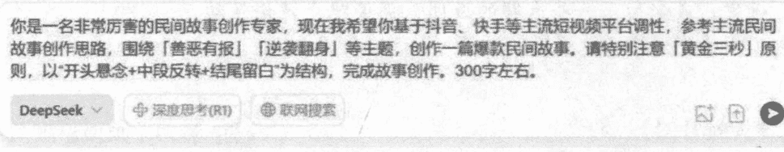

> **图片说明**：将剧本提示词发送给 AI 的对话界面。AI 会先给出完整剧本，再按要求的分镜表格式整理输出，后续分镜表可直接用于即梦生图。

做剧本方向的新手要特别留意一个分工：**AI 负责把故事“写满”，你负责把故事“写对节奏”。** AI 生成的初稿常常情节齐全但平铺直叙，你要做的是拿着“情绪闹钟”去校对：钩子够不够前面？第一处反转在第几秒？结尾留没留钩子？改完这几处，交付质量立刻上一个台阶。

---

## 30.4 新手入门建议与避坑

### 30.4.1 先选一个方向深扎

不要三个同时做。建议根据自己的基础选择：
- 有设计感觉的 → 选 PPT
- 有视频剪辑经验的 → 选视频
- 喜欢写故事的 → 选剧本

如果三样都沾不上边，就按上手速度选：**PPT 最快（一个下午能出样品），视频居中（要多学生图和剪辑），剧本最吃积累（但单价往往最高）**。选定的判断标准只有一条：两周内能不能做出一个敢发给陌生人的样品——能，就选它。

### 30.4.2 先模仿，再创新

不管哪个方向，第一步都是拆解 3-5 个优秀案例，搞清楚"好的标准长什么样"，然后照着做。不要一上来就追求原创。

> **大白话**：模仿不是抄袭——抄的是“结构和标准”，不是“内容”。比如你对标的 PPT 用了“问题 → 原因 → 方案 → 成果”的四段结构，你换一个主题照这个结构写，就是合格的模仿；等做过 10 单，你的手感自然会长出属于你自己的风格。所有手艺人都是从临摹开始的，接单这行也不例外。

### 30.4.3 避坑：不要陷入"学工具"的循环

工具永远在更新，够用就行。**核心能力是理解客户需求和交付质量，不是会用多少种 AI 工具。**

一个自测的小办法：问自己“现在能不能交付一单？”——能，就停下去接单；不能，找出差的那一块（通常是脚本逻辑、审美判断或沟通话术），补完那块就立刻去接单。**“工具焦虑”的解药不是再学一个工具，而是完成第一笔真实交付。**

### 30.4.4 避坑：不要免费接单"攒经验"

哪怕第一单只收几十块，也要建立"我的服务是有价值的"认知。免费做只会吸引不尊重你时间的客户。

把两个坑合起来看，其实是同一件事的两面：**你的时间应该花在“交付质量”上，而不是花在“学不完的工具”和“不付钱的客户”上。** 守住这条，新手期走不歪。

---

## 30.5 对应素材

- `202603-ai-fuwu` > AI 服务大航海（AI 服务接单，交付物明确，无需粉丝人脉）
- `202503-deepseek` > 三、DeepSeek 的应用场景（3.5 用 DeepSeek 设计一套完整 PPT）

---

## 小练习

用 AI 生成一份 5 页 PPT 或一个 30 秒短视频脚本，作为样本作品保存，并列出 3 个可能需要此类服务的潜在客户类型。

> **参考模板**：
>
> | 样本作品 | 平台工具 | 潜在客户类型 1 | 潜在客户类型 2 | 潜在客户类型 3 |
> |---------|---------|-------------|-------------|-------------|
> | 5 页 PPT | DeepSeek/Claude Code | 公司行政 | 培训机构 | 自媒体博主 |
> | 30 秒短视频脚本 | 可灵/即梦 | 短视频制作团队 | 网络电影制片 | 电商品牌方 |

做完小练习后，再往前走半步：把你的样品拿给一位完全不了解 AI 的朋友看，只问一个问题——“如果我要卖这项服务，你觉得值多少钱？”对方的答案大概率低于你的心理价位，这个差价就是你在 30.4.4 节要建立的“价值认知”需要补的课；而对方看完样品追问的细节（“还能改成横版吗？”“能加我们 logo 吗？”），正是真实客户会问的问题，提前记下来，就是你接第一单时的谈单清单。

---

## 本章小结

通过本章，你应该了解：

1. **AI 服务的本质**：别人不会用 AI，你会，你帮他做，他付钱。你的竞争优势来自效率差，客户的购买理由是“够用、快速、便宜”。
2. **三个高确定性方向**：AI 视频、AI PPT、AI 剧本，交付物明确，决策门槛低；核心能力分别是需求翻译、审美与商业理解、情绪设计。
3. **共用链路**：学会工具 → 找对标 → 产出作品 → 接单变现；样品是敲门砖，第一单也要收费。
4. **两条提效工作流**：视频走“脚本 → 分镜图 → 图生视频 → 配音剪辑”五步；PPT 走“DeepSeek 出大纲 → 豆包 AI PPT 一键成稿 → 人工精修”四步。
5. **避坑指南**：先选一个方向深扎，先模仿再创新，不要免费接单，不要陷入"学工具"的循环。

下一章，我们将学习 AI 自媒体账号搭建与长期变现，教你如何在小红书、视频号、X/推特、YouTube 等平台建立 AI 垂类账号，实现长期商业变现。
