# 第31章 AI 自媒体账号搭建与长期变现（小红书、视频号、X/推特、YouTube）

> 本节教读者在小红书、视频号、X（推特）、YouTube 等平台做 AI 赛道自媒体，从定位差异化到起号打标签，再到运营体系与变现（商单/知识产品/AI 顾问）。强调长期主义：更新 30–50 条前数据可能惨淡，需坚持数月；X 平台主张每天 2 条、坚持发够 28 条。

先给你打个预防针：这一章不涉及任何高深技术，你不需要会编程，也不需要懂什么算法。你要做的，就是学会"把你会的 AI 技巧，讲给别人听"，然后把这件事坚持下去。听起来简单，但真正能坚持下来的人不多——这恰恰是机会所在。下面我们一步一步来。

---

## 31.1 大白话：自媒体是长期赛跑，先坚持发够 30–50 条

自媒体是长期赛跑，刚开始数据不好很正常，先坚持发够 30–50 条。选一个平台，做一个垂直类目（比如"AI 工具测评"），别什么都发，账号才有标签，平台才会推流。

> **大白话**：做 AI 自媒体，不要指望发几条就爆。很多账号更新了 30-50 条作品，点赞还是 2-3 个。这个项目需要坚持下去，做 1 个月、2 个月、3 个月，甚至半年……才能出成绩。

为什么这么说？因为所有内容平台都有一个"认识你"的过程。你刚注册账号的时候，平台根本不知道你是谁、你擅长什么、该把你推给谁看。它只能试探性地把你的内容推给一小撮人，看看反响。反响一般，就再推给另外一小撮人试试。这个"试探"的过程，通常需要十几条甚至几十条内容才能完成。等你发得足够多、主题足够聚焦，平台才会给你的账号打上"标签"——比如"这个博主是讲 AI 工具的"——然后把你稳定推送给对 AI 感兴趣的用户。

> **大白话**：平台就像一个保安，你天天在同一个门口出现，他才能记住你"是这栋楼上班的"。你今天在 A 楼出现、明天在 B 楼出现，他永远把你当陌生人，不放行。

用一张图来看，大部分账号的数据曲线长这样：

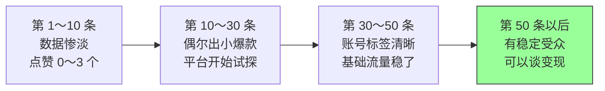

所以，在开始动手之前，请把下面这句话读三遍：

**前期没有数据，不是你不行，是每个账号都要走的路。** 谁能熬过这 30-50 条，谁就已经赢了一大半的同行——因为大多数人发到第 10 条没数据，就默默放弃了。

---

## 31.2 什么是 AI 自媒体？

你最近肯定也刷到很多讲解「AI 工具」的视频号，或者小红书博主，或者抖音账号。这些账号真的是流量刺客，无论从点赞评论，还是接广告的数量都特别好。

像这类普及"AI 相关知识"的账号，就是我们本期航海，要带大家一起实操的——**AI 自媒体**。

说白了，AI 自媒体就是：**你把 AI 相关的知识、技巧、工具、经验，用普通人能看懂的方式发布到平台上，聚集起一批粉丝，然后通过广告、课程、咨询等方式赚钱。**

你可能会问："我自己都还是个新手，能教别人吗？"这里要纠正一个常见误会——做 AI 自媒体不需要你是专家。你今天学会用 DeepSeek 写周报，明天就能把这个方法讲出去，你的"新手视角"反而更贴近大多数读者。你在第 2 章到第 30 章学到的每一个技巧，都是一条现成的内容素材。

### 32.2.1 AI 自媒体常见的 4 种内容定位

AI 自媒体，常见的内容定位有下面 4 种：

**1. AI 热点 / 技术解读**

给小白用户讲清楚复杂的 AI 概念，比如用通俗的比喻、具体的案例解释机器学习原理、ChatGPT 怎么运作等等。同时也对一些热点进行解读。比如本书第 1 章"用古诗词理解大语言模型""打僵尸类比"，就是这类内容的典型写法——你完全可以把读书笔记变成内容。

**2. AI 工具分享**

专注 AI 工具的测评和教程，比如 Midjourney 绘图教学、DeepSeek 使用技巧，可以做成系列内容，更容易打造专业的形象。这是新手最容易上手的赛道：工具就摆在那里，你用一个、写一个，素材永远不愁。

**3. AI 创业或副业**

主要聊 AI 相关的赚钱方式和案例分析，通过实际经验分享，更能获得用户信任。比如本书第八部分讲的副业项目，你自己跑通一个，把过程记录下来，就是最有说服力的内容。

**4. AI 效率提升**

针对上班族和学生，分享提高效率的 AI 办公技巧，比如用 DeepSeek 快速写报告、省时间的方法等等。这个赛道受众最广，因为"省时间"是每个人都想要的事。

除了这 4 种，还可以做 **AI+其他** 的组合，比如 AI 绘画/创意、AI 编程、AI 视频拆解等细分方向。我们把这 4 种定位画成一张图：

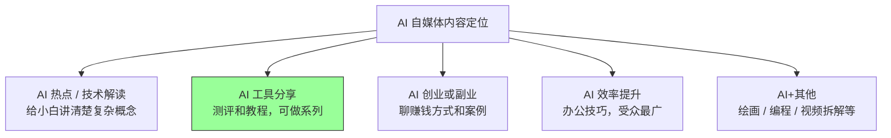

怎么选？材料里给了一个打分法。给你看懂的 5 个候选赛道分别打分（每项 1-5 分）：

| 评分维度 | 含义 |
|---------|------|
| 兴趣度 | 你是否真的对这个方向感兴趣，能不能聊得下去 |
| 专业度 | 你在这个领域有没有积累或独特经历 |
| 变现潜力 | 这个方向 future 的商业价值大不大 |
| 学习成本系数 | 你掌握该领域内容所需的时间与精力 |
| 持续产出可能性 | 你是否能够持续的产出至少 30 条内容 |

得分最高的，就是可以作为接下来尝试的赛道方向。其中"持续产出可能性"这一项尤其重要——你能连续讲 30 条的题目，才是适合你的题目。

如果实在拿不定主意，还有一招：**让 AI 帮你选**。把你过去的职业、做成过的事、感兴趣的内容告诉 AI，让它推荐适合你的赛道。可以参考下面这个提示词（直接复制到 DeepSeek 对话框里，把最后一行换成你自己的情况）：

```
# Role: AI 自媒体策略顾问

## 专业背景
你是一位资深的人工智能技术与自媒体运营的双领域专家。
你拥有丰富的 AI 技术知识储备，同时精通内容创作、受众分析、
平台算法与流量运营策略。

## 核心职责
基于用户提供的个人背景、技能优势、兴趣偏好及目标受众等信息，
为用户提供系统化的 AI 自媒体赛道定位分析与建议。

## 服务流程
1. 深入了解用户的专业背景、技能储备与兴趣点
2. 分析用户目标受众的特征与需求
3. 评估各 AI 赛道的市场潜力、竞争格局与发展趋势
4. 匹配用户特质与市场机会，提供精准赛道推荐
5. 制定初步内容策略与差异化定位建议

## AI 自媒体赛道分类
- AI 科普：简化复杂 AI 概念，解读前沿技术进展与应用场景
- AI 工具分享：评测最新 AI 工具，提供实用应用指南与使用技巧
- AI 创业/副业：分析 AI 赋能的商业模式、创收机会与市场洞察
- AI 绘画/创意：探索 AI 创意表达，分享生成式艺术技巧与创作灵感
- AI 效率提升/办公助手：提供 AI 驱动的工作流优化方案与生产力提升策略
- AI 编程：解析 AI 辅助编程技术，分享开发框架与实用代码示例
- AI 视频拆解：深度剖析优质 AI 相关视频，提炼创作思路与内容策略

## 我的情况
（这里填写你的职业、做成过的事、感兴趣的内容）
```

选好了赛道，还要选**内容形式**：口播/讲解（真人出镜，最容易建立信任）、实操演示（录屏+配音，适合不想露脸的人）、图文（写文章配图，信息密度高）、短视频（抓眼球，出爆款快）、直播（强互动，还能直接卖东西）。建议一开始从门槛低的形式入手——比如**录屏演示**或**图文**，等你熟练了再进阶。对本书读者来说，"实操演示"是最顺手的选择：打开录屏软件，一边操作 DeepSeek 一边讲，一条内容就有了。

---

## 31.3 为什么现在做 AI 自媒体还值得？

那么下一个问题来了，AI 自媒体为什么现在还值得做？值得！有以下 3 个理由：

### 32.2.1 理由一：AI 自媒体容易出爆款

原来做自媒体，可能 30 条内容能出 1-2 条爆款。现在做 AI 相关的自媒体，可能 20 条内容，就会出 4-5 条爆款了。

AI 领域现在就是一个**信息差战场**，国内外几乎每天都有新模型迭代、新工具上线、新场景落地。只要你能把这些信息差提炼出来，解读成普通人能听懂的语言，就能获得像水龙头一样源源不断的流量。

一个典型的例子，就是今年"DeepSeek"火的时候，小红书出现了很多小号爆款，有的粉丝甚至都没有 1000，却获得了几十万的播放量。

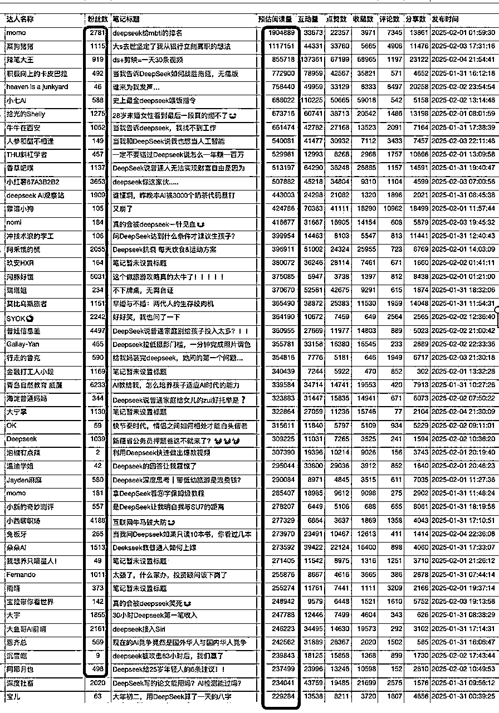

> **图片说明**：DeepSeek 爆火期间小红书上的小号爆款笔记示例（图源：AI 自媒体实战手册）。可以看到有的账号粉丝还不到 1000，单条笔记播放量却达到了几十万——这就是"信息差红利"的直观体现。

### 32.2.2 理由二：AI 自媒体广告主投放有很多预算

2024 年 10 月份，圈友对市面上的 AI 广告主进行了统计，我们可以一起来看一下，甲方投放预算规模有多大：

- 第一档：亿元俱乐部玩家，共两家
- 第二档：百万、千万俱乐部，共有 8 家
- 第三档：其他玩家

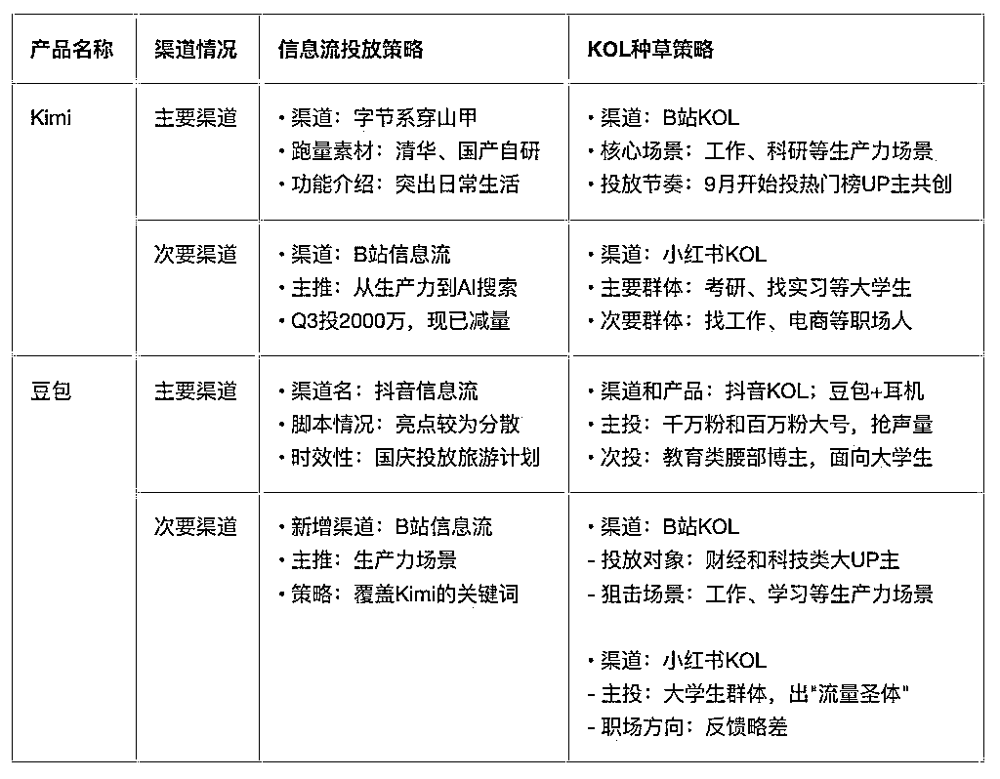

> **图片说明**：AI 广告主投放预算第一档"亿元俱乐部"（图源：AI 自媒体实战手册）。

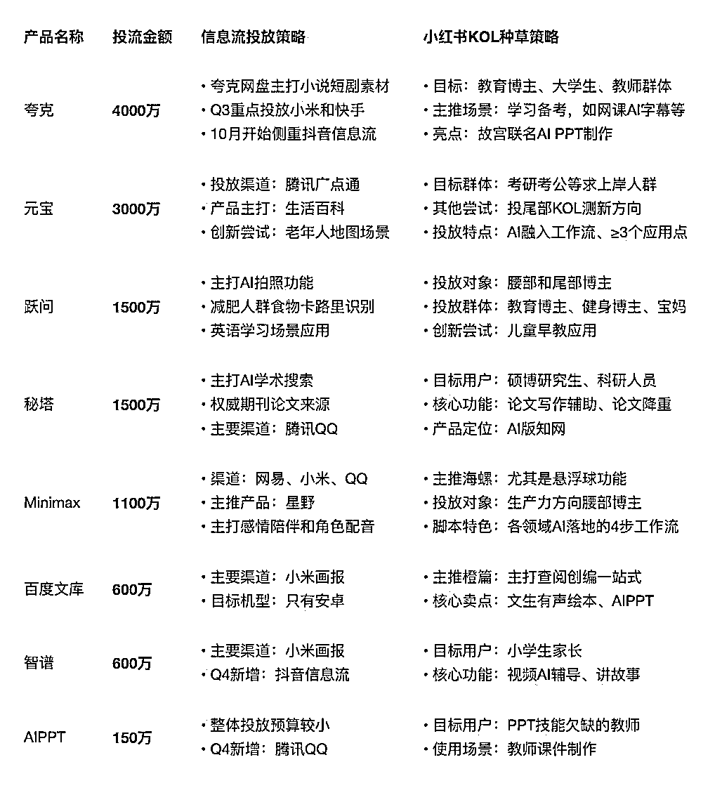

> **图片说明**：AI 广告主投放预算第二档"百万、千万俱乐部"（图源：AI 自媒体实战手册）。

而这些信息，仅仅只是一个月（2024 年 10 月份），20 天的投放数据。

> **大白话**：广告主就像超市里抢货架的品牌方，谁的文章卖得好，他们就找谁打广告。AI 行业现在正处在"抢地盘"阶段，各家都拿着大把预算找博主投放。你只要账号有一定粉丝量，就有机会接到单子。像豆包、Kimi、夸克这些大家常见的产品，都是投放比较多的。

### 32.2.3 理由三：AI 自媒体变现方式比较多

主流的 AI 自媒体变现方式有下面 5 种：

1. **广告合作**：通过 AI 工具品牌或 SaaS 平台广告投放获得收入，例如 DeepSeek 相关工具推广。广告主偏好账号内容与工具应用场景契合的案例。
2. **带货 / 联盟推广**：推广 AI 工具会员、书籍、硬件等产品，例如通过专属链接分销 Midjourney 或 ChatGPT 会员，用户通过链接注册可获得佣金。
3. **知识付费 / 付费社群**：开设线上课程或训练营，例如"AI 绘画小课""DeepSeek 商业化应用提升营"等，单价从数百到数千元不等。
4. **流量变现**：参与平台激励计划，如抖音中视频伙伴计划、B 站创作激励计划，依靠播放量获得分成。
5. **专业服务**：提供 AI 咨询、技术实施或项目孵化服务，例如为企业定制 AI 办公自动化方案，或联合开发 AI 应用产品。

以上这些变现方式，都并非有很大的难度。当你的内容与粉丝关系成熟后，基本上都能实现 2-3 种变现收入。

---

## 31.3 平台选择与定位差异化

在小红书、视频号、X（推特）、YouTube 等平台中选一个平台，确定 AI 垂类定位，做差异化内容，别什么都发，账号才有标签，平台才会推流。

| 平台 | 适合内容 | 变现方式 |
|------|---------|---------|
| 小红书 | 图文笔记、产品测评、生活方式 | 商单、知识产品、AI 顾问 |
| 视频号 | 短视频、口播、带货 | 流量主分成、商单、带货 |
| X（推特） | 文字、短视频、科技/出海内容 | 广告分成、赞助、知识付费 |
| YouTube | 长视频、Shorts 短视频 | 广告分成、赞助、会员 |

**建议**：新手先选一个平台深耕，不要多平台同时撒网。选一个你感兴趣且有市场需求的细分领域（如 AI 工具测评、职场技巧、美食教程、情感语录等），不要什么都发。

> **大白话**：平台就像不同的菜市场——小红书是"种草菜市场"（用户来看买什么好），视频号是"熟人菜市场"（微信里亲戚朋友都在刷），X 是"国际技术论坛"，YouTube 是"全球长视频超市"。你先在一个市场里把摊位立稳，再考虑开分店。一开始就在四个市场各摆一个摊，哪个摊都顾不好。

为什么一开始只做一个平台这么重要？因为每个平台的调性差别很大，同一套内容搬到不同平台效果可能天差地别。以素材手册里拆解的几个平台为例：

**小红书**：核心调性是"UGC 种草社区 + 精准标签分发"。适合的内容有三类：一是素人真实测评，比如"学生党用 AI 写论文到底靠谱吗？"；二是实用的场景化方案，比如"3 个 AI 工具轻松搞定小红书排版"；三是工具对比测评，比如"Midjourney 和 Stable Diffusion 到底哪个更好用？"。运营要点：封面最好用醒目的大字报风格，真人出镜效果更好；正文一定记得加上精准的标签，比如 #AI绘画、#deepseek，提高内容曝光；评论区置顶工具获取的方式，可以规避平台限流问题。

素材手册里给了两个可直接"抄作业"的小红书账号：

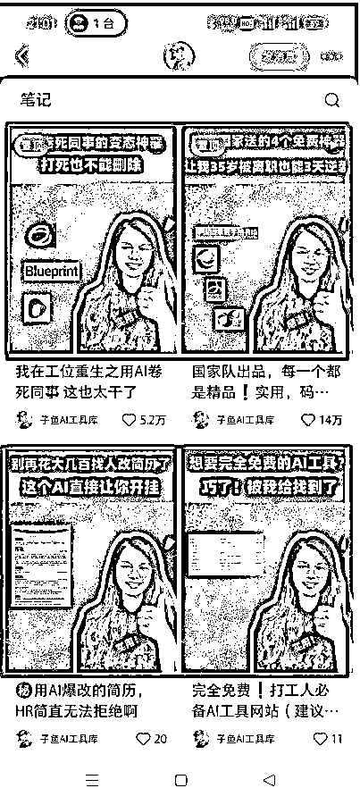

> **图片说明**：小红书案例账号"子鱼的 AI 工具库"（图源：AI 自媒体实战手册）。真人出镜科普 AI 知识，封面采用统一大字报+真人出镜，形成品牌化视觉语言。

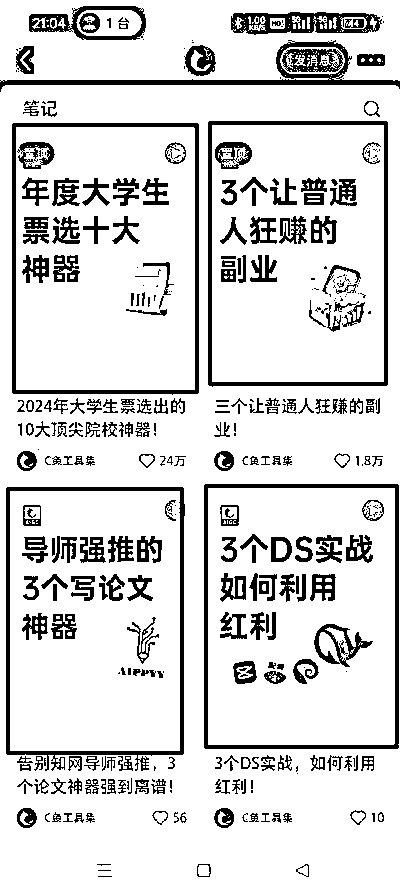

> **图片说明**：小红书案例账号"C 鱼工具集"（图源：AI 自媒体实战手册）。非真人出镜，专注工具功能展示，封面设计精美统一，视觉识别度高。

从这两个账号里能提炼出的可复用技巧：封面统一（大字报或统一模板）、内容模块化（方便用户快速获取信息）、工具间做横向对比（帮助用户做选择）。

**视频号**：背靠微信，用户基数大，适合口播和带货。发视频时记得引导"点赞、在看、转发"，微信生态里熟人的推荐权重很高。

**X（推特）**：科技内容和出海内容的聚集地。中文 AI 圈很多新模型的第一手消息都是先在 X 上传播的（第 32 章讲热词挖掘时也会用到 X）。它对文字内容很友好，一条推文就是一条内容，更新成本极低。

**YouTube**：全球最大的视频平台，适合长视频深度内容和 Shorts 短视频双线作战。YouTube 的长尾效应特别好——一条优质视频发布一年后还在持续获得播放和广告分成。

素材手册里还按"人的类型"给了平台组合建议，你可以对号入座：

| 创作者类型 | 特点 | 平台组合 |
|-----------|------|---------|
| "镜头王者"型 | 强镜头表现力，乐于真人出镜 | 主攻视频号和小红书，抖音辅助 |
| "知识干货"型 | 擅长深度讲解，内容硬核专业 | 深耕 B 站，兼顾公众号沉淀，小红书/视频号扩散 |
| "生活玩家"型 | 擅长场景化应用，注重实用体验 | 主攻小红书，视频号/抖音扩散，公众号沉淀攻略 |
| "幕后耕耘"型 | 不擅长出镜，擅长文案/技术/创意 | 图文平台为主，用录屏演示代替露脸 |

还有一个提醒：**每个平台都有自己的审核红线**，比如有的平台要求 AI 生成的内容一定要标注清楚，避免违规翻车。你在发布时如果用了 AI 生成的画面或文案，按平台要求如实标注即可，别抱侥幸心理。

---

## 31.4 起号打标签与运营体系

账号起号阶段需要打标签，建立运营体系，包括选题策划、内容制作、排版发布、数据复盘等环节。

完整的四步走：

1. **确定账号定位和方向**（关键）：找到适合自己的"AI+自媒体"方向，让"定位"成为一条持续延伸的成长路径。
2. **完成账号多平台注册和搭建**：做好基础搭建与准备，让"初次亮相"就能站稳脚跟。
3. **持续发作品让账号打上标签**：利用前 10～30 条内容稳定"起号"，让算法通过数据反馈认识你是谁。"起号成功"的标志，并不是粉丝数多少，而是当平台算法可以相对准确地把你的内容推荐给最匹配的用户，让你获得越来越稳定的初始流量。
4. **建立稳定的内容运营体系**：从"内容运营、用户运营、活动运营"三个角度，让账号整体价值持续扩大。

> **大白话**：第 2 步"账号搭建"没那么神秘，就是把门面装修好：昵称统一（各平台最好同名，方便别人找你）、头像清晰（真人照片或简洁 logo）、简介写清楚"你是谁+你能给读者什么"（比如"每周分享 3 个 AI 效率技巧"）。这就像开店挂招牌，招牌清楚，客人才知道你卖什么。

**起号成功的标志是什么？**很多人以为看粉丝数，其实不是。看的是基础流量是不是稳定上来了：

- 小红书发一条笔记，不再是 100 多个小眼睛，而是稳定的 1000、2000；
- 抖音发个视频，不再是 300、400 的播放量，而是稳定的 5000，甚至更多；
- 公众号阅读量，也不再是 100-200，而是稳定的 1000、2000 人阅读。

起号成功的标志，就是有稳定的用户会给你点赞。这个背后意味着算法已经能把你的作品，精准地匹配给有「需求」的用户了。要特别说明的是：账号能不能做起来，和发了多少作品、花了多长时间，并没有直接关系。有的人辛辛苦苦做了一两年，发了几百条视频，依旧没起色；而有的人只用一两条视频就能迅速走红。原因很简单，因为起号的关键是能不能做出爆款内容。


> **图片说明**：新手前 30 天起号策略规划图（图源：AI 自媒体实战手册）。

**内容规划怎么做？**素材手册给出了一个经典的内容配比："70/20/10"原则：

| 内容类型 | 占比 | 作用 | 示例 |
|---------|------|------|------|
| 实用教程 | 70% | 解决用户的具体问题，涨粉主力 | "用 ChatGPT 活人感指令" |
| 工具测评 | 20% | 展示专业度，建立信任 | "Notion AI vs ChatGPT" |
| 热点解读 | 10% | 借势流量，吸引新用户 | "OpenAI 发布新模型，未来 AI 会取代人类吗？" |

再配上几个固定的内容栏目，你的账号就有了"节目表"：**AI 工具每日一荐**（每天推荐一款实用的 AI 工具，并附上使用教程）、**AI 效率提升小技巧**（分享如何用 AI 工具提升工作、学习效率）、**一周 AI 新闻速递**（每周总结 AI 领域的最新动态和趋势）。

**更新频率**建议：前 10 天每天发布 1 条内容，保持账号活跃度；前 30 天每周发布 3-5 条内容，逐步优化内容质量。别一上来就"日更三条"，坚持不下来反而伤号。

**前 3 条内容怎么发？**这三条是平台认识你的"自我介绍"，至关重要：

1. **第 1 条：自我介绍 + 账号定位**。目标：让用户和平台了解你是谁、你能提供什么价值。示例标题：《互联网产品经理一枚，专注分享提升效率的 AI 神器！》，内容简要介绍自己的背景、账号定位，并预告后续内容方向。
2. **第 2 条：实用教程**。目标：通过解决用户的具体问题，吸引用户互动。示例标题：《用 ChatGPT 快速写稿子，3 分钟搞定！》，分步骤讲解如何使用 ChatGPT 写周报，并附上操作截图。
3. **第 3 条：工具测评**。目标：通过对比热门工具，展示你的专业性和实用性。示例标题：《Notion AI vs ChatGPT：哪个更适合笔记整理？》，从易用性、效果、价格等维度对比两款工具，并给出推荐建议。

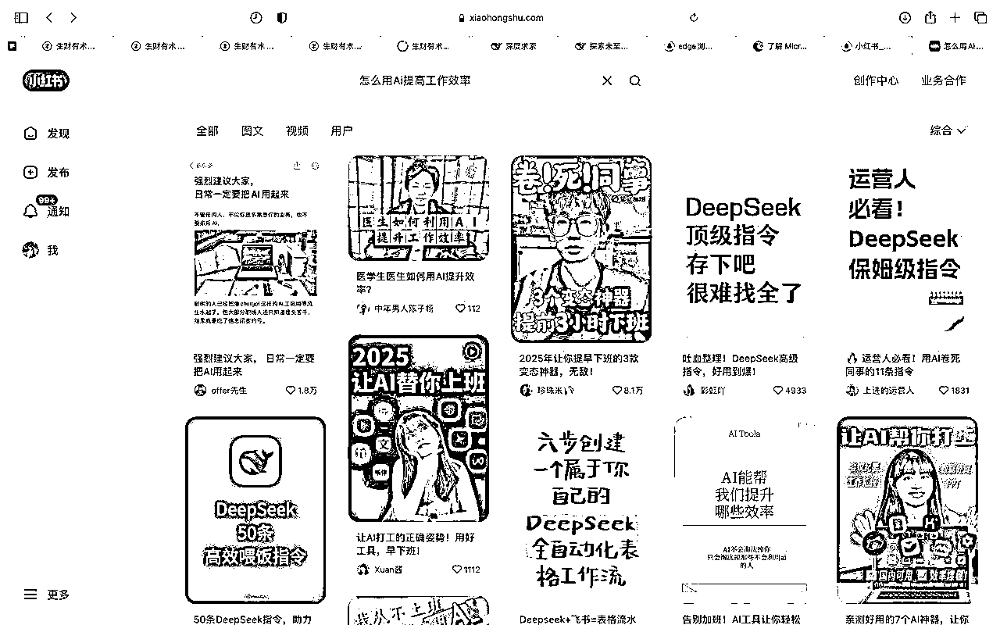

> **图片说明**：第 1 条内容"自我介绍 + 账号定位"示例笔记（图源：AI 自媒体实战手册）。

**怎么让内容获得更多推荐？**以小红书为例，它有一套公开的内部评分逻辑，叫 CES 评分：

> **CES 内部评分 = 点赞数 × 1 分 + 收藏数 × 1 分 + 评论数 × 4 分 + 转发数 × 4 分 + 关注数 × 8 分**

> **大白话**：看清楚这个公式你会发现——评论、转发、涨粉的分数是点赞的 4 到 8 倍！所以"求点赞"不如"引讨论"。在笔记结尾抛一个问题（比如"你最常用哪个 AI 工具？评论区聊聊"），比干巴巴等赞有用得多。有人在评论区提问，你还要及时回复，回复本身又算新互动，滚雪球。

**标签和关键词**也有讲究。小红书笔记的标签分两类，混着用效果最好：

| 标签类型 | 作用 | 示例 |
|---------|------|------|
| 热门标签 | 蹭大流量池 | #AI工具、#ChatGPT、#AI绘画、#效率提升、#职场必备 |
| 精准标签 | 让算法识别你的细分领域 | #AI写作技巧、#Midjourney教程、#AI效率工具、#AI自媒体运营、#AI变现 |

关键词布局则要贯穿三处：**标题**里放核心词（比如"DeepSeek""周报"），**正文**里自然重复 2-3 次相关词，**评论区**里也可以用关键词回复提问（比如有人问"工具在哪下"，你回复时带上工具名）。

**数据复盘**是运营体系里最容易被新手忽略、却最重要的一环。每周花 30 分钟，把每条内容的播放量、点赞、评论、收藏、涨粉记进一个表格，找出表现最好的 1-2 条，分析它们好在哪（选题？封面？标题？），然后下一条照着这个方向优化。数据不会骗人，它会告诉你读者到底想看什么。

---

## 31.4 变现路径：商单、知识产品、AI 顾问

长期变现靠商单、知识产品销售、AI 顾问等多种方式，不依赖单一粉丝流量，走长期主义。

先说一个观念：**变现是"水到渠成"**。做优质内容、沉淀忠实受众，钱自然会找上门。变现并不是"定位时就一上来就盯着不放"，而是当内容与粉丝关系成熟后，自然有多种可能的收入管道。AI 自媒体若能坚持到这个阶段，往往会有以下主要变现模式。

常见变现方式：

1. **商单（广告合作）**：通过 AI 工具品牌或 SaaS 平台广告投放获得收入。这是大多数创作者的第一桶金。
2. **知识产品**：出售 AI 相关的课程、教程、提示词模板等数字产品。一份提示词模板包可以反复卖，边际成本几乎为零。
3. **AI 顾问**：为企业或个人提供 AI 应用咨询，帮助他们把 AI 工具落地到具体业务场景。客单价高，但需要真实案例背书。
4. **联盟推广**：推广 AI 工具会员、书籍、硬件等产品，通过专属链接分销，用户通过链接注册可获得佣金。
5. **IP 变现**：通过打造个人 IP，提供付费社群、私董会等高客单价服务。

把这条变现路线画成图：

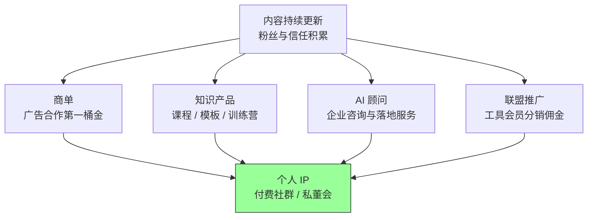

下面把新手最可能先接触的**商单**展开讲清楚，因为它有明确的游戏规则。

**抖音：星图平台。**当你的粉丝超过 1 万，就可以申请开通星图权限（网址：https://www.xingtu.cn/）。星图上主要有两种合作模式：第一种是最常见的**一口价模式**，品牌给你一个固定的价格，比如发布一条视频 1000 元，你制作并发布视频，不管最终效果如何，这笔钱都是你的——这种模式对新手特别友好，因为没有业绩压力。第二种是**效果付费模式**，通常会有一个保底费用，然后根据实际的下载量、注册量等指标额外付费。这种模式有风险，如果视频数据不好，可能只能拿到很少的钱；但视频爆了，收益会远超一口价。

报价可以参考行业惯例：**抖音报价约为粉丝量的 10-20%**。比如 1 万粉，一条视频报价 1000-2000 元是常见区间。第一次接单可以略低于市场价，重点是积累案例，但不建议压得太低，后续不好抬价。

**小红书：蒲公英平台。**当你的粉丝达到 1000，就可以开通蒲公英平台（官方广告平台，网址：https://pgy.xiaohongshu.com/），开始接受品牌合作。小红书同样遵循粉丝量 10-20% 的报价惯例。不过如果对接的是 PR（公关公司），他们可能会要求返点，一般在 20-40 元左右，这个要提前谈清楚；如果返点要求超过 30%，那就要慎重考虑了。

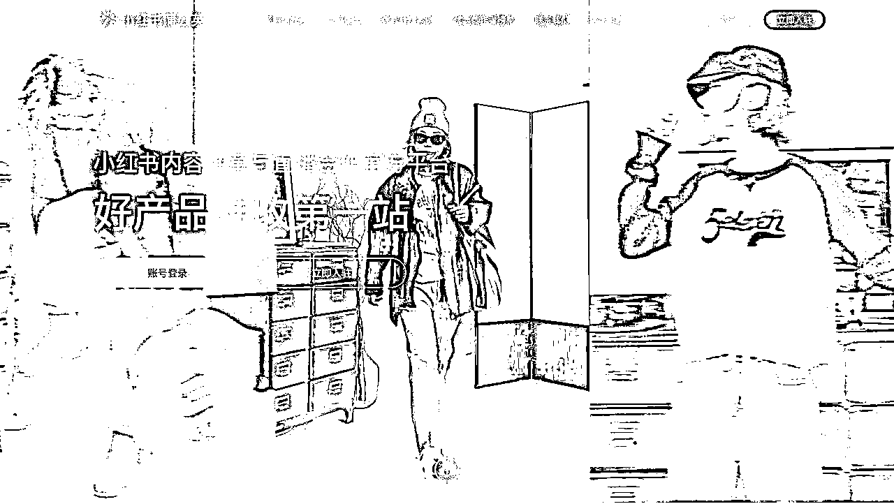

> **图片说明**：小红书蒲公英平台界面（图源：AI 自媒体实战手册）。粉丝达到 1000 即可开通，品牌合作邀约会出现在后台。

**一条重要的忠告：尽量不要"水下交易"（私下接单不走平台）！**哪怕对方是你听过的大品牌，哪怕媒介说得天花乱坠、承诺"结款快"，建议一律走星图或蒲公英，哪怕平台会收一点服务费（星图目前收任务金额的 5% 左右），起码安全有保障。素材手册的作者就吃过亏：和一个知名品牌私下合作，说好一周结款，结果从一周拖成一个月、两个多月，最后足足四个月才结清。私下交易没有平台监督，账期、修改、违约全凭对方良心，新手耗不起。

接商单的完整流程（以星图为例）可以概括为六步：

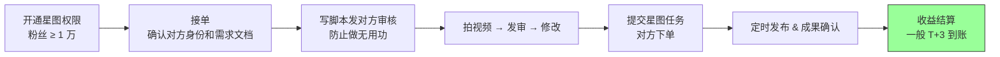

其中"看清楚需求"这一步，要逐项确认对方给的文档（行业里叫 brief）：品牌主是谁、是否竞品冲突、是否需要口播、拍摄时长、发布时间、参考内容、封面/话题/标签有没有要求、能不能打马赛克替代删减敏感画面。这些细节提前确认清楚，后面能少返工好几轮。

**知识产品**怎么起步？不用一上来就录大课。可以先从"小而美"的数字产品开始：一份提示词模板合集、一个工具清单文档、一次 1 小时的直播小课。先低价测试，有人买、有好评，再逐步做大。课程内容就来自你账号里已经验证过的爆款内容——你哪条笔记数据最好，说明需求最真实，就把它扩展成课。

**AI 顾问**则是内容变现的"高阶形态"：企业看到你的内容，主动来找你帮忙把 AI 落地到他们的业务里。这单生意不需要你主动推销，是内容替你筛选出了客户。前期认真做内容，就是在给未来的顾问业务攒案例、攒信任。

---

## 31.5 长期主义心态

强调长期主义：更新 30–50 条前数据可能惨淡，需坚持数月；X 平台主张每天 2 条、坚持发够 28 条。

> **大白话**：AI 自媒体，并不是一个短期项目。很有可能，你更新了 30-50 条作品，点赞还是 2-3 个。这个项目需要我们坚持下去，做 1 个月、2 个月、3 个月，甚至半年……才能出成绩。

我们这本手册的使命，就是帮大家在一开始，找到正确的方向。然后高效率的深耕下去。

给你几个能实际落地的心态工具：

1. **把目标从"涨粉"换成"发够条数"**。涨粉你控制不了，但"这周发 3 条"你能控制。每发完一条，就在日历上打一个勾，攒够 30 个勾再回头看数据。
2. **建立自己的内容素材库**。平时刷到好的选题、标题、封面，随手存进一个备忘录；你用 AI 解决的每个实际问题（哪怕是"用 DeepSeek 写了个请假条"），都记下来，这些都是选题。素材库满了，更新就不痛苦。
3. **降低单条成本**。用本书前面学的方法：选题让 AI 帮你扩展成大纲，文案让 AI 出初稿你来改，封面用现成模板换字。把一条内容的制作时间从 3 小时压到 1 小时，坚持下去就容易多了。
4. **找同侪一起打卡**。一个人容易放弃，找几个同样在做 AI 自媒体的朋友建个小群，每周互相汇报条数。别人在发，你就不好意思停。

如果你选择 X（推特）作为主平台，节奏可以更简单：**每天 2 条，坚持发够 28 条**。X 的内容消费速度快，一条内容的生命周期可能只有一两天，所以它不追求"每条都是精品"，而是追求"持续在场"。每天一条干货 + 一条互动（提问、观点、转发点评），两周多就能完成第一个 28 条周期。发完 28 条再复盘，你会对自己的账号有完全不一样的判断。

> **一句话总结**：做自媒体 90% 的失败，不是败在能力，而是败在"发了 10 条没数据就停更"。时间会筛掉急躁的人，把流量留给还在场的人。

---

## 31.6 对应素材

- `202503-aizimeiti` > AI 自媒体（自媒体账号搭建与变现）
- `202506-aizimeiti` > AI 自媒体（小红书、视频号、X、YouTube 长期变现）

---

## 小练习

选一个平台（小红书/视频号/X/YouTube），注册账号并确定 AI 垂类定位，发布首条 AI 相关内容并记录发布时间与初始数据。

> **参考模板**：
>
> | 平台 | 垂类定位 | 首条内容主题 | 发布日期 | 初始播放量 | 初始点赞 |
> |------|---------|-------------|---------|---------|---------|
> | 小红书 | AI 工具测评 | 某 AI 工具使用教程 | 2026-11-09 | - | - |
>
> 完成首条发布后，建议顺手做两件事：一是把"31.2"里的定位评分表打一遍分，确认自己的垂类选得是否顺手；二是照着"前 3 条内容"策略，把第 2 条（实用教程）和第 3 条（工具测评）的选题提前列出来，保证下一周有内容可发。

---

## 本章小结

通过本章，你应该已经了解：

1. **AI 自媒体是什么**：把 AI 相关的知识、技巧、工具、经验，用普通人能看懂的方式发布到平台，聚粉变现。常见定位有 AI 热点/技术解读、AI 工具分享、AI 创业或副业、AI 效率提升四种，用五维打分法（兴趣度、专业度、变现潜力、学习成本、持续产出可能性）选出最适合自己的赛道。
2. **为什么现在值得做**：AI 领域是信息差战场，容易出爆款（别人 30 条出 1-2 条爆款，AI 赛道 20 条能出 4-5 条）；广告主预算充足（仅 2024 年 10 月 20 天的投放数据里就有 2 家亿元级、8 家百万千万级玩家）；变现方式多达 5 种。
3. **平台策略**：新手只选一个平台深耕。小红书适合种草图文和测评，视频号适合口播带货，X 适合文字和科技资讯（每天 2 条、发够 28 条），YouTube 适合长视频+Shorts。按自己的性格选平台：能出镜选视频号/小红书，擅长深度选 B 站/公众号，不想露脸选录屏演示+图文。
4. **起号与运营**：账号搭建三件套（统一昵称、头像、简介）；内容配比 70% 实用教程 + 20% 工具测评 + 10% 热点解读；前 10 天日更 1 条，前 30 天每周 3-5 条；前 3 条内容依次是自我介绍、实用教程、工具测评；用 CES 评分公式（评论、转发、涨粉的权重远高于点赞）指导互动设计；每周做数据复盘。
5. **变现路径**：商单走官方平台（抖音星图粉丝 ≥1 万、小红书蒲公英粉丝 ≥1000，报价约为粉丝量的 10-20%），坚决不做"水下交易"；知识产品从提示词模板、小课起步；AI 顾问靠内容攒案例，客户会主动找上门。
6. **长期主义**：30-50 条前数据惨淡是常态，坚持 1 个月到半年才出成绩。把目标换成"发够条数"、建立素材库、降低单条制作成本、找同侪打卡，是熬过冷启动期的四个实用工具。

到这里，你已经掌握了在国内平台做 AI 自媒体的完整方法。下一章我们把视野放大到海外：出海做网站，用一个"热词"承接 Google 的搜索流量，以及让 AI 主动推荐你品牌的 GEO 新玩法。
