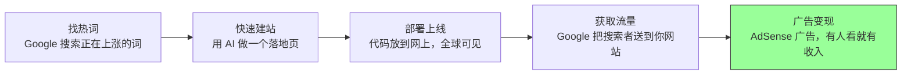
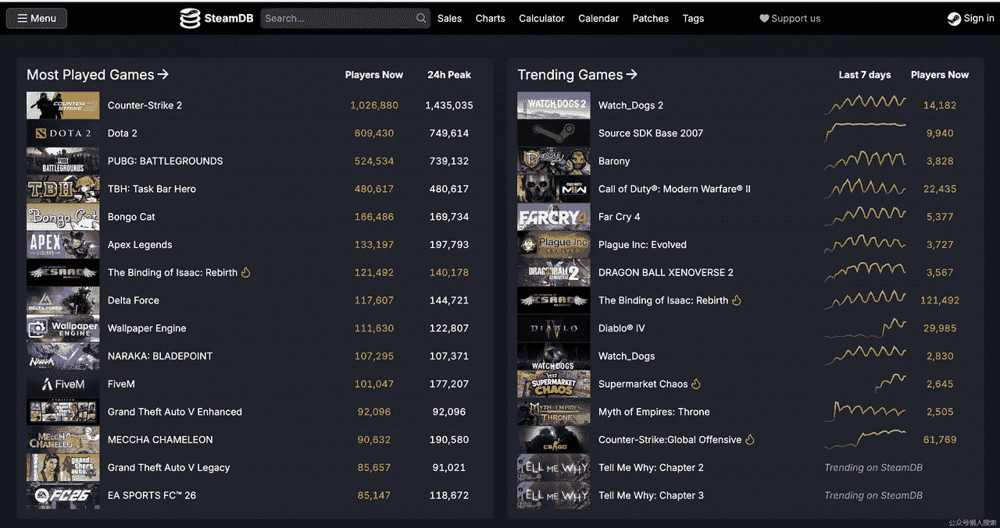
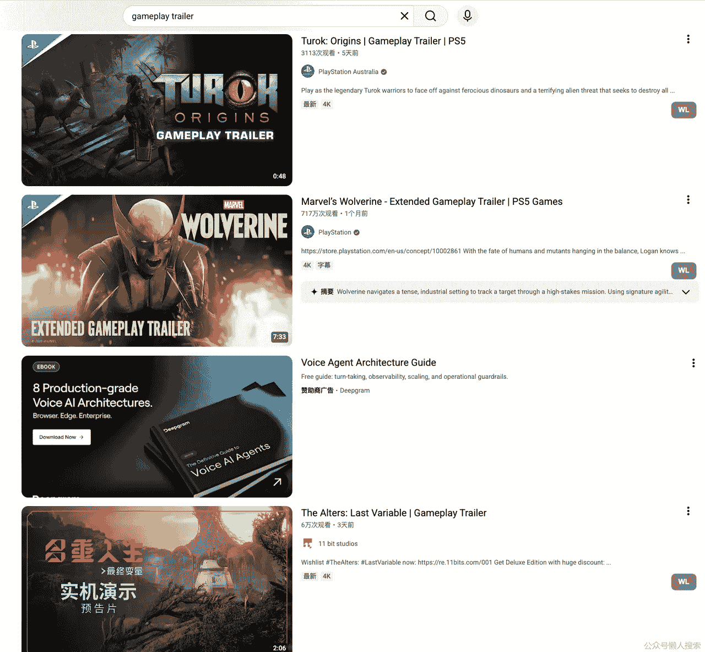
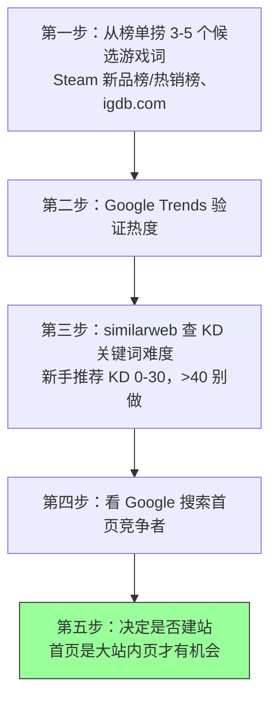
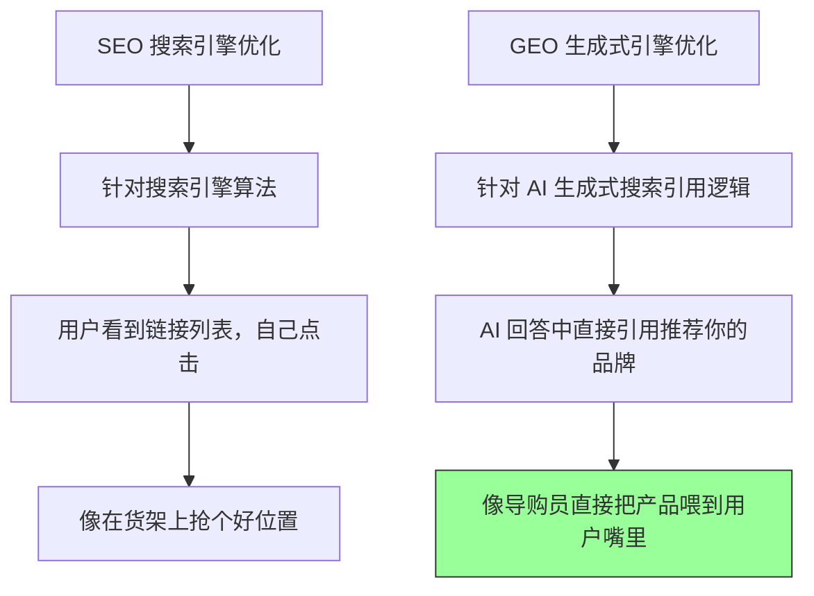
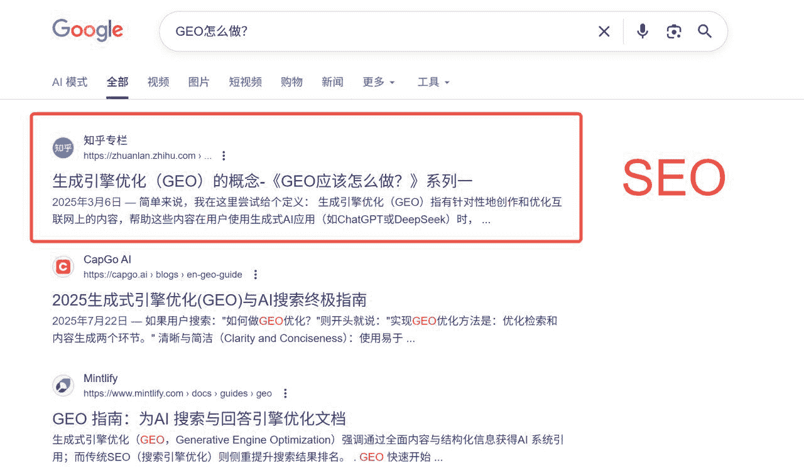
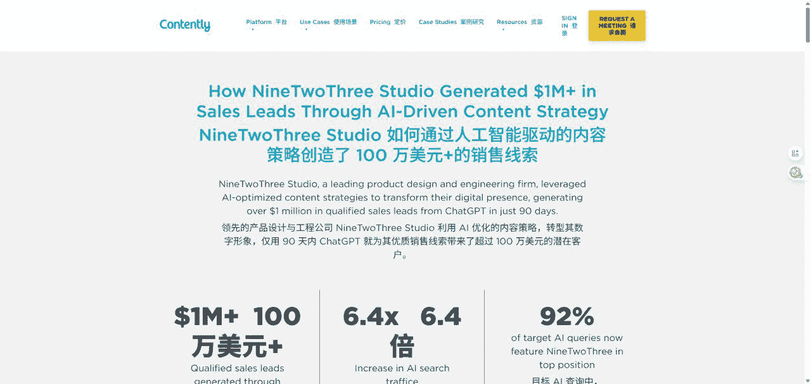
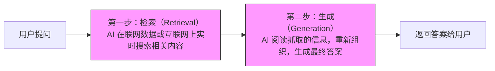

# 第32章 AI 产品出海：海外工具站、热词游戏站与 GEO

> 本节教出海玩家挖掘正在上涨的热词，用 AI 快速做落地页建站承接搜索流量变现；围绕海外游戏玩家高频搜索问题（攻略、兑换码）做小网站承接 Google 流量，靠广告变现；并介绍 GEO（生成式引擎优化）让 AI 在回答问题时推荐你的品牌或独立站。

出海听起来像只有程序员才能玩，其实不是。本章教的是一个"零成本起步"的出海路线：不需要写复杂的 App，不需要经过应用商店审核，不需要域名备案，只需要一个简单的网页（落地页），就能承接海外用户的搜索流量，靠广告赚钱。你只需要一台能联网的电脑，剩下的东西，都可以让 AI 帮你写。

---

## 32.1 大白话：出海做网站，找个正在上涨的"热词"

> **大白话**：国内做网站竞争太卷了，大家都在做同样的东西。出海做网站，不需要做大家都做的大平台，找个正在上涨的"热词"（比如某个新游戏的兑换码、某个 AI 工具的替代方案），快速做个落地页承接 Google 搜索流量，靠广告变现。热词本身自带搜索流量，你不需要从零找用户。

举个最简单的例子，就像开饭店：你发现这条街客流量很大，但是又没什么饭店，你赶快开一个店，哪怕店面装修一般，客人也会进来消费。但是在有些地方，一条路上已经开了好多饭店，你开新店就很难脱颖而出。做海外网站也是一样的道理——找一个"正在涨、还没被大站占满"的搜索词，快速做个页面接住流量，性价比最高。

整套玩法可以概括为一条流水线：



为什么偏要做"网站"，而不是做 App 或小程序？素材手册里给出了非常直接的比较：

- 做 iOS、Android App，编码比网页复杂，还要提交审核，审核可能不通过，时间成本很高；
- 做国内网站，还要办理域名备案，周期大约 1～3 周，严格的城市（比如北京）备案还经常被打回；
- 做🛰️小程序，比上面稍好，但生态不够大，很多轮子得自己造；
- 做海外网站，**不需要软件著作权证书、不需要域名备案、不需要应用商店审核**，代码放到 Github 仓库里，通过 Github Action 做 CI/CD，实现一提交代码就立即自动上线。

> **大白话**：出海做网站，就像在人少、地广的地方开摊——流量池大，竞争小，平台规则宽松，你上架得比别人快，这就赢了。一旦排名上去了，几乎可以吃十年二十年的收益，只要还有互联网、还有搜索引擎、还有互联网广告，你就会有收入。

当然有个前提：你做的不是垃圾站，工具必须能真正帮到用户。用户觉得有用，才会自发帮你传播。

---

## 32.2 海外工具站：挖掘热词快速建站

### 32.2.1 为什么做海外工具站？

相比于国内的卷度，海外竞争要小很多，流量池也更大。海外工具站有一定的壁垒，不是小个体或者小团队可以轻易复制的，能活的比较滋润，做的好的工具站，一年也能有上百万利润，而且进可攻融资成为 SaaS 独角兽，退可守赚钱闷声发财。想象空间是非常大的。

另外海外还是非常依赖谷歌的搜索流量，短期没什么大的危机。做好了工具站，能力可以迁移到下一个工具需求再来一遍。

这个项目适合什么样的人做？素材手册给了两条条件：

1. 有一定产品设计、开发和营销产品的能力的人；
2. 适合对海外市场感兴趣，有耐心试错、对挖掘用户需求和开发工具有一定了解的人。

但门槛和挑战也要提前说清楚：

1. 开发容易推广难，网站上线后需要持续关注流量和优化；
2. 有一定的技术门槛，如果自己开发能力不足，建议通过自学、工具辅助或者找合作伙伴解决。

### 32.2.2 什么样的人适合做海外工具站？

做海外工具站，核心思路是从 0 到 1 建立一个最小 MVP（最小可行性产品），验证需求后再迭代扩大。不要试图一开始就做一个完美的大网站，先跑通"挖需求→建站→上线→推广→变现"的全流程。

工具站本质上是提供特定工具或服务的网站，比如搜索引擎、在线存储空间、翻译工具等。它不同于内容站（新闻门户、博客）、电商站（独立站官网、在线市场）、社区站（论坛、社交网络）、教育站（在线学习平台）等。在本章实战中，我们主要关注工具站，因为它能满足从用户需求挖掘、定位、到达成变现的全流程需求。

工具站的核心竞争力来自：了解用户需求、注重用户体验（界面简洁、使用方便）、功能强大、技术稳定、数据安全、有效的营销、客户支持和数据分析。个人开发者做的时候，更建议瞄准细分领域的需求，也就是所谓的"Micro SaaS"（微型 SaaS）——一种简单、易用的互联网工具，解决某个特定的业务需求，价格更实惠，日常维护花费的精力也很少，用户好用了会自己把网址加入书签，以后常来。

变现方式上，英文工具站大体分为"卖流量"和"卖产品"两条腿。卖流量是指提供免费工具来获取流量，然后通过广告、分销、广告联盟、联盟推广（Affiliate）、导流其他产品等方式变现；卖产品则是直接收费订阅或售卖服务。新手建议先走"卖流量"路线：免费工具好推广，流量起来了再挂广告。

### 32.2.3 英文工具站基础介绍

做落地页，首先得懂几个基础名词，素材手册里有专门的名词解释：

- **Google SEO / 收录**：SEO 全称 Search Engine Optimization（搜索引擎优化），就是让网站在谷歌搜索结果里排得靠前，被搜索引擎"收录"进数据库。
- **Meta Title 和 Meta Description**：网页的标题和简介，会显示在谷歌搜索结果里，对点击率影响很大。
- **CTA（Call to Action）**：行动号召，比如"立即下载""点击使用"，引导用户做下一步动作。
- **Hero 板块**：网页最醒目的第一屏，通常放一句话主标题和核心按钮。
- **前端代码 / Next.js / SSR**：构建网页的技术手段，新手可以从纯 HTML 开始。
- **GitHub / 仓库**：存代码的地方，就像代码的云盘。
- **Git / 版本控制 / Commit**：记录代码每次改动的工具。
- **部署（Deployment）**：把网站代码放到服务器上，让全球用户能访问。

具体怎么生成落地页内容，素材手册给了一个实战流程：先选核心关键词，围绕关键词写文案（总分结构、标题层级清晰）；再用 AI 分析竞品结构；构建落地页内容模块（提高用户确信度）；撰写文案并生成网页；最后做关键词密度优化和 Meta 信息调整。第 32.3 节会有一个完整的可运行代码示例，你可以直接套用。

---

## 32.3 出海游戏网站：两条路径，选"热词游戏站"

### 32.3.1 路线 A：追热词，赚搜索的钱（本手册主线）

发现一个正在涨的搜索词 → 快速做一个网站承接这些搜索 → 靠广告赚钱。

用户在搜一个新东西的信息，你比别人先给到完整答案。你切的是用户实实在在的信息需求。只是这个需求有时效性——词不热了，搜索就少了。

不需要登录、不需要支付、不需要数据库。一个 HTML 页面就能上线，几天内能跑通，最快拿到正反馈。

**案例**：cursor-ide.com（蹭 Cursor 词，单页落地页，月访问 455K）、nanobanana.ai（蹭 nano banana 词，两个月千万访问，已经迁移了）。



> **图片说明**：steamdb.info 游戏榜单页面（图源：AI 产品出海-热词游戏站）。新手可以从 Steam 新品榜和热销榜里"挑"正在热的游戏。

热词挖掘的核心工作流是：**社交媒体发现 + 核心工具验证和拓展**。比如以"nano banana"为例：8 月 14 日，X 上的博主 guizang.ai 发布了 nano banana 相关消息，这个词在 8 月 13 日之前几乎没有流量，8 月 14 日有小幅上升，直到 8 月 24 日消息越来越多，最后谷歌正式发布了该模型，热度直接飙升。如果你在 8 月 14 日就注册域名并且上站，就能抢占先机。



> **图片说明**：YouTube 游戏预售视频页面（图源：AI 产品出海-热词游戏站）。搜索 gameplay trailer 可以提前发现即将上架的新游戏。

### 32.3.2 路线 B：切长期需求，赚用户的钱

发现一个长期存在的用户痛点 → 做一个工具或产品持续解决它 → 用户订阅付费。

用户一直有这个需要——"我要批量处理图片""我要生成 AI 视频"。需求不跟着词走，只要痛点还在，生意就在。SEO 起量慢（3-6 个月），但一旦跑通，收入更稳定。

需要做登录、支付、数据库、多语言，门槛比路线 A 高。

**案例**：Pollo.ai（AI 视频品牌站，月访问 620 万）。

本手册的主线是路线 A。路线 A 更适合新手切入，主要原因是：词本身自带搜索流量，你不需要从零找用户；正反馈路径短——找词、建站、上线、看数据，几天到几周就能跑完一圈。路线 B 如果你前期有产品经验、技术基础或海外市场认知，走起来也合适，但完全纯新手一上来就做登录、支付、数据库，难度会大不少。

### 32.3.3 什么是游戏热词站？

路线 A 里有一个特别适合新手的切入方向：**游戏热词站**。

它的逻辑很简单：玩家已经在 Google 搜一个游戏问题，你做一个小网站，把答案接住。你不是开发游戏，不是做 App，不是写游戏评测。你做的事情比这些都轻——围绕一个海外正在变热的游戏，把玩家最常搜的问题整理成页面。Google 给你流量，你靠广告赚钱。

来看看已经跑通的人是怎么做的。

**Genshin Builds：角色攻略站**

Genshin Builds（genshin-builds.com）专门服务原神玩家：这个角色怎么培养？用什么武器？配什么队伍？材料去哪刷？页面结构很清晰——角色、Builds、Teams、Tierlist、Wiki、材料、武器、圣遗物、计算器。

这类站的核心不是新闻，而是**长期有人反复查的资料页**。玩家养角色、换配队、刷材料，每次都要回来查。据 Semrush 显示，2026 年 5 月约 59.7 万访问量。

**Pro Game Guides 的 codes 页面：兑换码站**

还有一种最轻的起步方向：玩家不想深度阅读，他们只想快速拿到可用兑换码。

Pro Game Guides 是一个大站，覆盖 Roblox、Fortnite、Minecraft 等大量游戏。我们不用照抄它的体量——只看它的一个动作：把玩家高频搜索的 codes 整理成页面，并持续更新。

对新手来说，不需要一上来就做成大站，只需要先选一个具体游戏，做出"最新兑换码 + 如何兑换 + 失效码 + 常见问题"这几个页面，就已经是一个很清晰的起步方向了。

### 32.3.4 游戏热词站怎么赚钱？

**主要方式：广告（AdSense）。** Google 自动在你的网站上匹配广告，有人看或点你就有收入。

其他可选方式：游戏相关联盟项目（Humble Bundle Partner、Nexus.gg 等，推荐游戏拿佣金）。

**本次预期**：广告不是立刻就能赚到，需要先有流量。日访问几百的时候，AdSense 收入可能每天只有几毛到几块钱。本期的第一目标不是赚钱——是先跑通从找词到上线到有数据的完整流程。

跑通以后，你掌握的是一整套热词站的方法：怎么发现一个正在被搜索的词，怎么判断它值不值得做，怎么快速建站承接流量。

**选词验证流程**，新手按下面这个顺序走，不容易走弯路：



具体操作要点：

1. **找候选词**：打开 Google 不知道搜什么，先去榜单里捞。来源一：Steam 商店的"新品榜""热销榜"（steamdb.info、igdb.com），挑新上线且玩的人数持续上升的游戏；来源二：YouTube 搜索"gameplay trailer"看游戏预售视频，提前发现即将上架的新游戏。
2. **验证热度**：用 Google Trends 验证词到底火不火、还在不在涨。Google Trends 只显示 0-100 的相对热度，不直接显示真实搜索量，所以要找一个已知大概搜索量的词做对比——素材手册里建议用"GPTs"（一天大概 3000-5000 搜索量）作为对比词。游戏词接近 GPTs 说明热度不错；超过 GPTs 很多说明是强趋势词，值得重点关注。看趋势线：线在往上走有戏；线平的或往下说明搜的人越来越少，换一个；线像一座山（突然暴涨→很快暴跌）属于陷阱词，避开。**一周内陡升的算新词，越新越好。** 一般来说，3 个月内都算新词，越新越好，如果是几个小时内出现的就更好了。
3. **看难度**：用 similarweb 查 KD（关键词难度，0-100，数字越大越难）。新手推荐 KD 0-30，KD 超过 40 时尽量别做，因为大站已经占满，新手切不动。同时看细分关键词数量，判断是否有细分长尾词可以抢占流量。比如"Sora"很火，那么"Sora AI Video Generator""Sora AI Video Watermark remover"这类长尾词的流量潜力同样巨大，完全可以围绕长尾词布局。
4. **看首页竞争**：最后一定要看 Google 搜索首页，因为能不能排进首页才决定有没有流量。首页前面如果是 Fandom/Wiki 类大站、官方 Wiki、IGN/GameSpot 等大型游戏媒体、Pro Game Guides 这类成熟攻略站，主词竞争就大，新手正面排上去很难；但如果前面是大站的普通内页（内容浅、没专门维护、甚至已经过时），说明这个需求还没被认真满足，你仍然有机会。可以安装 SiteData 浏览器插件，在搜索结果页面下查看每月访问量、域名创建时间、DR 等指标。

**找词的避坑指南**，新手一定要绕开两个坑：

- **灰产词**：成人内容、赌博（Slots）、侵犯版权的词（如 YouTube Downloaders），SEO 工具里显示的竞争度 KD 极低，但这其实是陷阱——不是因为没人做，而是谷歌已经把大量这类网站从搜索结果里移除或屏蔽了。一旦你用这类词建站，很快面临被谷歌封禁的风险，还会损害 Google 账号（GSC）和未来变现渠道（AdSense 等）的信誉。坚决不碰。
- **名人词**：X 上每天都有名人相关新词，光看曲线很好看，但搜第一名通常是维基百科，前几名是 BBC、CNN 等大媒体报道，很难竞争得过，而且观众搜这个词只是为了看新闻，没有做网站的必要。

选完词、验证完可行，就可以建站了。下面给出一个新手可以直接运行的**单页游戏兑换码落地页代码**，按注释修改里面的游戏名和关键词即可：

```html
<!DOCTYPE html>
<html lang="zh-CN">
<head>
    <meta charset="UTF-8">
    <meta name="viewport" content="width=device-width, initial-scale=1.0">
    <!-- 1. Meta Title：谷歌搜索结果里显示的标题，包含核心关键词，控制在 60 个字符以内 -->
    <title>XX 游戏兑换码免费领取 - 每日更新（XX Codes 2026）</title>
    <!-- 2. Meta Description：搜索结果里显示的简介，影响用户是否点击，控制在 160 个字符以内 -->
    <meta name="description" content="最新 XX 游戏兑换码免费领取，每日更新，附带如何兑换的图文教程，失效码自动标注。">
    <!-- 3. 关键词标签（现代搜索引擎权重较低，填上即可，不必纠结） -->
    <meta name="keywords" content="XX游戏, 兑换码, XX codes, 游戏攻略, 免费领取">
    <style>
        body { font-family: system-ui, -apple-system, sans-serif; max-width: 800px; margin: 40px auto; padding: 0 16px; line-height: 1.8; color: #333; }
        h1 { font-size: 24px; margin-bottom: 8px; }
        h2 { font-size: 20px; margin-top: 32px; }
        .hero { background: #f5f7f9; border-left: 6px solid #2563eb; padding: 16px; margin: 24px 0; }
        .box { border: 1px solid #e5e7eb; border-radius: 8px; padding: 16px; margin: 16px 0; }
        code { background: #f3f4f6; padding: 2px 6px; border-radius: 4px; font-family: monospace; }
        ul { padding-left: 24px; }
        .note { color: #6b7280; font-size: 14px; }
        .adsense-placeholder { border: 1px dashed #cbd5e1; background: #f8fafc; padding: 40px 16px; text-align: center; color: #64748b; font-size: 14px; margin: 32px 0; }
    </style>
</head>
<body>

    <!-- 4. Hero 板块：第一屏直接给出核心价值主张，用户一秒钟明白页面在干什么 -->
    <header class="hero">
        <h1>XX 游戏兑换码免费领取（每日更新）</h1>
        <p class="note">最新可用兑换码，快速兑换教程，失效码自动标注。</p>
    </header>

    <!-- 5. 核心内容：兑换码列表，方便谷歌抓取，方便用户直接复制 -->
    <section class="box">
        <h2>最新可用兑换码</h2>
        <ul>
            <li><code>XXCODE1</code> - 100 钻石 + 体力×10（有效期至 2026-12-31）</li>
            <li><code>XXCODE2</code> - 稀有角色碎片 × 5（有效期至 2026-12-31）</li>
            <li><code>XXCODE3</code> - 金币 × 5000（有效期至 2026-11-30）</li>
        </ul>
        <p class="note">提示：兑换码区分大小写，复制时不要带空格。</p>
    </section>

    <!-- 6. 如何兑换：结构化步骤，AI 容易提取，用户容易操作 -->
    <section class="box">
        <h2>如何兑换</h2>
        <ol>
            <li>打开 XX 游戏，点击头像进入“设置”；</li>
            <li>找到“兑换码”或“礼包码”入口；</li>
            <li>将上方代码粘贴进去，点击确认领取。</li>
        </ol>
    </section>

    <!-- 7. 失效码：标注清楚，减少用户重复尝试，也能增加页面的信息密度 -->
    <section class="box">
        <h2>已失效兑换码</h2>
        <ul>
            <li><code>XXOLD1</code>（已失效）</li>
            <li><code>XXOLD2</code>（已失效）</li>
        </ul>
    </section>

    <!-- 8. 常见问题：问答式内容，容易被 AI 引用，也能承接长尾搜索流量 -->
    <section class="box">
        <h2>常见问题（FAQ）</h2>
        <p><strong>Q：兑换码哪里获得？</strong><br>A：官方社交媒体、直播活动、合作伙伴发布。</p>
        <p><strong>Q：兑换码为什么用不了？</strong><br>A：可能已过期，或者大小写输入错误，建议直接复制粘贴。</p>
        <p><strong>Q：这个页面多久更新一次？</strong><br>A：每天检查官方新码，并及时更新本页面。</p>
    </section>

    <!-- 9. CTA 行动号召：引导用户收藏、分享，增加页面停留和互动 -->
    <section class="box">
        <p>如果本页对你有帮助，请按 <kbd>Ctrl + D</kbd> 收藏，并分享给同样在玩 XX 游戏的朋友。</p>
    </section>

    <!-- 10. AdSense 广告位预留：审核通过后，将下面注释替换为真实的广告代码 -->
    <div class="adsense-placeholder">
        [广告位：此处放置 Google AdSense 响应式广告代码]
    </div>

    <footer class="note">
        免责声明：本站为第三方兑换码汇总页面，与 XX 游戏官方无关。兑换码以官方发布为准。
    </footer>

</body>
</html>
```

**代码注释说明（新手必读）**：
- `<title>` 和 `<meta name="description">` 是页面的"门面"，谷歌搜索结果里显示的就是它们，里面一定要出现用户会搜的关键词（比如"XX 游戏 兑换码"）。
- 正文里用 `h2` + `ul`/`ol` 做结构化内容，AI 抓取时容易理解，也容易被引用（这是第 32.4 节讲 GEO 的核心逻辑，建站时就顺便符合）。
- `code` 标签包裹兑换码，方便用户复制，也方便搜索引擎识别这是"代码/兑换码"类内容。
- 底部广告位先用注释占位，等网站有流量、申请通过 AdSense 后再填入真实广告代码。

把这个 HTML 保存为 `index.html`，用本地浏览器打开就能看到效果；再按第 32.2 节的思路，上传到 Github Pages 或 Vercel，就能上线了。

---

## 32.4 GEO：让 AI 推荐你的品牌或独立站

除了靠广告变现，还可以介绍 **GEO（生成式引擎优化）**，让 AI 在回答问题时推荐你的品牌或独立站，应对"用户开始直接问 AI"的零点击搜索趋势。

过去用户搜关键词，看到一堆链接自己点（SEO）；现在用户直接问 AI，AI 直接给答案并提到品牌名（GEO）。如果你的品牌没出现在 AI 答案里，就等于在新入口面前"查无此人"。

**SEO 与 GEO 的核心区别**：

| 维度 | SEO（搜索引擎优化） | GEO（生成式引擎优化） |
|------|---------------------|-----------------------|
| 针对对象 | 搜索引擎算法 | AI 生成式搜索的引用逻辑 |
| 像什么 | 货架上抢好位置，用户自己点击 | 超市导购员直接把产品推荐给顾客 |
| 用户得到 | 一堆链接，需要点进去看 | 直接得到答案，AI 说是谁的 |
| 关键动作 | 排在列表里靠前 | 让内容被 AI 看见、理解、引用 |

用一张图来理解：



**GEO（Generative Engine Optimization，生成式引擎优化）**简单讲，它的核心逻辑是：让你的内容能被 AI 看见、理解、引用，最后被推荐出去。（可能你还听过 AEO、AISEO，其实都是一回事，GEO 是最专业的叫法。）

### 为什么要关注 GEO？

**变化一：资本的流向**。在美国，一家叫 Profound 的公司刚融了 2000 万美金，专门做 AI 搜索优化，背后的投资方包括英伟达；在中国，营销巨头蓝色光标也投资了一家做同类业务的公司叫清蓝 AI。同时，ChatGPT 已具备联网与引用能力，并与 Shopify 和沃尔玛合作，测试边聊边下单的对话式购物；豆包已经能在对话中推荐商品；阿里 Qwen 模型服务企业超 9 万家；百度文心、腾讯混元、字节豆包都在强化 AI 搜索入口。这说明巨头们都在判断同一个未来：以后的用户可能不再搜网页了，而是改问 AI 了。谁能先让 AI 记住，谁就占了新时代最值钱的黄金铺位。



> **图片说明**：SEO 与 GEO 差异示意图（图源：GEO 实操指南）。

**变化二：AI 带来的流量逻辑变化**。现在各平台，比如百度、抖音、🛰️、📕等，在搜索结果里第一条都是 AI 回答；同时，传统渠道流量来源越来越少，很多人都在用 AI 搜索了。流量的逻辑在演进：

```
第一代，是“搜索时代”——靠 SEO 被找到；
第二代，是“推荐时代”——靠算法被推送；
而第三代，正在到来——AI 时代。
```

以前抢排名，现在抢 AI 的引用。谁被 AI 翻牌子了，谁就是权威。像豆包、Kimi 这些 AI 搜索工具，用的人越来越多。

**变化三：真实的获客案例**。一家 B2B 服务公司（SaaS/技术服务），叫 NineTwoThree Studio，以前主要靠销售跑客户。后来调整策略，专门针对 ChatGPT 会回答的商业问题（比如如何开发一个企业级 APP），写了一系列问题-解决方案类型的深度文章。结果惊人：短短 90 天内，他们直接通过 ChatGPT 的推荐，获得了超过 100 万美元的合格销售线索。这些客户不是搜出来的，而是问 AI 问出来的——AI 看了他们的文章，觉得懂行，就把他们推荐给了提问的老板。不过 AI 的推荐名单是动态变化的，就像搜索引擎排名一样，不持续维护，位置就会被后来者抢走。GEO 是一场动态博弈的持久战，不进则退。



> **图片说明**：NineTwoThree Studio 90 天通过 AI 推荐获客超 100 万美元的案例数据（图源：GEO 实操指南）。

### GEO 的底层逻辑：AI 凭什么推荐你？

很多老板有个误区，觉得 AI 推荐谁是因为它喜欢谁，或者是谁充了值。其实 AI 不是人，它没有喜怒哀乐。目前的 AI 搜索（如 Kimi、Perplexity、ChatGPT Search）普遍采用一种叫 **RAG（检索增强生成）**的技术。

AI 生成答案的过程是完全机械化、可拆解的，就两步走：



核心逻辑非常残酷：**如果你的内容没有在第一步被【检索】到，或者在第二步因为写得太乱没被【提取】，你的品牌就绝不可能出现在最终的答案里。**

在众多网页中，AI 凭什么选中你的内容？可以把它看作一个三层漏斗：

| 漏斗层 | 名称 | 含义 | AI 喜欢 / 讨厌什么 |
|--------|------|------|------------------|
| 第一层 | 可检索性（能看见） | AI 首先得能找到你 | 喜欢：高权重信源（权威媒体、知乎高赞回答、百度百科）；讨厌：私域流量、封闭社群、Robots.txt 屏蔽爬虫、页面加载极慢 |
| 第二层 | 可理解性（读得懂） | AI 需要对内容进行语义分析 | 喜欢：定义清晰、列表明确、参数量化；讨厌：情绪化软文、逻辑混乱的长篇大论、全是形容词的广告语 |
| 第三层 | 可信度（信得过） | AI 防止自己胡说八道（幻觉）的关键 | 喜欢：交叉验证（官网+知乎+新闻都提到你）、具体数据、行业报告、专家背书；讨厌：低级水军刷重复评论，AI 会过滤为噪音甚至降权 |

基于 RAG 机制和筛选漏斗，GEO 的工作公式总结如下：

> **高推荐率 = 权威渠道（找得到） + 结构化内容（读得懂） + 数据背书（信得过）**

下面按这个公式，教你具体该怎么写、怎么发。

### 如何写出 AI 愿意搬运的内容

AI 毕竟不是人，它不懂文学，也没有审美。在它眼里，文章没有优美和枯燥之分，只有结构清晰和逻辑混乱的区别。它抓取内容时，本质上是在做一道填空题。

所以，写 GEO 内容的黄金法则只有一条：**别写散文，要写说明书。**

写作原则：**结论前置，结构至上。** 传统文章喜欢起承转合，把核心观点藏在最后；但这对 AI 是灾难，它读到一半可能因为抓不到重点就放弃了。做 GEO 内容，每一段的开头，必须直接把核心结论抛出来。能用句号就别用逗号，能用分段就别写长句，能用序号就别用文字。你的目标是让 AI 扫描一眼，就能提取出它想要的信息。

以一款产品"极光 X1 智能降噪耳机"为例，对比一下：

**反面案例**：前半段全是情绪渲染，产品名称直到文中才出现，"续航给力""最新科技"这种模糊形容词 AI 无法量化，长句一逗到底，AI 很难拆解出独立功能点。

**正面案例**：第一句直接给出定义式介绍（产品名+品类+核心卖点），每一句话都是一个独立的事实，用"48dB""60 小时""5.3 芯片"代替模糊形容词，使用 1.2.3 列表，AI 抓取后会直接生成产品参数表。

根据 AI 对结构化数据的偏好，总结了四个最高频被引用的格式模板，建议在同一篇文章中组合使用：

**模板一：定义式**

目的是抢占"是什么"的解释权。第一句直接定义产品/概念，方便 AI 抓取做名词解释。

**模板二：要点式**

用 1.2.3 列举核心优势或步骤，每点一句话，便于 AI 生成参数表或步骤清单。

**模板三：结论式**

把最重要的结论放在开头，后面再补充细节，避免 AI 读到中途放弃。

**模板四：表格对比式**

用表格对比你的产品与竞品，AI 容易从结构化表格里提取关键差异。

### 三个提升信任度的钩子

1. **全网口径统一**：你的官网、知乎回答、新闻报道里说的话要一致，AI 会做交叉验证，信息冲突会降低可信度。
2. **包含具体数据**：引用行业报告、提及具体参数，比空谈"极致体验"更容易被 AI 判定为高质量信源。
3. **避免低级水军**：雇 100 个机器人在评论区刷"好吃！好吃！"，AI 会把这 100 条视为 1 条低质量噪音直接过滤，甚至降权；找 100 个真实用户说各不相同的真实体验，AI 会分析出共识，这才是有效的 GEO。

### 写作注意点

1. 内容要保持更新，过时信息会被 AI 降权；
2. 全网口径统一，避免自相矛盾；
3. 戒掉形容词，AI 只要名词和动词；
4. 严禁瞎编数据，防止幻觉反噬。

### 红线：哪些不能碰

做 GEO 时，以下三条红线绝对不能触碰：

- **红线一：用白色字体堆砌关键词**。在网页背景色上写白色关键词，肉眼看不见，但 AI 能抓到。这是作弊，一旦被发现，页面会被降权甚至封禁。
- **红线二：数据造假**。AI 最擅长发现数字不自洽，编造的数据会被判定为幻觉来源，整个品牌的可信度会一并塌方。
- **红线三：信息太少导致 AI 幻觉**。页面上信息太少，AI 抓取不到事实，就会"凭空编造"关于你的品牌信息，后果不可控。

### 未来机会

- **机会一：多模态 GEO**（让图片帮你带货）：除了文字，AI 也开始看图，给图片加正确的 Alt 文字和描述，能让图片内容也被 AI 引用。
- **机会二：个人 IP 实体化**（专家背书）：真实的人，在真实平台上留下真实的痕迹，比任何关键词堆砌都更有说服力。

跑通 GEO 后，你的品牌不仅在谷歌搜索里能被找到，还会在 Kimi、Perplexity、豆包、ChatGPT 等 AI 的回答里被主动推荐。这和第 32.3 节做的游戏热词站不是对立关系，而是两条腿走路：热词站抢搜索入口的流量，GEO 抢 AI 回答入口的流量。

---

## 小练习

用关键词挖掘工具找出 1–2 个正在上涨的海外热词，用 AI 快速生成一个落地页标题与简介，并标注该热词的搜索意图与变现方式。

> **参考模板**：
>
> | 热词 | 搜索意图 | 变现方式 | 落地页标题 | 简介 |
> |------|---------|---------|-----------|------|
> | 某游戏兑换码 | 寻找免费兑换码 | 广告联盟 | XX 游戏兑换码免费领取 | 最新 XX 游戏兑换码免费领取，每日更新 |
> | 某 AI 工具替代方案 | 寻找替代工具 | 联盟营销 | XX 工具最佳替代方案 | 寻找 XX 工具的免费替代方案，功能对比与价格 |
>
> 完成后，可以尝试用本章给出的 HTML 模板，把其中一个热词做成一个可上线的单页，部署到 Github Pages 或 Vercel，体验完整的"找词→建站→上线"流程。

---

## 本章小结

通过本章，你应该已经了解：

1. **出海做网站的核心思路**：不做大平台，找一个正在上涨的"热词"，快速做一个落地页承接 Google 搜索流量，靠广告变现。海外竞争比国内小，流量池大，做得好的工具站一年可有上百万利润。
2. **为什么做网站比做 App 快**：海外网站不需要软件著作权证书、不需要域名备案、不需要应用商店审核，代码放到 Github 后即可自动部署上线，一天就能跑通。
3. **两条路径**：路线 A（追热词，赚搜索的钱）不需要登录、支付、数据库，一个 HTML 页面就能上线，正反馈快，适合新手；路线 B（切长期需求，赚用户的钱）需要登录支付数据库，门槛高但收入更稳定。本章主线走路线 A。
4. **游戏热词站的玩法**：围绕海外正在变热的游戏，把玩家高频搜索的问题（兑换码、攻略、材料）整理成页面，Google 给流量，靠 AdSense 广告赚钱。选词验证流程：榜单捞词 → Google Trends 验证热度（用 GPTs 做对比词估算搜索量） → similarweb 查 KD（新手推荐 0-30，超过 40 别做） → 看 Google 首页竞争者（是大站内页才有机会） → 决定建站。找词要避开灰产词和名人词两个坑。
5. **GEO（生成式引擎优化）**：让 AI 在回答问题时推荐你的品牌或独立站。底层逻辑是 RAG（检索+生成），AI 选内容有三层漏斗：可检索性（能看见）、可理解性（读得懂）、可信度（信得过）。工作公式：高推荐率 = 权威渠道 + 结构化内容 + 数据背书。写作原则：结论前置、别写散文要写说明书，能用句号就别用逗号、能分段就别写长句、能用序号就别用文字。四个内容模板：定义式、要点式、结论式、表格对比式。红线：不能用白色字体堆砌关键词，不能数据造假，不能信息太少导致 AI 幻觉。
6. **落地页代码**：本章给出了可直接运行的单页 HTML 模板，包含 Meta Title/Description、Hero 板块、结构化内容、FAQ、CTA 和 AdSense 广告位预留，修改里面的关键词和游戏名即可上线。

至此，第八部分（AI 商业变现）的两章已经全部完成：第 31 章讲国内 AI 自媒体怎么起号、怎么变现；第 32 章讲出海怎么做热词网站、怎么做 GEO。下一部分（第九章）将介绍 AI 前沿与趋势，包括 GEO 更深入的实操、Reddit 出海运营等内容。
