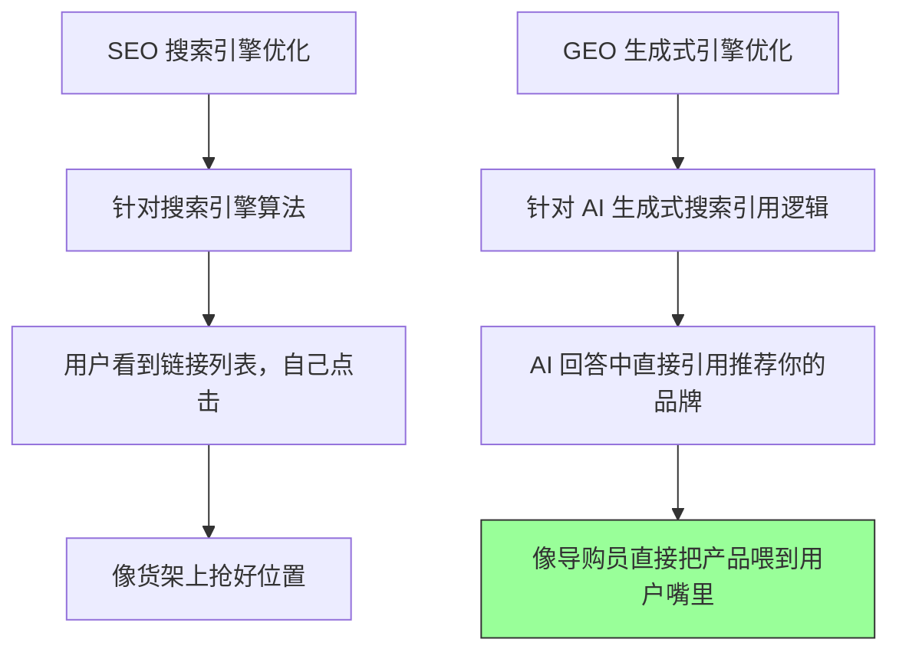

# 第33章 GEO：让 AI 在回答问题时推荐你

> 本节应对"用户开始直接问 AI"的零点击搜索趋势，教品牌/独立站做 GEO（生成式引擎优化），否则在小红书、抖音发再多在 AI 入口面前也"查无此人"。含 GEO 规则与底层逻辑（vs SEO）、0-1 实操（写内容/铺渠道/验证）、落地案例（小红书搜搜薯、烧烤店），并提醒禁用隐藏文本/伪造数据作弊。

## 33.1 大白话：过去搜关键词，现在问 AI

过去用户搜关键词，看到一堆链接自己点（SEO）；现在用户直接问 AI，AI 直接给答案并提到品牌名（GEO）。如果你的品牌没出现在 AI 答案里，就等于在新入口面前"查无此人"。

## 33.2 SEO 与 GEO 的核心区别 Mermaid 图

## 33.3 GEO 是什么：从 SEO 到 GEO

近几年，流量越来越贵，大家都有目共睹。但比变贵更麻烦的是，流量的"流向"开始变了。以前，用户买东西买服务，去百度、淘宝、小红书的搜索框，搜完关键词，还得在一堆链接、商品图或者笔记里，费劲巴拉地自己挑、自己辨别真假；现在，越来越多的用户开始直接问 AI：油皮怎么选粉底液、XX 品牌靠谱吗？、XX 方案怎么做？。

这就带来了一个残酷的新现实：如果你的品牌没出现在 AI 给出的答案里，无论你小红书发了多少笔记、抖音发了多少视频，在 AI 这个新入口面前，都是查无此人。这是新的挑战，更是新的机会！

这本手册主要跟大家分享，在 AI 搜索时代下，怎么通过优化内容和布局，让 AI 推荐你。就是我们说的 GEO（生成式引擎优化）。

**GEO（Generative Engine Optimization，生成式引擎优化）**：简单讲，它的核心逻辑是：让你的内容能被 AI 看见、理解、引用，最后被推荐出去。（可能你还听过 AEO、AISEO，其实都是一回事，GEO 是最专业的叫法）

**GEO 和 SEO 的核心区别是**：简单理解就是 G（生成式）与 S（搜索式）的区别，即生成引擎和搜索引擎区别。

- **SEO：针对搜索引擎算法。** SEO 是让你在搜索列表里排名靠前，像是在货架上抢个好位置，让用户一眼看到你，但不知道你好不好用；SEO 是授人以鱼竿（给你链接，你自己点）。
- **GEO：针对 AI 生成式搜索的引用逻辑。** GEO 是让 AI 在回答问题时，直接引用你的推荐语，像是让超市导购员（AI）直接把你的产品（内容）推荐给顾客。GEO 是直接喂到嘴里（直接给你答案，并说是从你这儿来的）。

AI 就像个懂行的导购，用户问哪家强，它直接报你的名字，还顺便说了你为啥强。

**适合人群**：这本手册适合如果你的商品客单价比较高，用户决策复杂，喜欢在下单前"问一问"，比如 B2B 企业、SaaS 软件、卖工业设备、专业服务机构（律所/留学/咨询/医美/装修/旅游/3C 数码）、跨境独立站运营负责人。

**阅读前的提醒**：
1. GEO 是长效资产，需要持续维护，且维护成本并不低，想要入局的伙伴建议看完本手册再做决策。
2. 现在的 AI 模型具备极强的数据交叉验证能力，千万不要尝试"隐藏文本"、"伪造数据"等作弊手段。一旦被判定为低质量信源，域名的权重损失将难以挽回。

## 33.4 为什么要关注 GEO？

为什么说 GEO 是个值得关注的大趋势，主要基于两个层面的变化：资本的流向、真实的获客案例。

**变化一：资本的流向**

资本市场正在押注这个方向，最近有两个动作值得关注：
- 在美国，一家叫 Profound 的公司刚融了 2000 万美金，专门做 AI 搜索优化，背后的投资方包括 英伟达。
- 在中国，营销巨头蓝色光标，也投资了一家做同类业务的公司叫清蓝 AI。

## 33.5 新趋势："零点击"与新流量逻辑

用户开始直接问 AI，不再点击搜索链接，这就是"零点击搜索"。从搜索到 AI，流量逻辑发生了根本性变化。

## 33.6 谁适合做 GEO？

1. **第一类：卖复杂决策的**（B2B、SaaS、工业设备）
2. **第二类：卖专业知识的**（律师、医生、留学、咨询）
3. **第三类：卖服务与体验的**（医美、装修、旅游、3C 数码）
4. **谁不建议做 GEO？**（素材中对应小节，具体内容请参阅原素材）

## 33.7 GEO 实操步骤（SOP）

### 1. 了解 GEO 的底层逻辑 —— AI 凭什么推荐你？

- 1.1 AI 回答问题的核心机制：RAG**（检索增强生成）**
- 1.2 AI 筛选内容的三层漏斗
- 1.3 GEO 的工作公式

### 2. 如何写出 AI 愿意搬运的内容

- 2.1 写作原则
- 2.2 四个必杀内容模板：
  - 模板一：定义式
  - 模板二：要点式
  - 模板三：结论式
  - 模板四：表格对比式
- 2.3 三个提升信任度的钩子
- 2.4 写作注意点：
  - ① 内容要保持更新
  - ② 全网口径统一
  - ③ 戒掉形容词（AI 只要名词和动词）
  - ④ 严禁瞎编数据（防幻觉反噬）

### 3. 如何将内容铺到各个信息平台

- 3.1 国内战场：借势大平台
（后续内容请参阅原素材）

## 33.8 对应素材

- `202602-geo` > 引言（GEO 是什么，从 SEO 到 GEO，零点击搜索，AI 推荐品牌）
- `202602-geo` > 一、GEO 是个什么新趋势？（1. 什么是 GEO？它和 SEO 有什么区别？、2. 为什么要关注 GEO、3. 新趋势："零点击"与新流量逻辑）
- `202602-geo` > 二、谁适合做 GEO？（第一类：卖复杂决策的；第二类：卖专业知识的；第三类：卖服务与体验的；谁不建议做 GEO？）
- `202602-geo` > 三、GEO 实操步骤（SOP）（怎么写内容、怎么铺设内容渠道、怎么验证效果）
- `202602-geo` > GEO 落地案例（小红书搜搜薯打法、烧烤店怎么做 GEO）

## 小练习

选一个你熟悉的品牌或产品，在一个 AI 搜索工具中搜索相关问题，观察 AI 回答是否提及该品牌，记录被引用与未被引用的差异，写出 1 条可改进的 GEO 建议。
