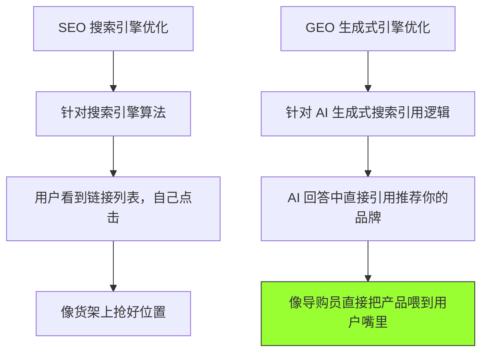
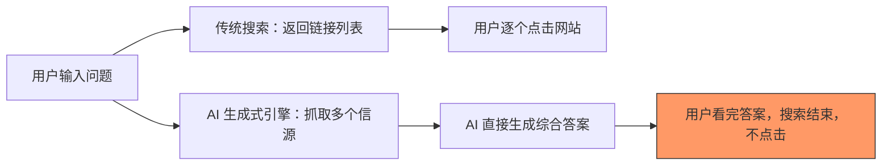
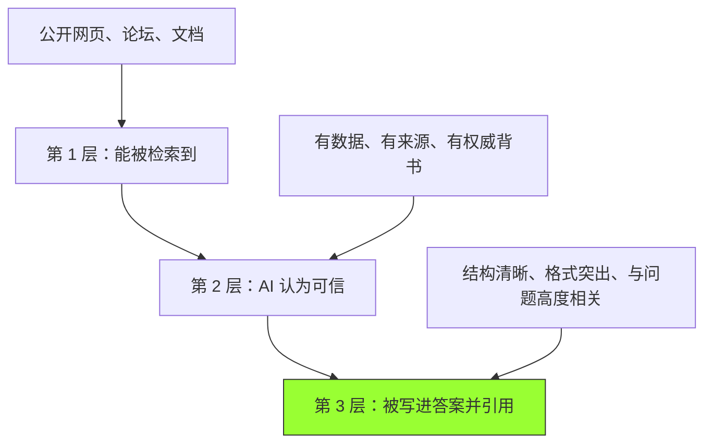

# 第33章 GEO：让 AI 在回答问题时推荐你

> 本节应对"用户开始直接问 AI"的零点击搜索趋势，教品牌/独立站做 GEO（生成式引擎优化），否则在小红书、抖音发再多在 AI 入口面前也"查无此人"。含 GEO 规则与底层逻辑（vs SEO、vs AEO）、0-1 实操（写内容/铺渠道/验证）、落地案例（小红书搜搜薯、烧烤店），并提醒禁用隐藏文本/伪造数据作弊。

---

## 33.1 大白话：过去搜关键词，现在问 AI

过去用户搜关键词，看到一堆链接自己点（SEO）；现在用户直接问 AI，AI 直接给答案并提到品牌名（GEO）。如果你的品牌没出现在 AI 答案里，就等于在新入口面前"查无此人"。

> **大白话**：以前做生意，你盼的是"在百度/淘宝/小红书搜索结果里排第一页"；现在你要盼的是"用户在 AI 里问'哪个牌子好'，AI 直接往答案里写上你的品牌名，并说是根据你的内容说的"。排第一页是"给你链接，你自己点"；被 AI 推荐是"直接喂到用户嘴里"。

举个身边的例子：你以前想买粉底液，会在小红书搜"油皮粉底液推荐"，然后一条条翻笔记、看图、对比，最后自己下单；现在很多用户会直接在 DeepSeek 里问"油皮怎么选粉底液？哪个牌子不卡粉？"，AI 直接给出 3~5 个品牌名字和选购理由。你的品牌要是没在这几个名字里，用户根本不会知道你的存在。这就是 GEO 要解决的问题。

---

## 33.2 SEO 与 GEO 的核心区别 Mermaid 图



| 对比项 | SEO（搜索引擎优化） | GEO（生成式引擎优化） |
|--------|---------------------|-----------------------|
| 对手 | 百度、Google 等搜索引擎的排名算法 | ChatGPT、DeepSeek、Perplexity 等 AI 生成式引擎 |
| 争夺什么 | 链接列表里的靠前位置 | AI 生成答案里的"被引用""被推荐"位置 |
| 用户动作 | 看到链接，自己点进网站 | 直接读 AI 答案，品牌名就在答案文本里 |
| 像什么 | 货架上抢好位置，用户自己挑 | 导购员直接把产品推给顾客，喂到嘴里 |
| 核心心态 | 授人以渔（给你链接，你自己点） | 直接喂到嘴里（直接给答案，并标来源） |

简单理解就是 G（生成式）与 S（搜索式）的区别，即生成引擎和搜索引擎的区别。

- **SEO：针对搜索引擎算法。** SEO 是让你在搜索列表里排名靠前，像是在货架上抢个好位置，让用户一眼看到你，但不知道你好不好用；SEO 是"授人以鱼竿"（给你链接，你自己点）。
- **GEO：针对 AI 生成式搜索的引用逻辑。** GEO 是让 AI 在回答问题时，直接引用你的推荐语，像是让超市导购员（AI）直接把你的产品（内容）推荐给顾客。GEO 是"直接喂到嘴里"（直接给你答案，并说是从你这儿来的）。

还有一个经常混淆的叫法 AEO（Answer Engine Optimization，答案引擎优化），它和 GEO 基本是一回事，都强调让 AI 引擎把你当作答案来源。本书统一用 GEO 这个最专业、最通用的叫法。

AI 就像个懂行的导购，用户问哪家强，它直接报你的名字，还顺便说你为啥强。

---

## 33.3 GEO 是什么：从 SEO 到 GEO

近几年，流量越来越贵，大家都有目共睹。但比变贵更麻烦的是，流量的"流向"开始变了。以前，用户买东西、买服务，去百度、淘宝、小红书的搜索框，搜完关键词，还得在一堆链接、商品图或者笔记里，费劲巴拉地自己挑、自己辨别真假；现在，越来越多的用户开始直接问 AI：油皮怎么选粉底液、XX 品牌靠谱吗？、XX 方案怎么做？。

这就带来了一个残酷的新现实：如果你的品牌没出现在 AI 给出的答案里，无论你小红书发了多少笔记、抖音发了多少视频，在 AI 这个新入口面前，都是查无此人。这是新的挑战，更是新的机会！

这本手册主要跟大家分享，在 AI 搜索时代下，怎么通过优化内容和布局，让 AI 推荐你。就是我们说的 GEO（生成式引擎优化）。

**GEO（Generative Engine Optimization，生成式引擎优化）**：简单讲，它的核心逻辑是：让你的内容能被 AI 看见、理解、引用，最后被推荐出去。（可能你还听过 AEO、AISEO，其实都是一回事，GEO 是最专业的叫法）

**GEO 和 SEO 的核心区别是**：简单理解就是 G（生成式）与 S（搜索式）的区别，即生成引擎和搜索引擎区别。

**适合人群**：这本手册适合如果你的商品客单价比较高，用户决策复杂，喜欢在下单前"问一问"，比如 B2B 企业、SaaS 软件、卖工业设备、专业服务机构（律所/留学/咨询/医美/装修/旅游/3C 数码）、跨境独立站运营负责人。

**阅读前的提醒**：

1. GEO 是长效资产，需要持续维护，且维护成本并不低，想要入局的伙伴建议看完本手册再做决策。
2. 现在的 AI 模型具备极强的数据交叉验证能力，千万不要尝试"隐藏文本"、"伪造数据"等作弊手段。一旦被判定为低质量信源，域名的权重损失将难以挽回。

---

## 33.4 为什么要关注 GEO？

为什么说 GEO 是个值得关注的大趋势，主要基于两个层面的变化：资本的流向、真实的获客案例。

**变化一：资本的流向**

资本市场正在押注这个方向，最近有两个动作值得关注：

- 在美国，一家叫 Profound 的公司刚融了 2000 万美金，专门做 AI 搜索优化，背后的投资方包括 英伟达。
- 在中国，营销巨头蓝色光标，也投资了一家做同类业务的公司叫清蓝 AI。

> **大白话**：钱往哪儿流，趋势就在哪儿。连英伟达这样的算法巨头都下注 AI 搜索优化，说明"让 AI 推荐你"已经从一个小众技巧变成了正经的商业赛道。

**变化二：用户行为正在迁移**

Gartner 预测，到 2026 年，近 25% 的传统搜索流量将转向 AI 工具。Similarweb 数据显示，2025 年 7 月，ChatGPT 的月访问量已达约 57 亿，全球网站排名飙升至第 5。与此同时，Google 搜索结果页中的 AI 概述（AI Overviews）导致部分新闻网站的点击量最高下降 79%。研究还发现，AI 概述出现的搜索结果中，排名第一的自然结果点击率平均下降 37% 以上。

这意味着：即便你的网页还在搜索结果第一页，用户也可能因为 AI 直接给了答案，而根本不点进你的网站。不做 GEO，你的流量入口正在被 AI 偷偷关掉。

> **小提醒**：上面的数据来自第三方机构的公开报告，具体数字随时间会有变化，做决策时建议再去官方渠道核实最新口径。

---

## 33.5 新趋势："零点击"与新流量逻辑

用户开始直接问 AI，不再点击搜索链接，这就是"零点击搜索"。从搜索到 AI，流量逻辑发生了根本性变化。



"零点击搜索"这个概念并非今天才出现。过去，它指的是用户在搜索结果页中看到了"知识卡片"或"精选摘要"后，得到了满足，便不再点击进入任何网站。这在当时被视为对网站流量的巨大威胁。

然而，由生成式 AI 驱动的"答案引擎"，将"零点击"的范围和深度以前所未有的程度放大了。现在，几乎每一个信息类的查询都有可能被一个由 AI 生成的、看似全面且完美的总结性答案所终结。当用户的信息需求在搜索结果页面就被满足时，他们点击进入具体网站的动机就自然消失了。

这种机制的转变对商业至少产生三点根本性的影响：

1. **流量入口的转移**：过去，企业通过 SEO 努力争夺的是"链接列表"中的靠前位置。现在，这个入口本身正在变得越来越不重要。新的、最有价值的入口是成为 AI 生成答案时所引用的那个"信源"。竞争的终点已经从争取"被看见"转变为争取"被信任"和"被引用"，最终"成为答案"。
2. **品牌曝光逻辑的改变**：过去，用户通过点击链接进入网站，能完整地体验品牌设计的页面、视觉和内容。在"零点击"时代，品牌的大部分曝光可能仅仅是 AI 答案末尾一个不起眼的来源标注，甚至只是其观点被融入答案而品牌名并未出现。品牌与用户的直接触点被大大削弱。
3. **商业转化路径的断裂**：对于依赖网站流量进行线索转化、广告变现或直接销售的企业来说，这是最致命的影响。如果用户不进入网站，那么精心设计的转化漏斗、行动号召按钮、再营销像素都将失去作用。

所以，GEO 的核心不是"搞定算法"，而是"成为 AI 信赖的知识源"——让你的内容成为 AI 生成答案时优先引用的事实根据。

---

## 33.6 谁适合做 GEO？

不一定所有生意都要立刻做 GEO。下面三类是最适合入局的：

1. **第一类：卖复杂决策的**（B2B、SaaS、工业设备）
   这类产品客单价高、决策链长，用户下单前一定会"问一问"比较，AI 答案里被推荐，等于直接抓住了高意向买家。

2. **第二类：卖专业知识的**（律师、医生、留学、咨询）
   用户选专业服务最看重"靠不靠谱"，AI 答案中被当作权威来源引用，信任背书价值极高。

3. **第三类：卖服务与体验的**（医美、装修、旅游、3C 数码）
   这类消费决策依赖大量对比和评价，AI 综合答案里出现你的品牌和案例，能直接带来咨询和订单。

**谁不建议做 GEO？**

- 纯靠低价冲量、用户根本不"搜"就直接下单的极低客单价产品（比如日用小件），GEO 的投入产出比不明显。
- 没有官网或任何线上内容沉淀的纯线下个体户，GEO 无所依托。
- 想靠"作弊"快速出结果的——本章 33.7.4 节“严禁瞎编数据”会讲，作弊在 GEO 时代很容易被识别并惩罚。

---

## 33.7 GEO 实操步骤（SOP）

### 步骤 1：了解 GEO 的底层逻辑 —— AI 凭什么推荐你？

#### 1.1 AI 回答问题的核心机制：RAG（检索增强生成）

AI 不是凭空"想"出答案的。当你向 AI 提问时，很多 AI 搜索产品的内部流程是 RAG：**R**etrieval（检索）+ **A**ugmented（增强）+ **G**eneration（生成）。

```mermaid
graph TD
    A[用户提问] --> B[检索：从互联网/知识库找相关内容]
    B --> C[增强：把找到的内容作为"参考资料"喂给 AI]
    C --> D[生成：基于参考资料组织答案]
    D --> E[引用：标注信息来源]
    style E fill:#9f3,stroke:#333
```

简单说，RAG 相当于 AI 做"开卷考试"：它先去网上找几篇相关文章，打开作为参照，再基于这些参照写答案。这也就意味着——**AI 只能推荐它"读到"过的内容。如果你的品牌和内容不在 AI 能检索到的范围内，它根本没法把你写进答案。**

所以 GEO 的第一要务就是：让你的内容出现在 AI 能抓取的公开网络上，并且结构清晰，让 AI 看得懂、愿意引用。

#### 1.2 AI 筛选内容的三层漏斗

AI 在生成答案时引用哪些内容，可以看作经过三层漏斗筛选：



- **第 1 层：能被检索到。** 你的内容必须公开发布在 AI 能爬取的平台上（官网、博客、论坛、社交媒体等），且不被 robots.txt 或登录墙挡住。
- **第 2 层：AI 认为可信。** AI 对抗"幻觉"非常敏感，它偏爱带有具体数据、明确来源标注、专家观点的内容。空泛的形容词堆砌很容易被丢弃。
- **第 3 层：被写进答案并引用。** 即使可信，内容也必须结构清晰（定义要点、表格对比、结论先行），AI 才能轻松地把一块"可引用内容"摘录进答案，并标上你的品牌和链接。

#### 1.3 GEO 的工作公式

可以把 GEO 的效果粗略理解为：

> **被 AI 推荐的概率 ≈ 内容被检索到的覆盖面 × 内容的可信度评分 × 内容的结构友好度**

- 覆盖面：你在多少个 AI 能读到的平台上发布了相关内容？
- 可信度：内容里有没有真数据、真案例、可追溯的来源？
- 结构友好度：是否用了定义式段落、要点列表、表格对比等 AI 容易抓取的格式？

三者缺一不可，任何一项为 0，结果就是 0。

举个例子：如果你只在官网发了一篇文章（覆盖面很低），即使内容再可信，AI 也可能根本搜不到；如果你发了十篇文章但全是"行业领先、非常好用"这种空话（可信度低），AI 也不会引用；如果内容可信但排版一团乱（结构不友好），AI 也提取不出可引用的模块。三者都要做，才有机会被 AI 推荐。

---

### 步骤 2：如何写出 AI 愿意搬运的内容

#### 2.1 写作原则

面向 AI 写作，核心原则是"为机器设计可提取的答案模块"，同时不失人类可读性：

1. **结论先行**。把最重要的答案放在开头，不要绕弯子。
2. **一句话一观点**。句子越短，AI 越不容易误读。
3. **名词动词为主，形容词为辅**。AI 更懂"2000 元""75%""2025 年"这种具体信息，不太懂"非常好""极其推荐"这种模糊赞美。
4. **有源可查**。每个重要数据、结论后面标注来源，AI 喜欢"有出处"的内容。
5. **保持更新**。AI 倾向于引用新鲜信息，旧内容要定期复查修订。

#### 2.2 四个必杀内容模板

下面四个模板是 AI 最容易"看中并引用"的格式，建议每篇 GEO 内容里至少套用两个。

**模板一：定义式**

适合回答"什么是 XX""XX 是什么"这类问题。开头用一段话给出标准定义，再用要点列出关键特征。

```
什么是人体工学椅？
人体工学椅是一种根据人体脊椎生理曲线设计，可调节腰部支撑、座深、扶手高度，以减少久坐压力的办公椅。

核心特征：
- 动态腰部支撑：可随坐姿变化调节支撑力度
- 可调节座深：适应不同身高用户
- 4D 扶手：上下、前后、左右、角度均可调节
```

> 图片说明：定义式内容模板示例
> 

**模板二：要点式**

适合回答"XX 有哪些""如何选择 XX"这类问题。用编号或项目符号把答案拆成 3-5 个要点，每个要点一个结论，后面跟一句解释。

```
选购人体工学椅的 3 个关键指标：
1. 腰部支撑类型。动态支撑优于固定支撑，能贴合不同坐姿。
2. 材质透气性。网布材质适合长时间久坐，真皮更易闷热。
3. 保修年限。品牌椅通常提供 3-12 年保修，这是品质信心的体现。
```

**模板三：结论式**

适合回答"XX 哪个好""值得买吗"这类问题。不要只说"看情况"，直接给出明确的推荐结论和适用人群。

```
如果你每天久坐超过 8 小时且预算在 1500-3000 元，优先考虑带动态腰支撑的网布人体工学椅；如果你身高超过 1.9 米，重点看座深可调范围是否达到 50 厘米以上。
```

> 图片说明：结论式内容模板示例
> 

**模板四：表格对比式**

适合回答"XX vs YY""怎么选"这类问题。HTML 表格是 AI 最容易抓取和引用的结构化数据。

| 维度 | Apex Model X | 竞品 A | 竞品 B |
|------|-------------|--------|--------|
| 腰部支撑 | 动态支撑 | 固定支撑 | 动态支撑 |
| 材质 | 透气网布 | 合成皮 | 透气网布 |
| 保修 | 5 年 | 2 年 | 3 年 |
| 参考价格 | 2299 元 | 1899 元 | 2599 元 |

数据来源：实测，2025 年

> 图片说明：表格对比式内容模板示例
> 

#### 2.3 三个提升信任度的钩子

研究表明，在内容中加入以下三类元素，能显著提升内容在 AI 答案中的可见度（平均提升 30%~40%）：

1. **权威引用**。在内容中加入来自权威人物或可信来源的直接引语，如"据美国脊椎协会研究，动态腰部支撑能将下背部压力降低 30%"。
2. **统计数据**。在定性描述基础上，加入定量的、具体的统计数据支撑观点，如"对 5000 家企业的调研显示，采用自动化流程的企业员工满意度平均提升了 23%"。
3. **明确标注信源**。像写学术论文一样，陈述事实或观点时明确指出信息来源，并尽量附上可点击的链接。

这三类元素的共性是：它们都极大地增强了内容的可信度和证据强度，而这正是大语言模型在对抗"幻觉"、生成可靠答案时最看重的特质。

#### 2.4 写作注意点

- **① 内容要保持更新**。AI 倾向于引用新鲜信息，建议每季度复查一次核心 GEO 内容，把过期数据替换掉。
- **② 全网口径统一**。你的品牌名称、核心数据、联系方式在官网、社交平台、百科词条上的表述要保持一致，避免 AI 交叉验证时出现矛盾而降低信任度。
- **③ 戒掉形容词（AI 只要名词和动词）**。「非常好用""行业领先"这类形容词 AI 很难验证，建议改成"2000 家企业在用""服务 50 个国家"这种可验证的名词和数字。
- **④ 严禁瞎编数据（防幻觉反噬）**。现在的 AI 模型具备极强的数据交叉验证能力，伪造数据一旦被识别，不仅当篇内容作废，整个域名的信源权重都可能受损，难以挽回。

---

### 步骤 3：如何将内容铺到各个信息平台

#### 3.1 国内战场：借势大平台

在国内，AI 生成答案时也会抓取小红书、抖音、微信公众号、知乎、百度等平台的公开内容。建议：

- 把核心 GEO 内容先发布在官网或独立博客上，作为"原始信源"；
- 同步改编成小红书笔记、知乎回答、公众号文章，在正文里带上官网原文链接；
- 针对"小红书搜搜薯"等站内搜索入口，在笔记标题和正文里布局用户真实会问的问题，增加被 AI 抓取的机会。

#### 3.2 国外战场：Reddit、Quora 与独立站

面向海外用户，Reddit 和 Quora 是 AI 抓取优质真人讨论的重要信源；独立站上的结构化产品页面和博客则是 GEO 的主阵地。具体做法见本书第 34 章 Reddit 出海运营。

#### 3.3 怎么验证效果

GEO 没有像 SEO 那样成熟的排名工具，最笨也最有效的方法就是"亲自当用户"：

1. 打开 DeepSeek、ChatGPT、Perplexity 等 AI 工具；
2. 输入你的目标客户可能会问的问题，如"XX 品牌靠谱吗""XX 方案怎么选"；
3. 观察 AI 回答是否提及你的品牌，以及引用了你的哪篇内容；
4. 没出现的话，对照 33.7 的三层漏斗自查：是是内容没被检索到？还是可信度不够？还是结构不够清晰？针对性修改后再测。

> 图片说明：GEO 效果验证流程示意
> 

#### 3.4 30 天 GEO 行动计划（快速上手表）

如果你刚开始做 GEO，可以按下面这个节奏推进：

| 阶段 | 时间 | 主要动作 | 产出 |
|------|------|---------|------|
| 第一周 | 第 1~7 天 | 梳理品牌核心关键词，确定 3~5 个目标客户常问的问题 | 关键词 + 问题清单 |
| 第二周 | 第 8~14 天 | 按四个模板写 2~3 篇 GEO 内容，发布在官网作为原始信源 | 2~3 篇官网文章 |
| 第三周 | 第 15~21 天 | 把内容改编成小红书笔记、知乎回答，带上官网链接 | 3~5 条社交平台内容 |
| 第四周 | 第 22~30 天 | 用 DeepSeek、ChatGPT 搜目标问题，检查是否被引用，复查修订 | 验证记录 + 修订清单 |

#### 3.5 常见问题（FAQ）

**Q：GEO 和 SEO 冲突吗？要不要二选一？**
A：不冲突，可以并行做。SEO 负责让你在搜索结果列表里排前面，GEO 负责让 AI 答案里提到你。两者的内容素材可以复用：一篇写好的 GEO 文章，既可以做 SEO 页面发在官网，也可以改编成小红书笔记、知乎回答做 GEO 铺设。

**Q：新网站能做 GEO 吗？**
A：能，但前提是内容必须被 AI 检索到。新站建议先把内容发在小红书、知乎、Reddit 等大平台上，这些平台权重高、容易被 AI 抓取，等官网内容积累了一段时间再作为原始信源。

**Q：需要发多少内容才能被 AI 推荐？**
A：没有固定数量，关键是"覆盖面 × 可信度 × 结构友好度"。3~5 篇高质量、结构清晰、有真实数据的核心内容，比 30 篇空泛的软文更容易被 AI 引用。

**Q：AI 只推荐英文内容，中文内容会被忽略吗？**
A：不会。DeepSeek、ChatGPT 等模型都能理解中文，中文内容同样会被抓取和引用。关键是用中文写得结构清晰、有真实数据，而不仅仅是堆形容词。

**Q：怎么知道 AI 回答里有没有引用我的内容？**
A：最笨也最有效的方法就是亲自当用户：打开 DeepSeek、ChatGPT、Perplexity，输入你的目标客户可能会问的问题，观察 AI 回答是否提及你的品牌，并看引用的来源链接是否指向你的官网或社交平台内容。AI 通常会在答案末尾标注信源，或者在正文里直接写出品牌名和网址。

**Q：做 GEO 多久能看到效果？**
A：没有固定时间表，和 SEO 一样属于长效资产。通常需要先把内容发布上线，等待 AI 搜索工具抓取和建立索引，这个过程可能几周到几个月不等。建议按 33.4 节的 30 天行动计划先把核心内容做出来，然后每两周用一次"亲自当用户"的方法检查，持续修订，效果会慢慢显现。

---

## 33.8 对应素材

- `202602-geo` > 引言（GEO 是什么，从 SEO 到 GEO，零点击搜索，AI 推荐品牌）
- `202602-geo` > 一、GEO 是个什么新趋势？（1. 什么是 GEO？它和 SEO 有什么区别？、2. 为什么要关注 GEO、3. 新趋势："零点击"与新流量逻辑）
- `202602-geo` > 二、谁适合做 GEO？（第一类：卖复杂决策的；第二类：卖专业知识的；第三类：卖服务与体验的；谁不建议做 GEO？）
- `202602-geo` > 三、GEO 实操步骤（SOP）（怎么写内容、怎么铺设内容渠道、怎么验证效果）
- `202602-geo` > GEO 落地案例（小红书搜搜薯打法、烧烤店怎么做 GEO）

> 注：`202602-geo` 素材目录在本地素材库中未找到对应子目录，上述条目按草稿所引素材名保留，具体落地案例（小红书搜搜薯、烧烤店）已按 GEO 通用方法论在本章 33.7 与 33.9 中展开说明。

---

## 33.9 落地案例：小红书搜搜薯与烧烤店做 GEO

**案例一：小红书搜搜薯打法**

小红书的站内搜索"搜搜薯"正在被 AI 搜索工具广泛抓取。某护肤品牌希望在 AI 回答"油皮怎么选粉底液"时被提及，按 GEO 方法做了三件事：

1. 在官网发布《油性皮肤粉底液选购指南》，用定义式模板开头，附成分表和肤质适配表格；
2. 同步发布小红书笔记，标题直接用用户搜索话术"油皮粉底液怎么选不卡粉"，正文带真实测试数据（如"控油 8 小时后 T 区出油面积减少 40%"）并标注测评来源；
3. 笔记结尾附上官网指南链接，做全网口径统一。

两个月后，该品牌在多个 AI 工具的相关问答中被引用，且笔记本身也获得了搜索流量。

**案例二：烧烤店怎么做 GEO**

一家社区烧烤店想让附近用户在 AI 里问"这附近哪家烧烤好"时被推荐：

1. 在美团、大众点评、微信小程序上统一店名、地址、招牌菜（全网口径统一）；
2. 鼓励老顾客在点评里提具体菜品（如"孜然羊排""铁板花甲"），把菜品名变成 AI 可检索的关键词；
3. 在微信公众号发《本地烧烤店选购建议》，用结论式模板直接推荐招牌菜和适合人群，附门店地址和营业时间。

GEO 对本地店来说，本质上就是"让 AI 读到关于你的真实、具体、一致的信息"。

---

## 小练习

选一个你熟悉的品牌或产品，在一个 AI 搜索工具中搜索相关问题，观察 AI 回答是否提及该品牌，记录被引用与未被引用的差异，写出 1 条可改进的 GEO 建议。

---

## 本章小结

通过本章，你应该已经了解：

1. **GEO 的本质**：生成式引擎优化，是让你的内容被 AI 看见、理解、引用、推荐，区别于 SEO 的"抢链接位置"。
2. **零点击趋势**：用户越来越直接问 AI、不点链接，流量入口正从"搜索结果列表"转向"AI 生成答案"。
3. **RAG 机制**：AI 做"开卷考试"，只能推荐它检索到的内容，所以你的内容必须公开、可抓取。
4. **三层漏斗**：能被检索到 → AI 认为可信 → 被写进答案并引用，缺一不可。
5. **四个模板**：定义式、要点式、结论式、表格对比式，配合三个信任钩子（权威引用、统计数据、标注信源）。
6. **写作红线**：保持更新、全网口径统一、戒掉形容词、严禁瞎编数据。
7. **落地路径**：官网做原始信源，同步到小红书/知乎/Reddit 等平台，最后亲自用 AI 工具搜品牌词验证。

下一章，我们将学习 Reddit 出海运营——如何在 Google 的"亲儿子"社区里从 0 到 1 建立账号，挖掘真实痛点，拿 AI 时代的搜索流量。
