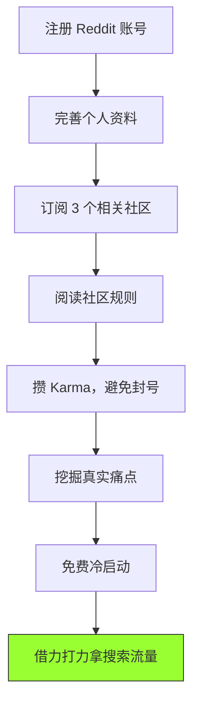

# 第34章 Reddit 出海与 AI 时代信息源运营

> 本节教出海者从 0 到 1 运营 Reddit：先解决风控封号（注册、养号、攒 Karma），再挖真实痛点、免费冷启动、借力打力拿搜索流量。Reddit 被定位为 AI 时代最重要信息源，强调硬门槛网络环境 + 软门槛真诚利他，配套 20+ 工具汇总。

---

## 34.1 大白话：Reddit 是海外"全球最大兴趣社区"，也是 Google 的"亲儿子"

Reddit 是海外的"全球最大兴趣社区"，类似于国内的贴吧，但更去中心化，上面聚集了成千上万个按兴趣划分的小社区（叫 Subreddit，比如 r/SEO、r/Entrepreneur、r/malefashionadvice）。在 Reddit 上发帖容易被搜索引擎收录，这对出海做独立站、做海外工具站非常有价值。

但 Reddit 风控严，新号容易被封，先要养号、攒积分，不能硬广，要真诚提供价值，才能拿到流量。

> **大白话**：Reddit 是海外最大的兴趣社区，Google 的"亲儿子"。新手不友好，新号容易被封；但一旦养号成功，流量非常精准，而且容易被 Google 搜索引擎收录。需要自行配置网络环境才能登录。

Reddit 上的内容由用户投票决定排序：点赞（Upvote）多的帖子会爬到社区首页，甚至整站首页（r/all）；点踩（Downvote）多的会被折叠、埋没。每个用户还有一个积分叫 Karma，发帖或评论被点赞会涨 Karma，被踩会跌。Karma 低的新号，发的帖容易被系统直接过滤掉，根本没人看到。所以养号、攒 Karma，是 Reddit 运营的第一道门槛。

---

## 34.2 什么是 Reddit 与为什么它很重要

### 34.2.1 什么是 Reddit

Reddit 是海外的社交新闻和论坛平台，被称为"互联网的首页"和"全球最大的兴趣社区"。用户可以在上面发布内容、投票和评论，形成高度互动的社区氛围。（网址：https://www.reddit.com/）需要自行配置网络环境才能登录。

Reddit 的核心单位是 Subreddit（子论坛），每个以 r/ 开头，比如 r/SEO 专门聊搜索优化，r/smallbusiness 聊小生意。每个 Subreddit 有自己的版主和规则，有些社区允许发推广链接，有些禁止任何广告，违规会被版主移除帖子，严重的会封号。

### 34.2.2 为什么 Reddit 很重要

Reddit 之所以重要，有四个核心理由：

**1. Google 的"亲儿子"**（SEO 价值极大）

Reddit 是 Google 的"亲儿子"，在 Reddit 上发帖容易被搜索引擎收录，这对出海做独立站、做海外工具站非常有价值。很多海外用户搜问题时，直接在 Google 关键词后面加上 `site:reddit.com`，就是为了找 Reddit 上真人的讨论。你在 Reddit 上的优质内容，有机会被 Google 收录并带来长期搜索流量。

**2. AI 时代最重要的信息源**

Reddit 上的内容是真人真话，不是营销号，是 AI 时代最重要的信息源之一。很多 AI 搜索工具和大模型在抓取网络内容时，都会把 Reddit 当作重要信源，因为那里聚集了真实用户的痛点、评价和讨论。你在 Reddit 上留下的真实内容，也更可能被 AI 引用和推荐。

**3. 早期产品的"流量洼地"**

Reddit 上有很多 niche（细分）社区，流量洼地多，适合新手冷启动。与小红书、抖音等国内平台相比，Reddit 上真实讨论更多，营销号更少，新产品和新品牌更容易通过真诚参与社区讨论获得首批种子用户。

**4. 商业化红利期**

Reddit 上市后正在加速商业化（广告、API 收费），现在入局属于顺势而为。平台方也在鼓励品牌和开发者通过官方渠道参与社区，早期建立社区声誉，后期获客成本会更低。

---

## 34.3 基础篇：注册、养号、攒 Karma，解决风控封号

Reddit 风控极其严格，对 IP 和网络环境要求很高，这是"硬门槛"。新手需要解决注册、养号、攒 Karma（积分）问题，避免被封号。

### 34.3.1 养号前 3 步

1. **完善个人资料**
   注册后不要立刻发帖，先上传头像、填写简介，让账号看起来像真实用户而不是营销号。资料越完整，被系统判定为机器号的概率越低。

2. **订阅 3 个相关社区**
   找 3 个与你出海产品相关的 Subreddit 并订阅，每天花 15~30 分钟浏览，了解社区用什么语言说话、关心什么话题、禁忌什么行为。

3. **阅读社区规则**
   每个 Subreddit 右侧边栏都有自己的规则（Sidebar Rules），比如"禁止发链接""只允许周五自推""标题必须加标签"。发帖前务必读一遍，违反社区规则是被封号或被移除帖子的常见原因。

软门槛是"真诚利他"，Reddit 极度排斥硬广。先在别人帖子下评论、提供帮助，攒够一定的 Karma 和社区信任，再分享自己的内容，成功率才高。

### 34.3.2 注册与前 30 天养号节奏

Reddit 对新号的审查比普通社交平台严得多，建议新手按下面的节奏来：

**第 1~3 天：只看，不发**
注册完成后，先不发帖、不评论，只订阅 3~5 个目标社区，每天浏览 20 分钟，看看社区里的人怎么聊天、用什么梗、忌讳什么。账号过于"活跃"却毫无阅读历史，很容易被系统判定为营销机器。

**第 4~7 天：先评论，后发帖**
在别人的热门帖子下留下真诚、有帮助的评论，比如回答别人关于产品选型的问题、分享一个自己真实遇到的坑。评论被点赞后，Karma 会慢慢上涨。这个阶段不带任何链接，不提自己的品牌。

**第 8~14 天：尝试发纯干货帖**
Karma 积累一定后，尝试在目标社区发一篇纯干货帖子（不带链接、不卖东西），比如"我用 XX 工具半年的真实复盘"。标题不要像广告，要像用户分享。发帖后认真回复每一条评论，显得你是个真人。

**第 15~30 天：建立社区信任**
如果帖子获得了不错的点赞和评论，说明社区开始信任你。这时才可以考虑在个人主页放上独立站链接，或在社区规则允许的情况下适当带链接。整个前 30 天，核心原则是：先贡献，后索取。

**常见风控红线**（碰到很可能直接封号）：
- 用数据中心机房 IP 或免费代理注册；
- 同一设备/IP 批量注册多个号并互相点赞；
- 注册后立刻大量发帖或发相同内容；
- 帖子里满是短链接、联系方式、"加我"之类字眼；
- 多个号在同一个帖子下互相顶帖。

如果被系统"影子封号"（Shadowban），你自己能看到帖子，但其他人看不到，建议换干净的网络环境重新注册，不要反复尝试申诉。

### 34.3.3 Reddit 做与不做

| 做 ✅ | 不做 ❌ |
|-------|---------|
| 先读社区规则，再发帖 | 无视 Sidebar Rules，硬发推广链接 |
| 在评论区真诚帮助别人 | 多个号互刷点赞、互顶帖 |
| 带链接前确认社区允许 | 每篇帖子都带"加微信/详情私信" |
| 用真实经历写干货 | 复制粘贴 AI 生成的营销软文 |
| 账号资料完整，像真人 | 新号注册后立刻大量发帖 |

---

## 34.4 进阶篇：挖痛点、免费冷启动、借力打力与 20+ 工具

进阶做法：挖掘真实痛点、免费冷启动、借力打力拿搜索流量。手册配套 20+ 款高效工具，涵盖账号分析、关键词监控与内容创作。

### 34.4.1 挖掘真实痛点

不要直接发广告，先去目标社区搜用户真在问的问题。方法：

- 在 Reddit 搜索框输入核心关键词，按"帖子"筛选，看用户在吐槽什么、求什么推荐；
- 用 Google 搜 `site:reddit.com + 你的产品关键词`，找到用户已经讨论过的帖子；
- 记录高频出现的不满点（比如"XX 工具太贵""YY 软件不会中文"），这些就是你的内容选题和产品卖点。

### 34.4.2 免费冷启动

新账号没 Karma 时，先不要发帖，先评论。在大号的热门帖子下留下有价值的回复，帮助别人解决问题，评论被点赞后 Karma 会缓慢上涨。Karma 达到一定数量后，再尝试在目标社区发帖分享干货，帖子里不要带链接，或者只在个人主页放链接，避免被判定为广告。

### 34.4.3 借力打力拿搜索流量

Reddit 帖子容易被 Google 收录，你可以把在 Reddit 上回答用户问题的内容，同步整理成独立站的博客文章或帮助文档，在 Reddit 评论里引用你的独立站链接（只要社区规则允许）。这样既借了 Reddit 的搜索收录，又把流量导回自己的站点，形成闭环。

### 34.4.4 常用工具汇总（20+ 款）

下面列出运营 Reddit 时常用的工具类别，具体选型请按需自行验证，避免违反平台规则：

1. **账号管理与防关联**：指纹浏览器、住宅代理 IP、账号密码管理器；
2. **社区数据分析**：Subreddit 流量统计（如 Subreddit Stats、Reddit Metrics 等）、帖子热度排名、用户活跃时段分析工具；
3. **定时发布**：社交媒体发布工具（如 Later for Reddit 等类似工具）的 Reddit 定时发帖功能；
4. **关键词监控**：Reddit 关键词告警、品牌词监控、竞品提及监控（如 Google Alerts 配合 site:reddit.com 检索）；
5. **内容创作**：AI 写作辅助、排版工具、截图与图片处理（如 Canva）；
6. **效果追踪**：Reddit 广告后台、Google Search Console、独立站流量统计；
7. **日程与任务**：发帖日历、回复跟踪表、社区运营 SOP 看板（如 Notion、Airtable）。

> 注：具体工具名称与下载渠道请自行搜索确认，工具只能辅助运营，真诚利他的内容才是留住流量的核心。

### 34.4.5 常见问题（FAQ）

**Q：为什么我的 Reddit 帖子发出去后没人看到？**
A：最常见的原因是 Karma 太低，或者触发了社区的自动过滤（AutoModerator）。新号建议先评论攒 Karma，再发帖；发帖前务必读社区规则。

**Q：一个人能注册多个 Reddit 号吗？**
A：可以注册多个号，但严禁多个号互相点赞、互顶帖，或在同一讨论里站队，否则会被判定为操纵投票并封号。建议一个号专心经营，而不是批量养号。

**Q：必须买 Reddit 广告才能有流量吗？**
A：不是。Reddit 广告可以加速，但免费的有机运营（干货帖子 + 真诚评论）更适合冷启动，而且 Reddit 用户对硬广反感极强，先做有机内容，等社区信任起来后再考虑投放。

**Q：Reddit 需要翻墙吗？**
A：是的，Reddit 在中国大陆无法直接访问，注册和使用都需要自行配置可用的网络环境，并尽量使用住宅 IP，避免数据中心机房 IP。

---

## 34.5 Reddit 出海 Mermaid 图

---

## 34.6 对应素材

- `202602-reddit` > 引言（Reddit 是什么，基础篇：风控与封号、注册养号积累 Karma；进阶篇：挖痛点、冷启动、借力打力搜索流量，20+ 工具汇总）
- `202602-reddit` > 基础篇：新手入局与运营指南（一、什么是 Reddit；二、为什么 Reddit 很重要：Google 亲儿子、AI 时代信息源、流量洼地、商业化红利期）

> 注：`202602-reddit` 素材目录在本地素材库中未找到对应子目录，上述条目按草稿所引素材名保留；本章已按 Reddit 出海通用方法论展开说明。

---

## 小练习

注册一个 Reddit 账号并完成养号前 3 步（完善个人资料、订阅 3 个相关社区、阅读社区规则），在个人主页上记录账号创建日期与初始 Karma。
