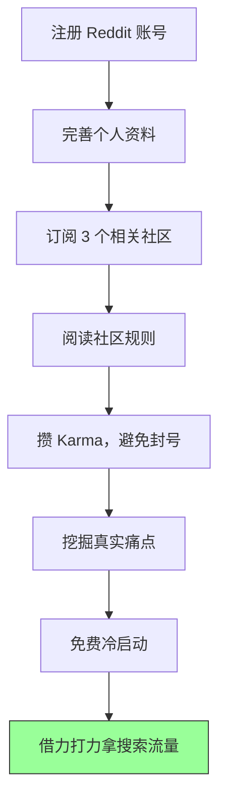

# 第34章 Reddit 出海与 AI 时代信息源运营

> 本节教出海者从 0 到 1 运营 Reddit：先解决风控封号（注册、养号、攒 Karma），再挖真实痛点、免费冷启动、借力打力拿搜索流量。Reddit 被定位为 AI 时代最重要信息源，强调硬门槛网络环境 + 软门槛真诚利他，配套 20+ 工具汇总。

## 34.1 大白话：Reddit 是海外"全球最大兴趣社区"，也是 Google 的"亲儿子"

Reddit 是海外的"全球最大兴趣社区"，也是 Google 的"亲儿子"，在上面发帖容易被搜索引擎收录。但它风控严，新号容易被封，先要养号、攒积分，不能硬广，要真诚提供价值，才能拿到流量。

## 34.2 什么是 Reddit 与为什么它很重要

### 34.2.1 什么是 Reddit

Reddit 是海外的社交新闻和论坛平台，被称为"互联网的首页"和"全球最大的兴趣社区"。用户可以在上面发布内容、投票和评论，形成高度互动的社区氛围。（网址：https://www.reddit.com/）需要自行配置网络环境才能登录。

### 34.2.2 为什么 Reddit 很重要

1. **Google 的"亲儿子"**（SEO 价值极大）
2. **AI 时代最重要的信息源**
3. **早期产品的"流量洼地"**
4. **商业化红利期**：Reddit 上市后正在加速商业化（广告、API 收费），现在入局属于顺势而为。

## 34.3 基础篇：注册、养号、攒 Karma，解决风控封号

Reddit 风控极其严格，对 IP 和网络环境要求很高，这是"硬门槛"。新手需要解决注册、养号、攒 Karma（积分）问题，避免被封号。

**养号前 3 步**：
1. 完善个人资料
2. 订阅 3 个相关社区
3. 阅读社区规则

软门槛是"真诚利他"，Reddit 极度排斥硬广。

## 34.4 进阶篇：挖痛点、免费冷启动、借力打力与 20+ 工具

进阶做法：挖掘真实痛点、免费冷启动、借力打力拿搜索流量。手册配套 20+ 款高效工具，涵盖账号分析、关键词监控与内容创作。

## 34.5 Reddit 出海 Mermaid 图

## 34.6 对应素材

- `202602-reddit` > 引言（Reddit 是什么，基础篇：风控与封号、注册养号积累 Karma；进阶篇：挖痛点、冷启动、借力打力搜索流量，20+ 工具汇总）
- `202602-reddit` > 基础篇：新手入局与运营指南（一、什么是 Reddit；二、为什么 Reddit 很重要：Google 亲儿子、AI 时代信息源、流量洼地、商业化红利期）

## 小练习

注册一个 Reddit 账号并完成养号前 3 步（完善个人资料、订阅 3 个相关社区、阅读社区规则），在个人主页上记录账号创建日期与初始 Karma。
