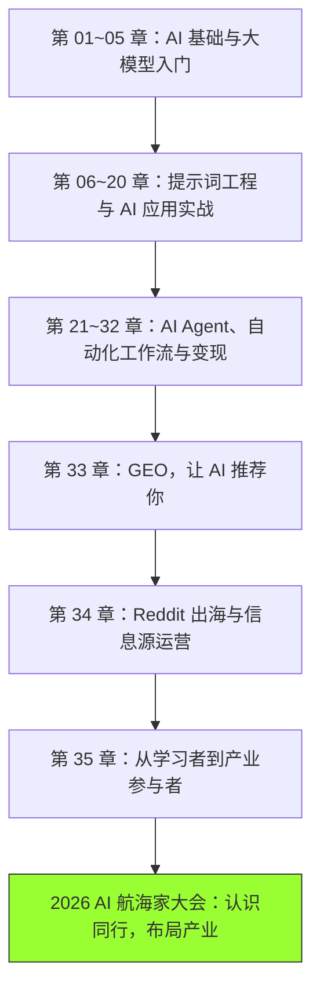

# 第35章 2026 AI 航海家大会前瞻

> 本节介绍 2026 AI 航海家大会的背景与意义，作为全书的收尾，激励读者从"学习 AI 工具"迈向"参与 AI 社区与产业"。注：该手册 README 仅含标题，正文待后续补充。

---

## 35.1 大白话：别只当"旁观者"，要参与 AI 社区

学完这本书，不要只当"旁观者"，要参与进 AI 社区，认识更多人，才能抓住下一波机会。2026 AI 航海家大会就是一个认识同行、布局产业的机会。

> **大白话**：学 AI 工具是第一步，但真正的机会在于参与 AI 社区，认识同行，了解产业动态。2026 AI 航海家大会就是一个让你从"学习者"变成"参与者"的机会。

光会用 AI 工具的人很多，但真正把 AI 工具变成工作、变成收入、变成产业资源的人，通常有一个共同点：他们不只在家里刷教程，也会走出去、参与社区、认识同行。社区是信息的放大器，产业是机会的聚集地。本书的最后一章，不是要教你一个新工具，而是要把你从"学习 AI 工具"推向"参与 AI 社区与产业"。

---

## 35.2 什么是 2026 AI 航海家大会？

2026 AI 航海家大会是生财有术航海体系的年度盛会，汇集了过去两年中通过"航海"手册学习 AI 的数千名读者，以及 AI 领域的从业者、创业者、投资人。

### 35.2.1 大会背景

生财有术"航海"项目从 2023 年 5 月开始，已经持续了三年多，期间出版了 187 份航海手册，其中约 65 份与 AI 密切相关。这些手册涵盖了 AI 绘画、AI 写作、AI 视频、AI 编程、AI 应用开发、AI 自动化工作流、AI Agent、AI 商业变现等方向。

2026 AI 航海家大会是对这三年航海成果的总结，也是对下一波 AI 机会的布局。

> **大白话**："航海"手册就像是一本本 AI 实战指南，从 2023 年出发到现在，已经出了 187 本，跟 AI 有关的大约有 65 本。2026 AI 航海家大会，就是把这些手册的读者和 AI 行业从业者聚在一起的一次年度聚会。

### 35.2.2 大会意义

作为全书收尾，2026 AI 航海家大会旨在帮助读者从"学习 AI 工具"迈向"参与 AI 社区与产业"。

注：该手册 README 仅含标题，正文待后续补充。

---

## 35.3 大会核心价值

### 35.3.1 认识同行

大会汇集了通过 AI 手册学习并实践的读者，你可以在这里认识志同道合的同行，交流实战经验，避免走弯路。

学 AI 是一条挺孤单的路，你在家里对着屏幕调提示词、写代码，很难知道外面的人都在做什么。大会把同样在学 AI 的人聚在一起，你可以听听别人怎么用 DeepSeek 写周报，怎么用 AI Agent 做自动化工作流，怎么用 GEO 让品牌被 AI 推荐，怎么用 Reddit 做出海获客。这些交流往往比单独啃教材更快。

### 35.3.2 布局产业

通过大会了解 AI 行业最新动态，提前布局下一波 AI 商业机会，从"跟随者"变成"布局者"。

AI 行业变得很快，今天的热门模型可能明天就被超越，今天的玩法可能后天就失效。只有参与产业圈子，才能第一时间听到新趋势、新工具、新机会。大会不是只讲"怎么用工具"，更是讲"AI 产业往哪走"，帮助你提前布局，而不是事后追赶。

### 35.3.3 从工具到产业

大会帮助你从单纯学习 AI 工具使用，进阶到理解 AI 产业逻辑，探索 AI 商业变现和产业参与机会。

用会用工具和懂产业逻辑，是两回事。会用 DeepSeek 写文案是工具层面；知道哪些行业最适合用 AI Agent 降本增效，哪些 AI 应用有商业变现空间，是产业层面。大会的意义，就是帮你跨过这一步，从"AI 工具使用者"成长为"AI 产业参与者"。

---

### 35.3.4 从本书到大会：学习路径回顾

本书共 35 章，带你从 AI 零基础走到落地实践，适合带着这些内容去大会交流：

- **第 01~05 章**：什么是 AI 与大模型，DeepSeek、ChatGPT 的定位差异，访问方式与使用技巧。
- **第 06~20 章**：提示词工程，如何写出让 AI 听懂的话，文案、代码、数据分析等常见场景实战。
- **第 21~32 章**：AI Agent 与自动化工作流，让 AI 不只会聊天，还能帮你干活。
- **第 33 章**：GEO（生成式引擎优化），让你的内容被 AI 看见、引用、推荐，应对零点击搜索趋势。
- **第 34 章**：Reddit 出海运营，在 Google 的"亲儿子"社区拿搜索流量，做海外信息源。
- **第 35 章**：从学习 AI 工具迈向参与 AI 社区与产业，2026 AI 航海家大会就是这个转折点。

---

## 35.4 对应素材

- `2026-ai-hanghaijia` > 2026 AI 航海家大会（无正文，待补充）

> 注：`2026-ai-hanghaijia` 素材目录在本地素材库中未找到对应子目录，上述条目按草稿所引素材名保留；关于大会的具体时间、地点、议程，请以官方后续公告为准，本书不做未经证实的细节展开。

---

## 小练习

写下你学完本书后 3 个月内要完成的 1 个 AI 相关目标（如"上线一个小程序""做出一个 AI Agent""赚到第一笔 AI 服务收入"），并设定复盘日期。

> **参考模板**：
> - 目标：上线一个微信小程序
> - 复盘日期：2027 年 2 月 9 日
> - 具体行动：本周注册微信小程序开发者账号，下周用 AI 生成代码，下第三周提交审核

你也可以把这个目标带到 2026 AI 航海家大会上，与同行交流，看看别人是怎么定目标、怎么复盘的。大会不是终点，而是你从"学习 AI 工具"迈向"参与 AI 社区与产业"的新起点。

---

## 本书小结

恭喜你，已经读完《AI 航海实战手册》全部 35 章。

全书一路走来，从"什么是 AI"开始，讲了大模型原理、提示词工程、AI 应用实战、AI Agent 与自动化工作流，最后讲了 GEO 与 Reddit 出海——这些都是 AI 时代普通人参与产业的切口。

AI 是锦上添花，不是雪中送炭；业务是核心，AI 是帮手。希望你不只当旁观者，也成为 AI 社区与产业的参与者。下一波机会，在社区里，在产业里，也在你下一个决定开始行动的那天。
