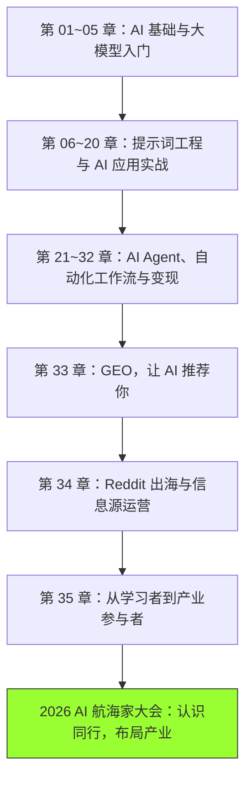

# 第35章 2026 AI 航海家大会前瞻

> 本节介绍 2026 AI 航海家大会的背景与意义，作为全书的收尾，激励读者从"学习 AI 工具"迈向"参与 AI 社区与产业"。注：该手册 README 仅含标题，正文待后续补充。

---

## 35.1 大白话：别只当"旁观者"，要参与 AI 社区

学完这本书，不要只当"旁观者"，要参与进 AI 社区，认识更多人，才能抓住下一波机会。2026 AI 航海家大会就是一个认识同行、布局产业的机会。

> **大白话**：学 AI 工具是第一步，但真正的机会在于参与 AI 社区，认识同行，了解产业动态。2026 AI 航海家大会就是一个让你从"学习者"变成"参与者"的机会。

光会用 AI 工具的人很多，但真正把 AI 工具变成工作、变成收入、变成产业资源的人，通常有一个共同点：他们不只在家里刷教程，也会走出去、参与社区、认识同行。社区是信息的放大器，产业是机会的聚集地。你在社区里听到的一个真实案例，可能比你独自摸索三个月还管用；你在产业圈里认识的一个人，可能成为你未来的合伙人、客户或雇主。

本书的最后一章，不是要教你一个新工具，而是要把你从"学习 AI 工具"推向"参与 AI 社区与产业"。工具会不断迭代，今天的 DeepSeek、明天可能是别的模型；但社区里的人脉、对产业趋势的判断、实战中的复盘习惯，这些才是不会过时的资产。

---

## 35.2 什么是 2026 AI 航海家大会？

2026 AI 航海家大会是生财有术航海体系的年度盛会，汇集了过去两年中通过"航海"手册学习 AI 的数千名读者，以及 AI 领域的从业者、创业者、投资人。

### 35.2.1 大会背景

生财有术"航海"项目从 2023 年 5 月开始，已经持续了三年多，期间出版了 187 份航海手册，其中约 65 份与 AI 密切相关。这些手册涵盖了 AI 绘画、AI 写作、AI 视频、AI 编程、AI 应用开发、AI 自动化工作流、AI Agent、AI 商业变现等方向，读者遍布国内外各个城市。

2026 AI 航海家大会是对这三年航海成果的总结，也是对下一波 AI 机会的布局。大会汇集了过去两年中通过"航海"手册学习 AI 的数千名读者，以及 AI 领域的从业者、创业者、投资人。现场不仅有经验分享，还有同行之间的一对一交流，适合把线上的学习转化为线下的人脉和合作机会。

> **大白话**："航海"手册就像是一本本 AI 实战指南，从 2023 年出发到现在，已经出了 187 本，跟 AI 有关的大约有 65 本。2026 AI 航海家大会，就是把这些手册的读者和 AI 行业从业者聚在一起的一次年度聚会。你在手册里看到的知识，在大会上可以找到真人来验证、讨论，甚至合作。

### 35.2.2 大会意义

作为全书收尾，2026 AI 航海家大会旨在帮助读者从"学习 AI 工具"迈向"参与 AI 社区与产业"。

参加大会能拿到三样在家里自学很难得到的东西：

1. **真实的人脉**。线上认识的人大多只停留在头像和昵称，大会上是真人面对面，交换名片、加微信、聊合作，这些关系在会后还能持续很久。
2. **真实的数据和避坑经验**。台上分享的往往是"我花三个月踩出的坑"，比你自己在社交媒体上看到的成功学更可信、更能用。
3. **对产业趋势的直觉**。看过足够多真实案例后，你会对"下一波 AI 机会在哪里"有自己的判断，而不是跟着热点跑。

注：该手册 README 仅含标题，正文待后续补充。

### 35.2.3 谁适合参加大会

- **已经学过 AI 一段时间，想找同行一起实践的**。你已经读完本书或其他"航海"手册，动手试过 DeepSeek、提示词、AI Agent，但平时一个人对着屏幕，很难知道外面的人都在做什么。大会上你能遇到同样在用 GEO 做品牌曝光、在 Reddit 上养号攒 Karma、用 AI Agent 做自动化工作流的同行，交流起来不费劲。
- **正在用 AI 做独立站、出海、自动化工作流的**。你想交流真实数据和避坑经验，比如"Reddit 新号怎么不被封""GEO 内容怎么被 AI 引用""哪个自动化流程真省人力"，这些问题在会上能得到比论坛帖子更直接、更真实的回答。
- **想了解 AI 产业最新动态，提前布局下一波商业机会的**。AI 行业变得很快，今天的热门模型可能明天就被超越，今天的玩法后天可能就失效。只有参与产业圈子，才能第一时间听到新趋势、新工具、新机会，从"跟随者"变成"布局者"。
- **希望把"会用 AI 工具"转化为"能在 AI 产业里立足"的能力的**。会用 DeepSeek 写文案是工具层面；知道哪些行业最适合用 AI Agent 降本增效，哪些 AI 应用有商业变现空间，是产业层面。大会就是帮你跨过这一步，从"AI 工具使用者"成长为"AI 产业参与者"。

**不太适合的情况**：如果你还在"什么是 AI""怎么注册 DeepSeek"的阶段，建议先把本书前面几章的内容动手做完，再带着具体问题去参会，收获会更大；如果你只想听"AI 未来怎么样"这种泛泛而谈的话题，可能也会失望，大会更强调踩过坑后的真实复盘。

**参会准备建议**：带着 1~2 个你真实遇到的问题去（比如"我在 Reddit 上发帖老被影子封号，怎么破""GEO 内容到底该发多少篇才有效"），具体问题带来具体答案，这才是参会的价值。

---

## 35.3 大会核心价值

### 35.3.1 认识同行

大会汇集了通过 AI 手册学习并实践的读者，你可以在这里认识志同道合的同行，交流实战经验，避免走弯路。

学 AI 是一条挺孤单的路，你在家里对着屏幕调提示词、写代码，很难知道外面的人都在做什么。大会把同样在学 AI 的人聚在一起，你可以听听别人怎么用 DeepSeek 写周报，怎么用 AI Agent 做自动化工作流，怎么用 GEO 让品牌被 AI 推荐，怎么用 Reddit 做出海获客。这些交流往往比单独啃教材更快，因为对方分享的是踩过坑后的真实经验，而不是教材里的理论。

会上可以聊的具体话题，不限于：

- "我在用 GEO 做品牌，让 DeepSeek 答案里提到我的公司，效果怎么样？"
- "我在 Reddit 上养号攒 Karma，新号老被影子封号，怎么破？"
- "我用 AI Agent 做了一个自动化工作流，每月省下多少人力？"
- "独立站做海外获客，Reddit 和 Quora 哪个社区更适合冷启动？"
- "AI 时代做内容，怎么写 AI 才愿意引用，而不是被当成低质信源忽略？"

这些具体问题带来具体答案，远比泛泛而谈"AI 未来怎么样"更有价值。

### 35.3.2 布局产业

通过大会了解 AI 行业最新动态，提前布局下一波 AI 商业机会，从"跟随者"变成"布局者"。

AI 行业变得很快，今天的热门模型可能明天就被超越，今天的玩法可能后天就失效。只有参与产业圈子，才能第一时间听到新趋势、新工具、新机会。大会不是只讲"怎么用工具"，更是讲"AI 产业往哪走"，帮助你提前布局，而不是事后追赶。

比如，你知道 AI 智能体（Agent）已经从"只会聊天"进化到"能调用工具干活"了吗？知道哪些行业最早开始用 AI Agent 替代部分人工客服、数据录入工作吗？知道 GEO（生成式引擎优化）正在从海外品牌逐步渗透到国内中小企业的获客体系里吗？这些信息在会上能从一线实践者口中直接听到，比你自己刷社交媒体要快得多，也更可信。

### 35.3.3 从工具到产业

大会帮助你从单纯学习 AI 工具使用，进阶到理解 AI 产业逻辑，探索 AI 商业变现和产业参与机会。

用会用工具和懂产业逻辑，是两回事。会用 DeepSeek 写文案是工具层面；知道哪些行业最适合用 AI Agent 降本增效，哪些 AI 应用有商业变现空间，是产业层面。大会的意义，就是帮你跨过这一步，从"AI 工具使用者"成长为"AI 产业参与者"。

下面这个对比能帮你区分两者：

| 维度 | AI 工具使用者 | AI 产业参与者 |
|------|-------------|-------------|
| 关注点 | 怎么写好提示词，让 AI 多干活 | 哪些业务流程适合用 AI Agent 改造 |
| 衡量标准 | 自己省了多少时间 | 带来了多少效率提升或收入 |
| 思考范围 | 今天用什么模型 | 明天哪些行业会被 AI 重塑 |
| 产出物 | 一篇文案、一段代码 | 一个可落地的 AI 产品或服务 |

---

### 35.3.4 从本书到大会：学习路径回顾

本书共 35 章，带你从 AI 零基础走到落地实践，适合带着这些内容去大会交流：

- **第 01~05 章**：什么是 AI 与大模型，DeepSeek、ChatGPT 的定位差异，访问方式与使用技巧。
- **第 06~20 章**：提示词工程，如何写出让 AI 听懂的话，文案、代码、数据分析等常见场景实战。
- **第 21~32 章**：AI Agent 与自动化工作流，让 AI 不只会聊天，还能帮你干活。
- **第 33 章**：GEO（生成式引擎优化），让你的内容被 AI 看见、引用、推荐，应对零点击搜索趋势。
- **第 34 章**：Reddit 出海运营，在 Google 的"亲儿子"社区拿搜索流量，做海外信息源。
- **第 35 章**：从学习 AI 工具迈向参与 AI 社区与产业，2026 AI 航海家大会就是这个转折点。

带着这些章节的内容去大会，你可以跟同行聊"我在用 GEO 做品牌被 AI 推荐""我在 Reddit 上养号攒 Karma"这类具体话题，而不是只聊泛泛而谈的"AI 未来怎么样"。具体问题带来具体答案，这才是参会的价值。

---

### 35.4 大会参与检查清单

如果你决定参加 2026 AI 航海家大会，可以对照下面这个清单提前准备，避免到场才发现没带重点：

| 检查项 | 具体做法 |
|--------|---------|
| 带上 1~2 个真实问题 | 比如"Reddit 新号怎么避免影子封号""GEO 内容怎么被 AI 引用"，具体问题换具体答案 |
| 复习本书关键章节 | 第 33 章 GEO、第 34 章 Reddit 出海、第 35 章学习路径，现场能跟同行聊上具体话题 |
| 准备一句话自我介绍 | 你是谁、在做什么、用 AI 解决了什么问题，方便在茶歇和同行快速破冰 |
| 带上名片或联系方式 | 会上认识的人可能是未来合伙人、客户或雇主，记得互换联系方式 |
| 设定参会目标 | 比如"认识 5 个做同方向的同行""带回 3 个可落地的自动化工作流思路" |
| 会后复盘 | 参会一周内，把学到的新工具、新趋势写成复盘，并选 1~2 个动作去执行 |

大会不是终点，而是你从"学习 AI 工具"迈向"参与 AI 社区与产业"的新起点。

### 35.5 给第一次参会者的建议

如果是第一次参加 AI 行业大会，下面这些小建议能帮你少走弯路：

- **不要只听演讲，多在茶歇聊天**。大会的价值很大一部分在茶歇和晚饭上的闲聊，那个时候大家更放松，真实的避坑经验和机会往往就在这些场合聊出来。
- **带上名片或二维码**。认识的人多了之后，方便快速交换联系方式，会后保持联系才有可能产生合作。
- **不要试图在一天内学会所有 AI 工具**。大会信息量很大，选 1~2 个你最关心的方向深入聊，比贪多嚼不烂更有收获。
- **带着具体问题去，带着具体行动回来**。比如"我想在 Reddit 上做出海获客"，会上找到已经做成功的同行请教，会后第一周就去注册一个 Reddit 账号开始养号，行动是参会最大的产出。

---

## 小练习

写下你学完本书后 3 个月内要完成的 1 个 AI 相关目标（如"上线一个小程序""做出一个 AI Agent""赚到第一笔 AI 服务收入"），并设定复盘日期。

> **参考模板**：
> - 目标：上线一个微信小程序
> - 复盘日期：2027 年 2 月 9 日
> - 具体行动：本周注册微信小程序开发者账号，下周用 AI 生成代码，下第三周提交审核

**怎么定好这个目标？** 建议遵循"具体、可衡量、有时限"三条原则。"学会 AI"不是好目标，太模糊，不知道什么时候算完成；"3 个月内用 DeepSeek 做出一个自动整理会议纪要的小工具，并让同事试用"是好目标，动作清晰，复盘时一看就知道做到了没。目标定完之后，把它写下来，带到 2026 AI 航海家大会上与同行交流，看看别人是怎么定目标、怎么复盘的，可能会给你新的启发。

大会不是终点，而是你从"学习 AI 工具"迈向"参与 AI 社区与产业"的新起点。

---

## 本书小结

恭喜你，已经读完《AI 航海实战手册》全部 35 章。

全书一路走来，从"什么是 AI"开始，讲了大模型原理、提示词工程、AI 应用实战、AI Agent 与自动化工作流，最后讲了 GEO 与 Reddit 出海——这些都是 AI 时代普通人参与产业的切口。下面是全书的学习路径回顾，你可以带着它去 2026 AI 航海家大会交流：

| 阶段 | 章节 | 核心内容 |
|------|------|---------|
| 第一阶段 | 第 01~05 章 | AI 基础与大模型入门：DeepSeek、ChatGPT、Claude 定位差异，怎么访问和使用 |
| 第二阶段 | 第 06~20 章 | 提示词工程与 AI 应用实战：怎么写让 AI 听懂的话，文案、代码、数据分析场景 |
| 第三阶段 | 第 21~32 章 | AI Agent、自动化工作流与变现：让 AI 不只会聊天，还能帮你干活 |
| 第四阶段 | 第 33 章 | GEO：让 AI 在回答问题时推荐你，应对零点击搜索趋势 |
| 第五阶段 | 第 34 章 | Reddit 出海与 AI 时代信息源运营：在 Google 的"亲儿子"社区拿搜索流量 |
| 第六阶段 | 第 35 章 | 从学习 AI 工具到参与 AI 社区与产业：2026 AI 航海家大会 |

AI 是锦上添花，不是雪中送炭；业务是核心，AI 是帮手。希望你不只当旁观者，也成为 AI 社区与产业的参与者。下一波机会，在社区里，在产业里，也在你下一个决定开始行动的那天。

## 附：大会参与快速行动建议

如果你决定参加 2026 AI 航海家大会，可以按下面这个顺序快速行动起来：

1. **确认参会资格**：关注生财有术航海体系的官方渠道，确认大会报名时间和名额，名额通常有限，尽早报名。
2. **定 1 个 3 个月目标**：参照本书第 35 章小练习，写下一个具体、可衡量、有时限的 AI 目标，带到大会上跟同行对比。
3. **复习重点章节**：重点温习第 33 章 GEO、第 34 章 Reddit 出海，现场能跟同行聊"AI 怎么推荐品牌""Reddit 怎么养号"这类具体话题。
4. **准备自我介绍和名片**：一句话说清你是谁、在做什么、用 AI 解决了什么问题，方便在茶歇快速破冰。
5. **会后一周内复盘**：把学到的新工具、新趋势写成复盘，并选 1~2 个动作立即执行，行动才是参会最大的产出。

下一波机会，在社区里，在产业里，也在你下一个决定开始行动的那天。
