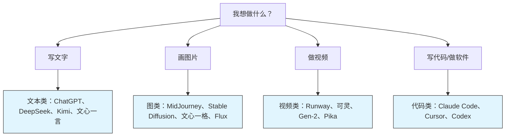
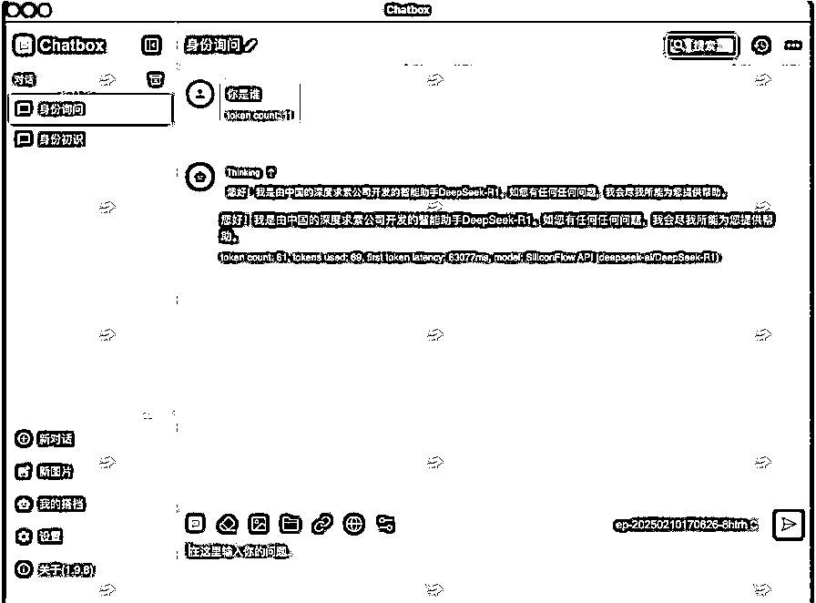
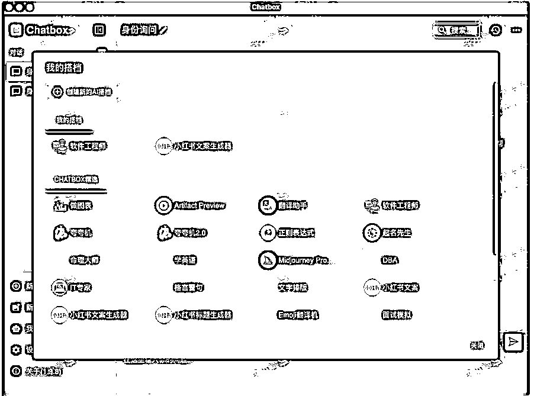
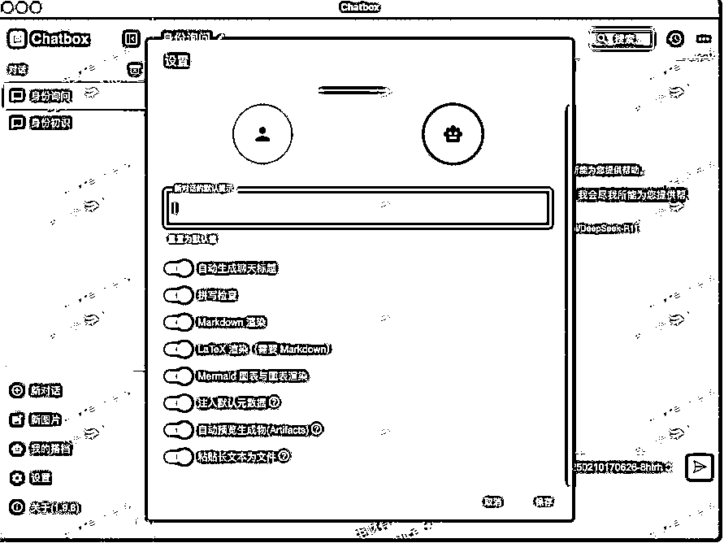
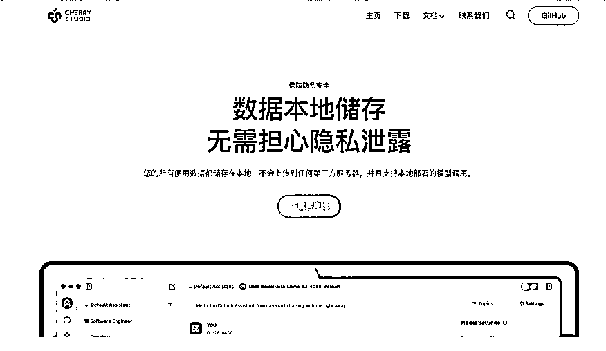
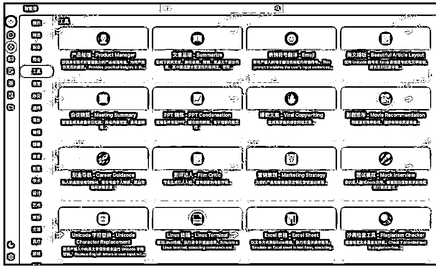
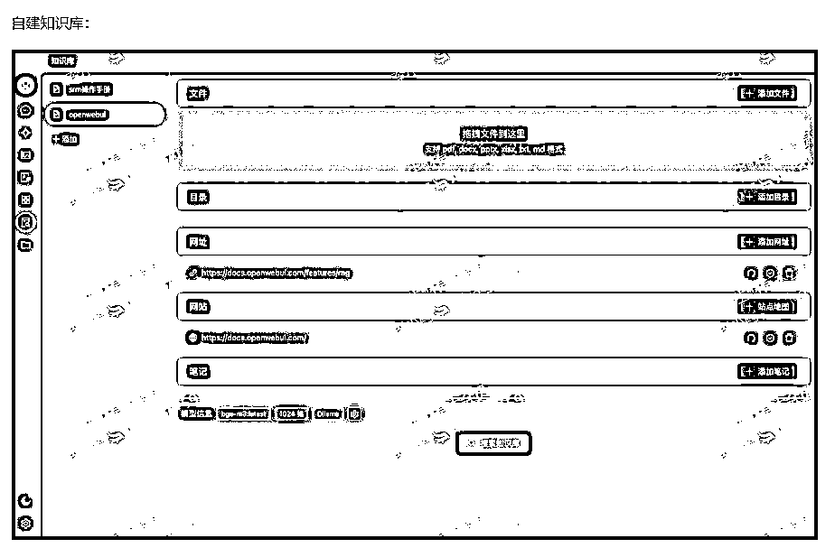

# 第3章 AI 工具全景图与选型

> 本节梳理文本生成（ChatGPT/Kimi/文心一言）、图像生成（MidJourney/Stable Diffusion/Flux/DALL·E）、视频生成（Runway/可灵/Gen）、代码生成（Claude Code/Cursor/Codex）等领域的主流工具，给出国内外平替方案与成本预估（航海期最低约 100 元），帮助读者按需选型、避免重复付费。

---

## 3.1 大白话：选 AI 工具就像选厨具

选 AI 工具就像选厨具，炒菜用炒锅、切菜用菜刀，没有一个锅什么都能做。先看你要做什么（写文案？画图？写代码？），再选对应的工具，不要全家桶都订阅，浪费钱。

> **大白话**：不同的 AI 工具擅长不同的事情，就像不同的厨具适合不同的烹饪任务。不要试图用一个工具解决所有问题，也不要把所有工具都买一遍。

下面这个决策树能帮你快速找到对应的工具类别。

## 3.2 AI 工具选型决策树 Mermaid 图

---

## 3.3 文本生成工具：如何选择 AI 写作工具？

### 3.3.1 ChatGPT 是干啥的？

说到 AI 写作，咱们使用的工具就是那个无人不知、无人不晓的 ChatGPT 了！不过呢，今天我还是要给大家科普下，让咱们对这个神奇的工具有个更全面的认识。理解工具的原理，能提高我们后续写作的效率。

ChatGPT 机器人由 OpenAI 公司创建，预先投喂了大量数据，互联网上能看到的信息都可能被投喂给 ChatGPT。当你问他问题的时候，它就像一个知晓天下事的小秘书，可以回答它知道的一切。

### 3.3.2 ChatGPT 主要功能

ChatGPT 的主要功能是理解和生成人类语言，可以在许多不同的场景中被应用：

| 功能 | 说明 | 举例 |
|------|------|------|
| 问答 | 根据训练数据生成答案 | 问科学、历史、文化等问题 |
| 文本生成 | 写文章、故事、诗歌等 | 给出开头或主题，生成相应文字 |
| 对话 | 模拟人类对话 | 客服、教育、娱乐、角色扮演 |
| 编程 | 理解编程语言，写代码 | 提问编程相关问题，帮写代码 |
| 学习 | 作为学习工具 | 解释复杂概念，学习新语言 |

### 3.3.3 ChatGPT 核心原理

ChatGPT 并不具有人类的思维和逻辑，他无法知晓一篇文章中上下文真正的逻辑。

而是从他脑子里的知识库中，通过一定的算法，猜测这个字的后边，更大概率会出现哪一个字，这样一个字接着一个字的生成一篇文章或一个回答给你。

> **关键点**：ChatGPT 是按概率"猜"下一个字的，不是真的"懂"。这就是为什么它有时候会说得很有道理，但实际上是错的（"幻觉"）。

### 3.3.4 免费版和付费 Plus 版的区别

ChatGPT 提供了免费版和付费的 Plus 版供大家选择使用。下面结合一张表格，展示一下它们的区别。

| 功能 | GPT-3.5 (免费) | GPT-4.0 (Plus 20 美元/月) |
|------|---------------|--------------------------|
| 基础对话功能（写文案、角色扮演、代码生成等） | ✓ | ✓ |
| 语音对话（APP） | | ✓ |
| 图像处理 | | ✓ |
| 文件上传 | | ✓ |
| 联网搜索 | | ✓ |
| 画图 | | ✓ |
| 创建专属对话（GPTs） | | ✓ |
| 多 GPTs 联合作业 | | ✓ |
| Web 端 | ✓ | ✓ |
| 🛰️小程序 | | ✓ |
| APP 端 | | ✓ |

购买 Plus 需要国外信用卡，目前免税州会员价格是 20 美金/月，折合人民币约 135.68 元，支付会员需要使用国外的信用卡。

目前有部分虚拟信用卡被封禁，无法正常进行支付，如果你用的是虚拟信用卡，请提前了解清楚相关的最新情况和风险。

### 3.3.5 如何购买 ChatGPT Plus 版

账号登录之后，左下角会提示升级到 Plus：

点击【Upgrade】，会出现会员选择界面，点击"plus"，按照相关指引，就能完成升级了。

如果你是在 iOS 移动端上进行的升级，且是美区用户，可以走苹果内购的方式来开通 Plus 会员。具体的开通方式请看圈友分享的操作步骤。

### 3.3.6 ChatGPT 的替代软件：国产大模型 Kimi

在过去的 1 年里，国产大模型也涌现出很多优秀的产品，今天来给大家介绍其中一款 **Kimi**。

Kimi Chat 是由月之暗面科技有限公司（Moonshot AI）开发的智能助手，具备文件读取、联网查询等功能；它能够一次性"消化"20 万字的文本，这相当于一部《三体》的全文。无论是复杂的合同、长篇的学术论文，还是你想要整理的旅行日记，Kimi 都能迅速帮你梳理出重点。

在背后，是月之暗面科技的顶尖团队在默默支持。他们的创始人杨植麟，不仅在清华大学有着辉煌的学术背景，还在卡内基梅隆大学和 Meta 的人工智能研究院取得了卓越的成就。他的研究成果，让 Kimi 在 AI 领域独树一帜，成为了处理长文本的佼佼者。

而且，Kimi Chat 得到了红杉中国、📕、美团和阿里等业界巨头的青睐和投资，这不仅是对 Kimi 技术的认可，也是对其未来潜力的肯定。这些大厂的背书，让 Kimi Chat 的可靠性和实用性更加值得信赖。

GPT3.5 具备的功能，Kimi 都具备；它在文本生成、搜索、翻译、读一本书这些场景能给你带来非常不错的体验。如果你不方便使用 ChatGPT，也可以直接用 Kimi 来完成咱们本次航海。

**Kimi 链接**：https://kimi.moonshot.cn/

> **大白话**：Kimi 像是一个读过整本《三体》的助手，能一次性处理非常长的文本，特别适合处理长合同、长论文等场景。

---

## 3.4 DeepSeek 客户端推荐

DeepSeek 官网过于火爆，很容易出现无法回应的问题。我们可以通过其他云服务厂商提供的 API 服务来使用 DeepSeek R1。这里推荐两个 AI 对话应用：

### 3.4.1 Chatbox

- 官网：https://chatboxai.app/zh
- Chatbox 是一款类似"智能聊天机器人"的跨平台应用，能通过文字对话帮你完成学习、工作和创作任务。

**核心特点有：**

1. **多面手能力**
   - 解读文件：直接发送 PDF/图片，它会总结内容
   - 生成代码：描述需求即可生成代码并预览效果
   - 联网搜索：实时获取最新资讯（天气/新闻/数据）
   - 图表生成：将复杂数据转化为可视化图表
   - 学术支持：处理数学公式/LaTeX/学术写作

2. **隐私保障**
   - 所有聊天记录只存在你的设备里（本地存储）
   - 支持历史对话快速检索
   - 多端支持：支持网页端、电脑端、手机端。

3. **创作神器**
   - 文字转图片：输入描述生成创意图像
   - 支持 20+ 艺术风格转换
   - 文档/PPT 内容智能优化

主页面：

支持提示词内置：

支持 Markdown、LaTex、Mermaid 等多种格式渲染：

### 3.4.2 Cherry Studio

- 官网：https://cherry-ai.com/
- Cherry Studio 是一款跨平台（支持 Windows、macOS、Linux）的多模型 AI 客户端，集成了 OpenAI、DeepSeek、硅基流动等云端大语言模型及本地模型（通过 Ollama 部署），支持用户自由切换并同时与多个模型对话以对比输出结果。

**核心功能：**
- 内置 300+ 预配置 AI 助手（覆盖写作、编程等 30 多个行业）
- RAG 技术驱动的本地知识库搭建（支持 PDF、网页等多源数据检索增强问答）
- 多模态文档处理（含代码高亮、流程图可视化等工具）
- WebDAV 数据同步。

该工具兼顾开发者的高效编程需求与企业的知识管理场景，提供高度可定制化服务，但需用户自行配置第三方 API 密钥使用。

该工具仅包含电脑端，没有移动端支持。

海量 Agent 调用：

---

## 3.5 航海期成本预估

航海期最低约 **100 元**。优先走免费层（DeepSeek 免费层、Kimi 免费层、Claude 免费额度），实在不够再订阅。

| 工具类别 | 首选工具 | 国内平替 | 典型费用 |
|---------|---------|---------|---------|
| 对话大模型 | ChatGPT / Claude | DeepSeek、Kimi、文心一言、豆包、Gemini | 免费层或月付 |
| 文生图 | MidJourney | Stable Diffusion（LibLib/秋叶）、文心一格、Flux | 订阅或云端按次 |
| 图生视频/文生视频 | Runway Gen-2、可灵 | Gen-1、腾讯混元、快手可图、Mochi、CogVideoX | 订阅或按次 |
| AI 编程 | Claude Code | Cursor、Augment、Codex | 订阅 |

> **大白话**：航海期（刚开始学习的阶段）不需要大把花钱，先用免费层跑通流程，等熟悉了再根据需要订阅付费工具。

---

## 小练习

列出你日常工作中重复次数最多的 3 个任务，为每个任务在本节工具全景图中找出 1 个可替代的 AI 工具，并标注该工具是免费、订阅还是按次付费。

> **参考模板**：
>
> | 重复任务 | 对应 AI 工具 | 费用类型 |
> |---------|-------------|---------|
> | 每周写周报 | DeepSeek / Kimi（免费层） | 免费 |
> | 整理产品图片背景 | 文心一格 / MidJourney | 按次或订阅 |
> | 每周生成短视频脚本 | 可灵 / Gen-2 | 按次或订阅 |
