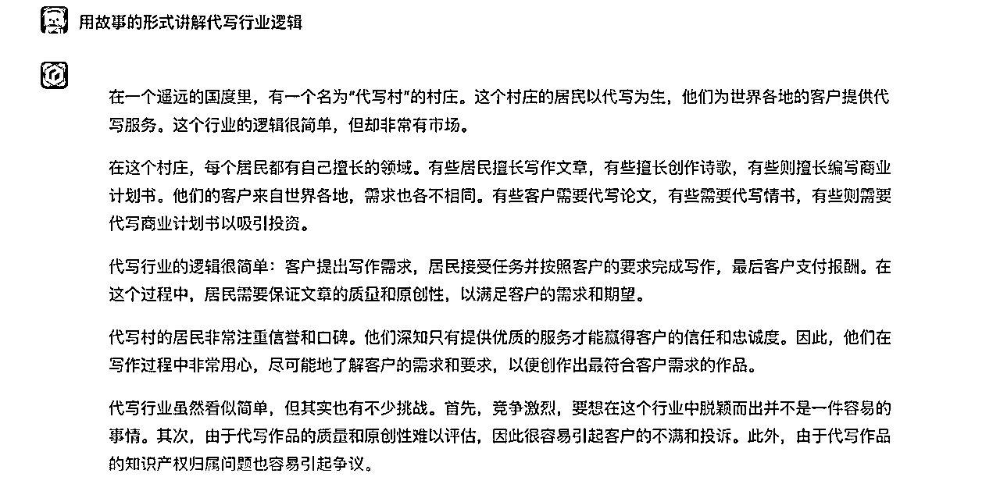
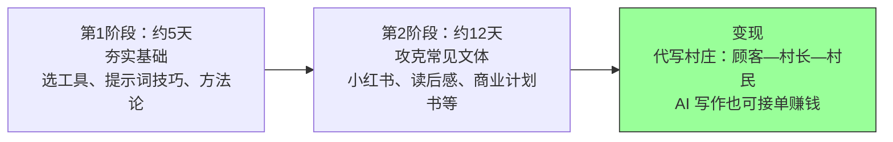

# 第5章 AI 写作方法论与 21 天入门路径

> 本节给出 21 天 AI 写作学习路径：第一阶段约 5 天夯实 AI 写作基础（选工具、必备技巧、底层方法论），第二阶段约 12 天攻克常见文体。以"代写村庄"故事讲清顾客—村长—村民的变现角色分工，让读者明白 AI 写作不仅是自我使用，也是可接单变现的服务。

## 5.1 项目分析：什么是 AI 写作？

### 5.1.1 大白话：AI 写作就是"代写村庄"

AI 写作，就是一个利用人工智能技术生成文本内容的项目。它能帮我们快速生成各类文章写作的类型，只要掌握它的技巧就可以了。

对于普通人不再担心文笔差了，现在可以通过 AI 轻松来来写作，甚至实现变现。

让文心一言以故事的形式，讲清楚 AI 写作变现逻辑：

**有一个代写村庄，这里的村民以代写为生，村民擅长写类型都不一样。客户提出写作需求，村民接受任务并按照客户的要求完成写作，最后客户支付报酬。**

这里面就有三个角色：

| 角色 | 职责 |
|------|------|
| **顾客** | 提出要求并支付报酬 |
| **村长** | 寻找顾客，并接到写作需求，招募村民入驻村庄 |
| **村民** | 根据顾客要求，完成写作，获取报酬 |

本次航海就是让大家利用 AI 当好一位**村民**，后面选修也会给大家提供一个方案。

你可以这样理解：

- 你不会写文案没关系，AI 是村民，帮你写
- 你不懂怎么找客户没关系，你先当村民练手，写出成品再说
- 等你熟练了，可以当村长，接单之后再分给 AI 做，赚中间差价

## 5.2 新手从 0 到 1 的有效路径

本节给出 21 天 AI 写作学习路径，分为两个阶段。

### 5.2.1 第一阶段：掌握 AI 写作基础（约 5 天）

第一阶段大约 5 天，主要夯实 AI 写作基础，包括：

1. **选工具**：知道该用什么 AI 工具写作（ChatGPT、DeepSeek、Kimi、文心一言等）
2. **必备技巧**：掌握提示词工程（BRTR 框架、角色设定、原子任务、任务拆解）
3. **底层方法论**：明白 AI 的能力边界，知道什么能用 AI，什么不能用 AI

### 5.2.2 第二阶段：学习常见文体写作（约 12 天）

第二阶段大约 12 天，攻克常见文体写作，包括：

- 📕种草文案
- 读后感
- 商务邮件
- 👸号文章
- 其他常见文体

### 5.2.3 21 天学习路径 Mermaid 图

## 5.3 为什么 21 天就能上手？

### 5.3.1 门槛很低

以前写作需要文笔，现在只需要会用电脑，会打字，会跟 AI 对话。

### 5.3.2 见效快

AI 写作不像学编程要几个月，AI 写作你今天学，明天就能出成品。

### 5.3.3 可变现

写出成品之后，可以发布到👸号、📕、知乎等平台，或者接单变现。

## 5.4 21 天学习建议

### 第 1-5 天：夯实基础

- 第 1 天：选一个 AI 写作工具（如 DeepSeek 或 Kimi），注册并熟悉界面
- 第 2 天：学习提示词工程基础（角色设定、直接提问）
- 第 3 天：学习原子任务和任务拆解（把复杂任务拆成小步骤）
- 第 4 天：练习写一篇简单的文章（如 500 字读后感）
- 第 5 天：复盘前 4 天的作品，找出提示词可以优化的地方

### 第 6-17 天：攻克常见文体

- 第 6-8 天：📕种草文案（学习起号、打标签、爆款结构）
- 第 9-11 天：读后感（学习观点提炼、个人化表达）
- 第 12-14 天：商务邮件（学习逻辑框架、说服性写作）
- 第 15-17 天：👸号文章（学习选题、标题、正文结构）

### 第 18-21 天：变现实战

- 第 18-19 天：写出 3 篇成品，发布到平台
- 第 20 天：尝试接单（如在闲鱼、📕发布写作服务）
- 第 21 天：总复盘，制定后续学习计划

## 小练习

按本节路径，花 3 天时间分别用 AI 完成一条📕种草文案、一篇读后感、一封商务邮件，每篇都用不同工具（如 ChatGPT、Kimi、文心一言）并记录耗时对比。

> **参考模板**：
> 
> | 文体 | AI 工具 | 耗时 | 难点 | 优化方向 |
> |------|---------|------|------|---------|
> | 📕种草文案 | Kimi | 30 分钟 | 标题不够吸引人 | 加入 emoji 和爆款关键词 |
> | 读后感 | ChatGPT | 45 分钟 | 容易泛泛而谈 | 加入个人感悟 |
> | 商务邮件 | DeepSeek | 20 分钟 | 语气不够专业 | 设定资深职场专家角色 |
