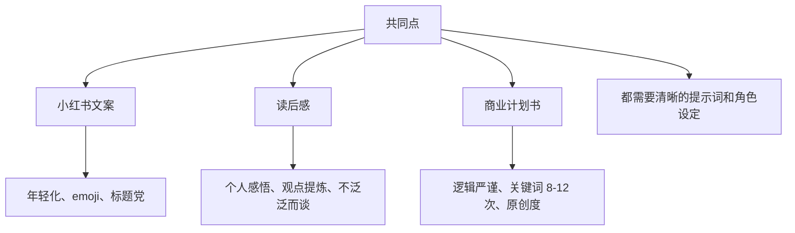

# 第6章 常见文体的 AI 写作（📕文案、读后感、商业计划书等）

> 本节逐文体拆解 AI 写作模板与技巧：📕笔记的起号打标签与爆款结构、读后感的观点提炼与个人化表达、商业计划书的逻辑框架与说服性写作。每个文体均配可复制的提示词手册，读者对照复制即可实战演练。

## 6.1 大白话：不同平台的文案就像不同口味的菜

不同平台的文案就像不同口味的菜，📕要"年轻、有 emoji、标题党"，读后感要"个人感悟为主"，商业计划书要"逻辑严谨、有数据"。套不同的模板，AI 出的东西才合适。

## 6.2 📕笔记的 AI 写作

### 6.2.1 四个步骤用 ChatGPT 写一篇📕旅游笔记

书中以写一篇邵阳隆回的旅游笔记为例，分享了四个步骤：

#### 第一步：先通过 ChatGPT 来帮我们获取基础内容

比如目的地的酒店、美食、景点信息。你可以问 ChatGPT：

> "邵阳隆回有哪些好玩的景点？推荐几家当地特色餐馆，住宿推荐哪些？"

把获取到的内容整理好，作为后续生成文案的素材。

#### 第二步：让它生成文案

给 ChatGPT 赋予一个角色——📕的旅游博主，帮我把以上的信息生成一篇📕旅游笔记。

**提示词示例**：
```
你是一位小红书的旅游博主，擅长写吸引人的旅游笔记。
请根据以下信息，写一篇邵阳隆回的旅游笔记：
景点：[填入景点信息]
美食：[填入美食信息]
酒店：[填入酒店信息]
要求：语言年轻化，多用 emoji 表情，分点排版，适合小红书发布。
```

#### 第三步：通过 ChatGPT 可以快速地插入 emoji 表情

📕文案的特点就是 emoji 表情多。你可以给它指令，在每段开头的位置插入合适的 emoji 表情，文章的内容里也要插入表情。

**指令示例**：
```
请在每段开头插入合适的 emoji 表情，文章内容里也要插入表情，让笔记更生动活泼。
```

#### 第四步：让它帮我们生成爆款标题

给它的角色是爆款标题生成器，要求是标题当中要包含解决什么问题、笔记的解决方案是什么、解决后的结果是什么，以及标题的字数。

**指令示例**：
```
你是一位爆款标题生成器。请为上面的邵阳隆回旅游笔记生成 3-5 个标题，要求：
1. 包含解决什么问题、笔记的解决方案是什么、解决后的结果是什么
2. 标题字数控制在 20 字以内
3. 适合小红书传播，有吸引力
```

可以看到，生成的标题。还是挺不错的，至少能打 80 分的水平。这样的水平，我们在外面可能要花 4000 - 5000 去请一个文案，但是有了 ChatGPT，这些钱都省下来了。

### 6.2.2 📕文案提示词模板

```
# Role: 小红书旅游博主
# Profile:
  - language: 中文
  - description: 擅长写吸引人的小红书旅游笔记
# Background:
  - 用户需要写一篇[目的地]的旅游笔记，发布到小红书平台
# Goals:
  - 生成一篇适合小红书的旅游笔记，语言年轻化，多用 emoji，分点排版
# Rules:
  1. 每段开头插入合适的 emoji 表情
  2. 正文内容里也要插入表情
  3. 分点排版，适合手机端阅读
  4. 标题控制在 20 字以内
# Workflow:
  1. 根据用户提供的景点、美食、酒店信息，生成旅游笔记正文
  2. 生成 3-5 个爆款标题供选择
```

## 6.3 读后感的 AI 写作

### 6.3.1 直接让 AI 写读后感的问题

我们如果直接让 AI 来完成这篇读后感，内容会有很大概率泛泛而谈，或者有虚假信息。

### 6.3.2 圈友 @Cheese 海盐芝士 分享的三种方法

圈友 @Cheese 海盐芝士 分享了三种方法，让 ChatGPT 帮助更好的完成一篇读后感：

#### 方法一：直接让 ChatGPT 扮演资深读者

直接让 ChatGPT 扮演资深读者，产生一篇独树一帜的读后感内容。

#### 方法二：将大纲中的每一个内容对应一个文章段落

对应一次生成的动作，一步一段地生成直到生成完整的文章。

#### 方法三：提示词中需要清晰的说明

提示词中需要清晰的说明 ChatGPT 需要扮演的角色、要做的任务、需要完成的内容大纲、内容要求。每一个大纲部分分别放到这个提示词模板中和 ChatGPT 对话，直到所有内容生成。

**读后感提示词模板**：
```
# Role: 资深读者
# Profile:
  - language: 中文
  - description: 擅长写有深度、有个人感悟的读后感
# Background:
  - 用户需要写一本《书名》的读后感
# Goals:
  - 生成一篇有个人观点、有深度、不泛泛而谈的读后感
# Rules:
  1. 不要泛泛而谈，要有具体的观点
  2. 结合个人阅读感受，避免虚假信息
  3. 每个大纲部分分别生成，不要一次性生成完整文章
# Workflow:
  1. 先确认读后感的大纲
  2. 按照大纲每个部分，分别生成对应段落
  3. 合并所有段落，形成完整读后感
```

## 6.4 商业计划书的 AI 写作

### 6.4.1 写文章要牢记的关键点

写文章的时候要牢记：最好多次出现关键词，文章篇幅推荐在 1000-1400 字，关键词出现的次数尽量保持 8-12 次。

### 6.4.2 文章的基本框架

书中以办公室电脑推荐的选题为例，文章标题为《办公笔记本电脑推荐：适合办公用的笔记本电脑推荐》或者《办公笔记本电脑推荐：办公笔记本电脑哪个品牌好》。

文章的基本框架是这样的：

| 部分 | 内容 |
|------|------|
| 第一部分：总述 | 比如现在移动办公场景越来越多 |
| 第二部分：选购要点 | 描述一下挑选适合办公用的笔记本，需要注意哪几点 |
| 第三部分：产品推荐 | 介绍 3-4 款产品即可 |
| 第四部分：总结 | 比如以上就是推荐的几款适合办公用的笔记本，希望可以帮助到大家 |

### 6.4.3 原创度检测

在发表之前，通过网上的原创评估工具，看看文章能否通过原创审核。通常 1500 字的文章，原创检测出来的严重的重复次数小于 10 次，都没有问题。

### 6.4.4 商业计划书提示词模板

```
# Role: 商业计划书撰写专家
# Profile:
  - language: 中文
  - description: 擅长撰写逻辑严谨、有说服力的商业计划书
# Background:
  - 用户需要写一份商业计划书，用于[具体用途，如融资、项目申报]
# Goals:
  - 生成一篇 1000-1400 字的商业计划书，关键词出现 8-12 次
# Rules:
  1. 文章结构：总述、选购要点/方案要点、产品/方案推荐、总结
  2. 关键词多次出现，保持 8-12 次
  3. 逻辑清晰，有说服力
# Workflow:
  1. 先确认商业计划书的主题和关键词
  2. 按照四部分结构分别生成内容
  3. 检查关键词密度和原创度
```

## 6.5 三种文体对比 Mermaid 图



## 小练习

选一本你最近读过的书，用 AI 生成两版读后感（一版偏学术分析、一版偏📕个人体验），对比两版的语言风格与适用场景，并修改其中一版发布到社交平台。

> **参考模板**：
> 
> **学术版提示词**：
> ```
> 你是一位文学评论家，请为《书名》写一篇学术风格的读后感，1000 字左右，重点分析主题、人物形象、艺术手法，语言严谨。
> ```
> 
> **📕版提示词**：
> ```
> 你是一位小红书读书博主，请为《书名》写一篇读后感，800 字左右，语言年轻化，多用 emoji，分点排版，结合个人感悟，适合小红书发布。
> ```
