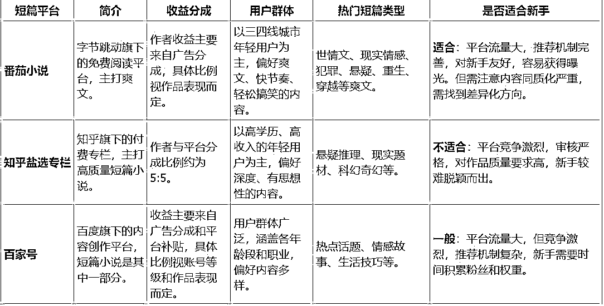
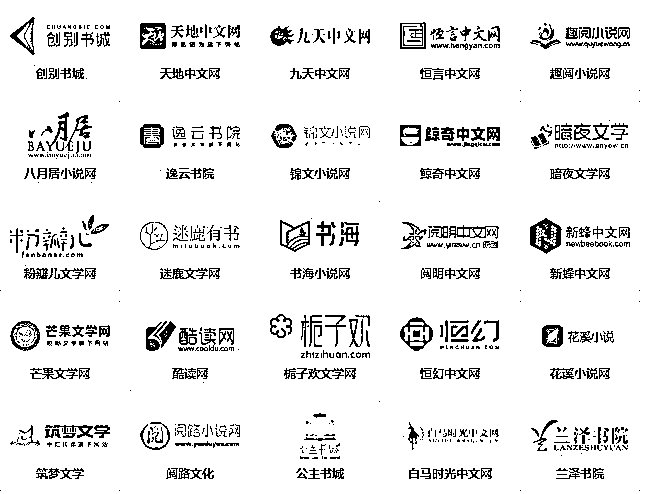
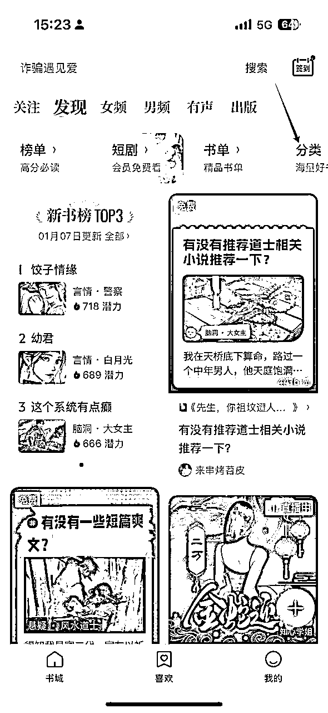
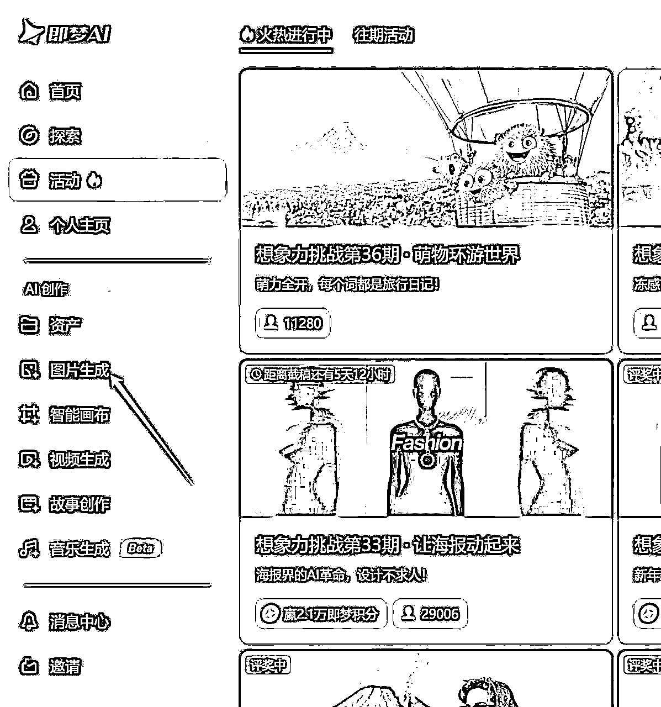
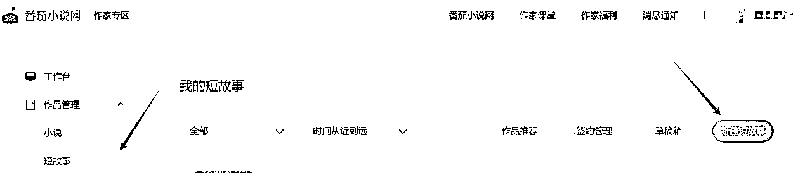
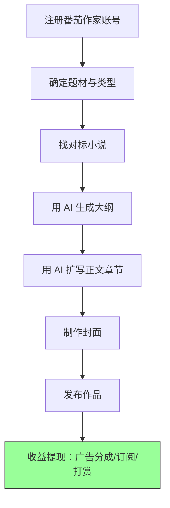

# 第8章 AI 小说与网文创作从写作到变现

> 本节教读者用 AI 写网络小说并实现变现，覆盖市场行情、类型题材、平台收益模式（番茄小说、知乎盐选、百度付费专栏“短篇三巨头”），从注册番茄账号起步，解决无写作功底的普通人入局网文的问题。重点讲解选文四种方法与套路化改文技巧。

## 8.1 大白话：网文就像工厂流水线

网文就像工厂流水线，选题是选产品，大纲是设计图，AI 负责扩写正文。新手建议从"番茄小说"短篇开始，门槛低，自动签约，不用先出名就能有收益。

## 8.2 市场规模和增长趋势

### 8.2.1 市场规模

2025 年网络文学市场持续增长。中商产业研究院发布的《2025-2030 年中国网络文学出版行业市场发展现状及潜力分析研究报告》显示，2023 年中国网络文学市场规模达到 404.3 亿元，同比增长 3.8%，作家、作品、读者数量呈稳健增长态势，作者规模达 2405 万，作品数量达 3620 万部，用户数量达 5.37 亿。

网络文学的社会影响力持续增强。中商产业研究院分析师预测，2024 年中国网络文学市场规模将达到 419.9 亿元，2025 年达到 436.1 亿元。

这正说明了网络小说的市场空间很大，值得去深耕。


## 8.3 小说类型

### 8.3.1 字数标准

在网络文学领域，长短篇的划分更注重用户阅读习惯与商业模式，字数标准更为宽松：

| 类型 | 字数标准 | 示例 |
|------|---------|------|
| 短篇 | 1 万～5 万字 | 知乎盐言故事、🧣连载短篇 |
| 长篇 | 50 万字以上为主流 | 《斗破苍穹》超 500 万字 |

### 8.3.2 发布形式与更新节奏

**短篇：**
- 单次发布：一次性完结（适合碎片化阅读）
- 微连载：分 3-5 章更新（如豆瓣阅读的"三日完结"计划）

**长篇：**
- 日更模式：每日更新 2000-6000 字，维持读者黏性（如起点中文网）
- IP 衍生导向：长期连载为影视、游戏改编积累内容库


## 8.4 常见平台与收益模式

### 8.4.1 短篇小说平台三巨头

目前短篇小说平台三巨头是：**番茄小说、知乎盐选、百度付费专栏**。

收益模式：小说平台流量分成、编辑投稿独家买断。

对于从未接触过小说创作的新人来说，首先推荐发布番茄小说平台，因为现在该平台是采用自动签约模式，只要你的短篇小说没有违禁内容，一般都会被签约。只有签约的小说才会获得平台稿费。

同时一篇文章你可以同步到百度百家号上，因为新手还不具备开通付费专栏的资格，所以只能发布在百家号上。

当你写好 100 篇短篇小说后，并且有几部可以拿到流量后，可以考虑去自动投稿平台去投稿，这里有专门的手稿编辑，可以实现 AI 自动投稿。

https://www.tougao168.com/



### 8.4.2 长篇小说平台

目前长篇小说以收费模式来划分，分为免费小说与收费小说两种：

- **免费**：看小说不需要花钱，但需要看穿插在小说中的广告；免费小说作者的主要收入是广告分成及打赏礼物
- **收费**：看小说的付费章节需要订阅章节才能阅读；收费小说作者的主要收入是会员订阅收入

目前主流的小说网站有：17K小说网、七猫小说、起点中文网、晋江文学城、纵横中文网、红袖添香、潇湘书院、掌阅小说网、书旗小说、刺猬猫、飞卢小说网、创世中文网、云起书院、咪咕阅读

#### 主要平台特点

| 平台 | 收益模式 | 平台特点 |
|------|---------|---------|
| 番茄小说网 | 全勤+广告分成+礼物分成+各类创作者计划 | 免费阅读平台，用户基础庞大，主要覆盖 16-35 岁，AI 签约容易，门槛低 |
| 七猫中文网 | 全勤+广告分成+礼物分成+各类创作者计划 | 真人编辑审核，质量要求高，30-45 岁城市中年女性多 |
| 起点中文网 | - | 男频小说证道之地，难度超级高 |
| 晋江文学城 | - | 女频小说证道之地，难度超级高 |



## 8.5 常用工具选择

### 8.5.1 常用 AI 网站

| 工具 | 优点 | 缺点 |
|------|------|------|
| Claude | 强大的上下文理解能力，对框架拆解流程，文字模仿能力较好 | 免费版每天只能发十几次对话，付费版 20 美元/月 |
| DeepSeek | - | - |
| 豆包 | 免费使用 | 需要掌握使用提示词能力，成文效果不可控 |
| ChatGPT | 可以用于 AI 写作，需要提示词辅助可以更好写 | 免费版可以使用 GPT-3.5 模型，有使用次数限制，付费版本 20 美元/月 |

### 8.5.2 AI 写作网站

- **星月** https://xingyuexiezuo.com/：拥有海量的专业提示词资源，可以从大纲到正文进行全流程写作，需要掌握使用网站方法，按字数收费

## 8.6 短篇小说创作过程

### 8.6.1 找对标

我们可以在今日头条、知乎盐选等平台寻找优质的短篇故事，然后将小说下载到本地。

大家可以找一些点赞数比较高，时间比较久的故事，这些故事一般都是有爆火因子的，所以我们复刻这些故事也会同样增加爆款的概率。

例如，我们找一篇现实情感的短篇，打开盐言故事 APP（知乎盐选小说平台）：

**寻找方向一**：点击主页上方的分类，选择上方的"现实情感"分类，在这里找一些点赞数超过 1000 的文章

**寻找方向二**：还可以在首页的女频/男频找对应的文章，评论越正面越好。



### 8.6.2 获取文本

**获取方式一**：知乎小说阅读网站：http://abcd7.top
（优点是不要钱；缺点是流程有些繁琐，需要下载夸克，然后每天需要下载指定文件来获取一个免费看书的码）

**获取方式二**：开通盐言故事会员 + 长截图 + 图片压缩 + OCR 识别
（优点是网站所有内容都可以获取到，缺点是要花点钱）

- 图片压缩：https://ai.danqingai.com/index/image/compressor.html
- OCR 识别：https://ocr.wdku.net/


### 8.6.3 创作新大纲

我们以 AI 写作网为例完成大纲创作。注册登录网站后 https://xingyuexiezuo.com/

#### 方法一：参考对标小说生成新大纲

1. **新建**：打开星月网站，点击+号
2. **命名**：输入短篇小说名称即可提交，创建一部新作品（这个小说名字只是给自己看的，无所谓叫什么）
3. **复制**：进入小说编辑页面，把我们找好的对标短篇全文复制进去（因为是短篇小说，就不必分章节）
4. **拆书**：对小说进行大纲分析，点击右上方的 AI 拆书，勾选第一章是我们要拆书的内容，然后选择下面拆书提示词，点击更多
5. **选提示词**：搜索"盟主君"，即可看到"【盟主君】短篇小说一键拆书并重新生成新的情节，短篇爆款神器"，点击+号即可添加
6. **添加提示词**：返回到拆书页面选择刚刚添加的提示词
7. **进行拆书**：勾选第一章，选择下方的"合并拆"或者"分章拆"，等待 30 秒钟，AI 就可以帮我们重新生成一份完整而详细的小说大纲，同时也会更换主人公的姓名
8. **迭代优化**：如果你对这个生成大纲不满意可以重新进行拆书；你可以把这个大纲复制到新建第二章里，并命名小说大纲；如果对这个大纲不满意，继续可以让 AI 对大纲进行优化，再次点击 AI 拆书，然后选择自定义，输入你需要改变大纲的要求

#### 方法二：一键生成爆款大纲

如果你觉得拆书生成的大纲没有创意，那也可以使用大纲生成器：

1. 首先登录后台，新建一本书，我命名为"短篇小说"
2. 回到后台点击创意中的大纲生成器
3. 选择任意一个大纲生成器，比如"【短篇】男频一键生成 10w+ 新大纲（盟主君）"
4. 输入提示词，按照我们所构思的小说内容填写下方的关键词
5. 点击右下角生成，等待 AI 为我生成一个全新的小说大纲
6. 生成好的大纲，如果不需要修改，可以直接点击"推送至备忘录"，直接推送到我们刚开始建立的短篇小说文档中

这里需要注意几点：
1. 填全关于小说的所有信息，越完善的情况下生成的大纲效果越好。
2. 大纲生成器的提示词可以选择不同老师的，这里只要搜索【短篇】就可以看到，对比一下哪个效果更好。
3. 如果对大纲不满意，可以把整个大纲复制到 AI 大模型（或者使用 AI 拆书）对其进行二次修改。

### 8.6.4 生成具体章节内容

#### 爆款短篇小说的特点分析

**（1）导语（50-200 字）**

一定要写出虐点/爽点。

✅ 经典套路：男主偏心女配，让女主去死，后来女主真的死了，男主却疯了。

这里以经典的都市情感小说为例。

**（2）正文（10000 字）**

- 第 0-2000 字：写出爆点。把高能亮出来，比如男主女配如何如何（暧昧/亲密）女主被女配欺负，男主却偏心女配，虐女主。
- 第 2000-4000 字：拉情绪，末尾卡点女主死。比如：女主要死了，女配还在挑衅女主；男主陪着女配一起虐女主，女主心灰意冷，死。一定把情绪拉起来，怎么生气怎么来，中途要给点追妻火葬场的暗示，吸引读者。
- 第 4000-9000 字：高潮，后悔。这部分写男主的后悔（爱而不得）。男主发现自己爱的是女主，女主却已经死了。
- 第 9000-10000 字：让读者解气。男主悲惨结局，把男主往死里写，怎么惨怎么来，疯狂虐男主，提高爽度。

**（3）总结**

整体节奏：拉仇恨（虐）+ 反转（女主死）+ 后悔。

爆款小说要点：
- 让读者有充分的代入感。
- 要充分地把控情绪拉扯。
- 一定要有创新点。
- 不要过分套路化。


#### 利用 AI 创作具体章节

1. **复制大纲**：把之前写好的大纲复制到新建的章节内
2. **AI 扩写润色**：选中大纲的章节，例如第一章，然后选择上方的 AI 扩写润色，首先要把高级功能打开
3. **选择 AI 模型**：这里面有市面上所有主流模型，目前看细腻版（Claude3.5）写的比较没有 AI 味道，文字生成字数较少
4. **关联知识库**：为了确保 AI 为我们可以生成连续性的章节，我们可以在关联章节时候，把正文（生成好的每一章节内容放在一起）和大纲都关联起来
5. **生成内容**：如果不满意效果，可以重新生成新的内容；如果满意可以直接复制到新建的正文章节中。检查一下 AI 是否遗漏情节，进行删改，一般末尾都会出现一些特殊的总结性语言，我们可以直接删掉
6. **重复书写**：按此方法，把大纲其他章节逐步写出来，然后都放在正文的章节内，同样关联好正文已经写好的内容

### 8.6.5 制作封面

目前番茄小说封面可以直接 AI 生成了，可以在后台直接一键生成。你也可以制作封面自己上传到小说后台。

打开即梦网站平台，选择图片生成 https://jimeng.jianying.com/

输入提示词，选择图片 2.1 模型，尺寸选择 9:16 的小说封面

提示词如下：

```
小说封面 + 小说主人公形象 + 小说标题文字""
```

这里面要详细描写一下你要表达的场景和人物形象。反复抽卡，直到我们在生成的图片选择一张适合的来做小说封面。



## 8.7 长篇小说创作过程

### 8.7.1 选择题材

#### 确定要写的小说题材

这里使用一款工具叫做网文大数据 https://www.wangwendashuju.com/

打开网文大数据，选择番茄男频/女频，选择新书风向标，打开榜单分析。统计时段选择——热门新书——全部——最近 90 天。

**最近 90 天男频热门标签词**：
穿越、系统、都市、玄幻、衍生、开局、架空、重生、同人、多女主、无敌、东方、玄幻历史、魂穿、单女主、空间直播、天才反派、大佬、校花、打脸、四合院、诸天万界、都市异能、洪荒、无女主、升级流、乡村、异世大陆、搞笑轻松、女帝、悬疑、扮猪吃虎、影视、腹黑、奥特同人、争霸、明朝、现代言情、发家致富、娱乐圈、灵异、神豪

**最近 90 天女频热门标签词**：
年代、豪门总裁、女频衍生、宫斗宅斗、现代言情、穿越、系统、甜宠、重生、古代言情、衍生、双洁、都市、同人、空间、总裁、大佬、豪门世家、现代、直播、打脸、穿书、反派、团宠、腹黑、1v1、娱乐圈、无敌、魂穿、二次元、单女主、四合院

这里更多的是在这些比较火的题材中，看看有没有自己比较喜欢的题材，或者是这些题材里有喜欢的书，最好是喜欢看什么题材的文，就选择什么题材，虽然一些赛道题材偏冷，但因为自己比较熟悉，写起来事半功倍。

比如最近哪吒 2 大火，写起来很有流量，但如果自己没看过哪吒、不了解封神演义或者洪荒这些，越往后写越困难。

#### 确定小说题材流派

假设这里选定的题材是男频末日题材（什么题材都行，最好是自己熟悉的题材！如果实在没有中意的题材，就选择当下热门的题材，男频女频皆是。也可以使用上文提到的网文大数据进行选择）。

**女频当下热门题材**："豪门总裁""宫斗宅斗""年代""种田""玄幻言情""星光璀璨""古言脑洞""现言脑洞""青春甜宠""悬疑恋爱""快穿""医术""职场婚恋""科幻末世""女频衍生""悬疑脑洞""游戏体育""民国言情"

**男频当下热门题材**："都市高武""玄幻脑洞""悬疑脑洞""传统玄幻""都市日常""奇幻仙侠""都市种田""悬疑灵异""都市脑洞""历史古代""都市修真""抗战谍战""科幻末世""历史脑洞""游戏体育""动漫衍生""战神赘婿"

打开番茄小说——选择分类——选择热门标签——选择要寻找的题材流派。

接下来是开始筛选，这个需要自己在平台上去找（当然如果本身就有非常中意想要模仿的题材，这一步掠过），在番茄上搜索相关标签，接下来就是一本一本的寻找有哪种类型的书是自己比较喜欢的，至少在茫茫书海中，第一眼就看到了那本书，而不是将它一眼掠过。

### 8.7.2 内容创作

#### 对标书名

找 5 本成绩比较好的作为对标，不要选作品巅峰榜上的作品，不要选作者是金番茄的。最好选择作家等级在 1~5 之间，在读人数超过一万的书籍。

原因在于：作品巅峰榜上的作品很多是作家自带粉丝基础并且不一定按照商业化网文的写作套路。即便他的节奏非常非常的慢，依旧有粉丝在等他，但我们没有。这里还是推荐一开始使用一般化的网文写作思路，"先对标后赶超"先去对标低粉爆款。

有两个方向，一个是通过【推荐榜】大数据来给我们推荐，多看一会儿，【推荐榜】就会刷出很多同类型的书，另一个是通过【读这本书的人还在读】

**方式一：星月写作**

这里使用星月写作的爆款书名生成器，填入大致思路，等待生成书名。一定要多试几次，多换几个模型，多换几个提示词找出一个自己满意的。

**方式二：提示词输出**

使用提示词通过 DeepSeek/kimi/阶跃星辰的阶跃 AI 进行书名输出。

#### 对标简介

选五本同题材同流派的书进行对标，将他们的简介全部复制下来。直接对标他们的特点：标签词 + 基本故事概述。

**方式一：星月写作**

打开星月写作官网——点击简介生成器，填入对标简介及大致思路，等待生成简介。一定要多试几次，多换几个模型，多换几个提示词找出一个自己满意的。

**方式二：提示词输出**

使用提示词通过 DeepSeek/kimi/跃问进行提问。

#### 小说封面制作

可以淘宝购买，几块钱可以买到，或者自己制作。

#### 黄金三章

"酒香也怕巷子深"是流量市场的真理，黄金三章最重要的事情是一开头就把读者留住，一定要把读者处于强情绪的事件当中，比如经常看男频小说，男频小说最经典的开头模板就是生死危机，或者女频小说经典一开局就是在争吵。

第一章，生死危机，第二章，点出金手指，前五章，通过金手指摆脱生死危机。

总之一开头，一定要让主角处于一种强情绪的事件当中。千万不要一开头抛出大量的设定或者出场人物过多。这样都可能对读者造成认知负担，选择放弃继续阅读。

这里放几个女频的开篇示例：

**示例 1：**

"发泄欲望都找的是校草级别的帅哥，也就是我们傅总了，这手笔，佩服佩服！"

"听说为了给小助理过生日，傅总可是一掷千金包场了酒店的天台啊，红玫瑰都订了有上千只吧？确定只是演戏？你可别把自己赔进去了！"

傅柔嫣轻笑起来，拿出口红给自己补妆。

"哄男人的钱我还是有的，不过随手买点花而已，也就是哄哄这种没见过世面的蠢货，外面的男人太脏，哪有刚毕业的学生干净。"

**示例 2：**

难受的喘息声传来，让我浑身一个激灵。

我顺着声音看过去，被下药的沈知宴脸色潮红，黑衬衫的扣子凌乱解掉几颗，眼看快要失去理智了。

"桑宁，你过来……"

他眼神迷离，哑着嗓子喊我。

如果是前世，我早就心疼的过去查看他了，可如今我只是惊恐地后退好几步。

前世就是因为这一夜，我和沈知宴都中了药，春风一度。

不管是男频还是女频，一开头都要带有强烈的情绪，这样才能吸引读者往下看，这个在构思故事和在写大纲的时候就应该考虑到。

在星月写作官网——选择创意——黄金开篇生成器，输入我们自己生成的标题、简介，以及我们自己大致的思路想法——点击生成。一定要多抽卡几次，多更换模写和提示词，找到相对最好的那一个。

或者使用 Gemini/Claude，输入提示词。

#### 后续剧情架构

如何构思一部百万字级长篇小说

核心秘诀在于"套娃"。

以热门末世小说《全球冰封：我打造了末世安全屋》举例：

- 第一层在整个居民楼内，为了物资发生冲突
- 第二层在整个小区内，为了物资发生冲突
- 第三层在整个本地城市中（市），为了物资发生冲突
- 第四层在风暴城（省），为了物资发生冲突
- 第五层和外国之间（国家），为了物资发生冲突
- 第六层和其他种族（文明），为了物资发生冲突

在每一层套娃之间，配合一些爱情支线、复仇支线、装逼打脸支线、学院去上学支线、拍卖会支线、帮派混战支线、拜师宗门支线、装备锻造线、秘境探索……等等支线。

每一层写个 30~40 万字，绝对没有问题。

## 8.8 发布作品

### 8.8.1 短篇小说发布

番茄小说网 https://fanqienovel.com/main/writer/home，点击短故事后，新建短故事，将标题和原文复制进去，上传封面，填写推荐标题，选择作品分类（最多 5 个），填好这些即可发布。

试读比例建议设置在最精彩的情节那里，这里是提升完读率的关键。

另外其他平台也可以同步发布，实现一鱼多吃：

- 百家号平台：https://baijiahao.baidu.com/
- 👸号：https://mp.weixin.qq.com/
- 大鱼平台：https://mp.dayu.com/
- 每天读点故事：https://www.gushi.cn/



### 8.8.2 长篇小说发布

打开番茄小说作家官网 https://fanqienovel.com/writer/zone/?enter_from=menu，选择——工作台，选择作品管理——小说，选择创建新书——创建书本，创建作品——相关信息依次填入。


## 8.9 收益提现

### 8.9.1 短篇小说收益

#### 平台收益

一般平台收益是流量分成模式，比如番茄小说网的短篇。

平台没有任何门槛，只要文章达到 6000 字，没有太大的问题都可以自动签约。只要签约就可以收到广告流量分成，也就是所谓的稿费。

目前番茄的流量稿费属于盲盒状态，每个作者，甚至每个文章的流量单价都不一样，这还是取决于内容质量和展示的广告的单价，因为收益是作者与平台五五分成。

另外番茄每个月都会有短篇活动，如果阅读量多，可以入选活动，一般奖金在 500 到 3000 左右。

番茄小说稿费，每月第二个周二显示上个月的收益。可以【番茄作家助手】APP 直接提现。

超过 800 的部分会扣 20% 的个人所得税，这个所得税每年是可以参与退税的。

#### 一鱼多吃

目前对于短篇小说，平台的需求量都很多，没有那么严格的发布限制性。你只需把小说的标题和前三段内容重新利用 AI 生成一遍修改润色即可。这样即可让一篇小说的收益最大化。

- 百家号：https://baijiahao.baidu.com/
- 大鱼号：https://mp.dayu.com/
- 👸号：https://mp.weixin.qq.com/

#### 投稿收益

AI 只是我们辅助写小说的工具，前期 3 分润色，7 分 AI；后期达到 5 分润色，5 分 AI，你就可以尝试给编辑进行投稿了。

你在📕搜索短篇投稿，可以找到很多手稿的编辑。

专业术语 K10、K20 …… 这就是每千字 10 元，每千字 20 元。


### 8.9.2 长篇小说收益

手机端下载番茄作家助手，登录后点击我的——提现中心。

#### 稿费发放时间

未签约作品不可享受平台作家福利，作品无稿费收益、无打赏收益等。完成实名认证后，作品创作满 2 万字时可申请签约（注意：实名认证姓名、手机号姓名、提现银行卡姓名需一致）。

番茄小说于「每个自然月的第二个周四 24 点前」发放上个月的作家稿费，如第一个周四是节假日，则稿费发放时间「顺延一周」。

举例 ①：4 月份月初无节假日，则稿费发放时间是 4 月的第二个周四。

举例 ②：5 月份月初有节假日，如 5 月份第一个周四在节假日期间，则稿费发放时间顺延一周，在 5 月份第三个周四发放；如 5 月份第一个周四不在节假日期间，则稿费发放时间不受影响，仍然在 5 月份第二个周四发放。

作家稿费按月结算，因此每月稿费发放前，番茄小说稿费数据不更新；只有每月稿费结算后，相关数据才会更新。

#### 提现时间

稿费发放后，除稿费发放当日以外其他日期均可提现。

#### 提现要求

提现平台的结算金额满 100 元时支持提现。每次提现需要一次提走全部可提现金额。

提现失败情况：如果提现失败，说明银行卡限额不够（举例银行卡限额 1 万元，则稿费超过 1 万元时会提现失败）。


## 8.10 常见问题汇总和复盘

### 8.10.1 每月使用 AI 的成本

目前测试很多工具，比如 windsurf 60 美金/月，Cluade 20 美金/月。

这个大家根据自己的实际需求，使用对应的工具。

### 8.10.2 创作的小说有时出现不连贯怎么办？

在使用大纲生成对应章节时候，会出现不同章节不连贯的问题。

那么可以在大纲内容的末尾添加一句提示词：【保证这章开头情节与上一章自然过渡，逻辑清晰，没有突兀感】

这里的提示词不唯一，大家可以给 AI 提各种要求，来提高输出的效果。

另外 AI 生成的内容末尾会莫名出现一些总结性话语或者与大纲情节不相符的内容，你只需要删减这些内容即可。

目前我们一般一篇文章 70% 靠 AI 生成，30% 靠人工修改润色，如果想要优质内容，可以增加人工润色的比重，50% AI，50% 人工润色。

### 8.10.3 如何避免 AI 创作的小说风格相似？

如果使用同一套提示词，AI 所创作的内容风格是一致的。

那么我们就需要不断修改提示词内容，按照自己的写作风格来修改。

另外在星月平台可以选择不同的扩写提示词，这样就确保避免风格相似的问题了。

我们还可以不断优化小说大纲，增加更多补充情节（脑洞），这样写出来的效果就完全不一样了。

### 8.10.4 如何生产出爆款小说？

首先，AI 是提高生产力工具，人是核心竞争力。AI 拆解的文章大纲不一定一次性成型，你需要反复优化调整，适当增加一些精彩情节。你可以针对一个大纲反复与 AI 进行多轮对话，以保证调整到最满意的大纲。

其次，要写好导语和前三个章节内容，把冲突、精彩情节前置，可以参考热门短剧的风格。

最后，每天至少读 10 篇热门小说，总结出爆文开头的写作的风格，你再按照这个风格修改 AI 写的文章，达到爆文的基础条件。

### 8.10.5 长篇小说在番茄平台有哪些流程？

以番茄小说平台为例，比如你写一本小说，从头写到尾，主要经过以下 5 个流程：

1. **申请签约**：2 万字（2 万字签约，不签约没有稿费。机签，基本都会签约成功~ 保证每天更新 4000 字以上）
2. **验证期**：8 万字（作品进入推荐状态，首先进入为期 7 天的推荐验证期，会小规模给量，10 万字后自动进入正式推荐状态，每天稳定更新即可）
3. **首秀**：10 万字（作品字数达到 8 万字并且在推荐节点前连续 3 天每日更新 4000 字以上即开始首秀，过程中会进行流量分发，首秀期大概是 3 个周左右，首秀每天更新 6000 字，稳定定时更新，千千万不要断更！不要大改！）
4. **全勤**：10 万字，听读 ≥ 200（每日打卡字数及对应月金额 4000 字/日-600 元/月 6000 字/日-800 元/月，全勤要求：10 万字，听读稿费过 500，每天更新 4000～6000 必须三条同时满足才可以有全勤）
5. **多书名测试资格**：20-50 万字（准备 5 个书名和封面，推荐分发，测试不同书名的数据效果。留下数据最好的那个）


## 8.11 小说创作全流程 Mermaid 图



## 小练习

注册一个网文平台作者账号，用 AI 生成一个短篇故事大纲（含类型、题材、主要冲突），并写出前 500 字正文，保存为草稿备用。
