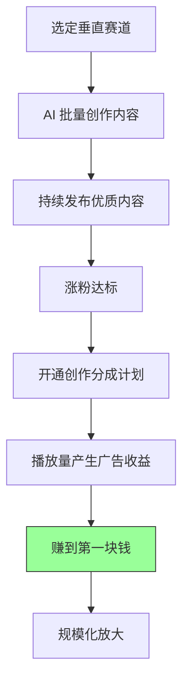

# 第15章 AI 视频在视频号分成计划、YouTube Shorts 等平台的变现

> 本节教读者用 AI 批量创作视频号热门原创内容，快速涨粉达标开通创作分成计划，靠评论区广告点击赚收益，目标是新手"赚到第 1 块钱"；并介绍 YouTube Shorts 冲刺 YPP 广告分成的路径（达标周期从约 2 年缩至最快 1–3 个月，建议按 3–6 个月长期主义准备）。

## 15.1 大白话：视频有分成计划，播放有人看就有钱赚

视频号有分成计划，视频播放有人看就有钱赚。AI 帮你批量做视频，你负责选垂直赛道和发布，先挣到第一块钱，再慢慢放大。YouTube Shorts 做得好，广告分成也是不错的美元收入。

## 15.2 视频号创作分成计划

### 15.2.1 什么是视频号创作分成计划

视频号创作分成计划是🛰️视频号推出的创作者激励计划，创作者通过发布原创视频内容，获得播放量带来的广告分成收益。

**核心逻辑**：视频播放有人看 → 产生广告展示 → 广告点击产生收益 → 收益结算到创作者账户。

### 15.2.2 变现路径：AI 批量创作 + 垂直赛道

实操步骤：

1. **选定垂直赛道**：选一个你感兴趣且有市场需求的细分领域（如AI工具测评、职场技巧、美食教程、情感语录等），不要什么都发。
2. **AI 批量创作内容**：用 AI 工具生成脚本、生成图片、生成视频，快速产出大量原创内容。
3. **涨粉达标**：持续发布优质内容，积累粉丝和播放量，达到开通分成计划的门槛。
4. **开通分成计划**：达到门槛后申请开通视频号创作分成计划。
5. **靠评论区广告点击赚收益**：视频获得播放后，评论区可能展示广告，用户点击产生收益。

### 15.2.3 目标：新手"赚到第 1 块钱"

对新手来说，最重要的不是赚多少钱，而是验证"AI 视频能赚钱"这个闭环。先挣到第一块钱，再慢慢放大规模。

**里程碑设定**：
- 第 1 个目标：发布 10 条 AI 视频，累计播放量 1 万+
- 第 2 个目标：开通视频号创作分成计划
- 第 3 个目标：月收益超过 100 元
- 第 4 个目标：月收益超过 1000 元

## 15.3 YouTube Shorts 冲刺 YPP 广告分成路径

### 15.3.1 什么是 YouTube Shorts YPP

YPP（YouTube Partner Program）是 YouTube 的合作伙伴计划，创作者通过加入 YPP 可以获得视频广告分成收益。

YouTube Shorts 是 YouTube 的短视频功能（类似 TikTok、抖音），时长在 60 秒以内。

### 15.3.2 达标周期缩短

过去，YouTube 频道要达到 YPP 门槛（1000 订阅 + 4000 小时有效观看时长）大约需要 2 年。但 Shorts 出现后，达标周期大大缩短：

- **过去**：约 2 年
- **现在**：最快 1–3 个月
- **建议**：按 3–6 个月长期主义准备

### 15.3.3 YPP 门槛要求（Shorts 路径）

- 订阅者数：500 个
- 公开上传视频数：3 个（过去 90 天）
- Shorts 观看时长：300 万次（过去 90 天）

或者传统路径：
- 订阅者数：1000 个
- 有效公开观看时长：4000 小时（过去 12 个月）

### 15.3.4 实操建议

1. **选定垂直赛道**：选择海外用户感兴趣的领域（如 AI 工具、英语学习、理财投资、科技评测等）
2. **批量制作 Shorts**：用 AI 工具快速生成 60 秒以内的短视频，每天发布 1–2 条
3. **优化标题和封面**：用英文标题和吸引人的缩略图，提高点击率
4. **持续发布**：建议按 3–6 个月长期主义准备，不要期望短期见效
5. **分析数据**：查看 YouTube Studio 后台数据，了解哪类内容受欢迎，优化后续创作

## 15.4 视频号 vs YouTube Shorts 对比

| 维度 | 视频号创作分成 | YouTube Shorts YPP |
|------|-------------|-------------------|
| 平台 | 🛰️生态（国内） | YouTube（国际） |
| 主要收益 | 评论区广告点击 | 视频广告分成 |
| 门槛 | 相对较低 | 500 订阅 + 300 万 Shorts 观看 |
| 达标周期 | 较快 | 最快 1–3 个月 |
| 语言 | 中文 | 主要为英文（也可做中文海外内容） |
| 收益结算 | 人民币 | 美元 |
| 适合人群 | 国内创作者 | 有海外思维的创作者、英语好的人 |

## 15.5 长期主义心态

### 15.5.1 更新 30–50 条前数据可能惨淡

刚开始做 AI 视频自媒体，数据不好很正常。建议先坚持发够 30–50 条，不要期望短期爆发。

### 15.5.2 X 平台主张每天 2 条、坚持发够 28 条

如果你也在 X（推特）等平台运营，可以参考"每天 2 条、坚持发够 28 条"的节奏，通过高频输出积累初始流量。

### 15.5.3 先挣到第一块钱，再慢慢放大

不要一开始就想做大规模矩阵，先跑通单个账号的"内容创作 → 发布 → 获得收益"闭环，验证可行性后再放大。

## 15.6 视频号变现 Mermaid 图

## 小练习

选定一个垂直赛道，用 AI 生成 3 条短视频脚本并制作 1 条成片，发布到视频号或 YouTube，记录发布后 7 天的播放量与粉丝增量。

> **参考模板**：
> 
> | 视频 | 平台 | 垂直赛道 | 播放量 | 粉丝增量 | 发布日期 |
> |------|------|---------|--------|---------|---------|
> | 第 1 条 | 视频号 | AI 工具测评 |  |  |  |
> | 第 2 条 | 视频号 | AI 工具测评 |  |  |  |
> | 第 3 条 | YouTube Shorts | AI 工具测评 |  |  |  |
