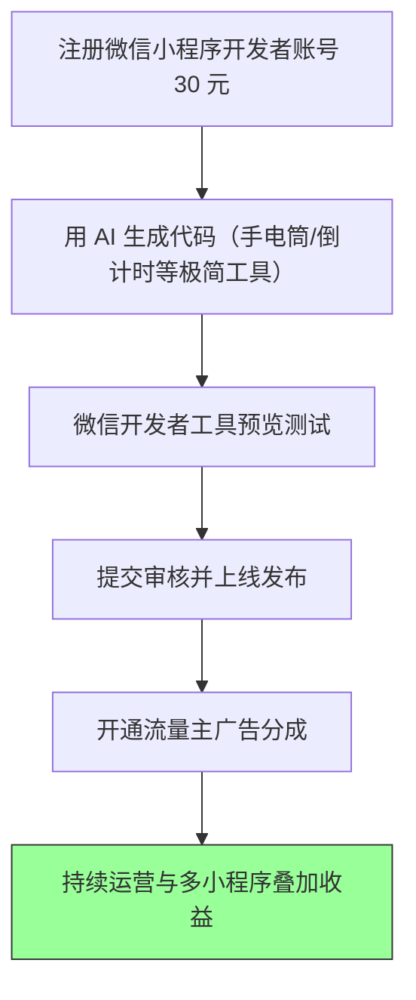

# 第20章 🛰️小程序 AI 产品 0-1 打造与变现

> 本节教个人开发者借🛰️ 13 亿月活生态与 2026 AI 小程序成长计划扶持（免费云开发 + 1 亿混元 Token），用 AI 低成本批量做小程序，走流量主广告分成或订阅制变现。案例包括某开发者 15 个小程序月入 2 万+、一篇笔记带来 650+ 用户。

## 20.1 大白话：🛰️小程序不用下载安装，搜一下就能用

🛰️小程序不用下载安装，搜一下就能用，用户基数巨大。现在🛰️还有 AI 小程序扶持计划，给免费服务器和 Token。新手可以做个"手电筒""倒计时"这种极简工具，先跑通"注册 → 开发 → 上线 → 开流量主"的全流程。

## 20.2 为什么当下做🛰️小程序产品打造？

### 20.2.1 🛰️小程序生态优势与激励计划

🛰️有 13 亿月活用户，小程序依托这个生态，天然拥有多个免费流量入口。🛰️搜索、首页下拉列表、发现页分类、好友分享、👸号和视频号导流——这些都是不花钱就能获得用户的渠道。和做 APP 不同，小程序不需要下载安装，用户搜一下就能用，用完就走，链路极短。

平台激励方面，目前有几个值得关注的政策：

- **广告分成**：流量主可获得广告收入的 50%（创意类小程序 200 万以内可拿 70%）
- **AI 小程序成长计划**：2026 年新推出的官方扶持，报名后可以免费获得 6 个月云开发环境、1 亿混元 Token 和 1 万张生图资源包，活动持续到 2026 年 6 月 30 日，报名入口在🛰️公众平台→行业能力→AI 小程序成长计划（官方文档）
- **免开发智能接入**：系统自动往你的小程序里插入广告组件，新手不用写广告代码也能变现

平台在持续完善开发者变现通道，对个人开发者来说目前仍处于值得入场的窗口期。

### 20.2.2 低技术门槛和上线成本

做小程序的启动成本低到什么程度？

- **个人主体注册费**：30 元
- **服务器**：不需要（最简单的小程序纯前端，后端仍需要服务器）
- **🛰️开发者工具**：免费
- **代码零基础友好**：用 Trae、Cursor、ChatGPT 这类 AI 工具可以直接生成完整的小程序代码

开发过程也不复杂。把需求告诉 AI（比如做一个手电筒小程序），AI 生成代码和页面，遇到报错直接复制给 AI 修复，最后用开发者工具预览测试，没问题就提交上线。

以前要花一个月的事，现在一周搞定。这个效率意味着试错成本极低——想到一个需求就快速验证，做不起来就换下一个。把每个小程序当成一次低成本的需求实验，而不是一个要长期打磨的产品。

### 20.2.3 小程序变现模式

**流量主变现**：小程序上线后，只要有用户在使用、产生广告曝光，收益就自动结算到账。每天上午 8-10 点更新前日数据，腾讯代扣个税后 15 个工作日内打款。

最关键的一点：不需要持续维护。实测停更半年以上的小程序，收入依然在跑。

收益还能叠加——单个小程序每天赚 10 元看似不起眼，但做到 5 个、10 个效果就完全不同。单个收益难免有波动，多个账号叠加后，整体收入会更稳定、更平滑。

**订阅制变现**：用户通过付费开通小程序会员，主要按月或年收费，到期续费。做一个产品，持续收钱。

优势：产品是一个品牌化的产品，不是一次性的内容。只要切中痛点，解决用户的需求，一个产品可以做很久，经历花在打磨产品和迭代，不需要做多个产品。产品好，会持续找到付费用户，喜欢的用户每年都会续费，用户越多，产品价值越高，是比较长期主义的方向。

参考：配音神奇小程序，免费会员每日有少量功能使用额度，额度使用完后会提醒升级会员，获取更高权限。

## 20.3 项目完整操作思路

整个项目的操作链路：**注册账号 > 挖掘与验证需求 > 产品开发 > 上线发布 > 推广引流 > 商业变现**

### 20.3.1 新手入门建议&避坑指南

- **先完整跑通一个项目**：不管多简单，先做一个小程序走完从注册到开通流量主的全流程。手电筒、倒计时、单位换算都行。目的是建立体感而不是做爆款，第一个跑完了后面再做就快很多。
- **先上线再优化**：很多人总觉得还不够好，一拖就是一个月还没上线。先发出去，有了真实用户反馈再迭代，比自己闷头打磨高效得多。
- **善用 AI，但自己要做产品决策**：整个开发过程就是自己当产品经理，AI 当程序员——自己提需求、做决策，AI 写代码、改 bug。你只需要在遇到报错以后直接复制给 AI 让它修复，不需要看懂代码。

几个容易踩的坑：
- 选了红海赛道——做之前先在🛰️里搜一下，有头部产品的类目不碰。
- 功能贪多——别搞全家桶，一个小程序只解决一个问题。
- 不主动推广——上线后必须主动引流，📕是最快的渠道。
- 忘了开封面广告——开通流量主后第一时间确认，这个设置直接影响收入。
- 数据不好还死磕——2-3 个月没起色就果断放弃，做下一个。

## 20.4 需求挖掘与定位

### 20.4.1 需求挖掘方法

在🛰️里搜索相关关键词，看看已有哪些小程序，用户评价如何，找出可以改进的地方。也可以在📕、👸号上搜索"小程序需求"，看看用户在吐槽什么。

### 20.4.2 明确功能与 MVP 构思

一个小程序只解决一个问题。不要贪多，先做最小可行性产品（MVP），验证需求后再迭代。

## 20.5 账号注册与环境搭建

### 20.5.1 🛰️小程序开发者账号

个人主体注册费 30 元，在🛰️公众平台注册。

### 20.5.2 代码开发与云端存储账号

🛰️云开发提供免费的云函数、数据库、存储，适合新手使用。

### 20.5.3 AI 编程辅助工具账号

注册 Claude Code、Cursor 或 DeepSeek 等 AI 编程工具账号，用于生成代码。

## 20.6 小程序开发实战

### 20.6.1 实战一：电子木鱼小程序

极简功能：点击屏幕敲木鱼，累计次数，显示功德数值。

### 20.6.2 实战二：消灭拖延症任务拆解小程序

功能：输入任务，自动拆解为子任务，设置倒计时，记录完成情况。

## 20.7 备案与认证

### 20.7.1 完整备案流程

小程序上线前需要完成 ICP 备案，按照🛰️官方文档的指引逐步完成。

## 20.8 上传、审核与发布

### 20.8.1 上传、审核与发布全流程

1. 使用🛰️开发者工具预览测试
2. 提交代码到🛰️公众平台
3. 等待审核（通常 1-3 个工作日）
4. 审核通过后发布上线

## 20.9 流量获取与商业变现

### 20.9.1 流量获取-📕引流

上线后必须主动引流，📕是最快的渠道。在📕上发布小程序使用教程、效果演示，引导用户搜索小程序名称。

### 20.9.2 小程序商业变现

开通流量主后，第一时间确认开启封面广告设置，这个设置直接影响收入。

## 20.10 🛰️小程序开发全流程 Mermaid 图



## 小练习

注册🛰️小程序开发者账号，用 AI 生成一个"手电筒/倒计时"级的极简小程序，完整跑通"开发 → 上线发布"的全流程，无需上架即可。

**参考提示词**：
```
请帮我写一个微信小程序，功能是一个简单的倒计时器。
要求：
1. 页面显示当前倒计时时间（时：分：秒）
2. 有开始、暂停、重置三个按钮
3. 用户可以自定义倒计时时长（输入小时、分钟、秒）
4. 倒计时结束时弹出提示框
5. 使用 WXML + WXSS + JS 开发
6. 添加中文注释说明代码功能
7. 界面简洁美观，适合在微信小程序中运行
```
